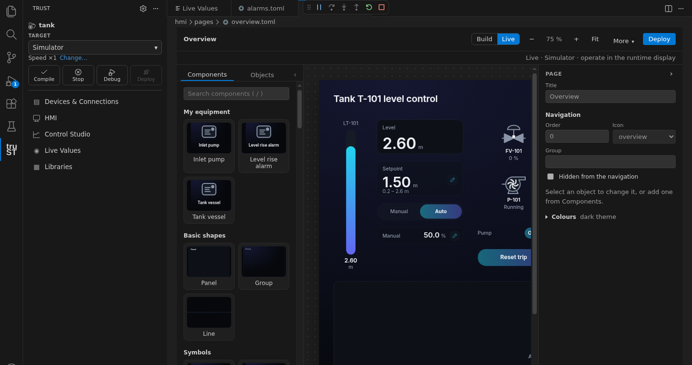

<p align="center">
  <picture>
    <source media="(prefers-color-scheme: dark)" srcset="docs/public/assets/images/brand/trust-logo-dark.svg">
    
  </picture>
</p>

<h3 align="center">IEC 61131-3 Structured Text, compiled to native code</h3>

<p align="center">
  Write PLC programs in VS Code, run them on Linux, macOS, Windows and microcontrollers,<br>
  and commission the control loops they hold, with one open toolchain.
</p>

<p align="center">
  <a href="https://johannespettersson80.github.io/trust-platform/"></a>
  <a href="https://marketplace.visualstudio.com/items?itemName=trust-platform.trust-lsp"></a>
  <a href="https://github.com/johannesPettersson80/trust-platform/releases/latest"></a>
  <a href="https://github.com/johannesPettersson80/trust-platform/actions/workflows/ci.yml"></a>
  <a href="LICENSE-MIT"></a>
</p>

<p align="center">
  <a href="https://johannespettersson80.github.io/trust-platform/">Documentation</a> ·
  <a href="https://johannespettersson80.github.io/trust-platform/start/installation/">Install</a> ·
  <a href="examples/control/README.md">Control course</a> ·
  <a href="CHANGELOG.md">Changelog</a> ·
  <a href="https://github.com/johannesPettersson80/trust-platform/issues">Issues</a>
</p>

---

truST is an open platform for IEC 61131-3 Structured Text. The VS Code extension brings a complete
language server, a debugger, an operator-screen builder and control-engineering tools.
`trust-runtime` compiles every program ahead of time into native machine code for the computer or
chip it runs on, and runs it in a scan cycle. VS Code, the browser IDE, the command line and the
automation API all work on the same plain-text project, which you review, version and test like
any other code.

<p align="center">
  
</p>
<p align="center"><em>Control Studio in VS Code: identify the plant from a step, tune the controller, check its
frequency response, and validate it against the requirements before it touches the process.</em></p>

## Highlights

**Native execution**

- Structured Text is translated into Rust and compiled with a pinned `rustc` into native code for
  x86-64, AArch64 and RISC-V. Programs are not interpreted.
- The complete compiler toolchain ships inside the VS Code extension: `rustc`, `rust-lld`, the
  target libraries and the PLC program library. The first build installs it, checks every file
  against its manifest, and needs no download and no Rust installation of your own, offline too.
  `trust-runtime` on its own downloads the same bundle on its first build, or installs it from a
  file.

**Language and editor**

- IEC 61131-3 Structured Text, including classes, interfaces, methods and namespaces.
- Diagnostics as you type, completion, hover, go to definition, find references, rename across
  files, formatting and refactorings.
- PLCopen XML import and export, and visual editors for ladder, SFC, Blockly and statecharts that
  keep a Structured Text companion in the project.

**Run and debug**

- Run on the built-in simulator or on a runtime, with breakpoints, stepping, call stack and
  variables on the compiled program.
- Live Values shows and writes inputs, outputs and memory while the program runs.

<table>
  <tr>
    <td width="50%"></td>
    <td width="50%"></td>
  </tr>
  <tr>
    <td align="center"><em>Structured Text with the language server's highlighting and hovers.</em></td>
    <td align="center"><em>Stepping through the compiled program with its locals and call stack.</em></td>
  </tr>
</table>

**Control engineering**

- `Control.PID`, a documented PID function block, and simulated plants with dynamics, actuator
  limits, delays, disturbances, noise and faults, connected through ordinary PLC I/O.
- Control Studio identifies a plant from experiments, tunes and validates a controller against
  the model, applies it to a running loop with a bumpless transfer, and restores the previous
  settings when needed.
- A practical control course of 89 runnable lessons in 13 chapters, from feedback basics to
  state-space, predictive and adaptive control.

**Operator screens**

- The HMI Builder designs operator screens in VS Code, stored as TOML pages that diff and review
  like code.
- The runtime serves them at `/hmi`, with trends and an alarm library after ISA-18.2 and
  EEMUA 191.

<table>
  <tr>
    <td width="50%"></td>
    <td width="50%"></td>
  </tr>
  <tr>
    <td align="center"><em>Operating the tank at <code>/hmi</code>: a setpoint change, the high-level alarm, its acknowledgement.</em></td>
    <td align="center"><em>The same page in the HMI Builder, live from the simulator.</em></td>
  </tr>
</table>

**Devices and communication**

- Modbus TCP, MQTT with Sparkplug B, OPC UA, Beckhoff ADS, EtherCAT and GPIO.
- Discovery and pairing between runtimes, data sharing over Zenoh, and fleet federation.
- Devices & Connections in VS Code finds, configures and wires the devices of a project.

**Automation**

- A complete command line for creating, building, testing, deploying and rolling back projects,
  ready for CI.
- A JSON-RPC Agent API and editor AI tools that work on typed truST interfaces.

## Quick start

**In VS Code**

1. Install the extension: `code --install-extension trust-platform.trust-lsp`, or search for
   *truST* in the Marketplace.
2. Run **truST: Create Project** from the Command Palette, or open one of the
   [examples](examples/).
3. Press **Start** on the Run card to build the program and run it on the simulator. The first
   build installs the compiler toolchain that the extension carries.
4. Open **Live Values** to watch the I/O, set a breakpoint, and step through the scan.

**From the command line**

```bash
trust-runtime new --parent . --name my-plc   # create a project
trust-runtime build --project ./my-plc       # compile program.tpi for this computer
trust-runtime play --project ./my-plc        # run it
```

A new project serves its web UI on `http://127.0.0.1:8080`: the browser IDE at `/ide` and the
operator screens at `/hmi`. To install the toolchain ahead of time, or offline:

```bash
trust-runtime toolchain install                                    # download and verify
trust-runtime toolchain install --from trust-toolchain-linux-x64.tar.gz
trust-runtime toolchain status
```

## Platforms

| Platform | Tools | Runs programs |
| --- | --- | --- |
| Linux x86-64 and AArch64, including Raspberry Pi with a 64-bit OS | yes | yes |
| macOS, Intel and Apple silicon | yes | yes |
| Windows x86-64 | yes | yes |
| ESP32-C6 | | yes: truST firmware, installed over USB, with Wi-Fi and firmware updates |
| STM32U5A9 | | the firmware builds; it has not run on hardware yet |

Raspberry Pi currently inherits Linux AArch64 artifact support; a named board model is qualified
only with its own device-in-loop evidence. [Linux PREEMPT_RT](https://johannespettersson80.github.io/trust-platform/operate/preempt-rt/) is
a supported deployment configuration, not a deterministic-latency certification. Hardware behaviour
is proven on the target where it is tested; see [Hardware](https://johannespettersson80.github.io/trust-platform/hardware/) and
[Supported Chips](https://johannespettersson80.github.io/trust-platform/hardware/supported-chips/).

## What a release contains

Every [release](https://github.com/johannesPettersson80/trust-platform/releases/latest) is built
for `linux-x64`, `linux-arm64`, `darwin-x64`, `darwin-arm64` and `win32-x64`:

| Asset | Contents |
| --- | --- |
| VS Code extension (`.vsix`) | the extension with the language server, runtime, debugger, Control Studio and the compiler toolchain for that platform |
| `trust-runtime-<platform>` | `trust-runtime`, `trust-dev` and `trust-bundle-gen`, with install notes and a systemd unit |
| `trust-lsp-<platform>` | the language server, for other editors |
| `trust-toolchain-<platform>.tar.gz` | the compiler toolchain: `rustc`, `rust-lld`, the target libraries and the PLC program library, with a hashed manifest |
| `SHA256SUMS` | the checksum of every asset, with release provenance and conformance status |

## Components

| Binary | Purpose |
| --- | --- |
| `trust-lsp` | Language server: diagnostics, navigation, formatting, refactorings |
| `trust-runtime` | Runtime and command line: build, run, deploy, web server for the IDE and HMI |
| `trust-debug` | Debug adapter (DAP) and the VS Code simulator |
| `trust-control-studio` | Control Studio's engine: identification, tuning, validation, apply and restore |
| `trust-dev` | Developer workbench: tests, docs, agent workflows |
| `trust-bundle-gen` | Builds a runtime bundle's program image (`program.tpi`) |

## Documentation

| Start here | |
| --- | --- |
| [Install truST](https://johannespettersson80.github.io/trust-platform/start/installation/) | the extension, the runtime and the toolchain |
| [Program in VS Code](https://johannespettersson80.github.io/trust-platform/start/program-in-vscode/) | the main engineering workflow |
| [Build, validate, test](https://johannespettersson80.github.io/trust-platform/operate/build-validate-test/) | the command line and CI |
| [Protocol matrix](https://johannespettersson80.github.io/trust-platform/connect/protocol-matrix/) | choosing a communication path |
| [HMI Builder](https://johannespettersson80.github.io/trust-platform/develop/hmi-builder/) | designing operator screens |
| [ESP32-C6 getting started](https://johannespettersson80.github.io/trust-platform/hardware/esp32c6-getting-started/) | from a bare board to a running program |
| [Libraries](https://johannespettersson80.github.io/trust-platform/develop/libraries/) | OSCAT, PLCopen Motion and truST's control, plant, alarm, HMI and communication libraries |
| [Reference](https://johannespettersson80.github.io/trust-platform/reference/) | commands, configuration, diagnostics and APIs |

## How truST is built

- truST is written in Rust; PLC programs and libraries are written in Structured Text.
- Runtime and debugger behavior claims are locked by their written
  product specifications and direct native executable tests ([specifications](docs/specs/README.md));
  where a claim needs environment-specific evidence, its proof class is
  stated separately. Interpretations of IEC 61131-3 are recorded in
  [IEC decisions](docs/IEC_DECISIONS.md), and intentional deviations in
  [IEC deviations](docs/IEC_DEVIATIONS.md).
- A release is tagged only after its exact commit has passed formatting, Clippy, documentation,
  the full test suite and the VS Code tests.

## Contributing and support

- Contributions are welcome; see [CONTRIBUTING.md](CONTRIBUTING.md) and the
  [Code of Conduct](CODE_OF_CONDUCT.md).
- Report security issues as described in [SECURITY.md](SECURITY.md).
- Questions and bugs: [GitHub Issues](https://github.com/johannesPettersson80/trust-platform/issues),
  or email <johannes_salomon@hotmail.com>.
- [LinkedIn](https://linkedin.com/in/johannes-pettersson)

## License

Licensed under either of [MIT](LICENSE-MIT) or [Apache-2.0](LICENSE-APACHE), at your option.
