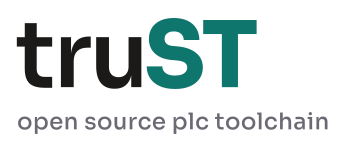
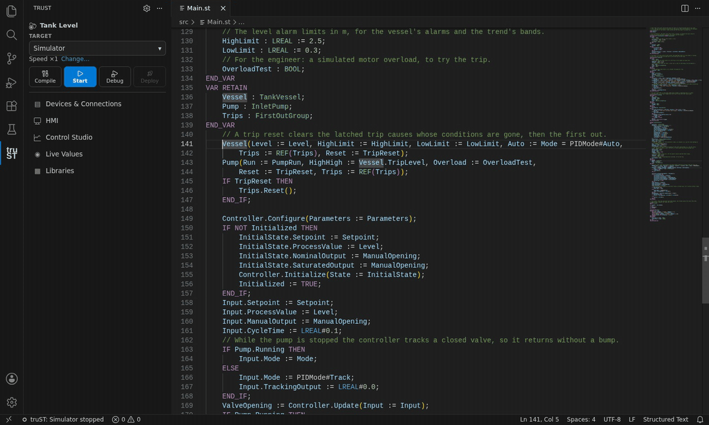
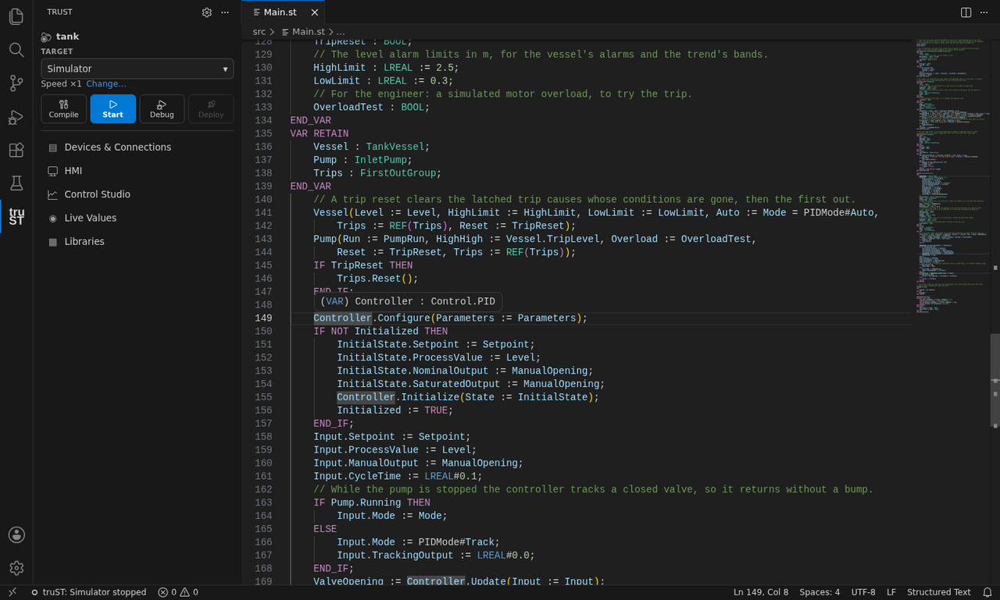
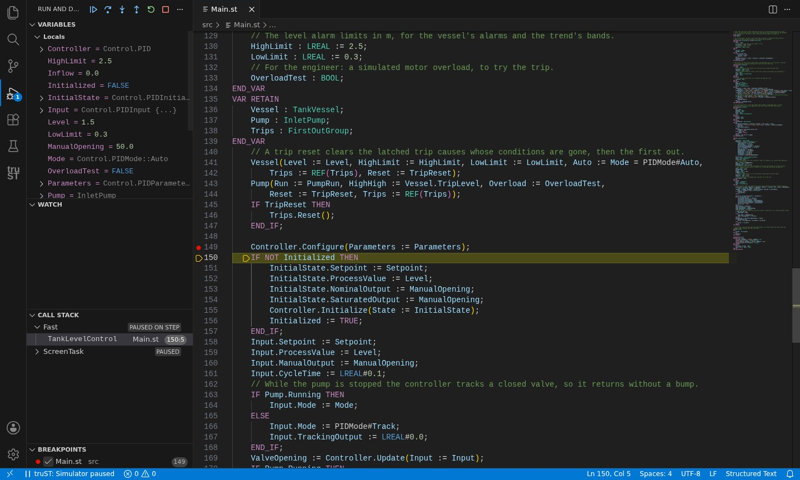
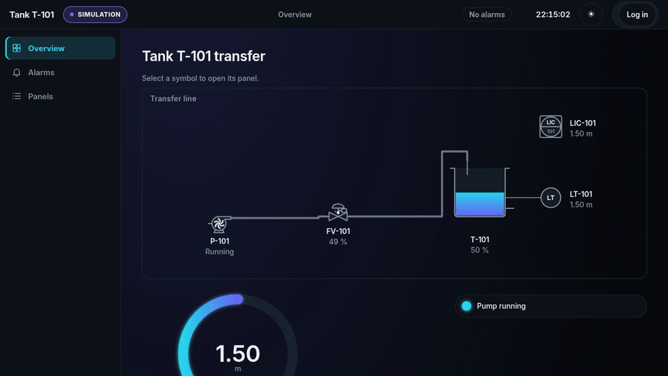
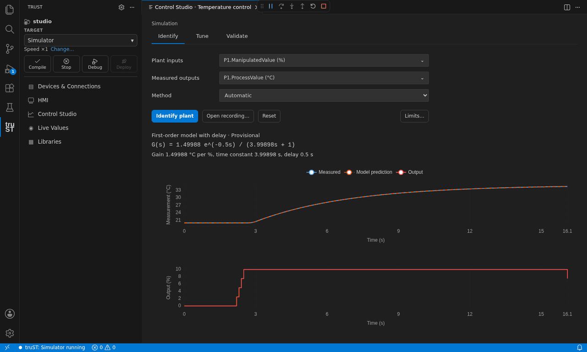

<p align="center">
  <picture>
    <source media="(prefers-color-scheme: dark)" srcset="docs/public/assets/images/brand/trust-logo-dark.svg">
    
  </picture>
</p>

<h3 align="center">IEC 61131-3 Structured Text in VS Code, compiled to native code</h3>

<p align="center">
  Write, run and debug PLC programs on Linux, macOS, Windows and microcontrollers.
</p>

<p align="center">
  <a href="https://johannespettersson80.github.io/trust-platform/"></a>
  <a href="https://marketplace.visualstudio.com/items?itemName=trust-platform.trust-lsp"></a>
  <a href="https://github.com/johannesPettersson80/trust-platform/releases/latest"></a>
  <a href="https://github.com/johannesPettersson80/trust-platform/actions/workflows/ci.yml"></a>
  <a href="LICENSE-MIT"></a>
</p>

<p align="center">
  <a href="https://johannespettersson80.github.io/trust-platform/">Documentation</a> ·
  <a href="https://johannespettersson80.github.io/trust-platform/start/installation/">Install</a> ·
  <a href="examples/README.md">Examples</a> ·
  <a href="CHANGELOG.md">Changelog</a>
</p>

<p align="center">
  
</p>

truST is an open platform for IEC 61131-3 Structured Text. You write programs in VS Code with a
complete language server. `trust-runtime` compiles each program ahead of time into native machine
code for the computer or chip that runs it, and runs it in a scan cycle. The debugger, Live Values
and the operator screens all work on the running program.

The aim is PLC programming as open and dependable as modern software: one plain-text project that
you review, version and test like any other code.

## Why truST

| If you need | truST gives you |
| --- | --- |
| A modern editor for Structured Text | a language server in VS Code: diagnostics as you type, completion, hover, go to definition, references, rename across files and formatting |
| PLC programs on ordinary computers | `trust-runtime`: native code on Linux, macOS and Windows, on x86-64 and AArch64 |
| A small controller | the ESP32-C6 firmware, a complete truST runtime that you install over USB |
| To see inside a running program | breakpoints, stepping, the call stack and variables on the compiled program, and Live Values to read, write and force I/O |
| Operator screens | the HMI Builder in VS Code; the runtime serves the screens at `/hmi`, with trends and alarms |
| Field devices | Modbus TCP, MQTT with Sparkplug B, OPC UA, Beckhoff ADS, EtherCAT and GPIO |
| Tuned control loops | `Control.PID`, simulated plants and Control Studio, which identifies, tunes, validates and applies |
| PLC code in CI | a command line that builds, tests, deploys and rolls back, and Structured Text unit tests with JUnit output |

## Quick start

**In VS Code**

1. Install the extension: `code --install-extension trust-platform.trust-lsp`, or search for
   *truST* in the Marketplace.
2. Run **truST: Create Project** from the Command Palette, or open one of the
   [examples](examples/README.md).
3. Press **Start** in the truST side panel. It compiles the program and runs it on the simulator;
   the first build installs the compiler toolchain that the extension carries.
4. Open **Live Values** to watch and force the I/O, or press **Debug**, set a breakpoint and step
   through the scan.

**From the command line**

```bash
trust-runtime new --parent . --name my-plc   # create a project
trust-runtime build --project ./my-plc       # compile it to native code for this computer
trust-runtime play --project ./my-plc        # run it
```

A new project serves its web UI on `http://127.0.0.1:8080`: the browser IDE at `/ide` and the
operator screens at `/hmi`. No Rust installation is needed: the extension and `trust-runtime`
install the compiler toolchain on the first build, also without a network connection
(`trust-runtime toolchain install --from trust-toolchain-<platform>.tar.gz`).

## Features

### Write Structured Text

IEC 61131-3 Structured Text, with classes, interfaces, methods and namespaces. The language server
checks the program as you type and knows every symbol of the project and its libraries.

- Completion, hover, go to definition, find references, rename across files and formatting.
- PLCopen XML import and export, and visual editors for ladder, SFC, Blockly and statecharts that
  keep a Structured Text companion in the project.
- Libraries: OSCAT, PLCopen Motion, and truST's control, plant, alarm, HMI and communication
  libraries.



[Program in VS Code](https://johannespettersson80.github.io/trust-platform/start/program-in-vscode/) ·
[Libraries](https://johannespettersson80.github.io/trust-platform/develop/libraries/)

### Run it anywhere

Structured Text is translated into Rust and compiled with a pinned `rustc` into native code for
x86-64, AArch64 and RISC-V. Programs are not interpreted.

- The simulator in VS Code, `trust-runtime` on a computer, or a truST runtime on a chip: the same
  program and the same project.
- The compiler toolchain ships inside the VS Code extension and is checked against its manifest;
  you never install Rust yourself.
- Deploy to a runtime and roll back, and change a running program online.

[Build, validate, test](https://johannespettersson80.github.io/trust-platform/operate/build-validate-test/) ·
[Deploy and roll back](https://johannespettersson80.github.io/trust-platform/operate/deploy-rollback/) ·
[ESP32-C6 getting started](https://johannespettersson80.github.io/trust-platform/hardware/esp32c6-getting-started/)

### Debug and watch

The debugger works on the compiled program, on the simulator and on a runtime.

- Breakpoints, stepping, the call stack and variables.
- Live Values reads, writes and forces inputs, outputs and memory while the program runs.



[Debugging in VS Code](https://johannespettersson80.github.io/trust-platform/operate/debugging-in-vscode/) ·
[Live Values](https://johannespettersson80.github.io/trust-platform/operate/live-values/)

### Operator screens

The HMI Builder designs operator screens in VS Code, stored as TOML pages that diff and review like
code. The runtime serves them at `/hmi`: process pictures, faceplates, trends, and an alarm library
after ISA-18.2 and EEMUA 191.



<em>The <a href="examples/hmi_equipment/README.md">hmi_equipment</a> example live at <code>/hmi</code>: an operator raises
LIC-101's setpoint, and the level follows.</em>

[HMI Builder](https://johannespettersson80.github.io/trust-platform/develop/hmi-builder/) ·
[Operator guide](https://johannespettersson80.github.io/trust-platform/operate/operator-guide/)

### Devices and communication

- Modbus TCP, MQTT with Sparkplug B, OPC UA, Beckhoff ADS, EtherCAT and GPIO.
- Devices & Connections in VS Code finds, configures and wires the devices of a project.
- Discovery and pairing between runtimes, data sharing over Zenoh, and fleet federation.

[Protocol matrix](https://johannespettersson80.github.io/trust-platform/connect/protocol-matrix/) ·
[Add a device](https://johannespettersson80.github.io/trust-platform/connect/add-a-device/)

### Control engineering

`Control.PID` is a documented PID function block, and simulated plants bring dynamics, actuator
limits, delays, disturbances, noise and faults through ordinary PLC I/O. Control Studio identifies
a plant from experiments, tunes and validates a controller against the model, applies it to a
running loop with a bumpless transfer, and restores the previous settings when needed. A control
course of 89 runnable lessons goes from feedback basics to state-space, predictive and adaptive
control.



[Control Studio](https://johannespettersson80.github.io/trust-platform/operate/control-studio/) ·
[Control course](examples/control/README.md)

### Automation

- A command line for creating, building, testing, deploying and rolling back projects, ready for
  CI.
- Structured Text unit tests with human, JSON, TAP and JUnit output.
- A JSON-RPC Agent API and editor AI tools that work on typed truST interfaces.

[Automate with the command line](https://johannespettersson80.github.io/trust-platform/start/automate-with-cli/) ·
[CI/CD](https://johannespettersson80.github.io/trust-platform/operate/ci-cd/)

## Examples by task

| Task | Examples |
| --- | --- |
| A first program | [memory_marker_counter](examples/memory_marker_counter/README.md), [tutorials](examples/tutorials/README.md) |
| Operator screens | [hmi_equipment](examples/hmi_equipment/README.md), [hmi_tank_level](examples/hmi_tank_level/README.md) |
| A complete plant | [room_heating](examples/room_heating/README.md) |
| Tuning a loop | [control-pid-commissioning](examples/control-pid-commissioning/README.md), the [control course](examples/control/README.md) |
| Field devices | [communication](examples/communication/README.md), [raspberry-pi](examples/raspberry-pi/README.md) |
| Motion | [plcopen-motion-single-axis](examples/plcopen-motion-single-axis/README.md) |
| Libraries | [OSCAT](examples/OSCAT/README.md) |
| Runtimes working together | [runtime_cloud](examples/runtime_cloud/README.md) |

Every example is a runnable project; [examples/README.md](examples/README.md) lists them all.

## Platforms

| Platform | Tools | Runs programs |
| --- | --- | --- |
| Linux x86-64 and AArch64 | yes | yes |
| macOS, Intel and Apple silicon | yes | yes |
| Windows x86-64 | yes | yes |
| ESP32-C6 | | yes: truST firmware, installed over USB, with Wi-Fi and firmware updates |
| STM32U5A9 | | the firmware builds; it has not run on hardware yet |

Raspberry Pi currently inherits Linux AArch64 artifact support; a named board model is qualified
only with its own device-in-loop evidence.
[Linux PREEMPT_RT](https://johannespettersson80.github.io/trust-platform/operate/preempt-rt/) is a
supported deployment configuration, not a deterministic-latency certification. Hardware behaviour
is proven on the target where it is tested; see
[Hardware](https://johannespettersson80.github.io/trust-platform/hardware/) and
[Supported chips](https://johannespettersson80.github.io/trust-platform/hardware/supported-chips/).

## Downloads

Every [release](https://github.com/johannesPettersson80/trust-platform/releases/latest) is built for
`linux-x64`, `linux-arm64`, `darwin-x64`, `darwin-arm64` and `win32-x64`:

| Asset | Contents |
| --- | --- |
| VS Code extension (`.vsix`) | the extension with the language server, runtime, debugger, Control Studio and the compiler toolchain for that platform |
| `trust-runtime-<platform>` | `trust-runtime` (runtime and command line), `trust-dev` (tests, docs, agent workflows) and `trust-bundle-gen`, with install notes and a systemd unit |
| `trust-lsp-<platform>` | the language server, for other editors |
| `trust-toolchain-<platform>.tar.gz` | the compiler toolchain: `rustc`, `rust-lld`, the target libraries and the PLC program library, with a hashed manifest |
| `SHA256SUMS` | the checksum of every asset, with the release's provenance and conformance status |

## Documentation

| Start here | |
| --- | --- |
| [Install truST](https://johannespettersson80.github.io/trust-platform/start/installation/) | the extension, the runtime and the toolchain |
| [Program in VS Code](https://johannespettersson80.github.io/trust-platform/start/program-in-vscode/) | the main engineering workflow |
| [Build, validate, test](https://johannespettersson80.github.io/trust-platform/operate/build-validate-test/) | the command line and CI |
| [Protocol matrix](https://johannespettersson80.github.io/trust-platform/connect/protocol-matrix/) | choosing a communication path |
| [HMI Builder](https://johannespettersson80.github.io/trust-platform/develop/hmi-builder/) | designing operator screens |
| [ESP32-C6 getting started](https://johannespettersson80.github.io/trust-platform/hardware/esp32c6-getting-started/) | from a bare board to a running program |
| [Libraries](https://johannespettersson80.github.io/trust-platform/develop/libraries/) | OSCAT, PLCopen Motion and truST's own libraries |
| [Reference](https://johannespettersson80.github.io/trust-platform/reference/) | commands, configuration, diagnostics and APIs |

## Development

truST is written in Rust; PLC programs and libraries are written in Structured Text. Runtime and
debugger behavior claims are locked by their written
product specifications and direct native executable tests ([specifications](docs/specs/README.md));
where a claim needs environment-specific evidence, its proof class is stated separately.
Interpretations of IEC 61131-3 are recorded in [IEC decisions](docs/IEC_DECISIONS.md), and
deliberate deviations in
[IEC deviations](docs/IEC_DEVIATIONS.md). A release is tagged only after its exact commit has
passed formatting, Clippy, the documentation build, the full test suite and the VS Code tests.

## Contributing and support

- Contributions are welcome; see [CONTRIBUTING.md](CONTRIBUTING.md) and the
  [Code of Conduct](CODE_OF_CONDUCT.md).
- Report security issues as described in [SECURITY.md](SECURITY.md).
- Questions and bugs: [GitHub Issues](https://github.com/johannesPettersson80/trust-platform/issues),
  or email <johannes_salomon@hotmail.com>.
- [LinkedIn](https://linkedin.com/in/johannes-pettersson)

## License

Licensed under either of [MIT](LICENSE-MIT) or [Apache-2.0](LICENSE-APACHE), at your option.
