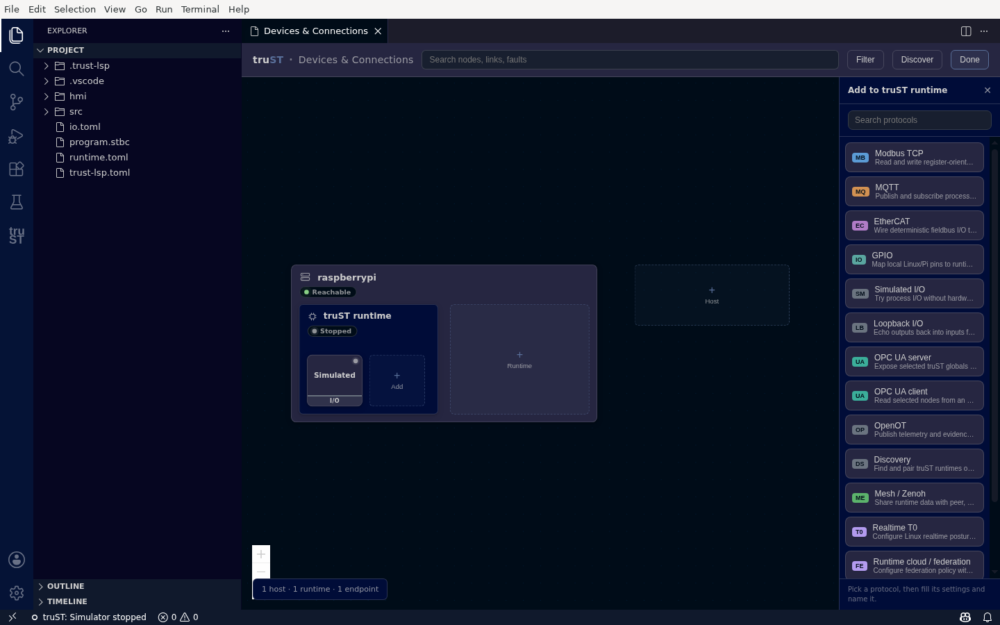
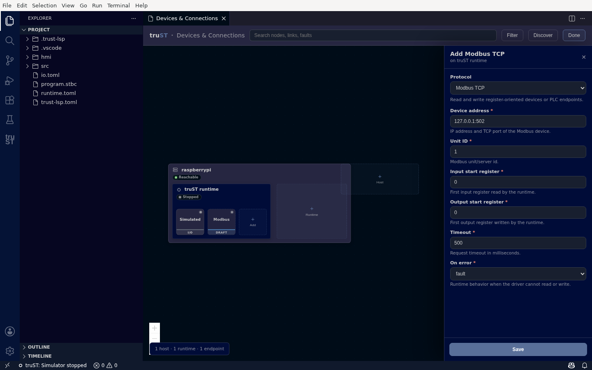

# Add A Device

Add and configure any device or service from [Devices & Connections](communication-panel.md), using a
typed form — you never hand-edit `io.toml`.

## 1. Open the add flow

In Devices & Connections, click the first-class **+ Add** toolbar action. You do not need to enter a
hidden Edit mode first.

## 2. Pick what to add

A drawer opens for the runtime you add to: **Add device, connection, or simulated plant**. At its top,
**Discover devices and runtimes** scans the network first, when the hardware is already connected.
Below it each choice says what it is for, grouped by what you want to do:

- **Simulation**: a simulated plant that models the process behind the program's I/O, where the
  runtime supports one
- **Devices and I/O**: Modbus, EtherCAT, GPIO, Simulated I/O and Loopback I/O
- **Read tags from another PLC or server**: OPC UA client and ADS client (Beckhoff)
- **Share truST values**: OPC UA server and ADS server (Beckhoff)
- **Send and receive messages**: MQTT broker

**Show advanced integrations** adds Mesh / Zenoh, OpenOT, Realtime T0 and Runtime cloud.

*+ Add on the Simulator of `examples/memory_marker_counter`.*

## 3. Fill the typed form

Pick a protocol and truST renders its form from the runtime's own schema — every field has a label,
a safe default, and inline help; required fields are marked. As you fill it in, a **DRAFT** node previews
on the canvas.

*A typed form per protocol, here Modbus TCP: device address, unit ID, register starts, timeout and
what the runtime does on an error, each with a default and help. The **DRAFT** node on the canvas
previews the device until you save it.*

Click **Save** to write the configuration. truST applies it to the project (`io.toml` or the relevant
config), and the draft becomes a real endpoint node. If the runtime is running, you can also apply it live.

## Discover and browse

Some protocols can find devices for you, instead of typing addresses:

- **Discover** (toolbar) scans for devices, servers, and other runtimes — *discovered means seen*, not
  connected. Modbus and MQTT use an address/topic setup rather than a tag tree.
- **Browse** (on a saved OPC UA client, ADS client, or EtherCAT node) reads the target's live address
  space or PDO channels so you can select symbols to add, instead of naming them by hand.

Each protocol's own guide walks through its specific discover/browse/test flow — see
[External Systems](external-systems/index.md) and [Devices And Fieldbus](devices-and-fieldbus/index.md).

## Next

- [Devices & Connections](communication-panel.md)
- [Modbus TCP](external-systems/modbus-tcp.md)
- [MQTT](external-systems/mqtt.md)
- [OPC UA](external-systems/opc-ua.md)
- [Beckhoff ADS](external-systems/ads.md)
