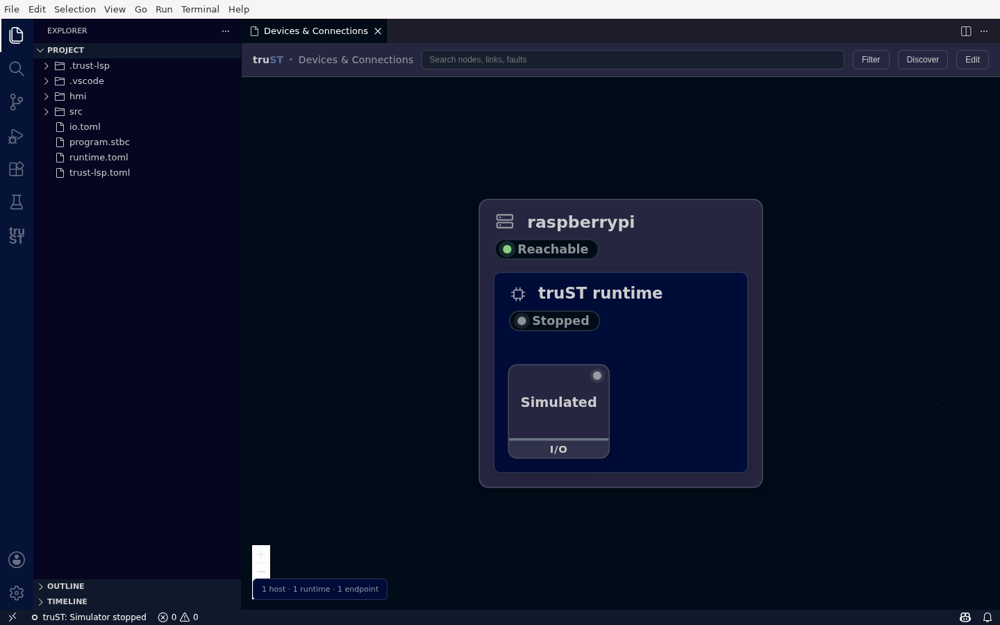

# Devices & Connections

**Devices & Connections** is the single front door for everything truST talks to — field devices, brokers,
PLCs, fieldbuses, and other runtimes. It shows your whole communication topology as a node graph, and lets
you add and configure a device without editing TOML by hand.

> Earlier versions of truST used a flat "Communication" panel of cards. That panel has been replaced by
> this graph. If a guide still mentions the *Communication panel*, it means Devices & Connections.

## Open it

In the truST view, click **Devices & Connections**. The graph opens as an editor tab titled
**truST · Devices & Connections**.

## Read the graph

*Devices & Connections shows your whole topology as a node graph — here the shipped project `examples/memory_marker_counter`: one host, one runtime (the Simulator, Stopped, shown grey), and a Simulated I/O endpoint. Nothing is green until the runtime is running and the connection is proven.*

The graph nests **Host → Runtime → Endpoint**:

- **Host** — the machine the runtime runs on: **This computer** for the one VS Code runs on, `Computer
  <IP>` for another computer, or a chip's name and address. Its badge is *reachability* (**Reachable**),
  not the runtime's run state.
- **Runtime** — your runtime, or the **Simulator** while it is the run target (badge **Run target**), as
  here; shown **Stopped** in grey until you start it. truST never shows a fabricated green: a node is
  green only when it is genuinely running/connected.
- **Endpoints** — each device or service on the runtime, with a role badge (here **Simulated I/O**, role
  **I/O**).
  As you add devices, Modbus, MQTT, OPC UA, and other endpoints appear here, and the external systems they
  link out to render as connected nodes.

Runtime and resource names do not have to be globally unique. If two hosts or
containers both run a runtime named `RESOURCE`, Devices & Connections keeps
their endpoints, configured mesh peers, link health, and link detail attached
to the correct owner. This also applies when older topology snapshots are
combined; internal identity normalization is never shown as a product label.

The footer summarizes the topology (**1 host · 1 runtime · 1 endpoint**).

## Toolbar

- **Search** — find a node, link, or fault.
- **Filter** — show or hide protocols. Filtering never hides a faulted device.
- **Discover** — scan for devices, servers, and other runtimes. *Discovered* means *seen*, not connected
  or live.
- **+ Add** — open the device/connection picker for the selected or default runtime.
- **Edit** — edit mode, which shows **+** on each runtime to add a device or service there; **Done**
  leaves it.

## Add a device

Click **+ Add** and pick a protocol. truST renders a typed form from the runtime's own schema (labels,
defaults, validation), so you fill in fields instead of writing config.
See the per-protocol guides for each one:

| Need | Protocol |
| --- | --- |
| Connect to a Beckhoff/TwinCAT PLC, or expose truST to TwinCAT | ADS / TwinCAT |
| Expose runtime variables to SCADA, HMI, or a historian | OPC UA |
| Read/write register-oriented equipment | Modbus TCP |
| Publish or subscribe through a broker | MQTT |
| Connect truST runtimes together | Discovery, Mesh / Zenoh, Realtime T0, Runtime cloud |
| Wire local hardware, or test without hardware | EtherCAT, GPIO, Simulated I/O, Loopback I/O |
| Publish telemetry/evidence records | OpenOT |

If a host has no runtime yet, its one action is **Set up runtime…**.

Secret fields (passwords, tokens) are never sent over an untrusted remote plain-TCP control channel — use a
same-host runtime endpoint, or apply the configuration on the runtime host.

## Next

- [Protocol Matrix](protocol-matrix.md)
- [External Systems](external-systems/index.md)
- [Runtime To Runtime](runtime-to-runtime/index.md)
- [Devices And Fieldbus](devices-and-fieldbus/index.md)
