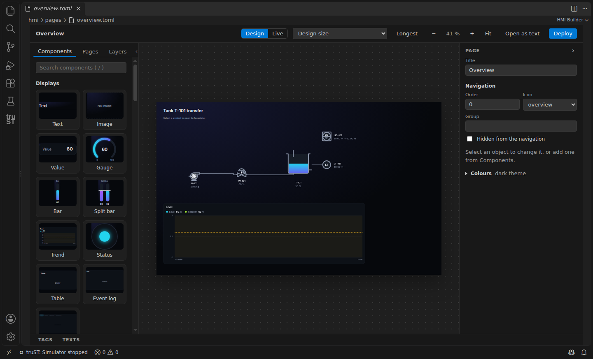
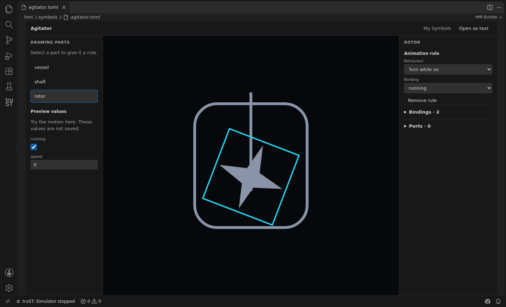
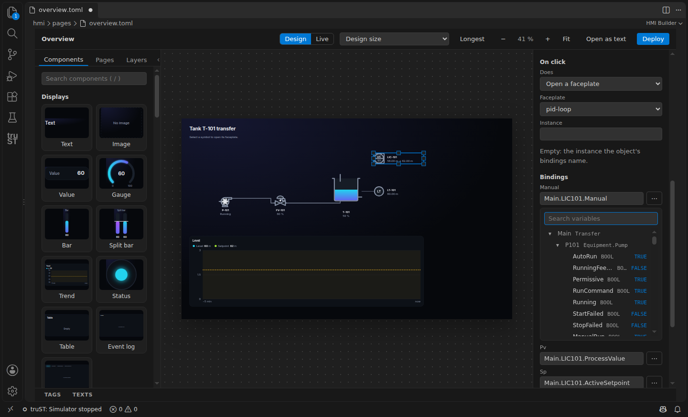
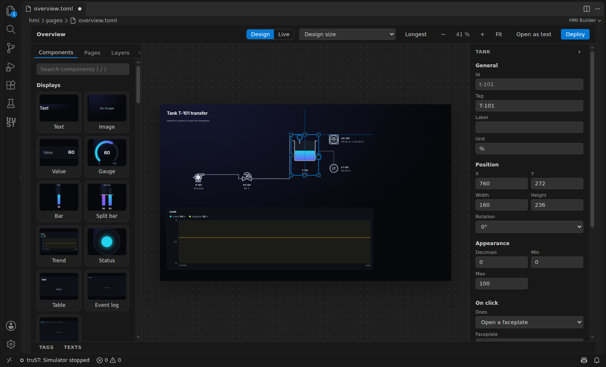
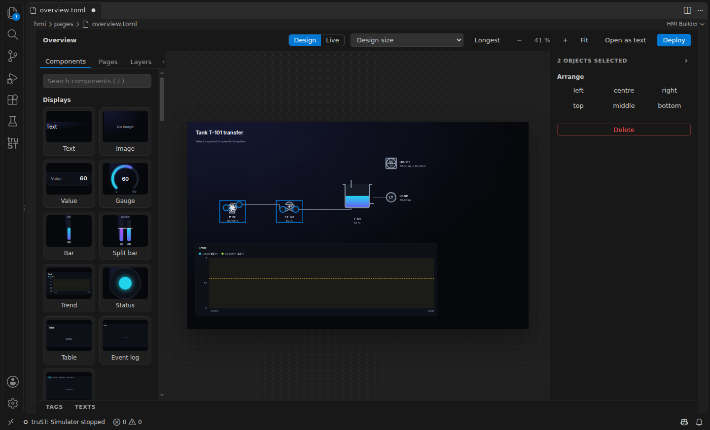
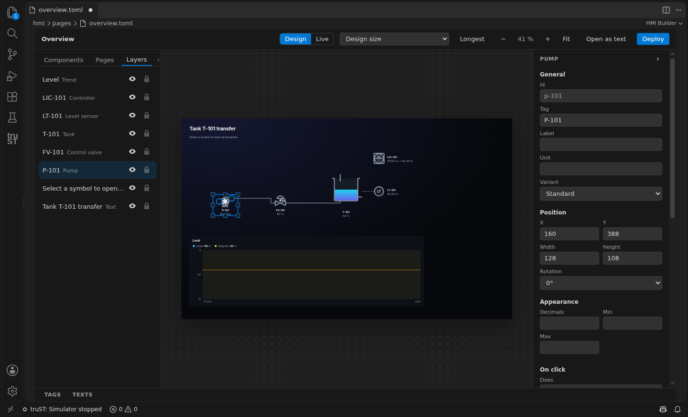
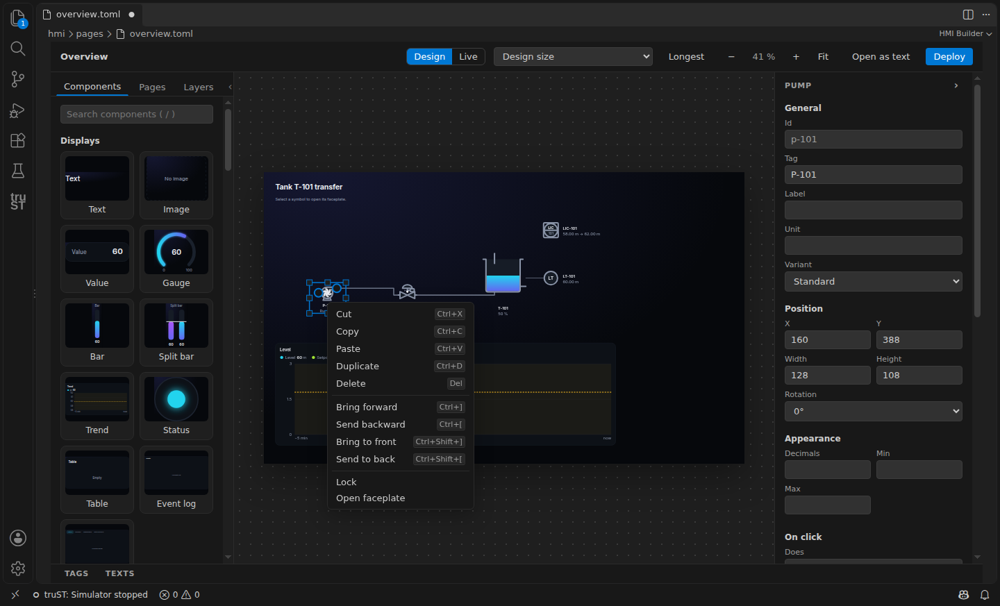
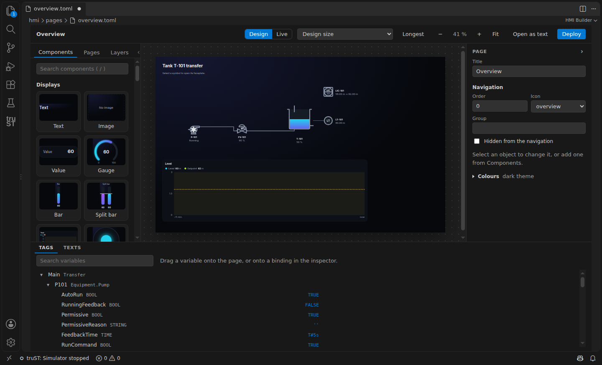

# HMI Builder

The HMI Builder is VS Code's drag-and-drop editor for operator screens. A page is a plain TOML
file under `hmi/pages/`, so it diffs, merges and reviews like code; every change you make on the
canvas is one edit of that file. The editor draws pages with the same drawing module as the
runtime display, so a page looks the same while you design it, in Live mode, and on the panel.



## Getting started

1. Run **truST: New HMI Screen** from the Command Palette. It adds `hmi/screen.toml` and a first
   page, the HMI library (`libraries/hmi`), a `Screens` program that calls `Hmi.Display`, and a
   task for it (every 250 ms). The runtime serves the screens where the program calls the block,
   so values and commands never run between scans.
2. Open `hmi/pages/<page>.toml`. It opens in the HMI Builder; **Open as text** shows the TOML.
3. Find your way around:
   - **Left:** the tabs **Components** (drag one onto the page, or click it to place it in the
     middle of the view) and **Objects**, the page's objects front to back. The `‹` button hides
     the side panel. The project's pages are in the VS Code Explorer.
   - **Middle:** the page at its design size, with the grid, guides and selection handles.
   - **Right:** the inspector for what is selected: its label, position and size, bindings and
     what a click does; with nothing selected, the page itself.
   - **Bottom:** **Tags**, the program's variables, and **Texts**, the page's words in each
     language.
   - **Top:** **Design** and **Live**, the design size, the language shown with
     **Languages…** to choose the languages your screens offer, zoom and **Fit**, **Open as
     text** and **Deploy**. Operators switch between those languages with the language button
     of the running screen.

## Main tasks

### Build with plant equipment

With the [Plant library](libraries/plant.md) in the project, **Components** starts with
**Equipment**, **Instruments**, **Controllers** and **Groups and sequences**; the general elements
(shapes, symbols, displays, controls and navigation) follow.

1. **Place it.** Drag a pump onto the page. It gets a tag such as `Pump1`; type the tag you want,
   such as `P101`, in the inspector while the pump is new.
2. **Set it up.** The inspector shows only what matters for the pump: its tag, its **Hardware**
   status (Connected, Partly connected, Not connected or Check connections) and its key settings
   with their real values and units. A changed setting is applied at once, as one undoable edit
   of the project's `plant.toml`. Equipment that depends on another, such as a level controller
   on its level transmitter, lists that connection under **Connected equipment**; choose it, or
   **Pick** it on the page.
3. **Connect hardware.** The button beside the hardware status opens Devices & Connections at
   the pump, where its run command and feedback are connected to PLC signals.
4. **Create PLC code.** **Create PLC code** writes one declaration and one call per new device
   into two marked regions of the program, with the chosen settings and signals:

   ```text
   (* truST plant: declarations sha256:… *)
   P101 : Plant.FB_Pump := (StartTimeout := T#10s);
   (* end of truST plant declarations *)
   ```

   The program's own code stays as it is: it sets `P101.AutoRun` when the pump should run. The
   regions belong to the generator; a region changed by hand is refused with its line, never
   overwritten. Renaming an instance with **Rename Symbol** keeps its regions valid. A device you
   declared yourself is used as it is and never declared again.

Starting from a program instead, **Create HMI** places a symbol for every declared device that is
not on a page yet, in rows of instruments, controllers and equipment, each opening its panel.

At run time a device's panel shows its state and mode. Start and Stop work in Manual; in Auto
they are greyed with "Auto: switch to Manual" beside them. An engineer also sees **Settings**,
with each setting's name, value and unit, and Apply.

### Make your own equipment

Write your function block in `src/` as usual. It appears under **My equipment** in the
Components panel by itself: place it like plant equipment. The first time, the builder writes
its definition and an automatic panel under `hmi/pairs/` and `hmi/panels/`:

- the block's outputs and `PUBLIC` members: BOOL ones as lamps, the others as values;
- a button for each method without inputs that gives BOOL and is declared by an interface the
  block implements (a Stop method is drawn as a stop button);
- members declared `VAR PUBLIC RETAIN` as settings, offered to engineers under **Settings**.

Until you choose a picture it is drawn as a plain device, whose lamp lights while a BOOL
`Running` is TRUE. A block that extends one of the Plant library's (`EXTENDS Plant.FB_Pump`)
takes that block's picture and panel instead.

In the inspector, **Shown as** gives the block your own picture: one of My Symbols, or a drawing
added with **Import SVG…**. Each part of the picture is driven by the member of the same name;
choose another member, or **Not shown**, for each input. Every placed object of the block follows
the change. A library ships its own symbols the same way, in its `hmi/symbols/` folder, so a
company library can carry its function blocks with their pictures and panels.

### Edit your own symbol

Open a definition under `hmi/symbols/` with **HMI Builder**. Select a named part in its drawing
or in **Drawing parts**, choose its behaviour, and choose the binding that drives it. The
binding list offers compatible kinds only. A part can turn or move to and fro while a BOOL is
TRUE, blink, take the alarm or the active colour, stand at an angle, fill to a level, move along
its travel (by **Moves by X** and **Y** at full travel), show a value, or be **Shown when equal
to** a number: give each state of an INT its own part, such as stopped, filling and mixing. A
fill-level or travel rule also has **Empty** and **Full** values; **Remove rule** leaves the
artwork in place.

Use **Preview values** to try the motion without changing the saved definition or writing to
a controller. Expand **Bindings** or **Ports** to edit the symbol's interface. **Open as text**
keeps the TOML accessible; ordinary undo and save apply to visual edits too. The original SVG
artwork is unchanged. If the definition has an error, the last valid drawing remains visible
while the error is corrected in text.



### Place and bind components

Drag a component from **Components** onto the page. Bind it by dragging a variable from **Tags**
onto the page (the matching component is created, bound and labelled) or onto a binding in the
inspector, or by the **⋯** button beside a binding, which opens a picker offering only the
variables that binding can have. While a run target is connected, the picker and **Tags** show
each variable's current value; a text is shown in quotes, and "?" means the running program does
not have that variable.



### Place a panel on a page

A device's panel can also stand on a page, bound to one instance: the Components panel's
**Panels** group lists the panels of the project and its libraries. Click one, or drag it onto
the page, and choose its instance; only the instances whose block has every field the panel needs
are offered. A symbol's right-click menu offers **Place panel on page** for its own panel and
instance. The placement takes the panel's size with a slim header naming the instance, and
resizing keeps its proportions. It shows the panel exactly as its popup does, controls and roles
included, and a change to the panel file changes every placement. A panel file with a `[panel]`
section is docked instead: it stands at an edge of every page it names, as a navigation sidebar
does.

### Show an object only while a condition holds

Every object has a **Visible while** binding in the inspector. Bind a BOOL of the program and the
display shows the object while it is TRUE and hides it while it is FALSE. While the value is
unknown, for example after a lost connection, the object stays shown. With several objects or a
group selected, the inspector's **Visibility** sets it on each of them.

### Select, move and arrange

Click an object to select it, Shift-click to add or remove one, drag a box on empty canvas to
select the objects wholly inside it, or press **Ctrl+A**. Drag to move: objects snap to the
8 px grid, and guides snap to other objects' edges and centres and show equal gaps. Hold **Alt**
to place freely. With two or more objects selected, the inspector's **Arrange** aligns them to
the selection's edges; with three or more it distributes them with equal gaps.





### Copy, paste and duplicate

**Ctrl+C**, **Ctrl+X** and **Ctrl+V** work across pages through the clipboard. A copy keeps every
property and binding and gets a new id; pipes between copied objects come along. **Ctrl+D**
duplicates, and after you move the copy, the next **Ctrl+D** repeats that step. A copied binding
moves to the next number when that variable exists in the program, so a copy of `TT101` binds
`TT102`.

### Groups, layers and locks

**Ctrl+G** groups the selection and **Ctrl+Shift+G** ungroups it. A click on a member selects its
group; a double-click selects one member. **Ctrl+]** and **Ctrl+[** move the selection one step in
the layer order, with Shift to the front or the back. The **Layers** tab lists the objects front
to back: drag a row to reorder, the eye hides an object in the editor only, and the lock stops it
being selected or moved.



### Zoom and pan

**Ctrl+wheel** or a pinch zooms at the pointer. Hold **Space** and drag, or drag with the middle
button, to pan. **Shift+1** fits the page, **Shift+2** zooms to the selection and **Shift+0**
shows 100 %. A page first opens at no less than 75%, with scrolling when needed, then at the zoom you
last left it at. **Fit** can still show the whole page at a smaller scale. Design mode shows
identified sample values and trend traces; Live mode shows the selected source.

### The right-click menu

A right-click anywhere on the canvas opens a menu with cut, copy, paste, duplicate, delete,
group, the layer order, align and lock, each with its key. On a symbol with a panel, **Open
panel** opens that panel, from the project or one of its libraries.



### Live mode

Bars, gauges and split bars have **Alarm limits** in the inspector. Enter any needed LL, L,
H and HH thresholds, then **Apply limits**. The quiet band marks the normal range; coloured
ticks mark the thresholds. These are display annotations; the program owns the alarms.
For a binding to a Plant instrument's `Value` (`Plant.FB_AnalogInput` and the blocks derived from
it) or a tank's `Level`, live marks follow the instrument's actual alarm limits. Set the block's `Unit` in the program to label its physical value.
Percent and raw-input bindings do not acquire those physical-value limits.

Readouts inherit units and decimal precision already specified for the same variable elsewhere
in the project. An explicit setting on the selected object overrides the inherited default.
Changing a source setting updates editor previews, including unsaved edits; deploy the saved
HMI to update the runtime display.
Alarm readings retain the unit captured when the alarm was raised. Number entry shows the
inherited unit while keeping the full editable value and the control's configured write range.

For a trend, **Pen scales** in the inspector gives each pen its own automatic or fixed range.
Choose **Fixed**, enter its minimum and maximum, then **Apply scale**. Without a pen override,
the trend's shared range applies if set; otherwise that pen fits its own visible samples.
The chart's value axis follows the first visible numeric pen in that pen's colour. Hiding it
in the legend makes the next visible pen own the axis. CSV exports keep the original values.

**Live** connects to the selected run target. Save and deploy the HMI first, then use **Log in**
inside the operating view with a named HMI user. Controls follow that user's runtime role,
confirmation questions and audit trail. The user's name and role stay visible beside **Log out**.
Page navigation keeps the same login; **Design** leaves operation.

The simulator and targets without an HMI web server show read-only values. Live always shows
the real run target; without one, it says so and every value is unknown. Editing HMI files,
changing the run target or losing the connection ends operation. An unfinished command then has
an unknown outcome and is never resent automatically.



### Deploy and check

On the runtime display, click an alarm row for its details. **Show equipment** takes you to
the equipment's page and outlines it briefly. This does not acknowledge the alarm. If no page
shows that equipment, the action explains why it is unavailable.

**Deploy** saves the HMI files, checks them, and sends them to the run target, which keeps the
previous version for a rollback. Binding problems show in the Problems view and on the canvas
while you edit. For a project's own CI, `trust-runtime hmi check` runs the same checks and fails
on an error, and `trust-runtime hmi test` compares every page's look with its approved screenshot
in `hmi/screens/` (see the [CLI reference](../reference/cli/trust-runtime.md#hmi-check)).

## Create and refine with your agent

Use your existing VS Code Agent conversation or Codex IDE conversation. truST supplies nine
engineering tools; it does not add a model provider or another chat panel. Ordinary editing
works without an agent account.

For the VS Code Agent, enable the HMI tools in its tool picker. For Codex, run **truST: Connect
Agent to HMI Project** in the Command Palette, choose the project when asked, and add the exact
MCP entry shown by that command to your client's settings. Keep that VS Code window open.
Reconnect after restarting it; never copy the private connection file into the project.

| Tool | Purpose |
| --- | --- |
| `hmi_get_context` | Read program metadata, dirty files, page revisions and canvas selection |
| `hmi_browse_library` | See actual components, states, ports, faceplate pairs and composition references |
| `hmi_inspect_page` | Inspect a source page or exact draft revision, groups and bindings |
| `hmi_compose_page` | Create a private single-page or explicit multi-page proposal |
| `hmi_edit_draft` | Refine layout, connections, bindings and page properties |
| `hmi_validate_draft` | Check engineering and visual findings; optionally propose separate PLC edits |
| `hmi_render_draft` | View the whole design, a native-detail crop and a requested viewport |
| `hmi_preview_states` | Render labelled synthetic states, extremes and longest text |
| `hmi_apply_draft` | Review in the builder, apply one undoable transaction, or discard the draft |

Ask the agent to read the project, explain the operator task and unresolved process connections,
compose a proposal, inspect its images and correct the findings before showing you the review.
The proposal shows before/after images, object changes, rationale and assumptions. Native-scale
detail matters: a fitted whole-page image alone does not establish readability.

Manual edits made while the agent works cause an explicit conflict. Preserve them and start a
new proposal from the current page; do not overwrite them to reuse an old draft. Applied edits
remain unsaved unless saving was explicitly requested. **Undo** restores the previous source.
A restart preserves private drafts; `hmi_get_context` lists those available in that workspace.
An uncertain application result requires source inspection, not a blind retry with another key.

Process-first proposals may have unresolved bindings. Program declarations are returned as a
separate proposal and never applied by these HMI tools. After reviewing PLC edits, recompile and
create a fresh HMI proposal. Explicit `allowIncomplete` application marks the saved pages
`incomplete = true`; deployment refuses them until the design is finished, the marker is cleared,
and engineering checks pass. Synthetic preview never deploys or operates the plant.

For a placed PID-loop or cascade faceplate, **Open in Control Studio** uses its existing project
loop configuration and selected runtime. Missing configuration is explained rather than guessed.

## HMI checks in your project's CI

After building the project with your pinned truST version, run `trust-runtime hmi check --project .`
and `trust-runtime hmi test --project .`. Commit reviewed reference images under `hmi/screens/`.
Retain comparison artifacts on failure; never pass `--update` in unattended CI. Review new
baselines locally before committing them. These checks do not deploy: use the separate named-login
deployment flow with program/bundle compatibility and rollback checks.

## Every key

| Key | Does |
| --- | --- |
| Click, Shift-click | select an object; add or remove one |
| Drag on empty canvas | select the objects wholly inside the box |
| **Ctrl+A** | select every object that is not locked or hidden |
| **Escape** | clear the selection |
| **Tab**, **Shift+Tab** | select the next or the previous object |
| Arrow keys | move the selection one grid step; with **Alt**, one pixel |
| **Shift**+arrow keys | resize the selection one grid step; with **Alt**, one pixel |
| **Alt** while dragging | place freely, off the grid |
| **Delete**, **Backspace** | delete the selection |
| **Enter** | edit the selected object in the inspector |
| **/** | search the components |
| **Ctrl+C**, **Ctrl+X**, **Ctrl+V** | copy, cut, paste |
| **Ctrl+D** | duplicate; again after a move repeats the step |
| **Ctrl+G**, **Ctrl+Shift+G** | group, ungroup |
| Double-click a group member | select that member alone |
| **Ctrl+]**, **Ctrl+[** | bring forward, send backward |
| **Ctrl+Shift+]**, **Ctrl+Shift+[** | bring to front, send to back |
| **Ctrl+wheel**, pinch | zoom at the pointer |
| **Space**+drag, middle-drag | pan |
| **Shift+1**, **Shift+2**, **Shift+0** | fit the page, zoom to the selection, 100 % |
| Right-click | the menu for the selection or the canvas |
| **Ctrl+Z**, **Ctrl+Shift+Z** | undo, redo: each action is one edit of the page file |

On macOS, **Cmd** takes the place of **Ctrl**.

## Related

- [HMI library](libraries/hmi.md): `Hmi.Display` and where the screens are served
- [Alarm library](libraries/alarm.md): alarms on the display
- [Plant library](libraries/plant.md): equipment blocks with their symbols, panels and settings
- [CLI reference](../reference/cli/trust-runtime.md): `hmi check` and `hmi test`

## Tags owned by another runtime

With the serving runtime connected to the mesh, Tags includes the other runtimes' explicitly
published paths. A binding is written `runtime:Program.Member`. The owner supplies its type and
write restrictions. Values become stale after 3 seconds without a new owner sample and unknown
after 10 seconds. Offline metadata cannot validate a new remote binding for deployment.

Remote writes require authenticated TLS mesh and a named account on the owning runtime. The
first attempted command asks for that owner's login explicitly; it does not send your local
password to peers. After login, review and submit the command again. Both runtimes enforce
policy and retain an audit record. A disconnected owner refuses new commands; uncertain outcomes
are not automatically retried. Remote pulses are limited to 60 seconds and end at the owner's
HMI task boundary even if the network connection drops.


## Explore and rehearse a proposal

Ask for review with `explore: true` to use **Explore navigation** in the proposal panel. It uses
snapshot pages and placed faceplates with synthetic values. Login and commands are disabled;
**Return to images** restores the before/after comparison.

For actual simulated operation, first run your local simulator with its HMI web endpoint, then
run **truST: Connect Named HMI Simulator Journey**. Name the journey and log in with a simulator
HMI account. Context lists the session for ten minutes. Ask the agent for an explicit simulator
journey, with a page, control action and expected readback. The draft page must already match
what you explicitly deployed to the simulator. A wrong target or mismatching page is refused;
there is no automatic deployment or fallback to a physical controller. Inspect failed outcomes
before deciding to try another command.
