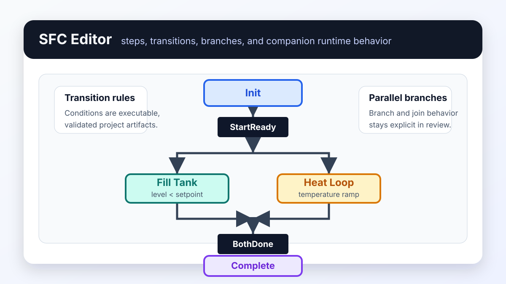

# SFC

*Figure:* An SFC sequence with an `Init` step, a `StartReady` transition,
parallel `Fill Tank` and `Heat Loop` branches, a `BothDone` join, and a
`Complete` step. The graph is reviewed as an open project artifact and then
validated through the same runtime loop.

## What it gives you

- step/transition visual authoring
- explicit phases and branching
- a shared ST/runtime toolchain instead of a separate execution engine

## Five-step quickstart

1. Open `examples/sfc/sfc_simple_parallel.sfc`.
2. Let truST open the SFC editor automatically.
3. Inspect the initial step, transition conditions, and any parallel branches.
4. Save and inspect the resulting companion ST/runtime behavior.
5. Validate the project and run it through the normal runtime loop.

## How a chart runs

The chart runs as its companion Structured Text, by the SFC rules of
IEC 61131-3 (the details are in `docs/specs/sfc-profile.md`):

- Each scan first runs the actions of the active steps, then clears the
  transitions whose steps are active and whose conditions hold; a step entered
  in one scan runs its actions in the next.
- A parallel split enters all its branches together; its join leaves them
  together once every branch has reached its last step and the join's
  conditions hold.
- When several transitions leave one step, the one with the lowest `priority`
  number wins, otherwise the one drawn first. Set a transition's priority in
  its properties (Priority: a whole number from 0; empty for none).
- Action qualifiers: `N`, `S` and `R` (set and reset across steps), `L`
  (limited to a duration), `D` (delayed), `P`, `P1` (once when the step
  starts), `P0` (once when it ends), and `SD`, `DS`, `SL`. Type a duration
  such as `T#2s` for `L`, `D`, `SD`, `DS` and `SL`.
- An action runs one more scan after it ends, with `<action>.Q` FALSE, so it
  can switch its outputs off: `motor := Run.Q;`. Code that must run only while
  the step is active goes inside `IF <action>.Q THEN`. Transition conditions
  may read `<action>.Q`, for example `NOT Heat.Q` after an `L` action.
- Each step is read as IEC 61131-3 names it: `<step>.X` is TRUE while the step
  is active, and `<step>.T` is the time since the step was entered, which keeps
  its value after the step is left. A transition can wait on it, for example
  `Fill.T >= T#5s`. The step flag `<step>_active` is the same as `<step>.X`.
  A step cannot have the name of a variable or an action of the chart; a step
  named with a keyword, such as `On`, has only `<step>_active`.

## Best for

- procedural phase control
- sequences with clear step ownership
- flows that need explicit parallel branches or joins

## When not to use SFC

- when the logic is closer to rung-based circuit behavior
- when the system is better described as event-driven states
- when a simple ST sequence is easier to maintain than a graph

## Common mistakes

- treating transitions as vague comments instead of executable conditions
- overusing SFC for logic that has no real sequencing
- editing the companion ST directly and expecting the graph to remain source-of-truth

## Example folder

- `examples/sfc`

## Related

- [Companion ST](companion-st.md)
- [Visual editor examples](../../examples/visual-editors.md)
