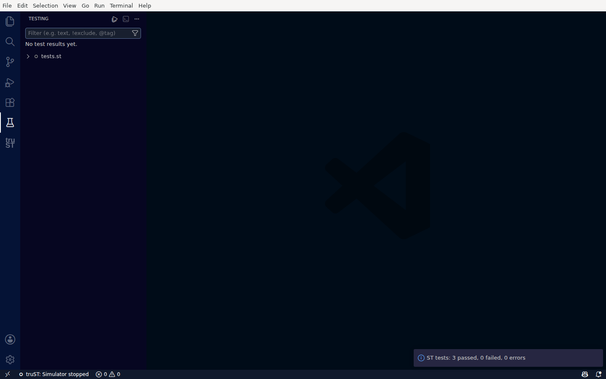
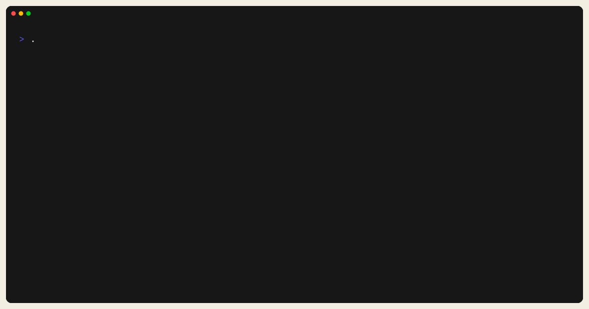
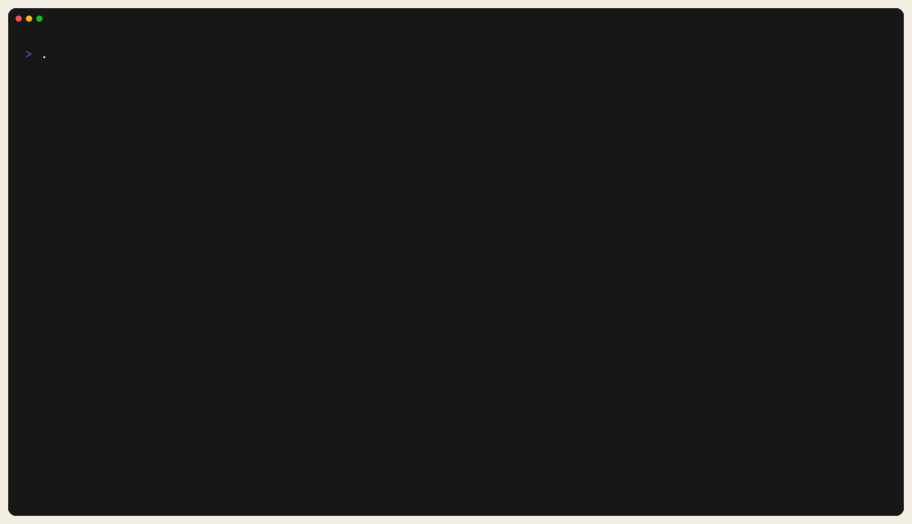
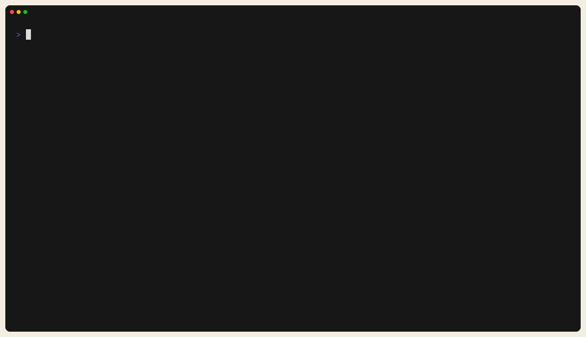

# Build, Validate, Test

## The Core Loop

```bash
trust-runtime build --project ./my-plc --sources src
trust-runtime validate --project ./my-plc
trust-dev test --project ./my-plc --output json
```

## What each command proves

### `build`

- parses and type-checks ST sources
- resolves project dependencies
- compiles them into the program image `program.tpi`, with its deployment
  record `deployment-record.bin` (the first build installs the compiler
  toolchain when none is installed)

### `validate`

- validates `runtime.toml`
- validates `io.toml`
- admits the program image as the computer admits it when it starts (its CPU
  and the image checks)

### `test`

- discovers ST tests in the project
- compiles an unfiltered project before reporting that it has no test POU
- runs them with configurable timeout and output format
- can list tests without executing them

## Run Tests In VS Code

Structured Text tests also appear in VS Code's native **Testing** view — no custom panel to learn. Open
the Testing view (the flask icon in the Activity Bar) to see your test files, run one test or all of them,
and read the result.



*Run Structured Text unit tests from the standard Testing view — here, 3 passed, 0 failed, 0 errors.*

## Worked Example

The unit-testing tutorial holds sources and tests, so it builds and runs its
tests:

```bash
trust-runtime build --project ./examples/tutorials/10_unit_testing_101 --sources src
trust-dev test --project ./examples/tutorials/10_unit_testing_101 --output json
```

`validate` checks a project that a runtime runs, with its `runtime.toml` and
`io.toml`; the tutorial has neither, so on it `validate` reports `missing
runtime.toml`. Validate a shipped runtime project instead:

```bash
trust-runtime validate --project ./examples/memory_marker_counter
```



*Figure:* A clean `validate` pass against a shipped project. This is the
config/bundle safety gate before runtime troubleshooting.



*Figure:* A deliberate one-line build break in a temporary project copy. This is
the shape of a compile failure, not placeholder garbage syntax.

## Test JSON Output And JUnit Output

Use JSON output when an agent or CI parser needs machine-readable results:

```bash
trust-dev test --project ./my-plc --output json
```

Use JUnit output when your CI system expects test-report artifacts:

```bash
trust-dev test --project ./my-plc --output junit
```



*Figure:* JUnit XML emitted from the unit-testing tutorial. This is the CI-safe
artifact shape to feed into a test-report parser.

Useful test options:

- `--list`
- `--filter <substring>`
- `--timeout <seconds>`
- `--output human|junit|tap|json`
- `--ci`

## CI Loop

For CI or automation:

```bash
trust-runtime build --project ./my-plc --ci
trust-runtime validate --project ./my-plc --ci
trust-dev test --project ./my-plc --ci --output junit
```

## Typical Failure Pattern

1. `build` fails:
   fix source code first.
2. `build` passes but `validate` fails:
   fix config shape or bundle/runtime mismatch.
3. `build` and `validate` pass but `test` fails:
   logic behavior is wrong even though the project is structurally valid.

## Related

- [Compile, Validate, Reload](compile-validate-reload.md)
- [trust-runtime CLI](../reference/cli/trust-runtime.md)
- [trust-dev CLI](../reference/cli/trust-dev.md)
- [Tutorials](../examples/tutorials.md)
