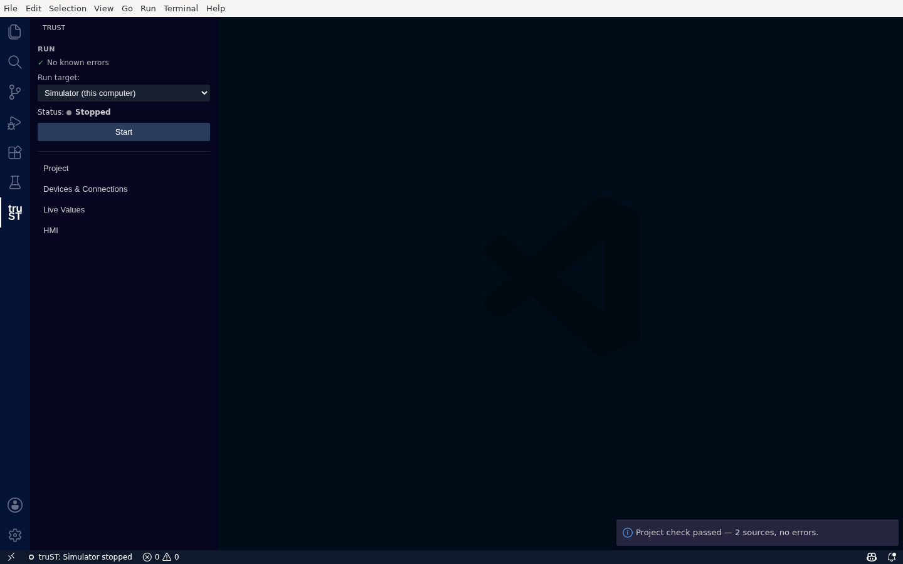
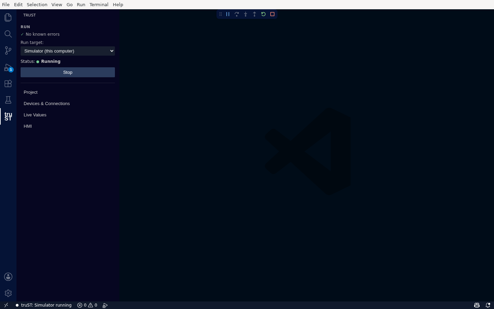

# Run & Compile

Compile your program, then run it on the simulator, both from the truST view: the **truST** icon in
the Activity Bar.

## Compile your program

Click **Compile**. It checks the whole project and builds the program. When it passes, the button shows
a check, and the status bar says so for a few seconds, for example *"Compile passed — 3 sources, no
errors."*

*Compile on the shipped project `examples/memory_marker_counter`: the button shows a check, and the status
bar counts the sources it compiled.*

### When Compile fails

If the project has errors, Compile does not pass, and the button shows their number with an error icon,
for example **Compile 2**. The errors are in VS Code's **Problems** panel with their IEC references (for
example an undefined identifier on a specific line). Fix them in the editor — the Problems entries are
clickable and jump to the source.

## Choose where it runs

**Target** selects where the program runs. For a new project this is the **Simulator**, the built-in
simulator on this computer, no hardware required. **Speed ×1** beside it is the simulation speed, which
**Change…** sets. The list shows the simulator and the runtimes you've added in
[Devices & Connections](../connect/communication-panel.md); you add or connect targets there, not from
this list.

## Run on the simulator

Click **Start**. truST runs the program on the simulator in a debug session:

- the status bar says `truST: Simulator running`, beside the session's name;
- VS Code's debug toolbar appears at the top, with pause, the step buttons, restart and stop;
- the Run and Debug view lists the program's tasks as running;
- **Live Values** opens on the program's inputs, outputs and memory, updated every scan.

*Start on `examples/memory_marker_counter`: its tasks run, and Live Values shows `P1.Counter` and
`P1.CounterLatched` counting with the scan.*

- **Start** — run the program on the selected target.
- **Debug** — run it with breakpoints and stepping; see [Debugging In VS Code](debugging-in-vscode.md).
- **Stop** — the debug toolbar's stop button ends the simulation.
- **Update running simulation** — appears in the truST view when you've edited the source while the
  simulator runs, to load the change without a restart (simulator only).

In [Live Values](live-values.md) you watch and drive the I/O while it runs; set a breakpoint and use
[Debugging In VS Code](debugging-in-vscode.md) to step through the logic.

## Related

- [Debugging In VS Code](debugging-in-vscode.md)
- [Live Values: write, force, release](live-values.md)
- [Build, Validate, Test](build-validate-test.md)
- [Runtime UI And Control](runtime-ui-and-control.md)
