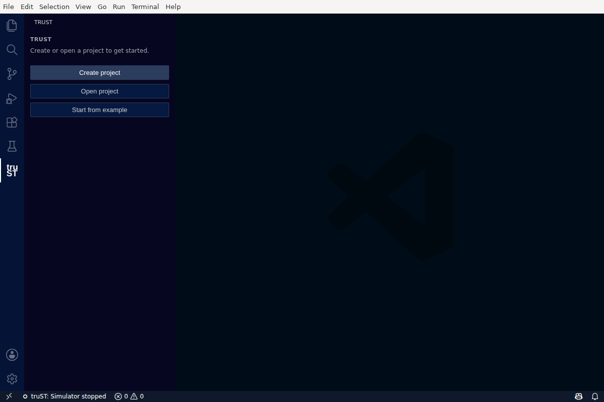
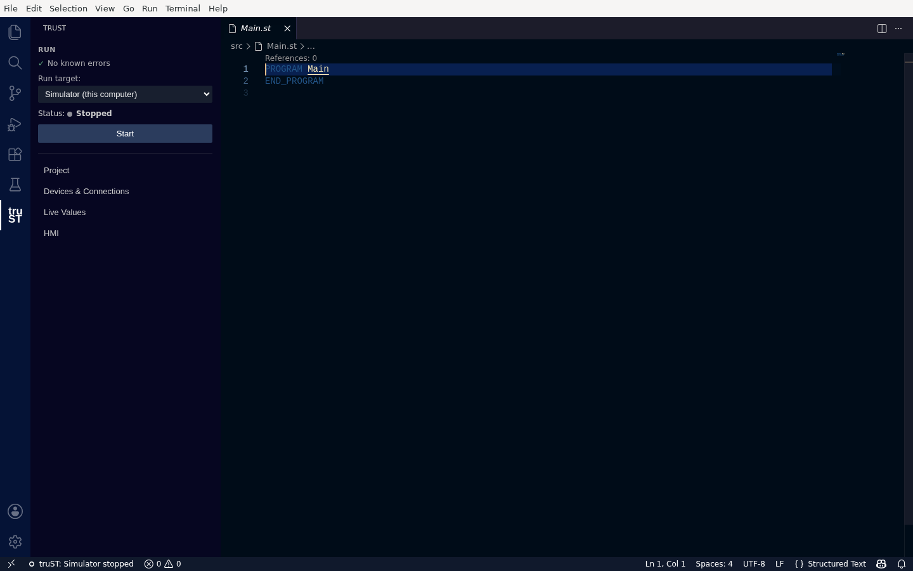

# Create A New Project

Create a new, **runnable** truST project in a folder of its own — no config files to edit by hand.

## 1. Find truST and start a project

Click the **truST** icon in the Activity Bar (left edge). With no project open, the truST view says
**No project**, *"Start with a runnable example, create a blank project, or open an existing folder."*,
and offers three buttons:

- **Start from example**: copy a ready-made starter.
- **+ Create project**: create a new, runnable project.
- **Open project**: open an existing truST folder.

Devices & Connections, HMI, Control Studio, Live Values and Libraries below them wait for a project.



*With no project open, the truST view offers three ways in: an example, a new project or an existing folder.*

## 2. Create the project

Click **+ Create project**. truST first asks what the project starts as:

- **Structured Text**: a program in `src/Main.st` and the configuration that runs it.
- **Structured Text with Rust**: that project with a Rust crate in `rust/`, whose function block
  `FILTER_EMA` `src/Main.st` calls.
- **Rust-first**: the crate is the project, with its Rust programs, and `trust.toml` holds their tasks.

Then choose the folder to create it in, and give it a name (for example `my-first-plc`). truST writes a
complete, runnable project into a new folder of that name and opens it. You never edit a config file to
get started — the generated `runtime.toml` and `io.toml` are valid out of the box with simulated I/O.

What gets created:

```text
my-first-plc/
  trust-lsp.toml      # project settings (include_paths = ["src"])
  runtime.toml        # runtime configuration (control endpoint, simulator defaults)
  io.toml             # I/O wiring, set to simulated so it runs with no hardware
  .gitignore          # keeps the runtime's endpoint folder and the build folder out of version control
  .vscode/
    launch.json       # the truST Simulator launch configuration
    settings.json
  src/
    Main.st           # your program, starting from an empty PROGRAM Main
    config.st         # a CONFIGURATION that instantiates Main (resource + task + PROGRAM Main WITH)
```

The `config.st` configuration is what makes the project actually run, and it opens warning-clean from the
first second.

A Rust start writes its crate as well, with the Structured Text that declares its Rust POUs, so the
project builds as it is created, with no Rust of your own. truST opens it on the crate's source:

```text
my-rust-project/                (Structured Text with Rust)
  ...                           # the files above
  rust-toolchain.toml           # the Rust that truST builds with, for your own rustup
  rust/
    Cargo.toml                  # the crate, with trust-plc at this release's version
    src/lib.rs                  # the function block FILTER_EMA
  src/generated/rust_pous.st    # its declaration, which src/Main.st calls

my-rust-cell/                   (Rust-first)
  Cargo.toml                    # the crate
  src/lib.rs                    # the program MAIN
  trust.toml                    # the resource, a 10 ms task and MAIN on it
  src/generated/trust/          # the declarations and the configuration from trust.toml
  runtime.toml, io.toml, trust-lsp.toml, rust-toolchain.toml, .vscode/
```

When you save a `.rs` file or `trust.toml`, truST writes the generated files again.

## 3. Recognize the workspace

`src/Main.st` opens in the editor. The **truST** icon opens the truST view with the project:

- its name, from its folder: **My First Plc**;
- **Target: Simulator**, where the program will run, at **Speed ×1**;
- **Compile**, **Start**, **Debug** and **Deploy**, which a device target enables;
- Devices & Connections, HMI, Control Studio, Live Values and Libraries.



*A new project: the simulator is its target, and **Start** runs the program on it. Above `PROGRAM Main`,
the language server counts its use in `config.st`.*

**Success signal:** the editor shows `src/Main.st` (language mode "Structured Text"), and the truST view
shows the project with the Simulator as its target.

**If it doesn't work:** if the view still shows **No project**, the folder wasn't recognized as a truST
project (no `trust-lsp.toml`) — reopen the folder you created.

## Next

- Write your logic: [Program In VS Code](program-in-vscode.md)
- Run it on the simulator: [Build, Validate, Test](../operate/build-validate-test.md)
- Prefer a ready-made starter? [Start from an example](../examples/index.md)
- [Project Layout](../develop/project-layout.md)
