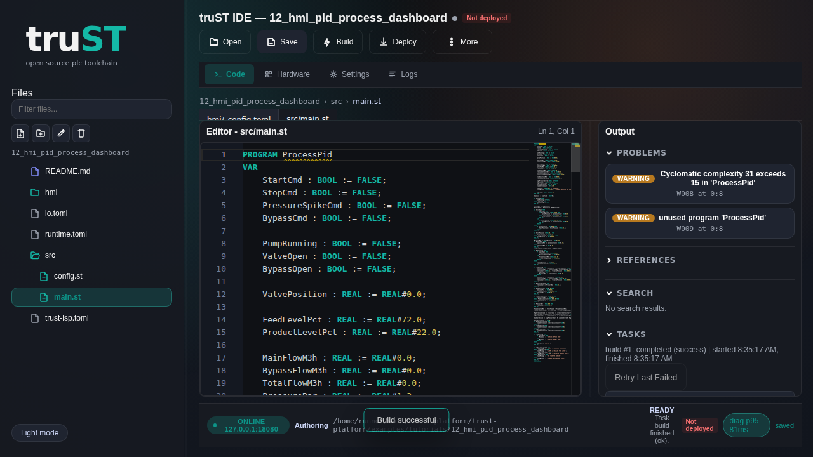

# Program In Browser IDE

## Truth First

- Browser IDE lives at `/ide`
- Browser IDE is served by `trust-runtime ide serve`
- default runtime web binding is often loopback-only
- if the URL must be reachable from another host, expose it safely:
  [Networking And Remote Access](../connect/networking-and-remote-access.md)

## For Administrators

Start the standalone Browser IDE:

```bash
trust-runtime ide serve --project examples/tutorials/12_hmi_pid_process_dashboard
```

Or from the repo root:

```bash
cargo run -p trust-runtime --bin trust-runtime -- ide serve \
  --project examples/tutorials/12_hmi_pid_process_dashboard
```

This gives you:

- Browser IDE on `http://127.0.0.1:18080/ide`

## For Browser Users

Open:

- `http://127.0.0.1:18080/ide`

Then:

1. open `src/main.st`
2. run build
3. run validate
4. inspect the project tree

## What Success Looks Like

- `/ide` loads the project and lets you browse files
- build and validate complete without errors



*Figure:* The browser IDE with the shipped tutorial project already loaded.
Open the project tree from here, then open `src/main.st` before you build or
validate.

## If It Fails

- URL works on the host but not another machine: check loopback-only binding and
  [Networking And Remote Access](../connect/networking-and-remote-access.md)
- `/ide` loads but you cannot edit: confirm the runtime/session mode

## Next

- [Runtime UI And Control](../operate/runtime-ui-and-control.md)
- [Network And Remote Access](../connect/networking-and-remote-access.md)
