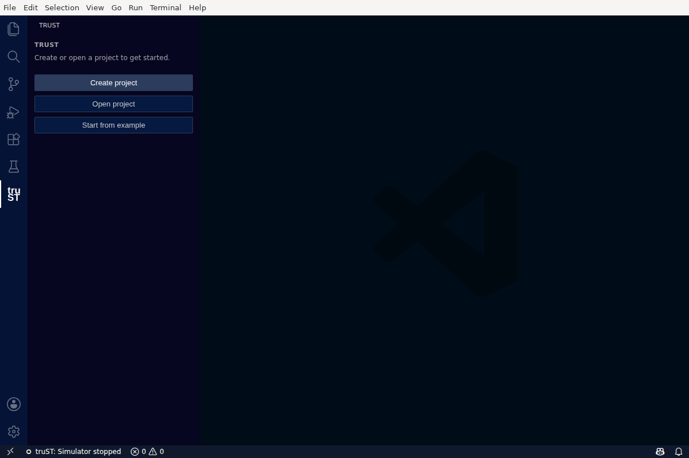

# Start From An Example

The fastest way to learn truST is to start from a bundled example — an editable working copy you can run
immediately, no config to write.

## Open the example gallery

With no project open, the truST view offers **Start from example** first, then **+ Create project** and
**Open project**.

*With no project open, **Start from example** copies a ready-made starter.*

Click it to open the searchable example gallery. Hardware and category filters can be combined, and each
card says how its example runs out of the box: **Runs in simulator** for an example whose I/O is simulated,
and what hardware it can connect to later. Pick one, choose a destination folder, and truST copies an
**editable** working copy there and opens its source. You never edit a `.toml` to get going: every starter
runs in the simulator right away.

## The bundled starters

Each of these cards says **Runs in simulator**:

| Example | Hardware | What it is |
| --- | --- | --- |
| **Empty simulator** | No hardware needed | A minimal runnable project — press **Start** to simulate immediately. |
| **Conveyor demo** | No hardware needed | A small, realistic program with live values to watch it run. |
| **Memory marker counter** | No hardware needed | Watch a counter in Live Values, stop it at a breakpoint and step one statement. |
| **Fault trace** | No hardware needed | A dosing pump faults when its stroke sensor breaks: save the flight recorder's trace of the fault and replay it. |
| **Rust function block** | No hardware needed | A Structured Text program that calls a function block written in Rust. |
| **Rust barcode reader** | No hardware needed | A Rust function block reads GS1-128 labels, and the program accepts or rejects each box. |
| **Rust signal filter and CRC** | No hardware needed | Rust function blocks drop a level sensor's spikes and check Modbus frames' CRC. |
| **Rust service** | No hardware needed | A Rust service beside the runtime writes a heater's setpoint from the electricity price. |
| **TwinCAT ADS** | Hardware optional: TwinCAT | Starter for a Beckhoff TwinCAT (ADS) device — runs in the simulator; wire the real PLC in Devices & Connections. |
| **Raspberry Pi (EtherCAT / GPIO)** | Hardware optional: Raspberry Pi | Starter for a Raspberry Pi field-IO target — runs in the simulator; wire real I/O in Devices & Connections. |
| **HMI tank level** | No hardware needed | A tank level loop with the real `Control.PID`, alarms, and screens built in the HMI Builder. |
| **HMI equipment** | No hardware needed | The Plant library's pump, control valve, level transmitter, tank and PID loop, each opening its operator panel. |
| **PLCopen Motion** | No hardware needed | A portable single-axis motion starter with the bundled PLCopen Motion library. |
| **Control Studio: PID loop** | No hardware needed | Identify a simulated heater, tune a PI controller for it, validate it on the program, apply and restore it. |
| **Control Studio: cascade** | No hardware needed | Two `Control.PID` blocks in cascade on a jacketed vessel: the inner loop first, then the outer loop through it. |
| **Control Studio: interacting loops** | No hardware needed | Two heated zones that share a wall, tuned one after the other or together as a PID group. |
| **Control Studio: ON/OFF control** | No hardware needed | A cold room held by a switching compressor: tune the hysteresis and the minimum ON and OFF times. |
| **Control Studio: state feedback** | No hardware needed | Two tanks in series held by an LQR law that feeds both measured levels back to the pump. |

The hardware badge tells you what you can add: a starter with **Hardware optional** opens and runs in the
simulator like the others, and you connect the real device later from
[Devices & Connections](../connect/communication-panel.md). A card that says **Requires** a device needs it
before it runs.

## Next

- Run it: [Run & Check](../operate/debugging-and-runtime-panel.md)
- Watch it: [Live Values](../operate/live-values.md)
- Wire real hardware: [Add A Device](../connect/add-a-device.md)
- Start from scratch instead: [Create A New Project](create-new-project.md)
