# Control Studio — workflow sequences

Shared purpose and completion claims: [Control Platform Purpose and Acceptance Contract](control-platform-purpose.md).
This document retains its detailed technical or teaching authority.

Required product behavior. Automatic is the default; every stage can be operated manually.

The [Identify](control-studio-identify-page.md),
[Tune](control-studio-tune-page.md) and
[Validate](control-studio-validate-page.md) specifications are the only page
layout authorities. The shared rules below own automatic progression and
retained study behavior. Later sections specify algorithms and runtime
operations, not additional UI controls or pages.

**Identify → Tune → Validate**, followed by the user's **Apply** action.

Every screen follows the [shared UI clarity and rendered acceptance contract](35-vscode-control-studio.md#shared-trust-uiux-contract--mandatory).
Only the task-specific editors defined below are added to the three page layouts.

## Qualification boundary — user correction, 14 September 2026

Identify performs one live acquisition campaign and produces a provisional model.
Tune may use that model. Validate explicitly collects the independent model-check
recording, checks frozen predictions and runs the actual-ST controller scenarios.
The following algorithm sections retain their independence/adequacy requirements;
any earlier ordering that requires a second acquisition before leaving Identify
is superseded by this boundary. Failed or missing model validation blocks Apply.

## Three-page automatic flow

Reuse the existing numerical methods, runtime authority, bounded experiments
and application transactions for this one connected flow.

### Identify, review, then tune

**Identify plant** runs automatic identification and stops on Identify to show
the provisional model and response plot. **Identify plant** keeps its name and
runs another identification when pressed again. **Reset** clears the working model, recordings, chart and dependent tuning/validation
results, including the saved draft. It retains configured signals and limits,
leaves the running controller unchanged and does not erase separately saved files.
Identify plant always acquires fresh data for the selected method.
The **Tune** tab navigates to Tune without starting tuning or opening an editor;
there is no separate continuation button. These are the user's 14 September
2026 corrections.
**Open recording…** uses the chosen recording for the
same identification and review without live excitation. Opening its file picker and cancelling
does nothing. If recorded channels are ambiguous, select them before analysis.
Simulation verification may run later; opening a recording never authorizes a
physical experiment.

Use configured signals, limits, requirements and controller bindings wherever
available. Pause only when a required value, explicit controller choice or
existing runtime approval is missing, or an operation fails. Open the owning
control with the missing field identified; do not introduce a setup page.
Configured requirements and limits must be used without inventing new limits
or silently relaxing them to obtain a pass.

**Tune controller** explicitly starts tuning and stops with its candidate.
**Validate controller** explicitly starts the independent model check and controller validation. Tune automatically fills missing test settings from the model and recording within declared bounds; Requirements remains an optional editor. Missing essential prerequisites are reported when tuning is requested.
Selecting a manual method preserves that choice while continuing the
sequence. Pause for manual settings when they have not yet been supplied.
An existing accepted controller choice and pinned settings remain unchanged.

Follow the active page as the sequence advances, unless the user deliberately
navigates to inspect another page. Navigation alone never runs an operation or
discards a result. While an operation runs, the visible page's operation button
becomes **Abort**, targeting the same active operation, with one short progress
message. Controls that would change that operation's inputs are read-only until
it completes or is aborted. Apply stays unavailable throughout the sequence.

On failure or Abort, stop automatic continuation and retain the results and
recordings. Show the specific problem in the affected page's action area.
After correction, its existing action restarts from the earliest invalid stage
and reuses unaffected work. Never loop indefinitely or switch controllers to
hide a failed requirement. Successful validation stops at **Apply**; it never
changes the running controller automatically.

### Small editors, only where needed

| Information | Owner and visible entry | Contents when opened |
|---|---|---|
| Experiment limits | **Limits…** beside the Identify actions | Allowed input/output ranges and maximum duration, using the selected signals and units. |
| Control requirements | **Requirements…** beside Tune controller | Applicable requirement, signal and limit rows shared by recommendation, tuning and validation. |
| Multichannel mapping | **Channels…** beside the Tune controller selector, only for multiple channels | The selected controller/group's command and feedback bindings. |

Each entry opens one compact editor anchored to its owning control. Use the
shared truST dialog when the editor cannot fit at a narrow width. Keep editors
closed by default and open them automatically only when an attempted operation
needs missing information. **Done** validates and stores the values; **Cancel**
discards the edit. Done resumes a start that was waiting for those values;
otherwise it only saves the edit. No JSON fields, generic settings dashboard,
extra navigation tabs or duplicate forms. These are task-specific editors,
not an exception permitting general Help/Details panels.

### Save, reopen and restart

Autosave the study through the existing project study/result storage: selected
signals and mappings, limits, requirements, methods, model, immutable recordings,
controller target, candidate settings, pins, validation and application receipts.
No Save button, saved-status strip or revision browser is needed in these pages.
Show an actual save failure briefly in the current action area; do not claim
the study was saved when the write failed.

Reopening restores the saved study and last viewed page, without starting a
test, tuning job or parameter write. Changes invalidate only dependent results
and application eligibility; retained recordings and earlier results remain
available. A saved pass cannot qualify a changed model, mapping, controller,
setting, requirement or experiment condition.

**Apply changes the active runtime settings; autosave preserves the study.**
Apply does not silently edit ST or change the project's startup/retain policy.
Settings survive a runtime restart only if that project/runtime already retains
them. After restart, read the actual target and parameters before reporting
anything active. If startup restored different settings, retain the candidate
and show **Saved settings are not active** in the Validate action area. Recheck
the current program, mappings and validation before offering explicit Apply
again. Never replay an old write or restore old live integral/filter state just
because the study was reopened.

Recover an unacknowledged transaction by inspecting its existing operation
identity. A new runtime epoch or missing transaction outcome is unresolved,
not permission to repeat Apply. Keep the existing recovery action in the same
action area until the outcome is known.

### Documentation checkpoint — shared flow clarification

- [x] **Start:** advance part 3, Control Studio, in the verified
  `trust-platform-connected-workflow` checkout at
  `f5ba9d02bd66441a894865f10070a27ccefa5eac`; keep the selected project,
  configured plant and real `Control.PID` as the primary intended target.
- [x] **Finish:** document limits, requirements, channel mapping, automatic
  continuation, restore and restart/save behavior across the three page specs;
  check references and consistency. Documentation only: no application code,
  runtime parameters, UI execution or acceptance status changed.

### Documentation checkpoint — UI consolidation

- [x] **Start:** in the verified implementation checkout, advance Control Studio
  specification clarity and remove superseded UI directions. Preserve the real
  Control.PID, selected project/plant and numerical/runtime contracts.
- [x] **Finish:** make the three page layouts and shared flow the sole UI
  authorities; remove the older workflow-analysis file and duplicate layout,
  badge, toolbar, separate-start and status-strip instructions. Check references
  and retained technical contracts. Implementation and rendered usability
  acceptance remain pending; no product code or runtime parameters changed.

## Main workflow

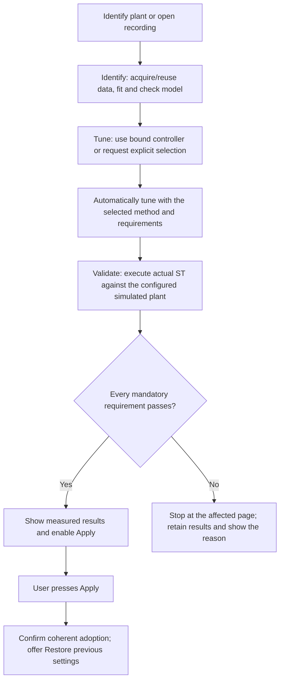

## Connect and observe

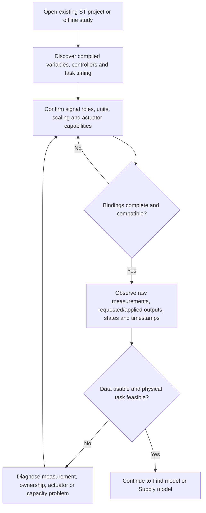

## Find model — choose what runs

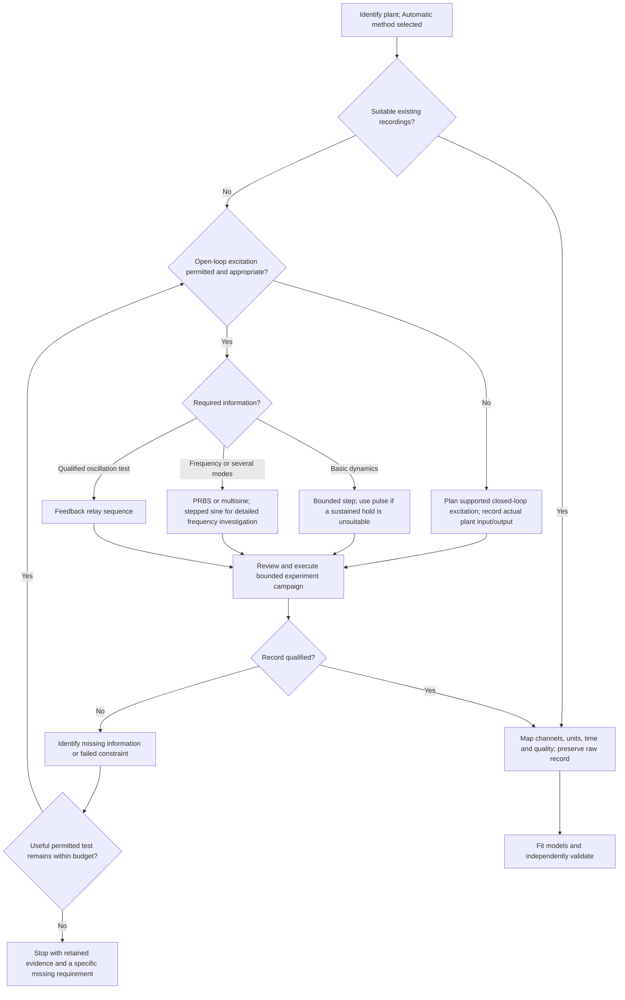

## Find model — fit, select and validate

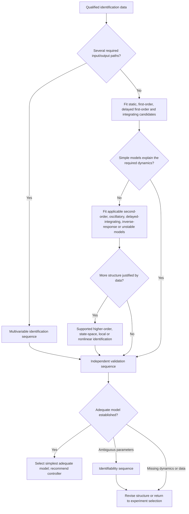

## Step and pulse identification

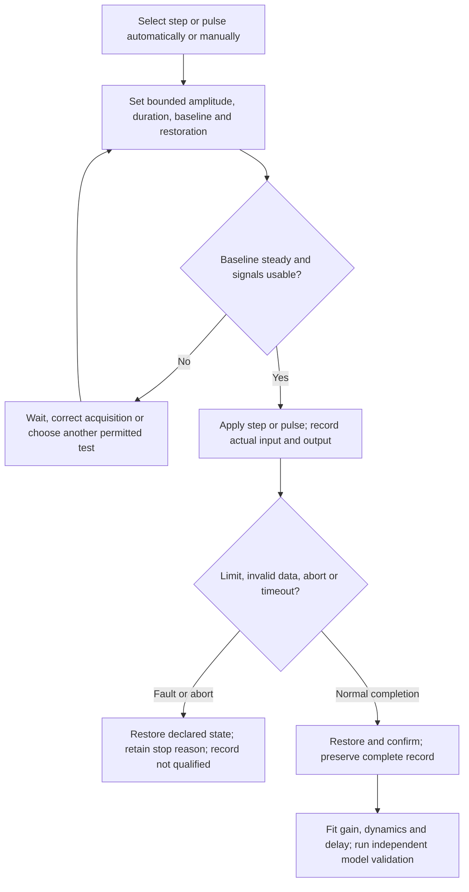

## Relay identification and tuning

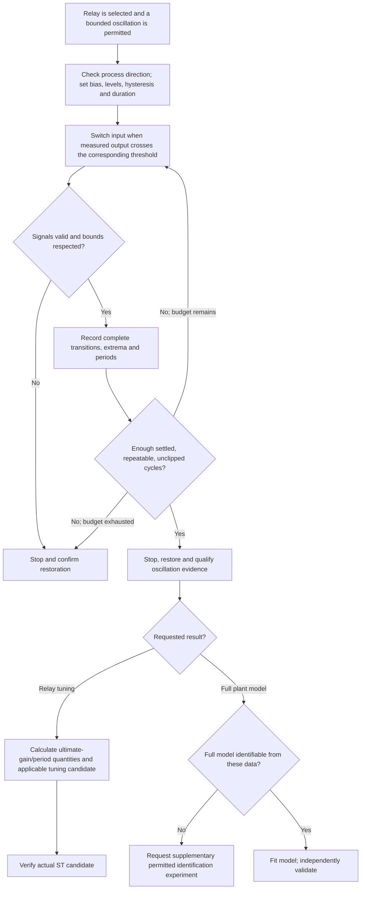

## PRBS, multisine and frequency testing

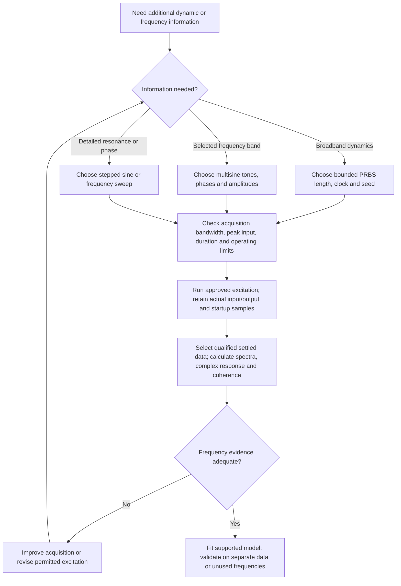

## Multivariable identification

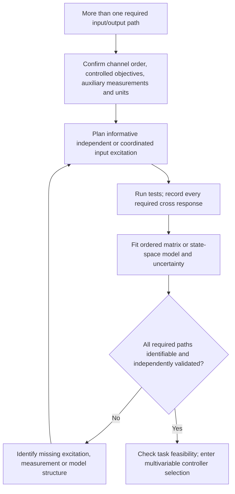

## Physical models, balances and supplied models

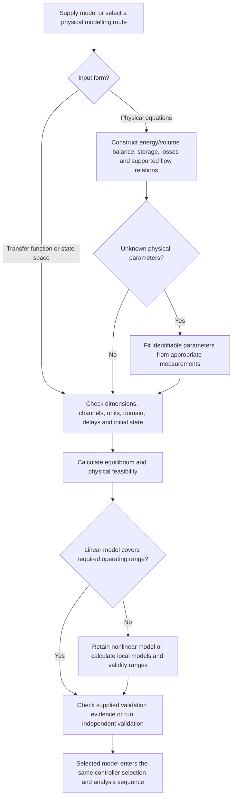

## Identifiability and independent model validation

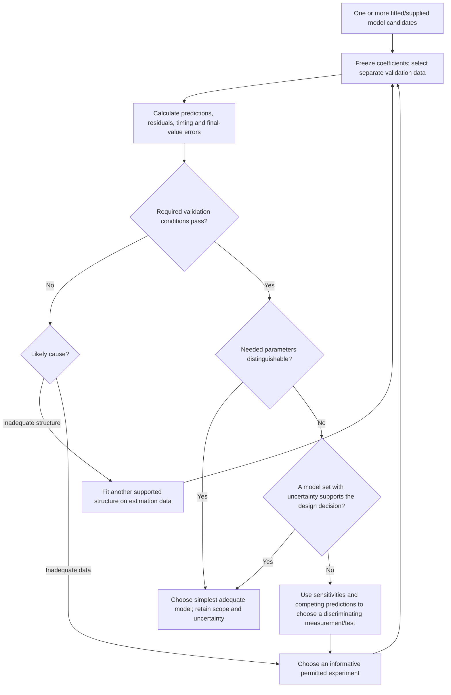

## Recommend a controller

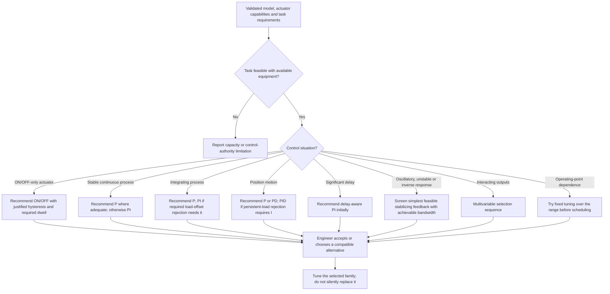

## Tune simple switching and P / PI / PD / PID controllers

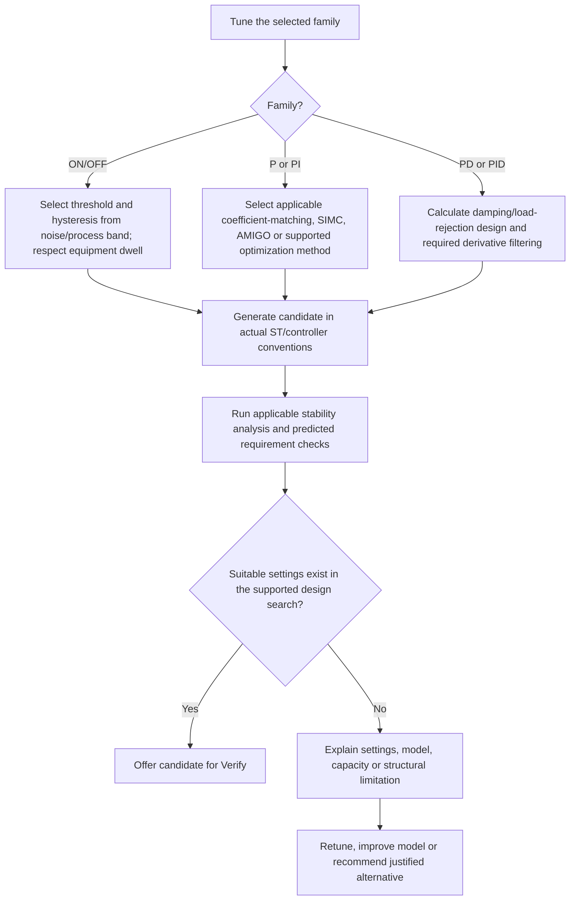

## Automatic filter selection

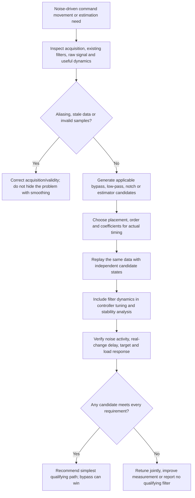

## Setpoint weighting and reference shaping

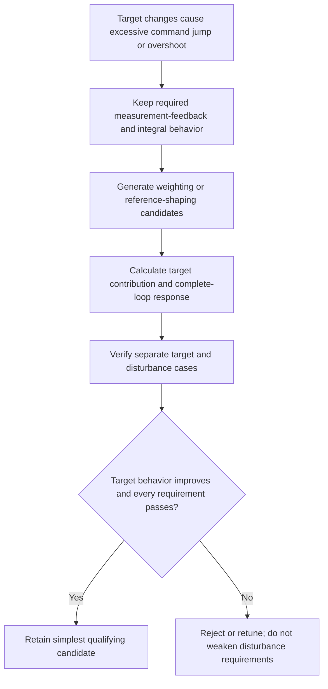

## Saturation, anti-windup and actuator tracking

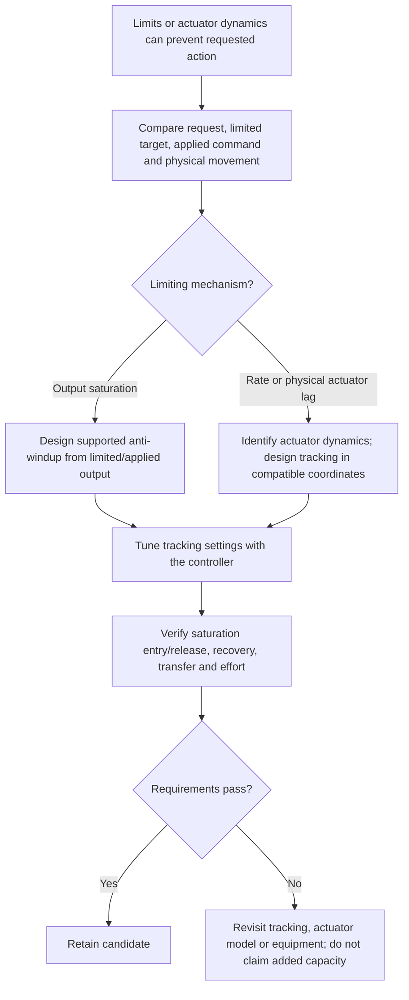

## Actuator characteristic and stiction investigation

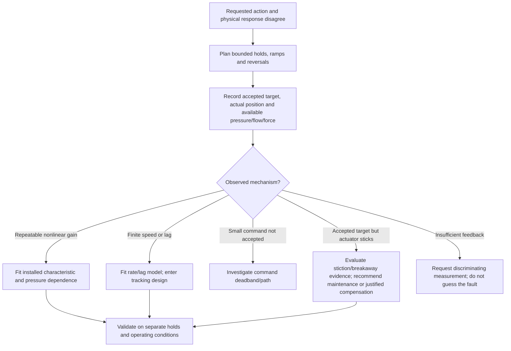

## Sampling and controller realization

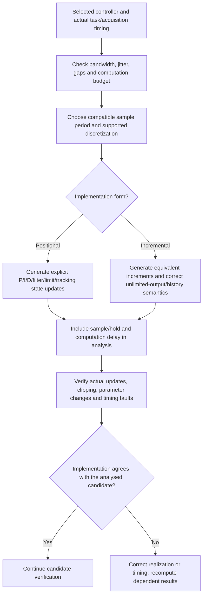

## Initialization, transfer and parameter changes

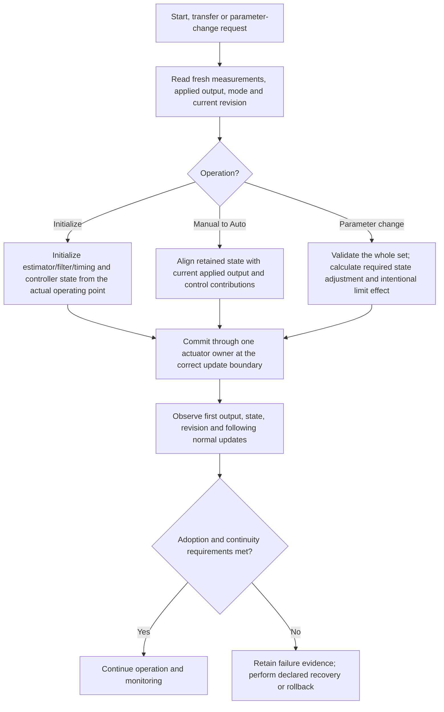

## Build mathematical loop representation

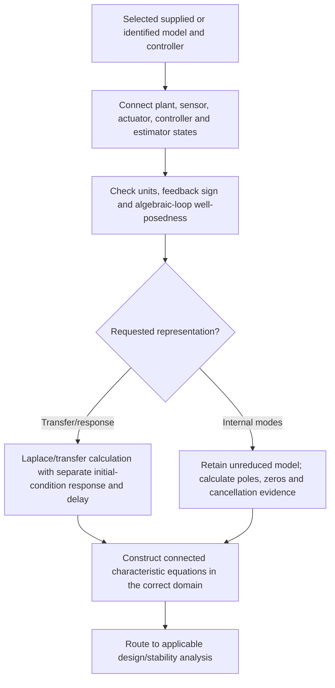

## Choose the stability analysis

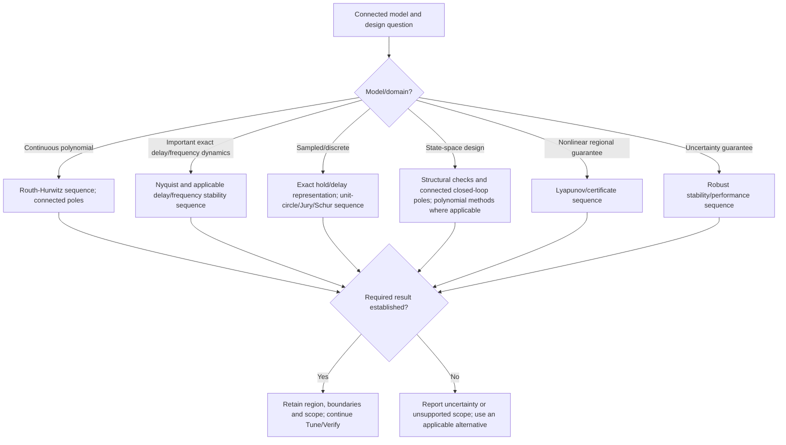

## Routh-Hurwitz

```mermaid
flowchart TD
A["Selected supplied or identified plant and controller; optional manual polynomial"] --> B["Construct characteristic polynomial and parameter dependence"]
B --> C["Build Routh rows and show calculation steps"]
C --> D{"Zero pivot, zero row or uncertain arithmetic?"}
D -->|Yes| E["Use supported symbolic/rigorous-limit or auxiliary-polynomial treatment"]
E --> F{"Resolved?"}
F -->|No| G["Report unresolved count/region; do not substitute a finite epsilon proof"]
F -->|Yes| H["Count first-column sign changes and analyse boundary roots"]
D -->|No| H
H --> I["Derive supported strict stability inequalities and full intervals/regions"]
I --> J["Display RHP count, boundaries, fixed parameters and proof scope"]
J --> K["Use region for tuning and candidate generation"]
K --> L["Verify actual ST candidates; gain trials do not establish the region"]
```

## Root locus and pole-based gain selection

```mermaid
flowchart TD
A["Need gain choices for damping or response speed"] --> B["Select one parameter; freeze all other plant/controller parameters"]
B --> C["Calculate pole paths and relevant branch information"]
C --> D["Calculate candidate gains from response/pole requirements"]
D --> E["Use the applicable stability-region analysis; do not certify from a finite plot"]
E --> F["Predict response, noise and effort"]
F --> G{"Candidate suitable?"}
G -->|Yes| H["Verify actual ST response"]
G -->|No| I["Revise gain/design requirements or recommend another structure"]
```

## Frequency response, sensitivity and loop shaping

```mermaid
flowchart TD
A["Validated model or qualified measured frequency response"] --> B["Calculate Bode/Nichols views and applicable margins"]
B --> C["Calculate sensitivity, complementary sensitivity and actual disturbance/noise/actuator paths"]
C --> D{"Requirements met?"}
D -->|Yes| E["Retain simpler controller; continue Verify"]
D -->|No| F["Identify the frequency band and physical tradeoff causing failure"]
F --> G["Synthesize supported lead, lag, filter or gain changes"]
G --> H["Recalculate the complete loop and appropriate stability analysis"]
H --> I["Verify target, disturbance, noise and actuator behavior"]
I --> D
```

## Nyquist stability

```mermaid
flowchart TD
A["Connected loop model with delay and frequency dynamics"] --> B["Establish open-loop unstable-pole count P from model evidence"]
B --> C{"Pole count and contour conditions known?"}
C -->|No| D["Resolve model/count uncertainty; never assume P equals zero"]
C -->|Yes| E["Construct full directed contour, branches, detours and closure"]
E --> F["Calculate signed encirclements N; clockwise is positive"]
F --> G["Calculate Z = P + N and inspect boundary cases"]
G --> H{"Contour resolution and result sufficient?"}
H -->|No| I["Refine or use supported certification; report unresolved scope"]
H -->|Yes| J["Return stability result and applicable margins/parameter boundaries"]
J --> K["Continue tuning or actual-ST verification"]
```

## Sampled-data stability

```mermaid
flowchart TD
A["Continuous/discrete plant and actual controller timing"] --> B["Calculate exact supported hold conversion and controller discretization"]
B --> C["Include acquisition/computation delay and pending-command states"]
C --> D["Calculate discrete poles and applicable Jury/Schur conditions/regions"]
D --> E{"Stable and meets performance/computation requirements?"}
E -->|No| F["Revise sample period or controller; recalculate coefficients"]
F --> B
E -->|Yes| G["Verify actual ST timing, delayed updates, held outputs and constraints"]
G --> H{"Observed behavior agrees?"}
H -->|Yes| I["Retain candidate"]
H -->|No| J["Separate implementation/timing faults from numerical integration error"]
```

## Multivariable pairing, decoupling and design selection

```mermaid
flowchart TD
A["Validated multivariable model and controlled objectives"] --> B{"Objectives feasible with available inputs and constraints?"}
B -->|No| C["Report control-authority/capacity limitation"]
B -->|Yes| D["Calculate applicable RGA, conditioning and frequency interaction"]
D --> E["Recommend feasible pairings and simple P/PI loops"]
E --> F["Tune loops together using the full coupled model"]
F --> G["Verify each channel, cross-effects, simultaneous demands and uncertainty"]
G --> H{"All requirements pass?"}
H -->|Yes| I["Keep paired loops"]
H -->|No| J{"Limiting cause?"}
J -->|Steady interaction| K["Calculate realizable static decoupler; retune"]
K --> G
J -->|Dynamic interaction| L["Propose supported dynamic compensation or centralized/state feedback"]
J -->|Future shared constraints| M["Compare simple allocation/override; propose MPC if necessary"]
J -->|Missing state information| N["Observability and estimator design sequence"]
L --> O["Engineer chooses new structure; Tune and Verify it"]
M --> O
N --> O
```

## Operating range, linearization and gain scheduling

```mermaid
flowchart TD
A["Required operating range or measured changing dynamics"] --> B["Obtain physical/local models at relevant operating points"]
B --> C["Calculate Jacobians, local gains and validity against nonlinear behavior"]
C --> D["Tune and verify a fixed controller across the range"]
D --> E{"Fixed controller meets every requirement?"}
E -->|Yes| F["Keep fixed controller"]
E -->|No| G{"Operating-point dependence justifies scheduling?"}
G -->|No| H["Revisit model, uncertainty or task"]
G -->|Yes| I["Generate local tuning and schedule/interpolation with coherent state handling"]
I --> J["Verify endpoints, intermediate points, transitions and out-of-range behavior"]
J --> K{"All requirements pass?"}
K -->|Yes| L["Recommend schedule"]
K -->|No| H
```

## Feedforward

```mermaid
flowchart TD
A["Disturbance rejection is inadequate"] --> B{"Useful disturbance measurement and timing available?"}
B -->|No| C["Retain feedback; improve measurement or other design"]
B -->|Yes| D["Identify/select disturbance-to-output and actuator-to-output models"]
D --> E["Calculate realizable feedforward; combine with feedback and limits/tracking"]
E --> F["Verify disturbance timing/error, model mismatch, saturation and invalid-estimate fallback"]
F --> G{"Required benefit with all constraints met?"}
G -->|Yes| H["Recommend feedback plus feedforward"]
G -->|No| C
```

## Cascade

```mermaid
flowchart TD
A["Outer feedback reacts too late to an intermediate disturbance"] --> B{"Useful faster intermediate measurement exists?"}
B -->|No| C["Keep simpler architecture or change measurement"]
B -->|Yes| D["Identify/select inner and outer dynamics"]
D --> E["Tune and verify inner loop first"]
E --> F{"Inner loop sufficiently faster and usable?"}
F -->|No| C
F -->|Yes| G["Tune outer loop around actual inner-loop behavior"]
G --> H["Verify both loops, intermediate disturbances, limits, initialization and tracking"]
H --> I{"Cascade needed and all requirements pass?"}
I -->|Yes| J["Recommend cascade"]
I -->|No| C
```

## Ratio control

```mermaid
flowchart TD
A["Dependent quantity must follow a changing master flow"] --> B["Confirm ratio units, master validity and actuator limits"]
B --> C["Calculate dependent setpoint; tune dependent flow feedback"]
C --> D["Define low/zero-master inhibition, tracking and recovery"]
D --> E["Verify master changes, low/invalid flow, lag and residual delivery"]
E --> F{"Ratio and delivery requirements pass?"}
F -->|Yes| G["Recommend ratio arrangement"]
F -->|No| H["Revise flow tuning, measurement or actuator capability"]
H --> C
```

## Split-range control

```mermaid
flowchart TD
A["Both heating and cooling or opposing services are required"] --> B["Identify physical service capacities, signs and limits"]
B --> C["Tune net-demand controller and calculate service maps/neutral region"]
C --> D["Track actual combined physical effect"]
D --> E["Verify each service, transitions, exclusion, clipping and recovery"]
E --> F{"All requirements pass?"}
F -->|Yes| G["Recommend split range"]
F -->|No| H["Correct scaling, allocation, controller or capacity"]
H --> C
```

## Override control

```mermaid
flowchart TD
A["Normal objective competes with a measured constraint"] --> B["Check whether both requirements can be satisfied"]
B --> C{"Feasible?"}
C -->|No| D["Report incompatible requirements or equipment limitation"]
C -->|Yes| E["Tune normal and limiting loops; choose correct selector direction"]
E --> F["Provide single output ownership and inactive-controller tracking"]
F --> G["Verify constraint, authority transitions, limits and recovery"]
G --> H{"All requirements pass?"}
H -->|Yes| I["Recommend override arrangement"]
H -->|No| E
```

## Smith prediction and delayed-process compensation

```mermaid
flowchart TD
A["Delay-aware simple feedback cannot meet the task"] --> B{"Validated delay/model and suitable predictor structure?"}
B -->|No| C["Improve model or retain supported conservative feedback"]
B -->|Yes| D["Construct delayed and delay-free prediction paths; tune feedback"]
D --> E["Define model/history-mismatch fallback and state alignment"]
E --> F["Verify nominal and varied delay, loads, noise, invalid history and fallback"]
F --> G{"Every required case passes?"}
G -->|Yes| H["Recommend predictor arrangement"]
G -->|No| C
```

## State-space structure and state-feedback design

```mermaid
flowchart TD
A["Select supplied or identified state-space model"] --> B["Check state/input/output coordinates, dimensions and operating point"]
B --> C["Calculate controllability rank, conditioning and stabilizability"]
C --> D{"Required modes can be controlled?"}
D -->|No| E["Revise objectives/actuation or report infeasibility"]
D -->|Yes| F{"Required states available?"}
F -->|No| G["Calculate observability/detectability; enter estimator design"]
F -->|Yes| H["Calculate feedback K from supported pole/performance objectives"]
G --> H
H --> I["Check connected poles and physical feasibility"]
I --> J["Verify actual ST under perturbations, loads, limits and model variation"]
J --> K{"Meets task and simpler design inadequate?"}
K -->|Yes| L["Recommend state feedback"]
K -->|No| M["Retune, use simpler design or revisit model/measurements"]
```

## Observer design

```mermaid
flowchart TD
A["Control requires an unmeasured state"] --> B["Calculate observability, detectability and numerical conditioning"]
B --> C{"Required estimation is supported?"}
C -->|No| D["Change measurement, model or objective"]
C -->|Yes| E["Calculate observer gain from response and noise requirements"]
E --> F["Implement the chosen prediction/correction order with applied input"]
F --> G["Verify initial error, noise, model mismatch, missing data and recovery"]
G --> H{"Estimator and connected control meet requirements?"}
H -->|Yes| I["Retain simplest adequate estimator"]
H -->|No| J["Revise correction strength/model or consider justified Kalman design"]
```

## Kalman filtering

```mermaid
flowchart TD
A["Model-based estimation with uncertain prediction and measurement"] --> B["Obtain model, timing and justified process/measurement uncertainty"]
B --> C{"Uncertainty assumptions supported or explicitly supplied?"}
C -->|No| D["Collect useful evidence; do not invent covariance confidence"]
C -->|Yes| E["Calculate prediction, covariance, innovation and correction gain"]
E --> F["Check numerical covariance consistency and initialization"]
F --> G["Verify innovations, model/noise variation and actual estimation error where reference exists"]
G --> H{"Estimation and connected-loop requirements pass?"}
H -->|Yes| I["Recommend if simpler estimation is insufficient"]
H -->|No| J["Revise assumptions/model or choose another supported estimator"]
J --> B
```

## LQR and LQG

```mermaid
flowchart TD
A["State regulation requires an accuracy/effort design"] --> B["Scale physical objectives; choose supported horizon policy"]
B --> C["Solve appropriate Riccati design and calculate feedback gain policy"]
C --> D["Check stabilizability, solver conditions, closed-loop poles and limits"]
D --> E{"States measured?"}
E -->|Yes| F["Prepare LQR/state-feedback candidate"]
E -->|No| G["Design qualified Kalman estimator; connect LQG candidate"]
F --> H["Verify actual ST states, effort, noise, initialization and constraints"]
G --> H
H --> I{"All requirements pass?"}
I -->|Yes| J["Recommend only if simpler control is inadequate"]
I -->|No: settings or estimator| B
I -->|No: future constraints| K["Consider MPC only if prediction is needed"]
```

## Model predictive control

```mermaid
flowchart TD
A["Future coupled constraints require predictive control"] --> B["Select model, objectives, hard/soft constraints and execution budget"]
B --> C["Calculate horizon, weights and supported optimization/enumeration design"]
C --> D["At each update predict feasible plans from current estimate and applied-input history"]
D --> E{"Feasible solution before deadline?"}
E -->|Yes| F["Apply first move in runtime; retain plan evidence; replan next update"]
E -->|No| G["Execute declared runtime fallback; retain reason"]
F --> H["Verify tracking, constraints, uncertainty, timing and fallback"]
G --> H
H --> I{"All requirements pass within runtime budget?"}
I -->|Yes| J["Recommend if simpler arrangements cannot qualify"]
I -->|No| K["Revise design or report infeasibility"]
K --> B
```

## Lyapunov stability

```mermaid
flowchart TD
A["Need a supported nonlinear or regional stability guarantee"] --> B["Select model/equilibrium; propose or manually supply candidate function"]
B --> C["Analytically derive continuous derivative or discrete change"]
C --> D["Check positivity, decay/invariance, actuator bounds and region"]
D --> E{"Certificate established by a supported method?"}
E -->|No| F["Try another permitted certificate/design or report unproven scope"]
E -->|Yes| G["Return certified region and assumptions"]
G --> H["Verify actual ST inside/boundary scenarios separately"]
H --> I["Retain certificate and execution evidence as different results"]
```

## Feedback linearization

```mermaid
flowchart TD
A["Known nonlinear dynamics prevent simple feedback meeting requirements"] --> B["Derive supported compensation from selected physical model"]
B --> C["Check realizability, internal dynamics, operating domain and limits"]
C --> D{"Compensation valid in required domain?"}
D -->|No| E["Use local/scheduled/robust alternative or revise model"]
D -->|Yes| F["Tune remaining feedback and define fallback"]
F --> G["Verify model error, noise, limits and operating-region departures"]
G --> H{"All requirements pass?"}
H -->|Yes| I["Recommend only if simpler feedback is inadequate"]
H -->|No| E
```

## Adaptive control

```mermaid
flowchart TD
A["Evidence suggests changing process parameters"] --> B["Check excitation, identifiability, measurement bias and disturbance confounding"]
B --> C{"Parameter change can be estimated credibly?"}
C -->|No| D["Keep fixed settings; collect evidence or use robust design"]
C -->|Yes| E["Estimate change and independently qualify update"]
E --> F{"Update inside the validated adaptation policy?"}
F -->|No| D
F -->|Yes| G["Calculate new settings and coherent state adoption"]
G --> H["Verify fixed versus adapted control under the same cases"]
H --> I{"Adaptation needed and requirements pass?"}
I -->|Yes| J["Deploy reviewed bounded policy; runtime records subsequent qualified updates"]
I -->|No| D
```

## Robust control

```mermaid
flowchart TD
A["Model uncertainty matters to the required task"] --> B["Establish justified uncertainty set and parameter correlations"]
B --> C["Tune the simplest applicable controller against that set"]
C --> D["Run supported robust stability/performance certificates"]
D --> E["Run declared uncertainty scenarios with frozen candidates"]
E --> F{"Required certificate scope and performance pass?"}
F -->|Yes| G["Recommend simplest qualifying robust tuning"]
F -->|No| H{"Cause?"}
H -->|Settings| C
H -->|Missing evidence or invalid uncertainty| B
H -->|Structure limitation| I["Recommend justified alternative family"]
H -->|Physical infeasibility| J["Revise requirements/equipment"]
```

## Networked control

```mermaid
flowchart TD
A["Task requires remote data or commands"] --> B["Prefer local feedback where it meets the task"]
B --> C["Define required age, sequence, clock uncertainty, hold and fallback policy"]
C --> D["Implement policy and state-aligned local/remote transfer"]
D --> E["Verify delay, jitter, loss, reordering, old epoch and reconnection"]
E --> F{"Thermal/motion requirements and communication policy pass?"}
F -->|Yes| G["Retain verified arrangement and runtime monitoring"]
F -->|No| H["Revise timing/fallback or keep control local"]
H --> C
```

## Measurement faults and recovery

```mermaid
flowchart TD
A["Invalid, stale, missing or disagreeing measurements"] --> B["Check each channel's range, quality, age and independent evidence"]
B --> C{"Usable measurement identifiable?"}
C -->|Yes| D["Select justified fallback; align controller/estimator state"]
C -->|No| E["Enter declared safe policy; do not guess which sensor is correct"]
D --> F["Latch and record fault where required"]
E --> F
F --> G["Require the configured fresh-data and deliberate recovery conditions"]
G --> H["Verify no automatic unsafe resumption or transfer bump"]
H --> I{"Recovery conditions satisfied?"}
I -->|Yes| J["Resume permitted operation"]
I -->|No| E
```

## Verify and commission

```mermaid
flowchart TD
A["Press Verify with a tuned or manually selected candidate"] --> B["Create isolated actual-ST execution with selected simulated plant"]
B --> C["Reset matched physical conditions; initialize each candidate appropriately"]
C --> D["Run target, disturbance, operating-range, noise and uncertainty cases"]
D --> E["Run selected-family tests: switching, interaction, estimation, constraints or nonlinear behavior"]
E --> F["Run applicable timing, startup, transfer, parameter, fault and recovery cases"]
F --> G["Calculate every requirement with value, limit, units and evidence"]
G --> H{"Every mandatory requirement passes?"}
H -->|Missing evidence| I["Inconclusive: complete the missing case"]
I --> C
H -->|Failure| J["Route to data/model, tuning, implementation, structure or feasibility correction"]
H -->|Yes| K["Compare qualifying candidates; prefer simplest sufficient design"]
K --> L["Present reviewed Apply or commissioning campaign"]
```

## Apply, monitor and rollback

```mermaid
flowchart TD
A["Engineer selects Apply"] --> B["Use the exact validated target, candidate revision and change"]
B --> C["Recheck values, types, bounds, mode, force state and authority"]
C --> D{"Checks pass?"}
D -->|No| E["Stop; show changed/missing condition"]
D -->|Yes| F["Apply coherently at the supported task/deployment boundary"]
F --> G["Confirm observed settings and required state behavior"]
G --> H{"Adoption confirmed?"}
H -->|No| I["Run declared recovery or guarded rollback; retain failure"]
H -->|Yes| J["Observe adoption; offer Restore previous settings in the Apply position"]
J --> K{"Performance or model drifts?"}
K -->|No| L["Retain study and continue monitoring"]
K -->|Yes| M["Return to diagnosis, identification or verification"]
```

## Manual control of any stage

```mermaid
flowchart TD
A["Engineer opens a stage manually"] --> B["Inspect inputs, method, calculations and evidence"]
B --> C["Edit or pin model, controller, settings, method or test choice"]
C --> D["Invalidate only dependent results; preserve history"]
D --> E["Run that operation or automate the remaining unpinned stages"]
E --> F{"Applicable and qualified result?"}
F -->|Yes| G["Continue through the same Tune/Validate/Apply sequence"]
F -->|No| H["Retain explicit provisional, failed or unsupported status"]
```

## Calculation and acceptance references

[Identification and regulation](control-studio-workflows/01-27-foundations-identification-and-pid.md) · [Motion and analysis](control-studio-workflows/28-54-implementation-motion-and-classical-analysis.md) · [Industrial and advanced control](control-studio-workflows/55-82-industrial-multivariable-and-advanced-control.md)
