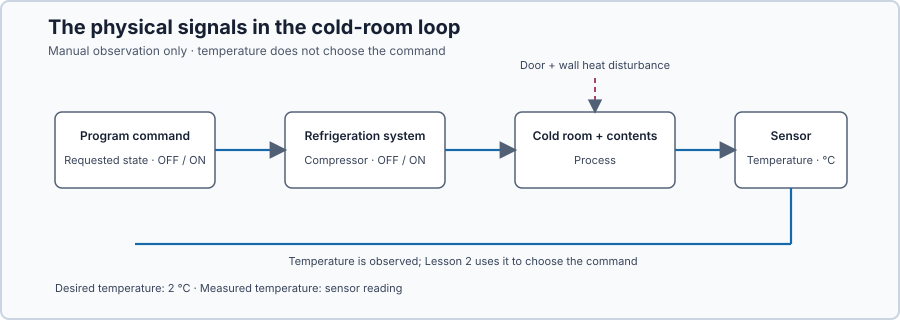
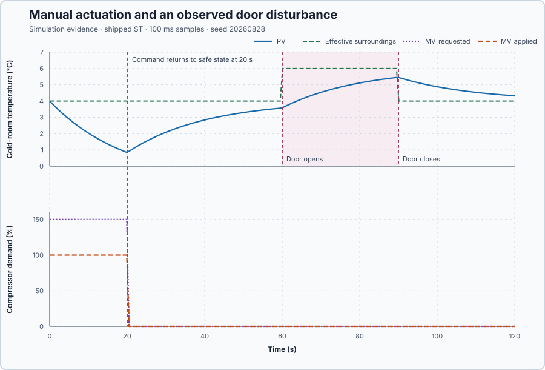

# Cold-storage loop anatomy

Course position: Lesson 1 of 84. Next lesson:
[ON/OFF control](../02-cold-storage-on-off/README.md).

**Lesson objective:** Identify every part of a control loop and use one bounded
manual experiment to determine the direction and delay of a cold room's
temperature response.

This lesson uses simulation. Its results are not food-safety, compressor, or
physical-plant qualification evidence.

## The problem

Cold-storage room refrigeration removes heat that enters through the walls and
an opened door. The compressor can be commanded from 0 percent, meaning no
cooling request, to 100 percent, meaning the largest cooling request represented
by this lesson. Stored food, shelving, walls, and air hold thermal energy. The
room temperature therefore changes gradually after the compressor command
changes; it cannot jump instantly to a new value.

The simulation exposes a door indication and an effective surrounding
temperature. These signals let the learner see when the heat load changes
instead of hiding that change inside the plant model.



The diagram separates the desired temperature, the measured temperature, the
operator's request, the bounded compressor command, and heat entering through
the door. These are different physical quantities even when a screen places
them beside one another.

Before choosing a controller, an engineer must know what must be controlled,
what can be changed, what is measured, which disturbances enter the equipment,
and which state is safe. This first lesson therefore uses manual actuation and
does not yet try to regulate temperature automatically.

## What we need

We need a clear map of the cold room, compressor, temperature sensor, desired temperature, measured temperature, heat loads, and safe command. We also need one bounded manual run that shows which way temperature moves and whether the response is immediate or delayed.

## The new idea

The **process** is the physical system whose behavior we want to influence. In
this lesson it is the cold room together with its stored contents.

The **actuator** is the physical device that changes the process. Here it is the
refrigeration compressor. The **sensor** is the device that measures the room
temperature.

The **setpoint (SP)** is the room temperature the operator wants. The **process
value (PV)** is the room temperature the sensor reports. Both are measured in
degrees Celsius (°C).

The **error (e)** says how far the measured temperature is from the desired
temperature. We define it as desired temperature minus measured temperature so
its sign has one consistent meaning: a positive error means the room is colder
than desired, while a negative error means it is warmer than desired. That
definition gives:

$e = SP - PV$

For the declared 2.0 °C setpoint and 4.0 °C initial process value:

$e = 2.0\,{}^\circ\mathrm{C} - 4.0\,{}^\circ\mathrm{C} = -2.0\,{}^\circ\mathrm{C}$

The room is therefore 2.0 °C warmer than desired. This first lesson records
that error but does not yet use it to command the compressor.

The **manipulated variable (MV)** is the compressor demand used to influence
temperature. The **requested manipulated variable ($MV_{\mathrm{requested}}$)**
is what the operator asks for. The **applied manipulated variable
($MV_{\mathrm{applied}}$)** is the bounded demand that the compressor path
actually receives. Both are measured in percent.

The simulated compressor accepts only the interval from 0 to 100 percent. A
request below 0 percent must therefore become 0 percent. A request between 0
and 100 percent can pass through unchanged. A request above 100 percent must
become 100 percent. The clamp equation is a compact way to write those three
physical cases:

$MV_{\mathrm{applied}} = \operatorname{clamp}\left(MV_{\mathrm{requested}}, 0\%, 100\%\right)$

For the reviewed 150 percent test request, the inner maximum keeps 150 rather
than 0, and the outer minimum chooses 100 rather than 150. The requested demand
is therefore 150 percent and the applied demand is 100 percent. This deliberately
out-of-range request reveals the simulated boundary; it is not permission to
exceed a real compressor's reviewed command range.

A **disturbance** affects room temperature but is not commanded by this control
path. Heat entering through the door and walls is the disturbance here.

The **door-open indication** is zero when the simulated door is closed and one
when it is open. It has no physical unit. The **effective surrounding
temperature** is the simplified thermal condition toward which the uncooled
room moves, measured in degrees Celsius (°C). It is 4.0 °C with the door closed
and 6.0 °C while the scheduled door load is active. This is a model input, not
an outdoor thermometer reading.

The **operating point** is the set of steady conditions before an experiment:
the room begins at 4.00 °C with 0.0 percent compressor demand. The **safe state**
for this simulated test is manual operation with the compressor command at
zero percent (0.0%). The lesson abort range is -10.0–10.0 °C; real food and compressor
protection must be designed independently.

This plant has **reverse process direction**: more compressor demand removes
more heat and produces a lower temperature. A heater has the opposite process
direction.

**Feedback** means returning a sensor measurement to a controller so the
controller can calculate a new command. This lesson observes the measurement;
a future lesson closes the feedback path automatically.

## Prediction

The requested compressor demand will be 150.0 percent. Because the compressor
can accept no more than 100.0 percent, predict an applied demand of 100.0
percent. Because the process direction is reverse, predict that the measured
temperature will fall. Because the room stores thermal energy, predict a
gradual fall rather than an instantaneous temperature jump.

At 60.0 seconds, predict that the door-open indication will change from zero to
one and the effective surrounding temperature will change from 4.0 °C to
6.0 °C. The compressor request will already be back at zero, so predict that
the measured room temperature will rise until the door closes at 90.0 seconds.

No response-speed formula is needed yet. Later modelling lessons will define
how to quantify the response shape after the learner has first observed it.

## Implementation

There is no automatic controller yet. The shipped Structured Text exposes the
manual request and applies the compressor's physical range:

```st
ManualDemand : LREAL := 0.0;
IF ExperimentEnabled THEN
    ExperimentScan := ExperimentScan + ULINT#1;
    IF ExperimentScan <= ULINT#200 THEN
        ManualDemand := LREAL#150.0;
    ELSE
        ManualDemand := LREAL#0.0;
    END_IF;
ELSE
    ExperimentScan := ULINT#0;
    ManualDemand := LREAL#0.0;
END_IF;
ManipulatedValue := MIN(MAX(ManualDemand, LREAL#0.0), LREAL#100.0);
```

Control Studio writes only the Boolean experiment authority at `%MX24.0`. The
project writes the scheduled operator request at `%ML8`. The applied command at
`%QL0` drives the simulator, and the measured temperature returns at `%IL0`.
The door-open indication returns at `%IL8`, and the effective surrounding
temperature returns at `%IL16`.

## Experiment in Control Studio

Use one 120.1-second recording from the declared initial state. Control Studio
writes only `P1.ExperimentEnabled`. The project requests 150 percent for the
first 20.0 seconds, restores the request to zero, and leaves it there while the
simulator opens the door from 60.0 through 90.0 seconds. Thus one synchronized
run shows both process direction and disturbance response. Completion restores
the authority false and both requested and applied demand to zero. The
deterministic Simulation seed is 20260828.

### Control Studio actions

1. **Monitor** — Start the **Simulator**, then open **truST sidebar → Control Studio → Monitor → Response**.
   - **Baseline check:** Wait until the header shows **Simulation**, **Running**, and current data. Confirm Cold-room air temperature (PV, degC) and Operator manual demand (MV, %), including units, limits, mode, and quality. Because this is an open-loop manual experiment, the Response view does not invent a closed-loop setpoint. Open **Monitor → Signals** and confirm Desired cold-room temperature = 2.0 °C, Applied compressor demand = 0 percent, Door-open indication = 0, and Effective surrounding temperature = 4.0 °C. The initial operating point is PV = 4 degC, requested MV = 0 %, and applied MV = 0 %. The unresolved baseline problem is: Watching temperature without changing compressor demand reveals the process but cannot regulate it.
   - **Decision before action:** Read **Prediction** above, then state what should move first and in which direction. Use this decision rule: Apply one bounded cooling interval, return the compressor demand to its safe zero state, then observe the scheduled door disturbance without automatic correction.
   - **Successful evidence:** The Response plot advances, the displayed values are finite and current, and **Start recording** is enabled. Select **Start recording** only after those conditions are visible.
   - **Recovery:** If recording is disabled or the plot reports unavailable or stale samples, stop the Simulator, correct the displayed runtime or binding problem, restart it, and repeat the baseline check.
   - **Record:** Write down SP = 2.0 °C, PV = 4.0 °C, requested and applied demand = 0 percent, experiment authority false, and the predictions above. Select **Start recording** for the complete run.

2. **Test** — Open **truST sidebar → Control Studio → Test**.
   - **Baseline check:** Confirm **Experiment** = **Observe without excitation**, **Amplitude** = **0** (disabled), and **Maximum duration (s)** = **120.1**. The reviewed authority is **Experiment authority** (`P1.ExperimentEnabled`). Its false-to-true transition starts the project-owned 150-percent request for 20.0 seconds; the project then restores demand to zero before the simulator-owned door event.
   - **Decision before action:** Before selecting **Review test**, state the calculated result: requested demand will become 150 percent, applied demand must stop at 100 percent, and PV must fall gradually. After restoration, predict PV recovery and then a rise during the 60.0–90.0-second door event.
   - **Successful evidence:** Select **Review test**, verify **P1.ExperimentEnabled**, the 120.1-second timeout, stop conditions, and false restoration, then select **Confirm and start**. During **Running**, confirm requested demand = 150 percent and applied demand = 100 percent for the first 20.0 seconds, then both zero. Confirm the door indication and effective surroundings change only during their scheduled interval. Completion restores authority false and both demand signals to zero. Keep **Abort test** visible.
   - **Recovery:** Select **Abort test** if the test is rejected, stale, unsafe, unavailable, failed, or aborted. Read the displayed reason, verify experiment authority false and both demand signals zero, restart the Simulator, and repeat the baseline check before reviewing a new test.
   - **Record:** Retain the one complete recording, the cooling endpoint, recovery change, door-load rise, terminal state, restoration result, and seed **20260828**.

## Evidence and decision

### Measures and comparison

The retained plot comes from the shipped Structured Text and simulator. The
upper panel shows the gradual temperature response together with the effective
surrounding temperature and door-open interval. The lower panel shows why the
operator's request and the compressor's applied command must be recorded
separately.



The **cooling endpoint** is the process value at 20.0 seconds, immediately
before restoration. It must be at or below 1.50 °C. The **recovery change** is
the process value at 40.0 seconds minus the cooling endpoint. It must be at
least 1.50 °C. The **door-load rise** is the process value at 89.9 seconds minus
the process value at 59.9 seconds; it must be at least 1.50 °C. Each temperature
criterion permits a 0.05 °C numerical tolerance for sampled simulation
comparison. These endpoint measures establish direction, visible delay, and
the failure of observation-only operation to reject a load; they are not
settling or identified-model measures.

| Evidence | Requirement | Recorded result |
| --- | ---: | ---: |
| Requested demand during cooling | 150.0% | 150.0% |
| Applied demand during cooling | 100.0% | 100.0% |
| Cooling endpoint at 20.0 s | ≤ 1.50 °C | 0.84 °C |
| Recovery change by 40.0 s | ≥ 1.50 °C | 2.00 °C |
| Door-open indication, 60.0–89.9 s | exactly 1 | 1 |
| Effective surroundings, 60.0–89.9 s | 6.0 °C | 6.0 °C |
| Door-load rise, 59.9–89.9 s | ≥ 1.50 °C | 1.89 °C |

### Validation

Compare the two recordings with the predeclared measures above. Confirm that
every value is finite, applied demand remains inside 0.0–100.0 percent,
temperature moves downward while cooling is applied, temperature rises after
restoration and during the open-door load, the door and effective-surroundings
signals change at the declared times, and each run ends with both requested and
applied demand at the 0.0 percent safe state. Reject a recording if any
condition fails; do not infer process direction or load response from invalid
evidence. Shared PID validation is intentionally absent because Lesson 1 has no
PID controller or controller candidate.

## Conclusion

The 150.0 percent request and 100.0 percent applied command prove that an
operator request is not necessarily the plant input. Temperature moves down
rather than up, proving reverse process direction. Its gradual movement shows
that stored thermal energy delays the visible response. When the door
indication changes, temperature rises toward the changed thermal condition.
Nothing in this manual program compares SP with PV to correct error, so it
observes but cannot reject that disturbance or regulate the room.

## Reason for the next lesson

The manual experiment established which signal changes the room and which way
temperature moves, but the operator did not continuously compare SP with PV.
The door load therefore warmed the room without any automatic correction.
Lesson 2 keeps the same cold room and the same 60.0–90.0 second door
disturbance, then uses measured temperature to switch the compressor
automatically. That lets the learner compare manual drift with feedback under
equivalent conditions.
