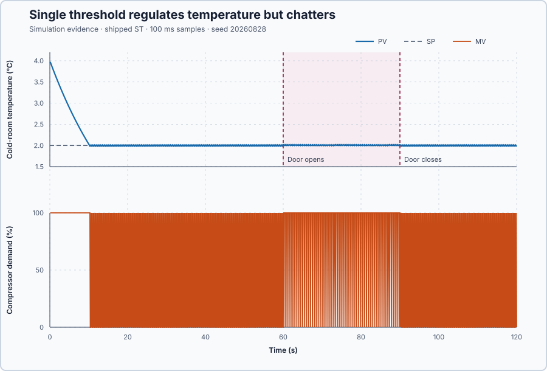

# 2. ON/OFF control

In this lesson, you will use the measured room temperature to switch refrigeration ON when the room is too warm and OFF when it is cold enough. You will then observe why using the same temperature for both decisions makes refrigeration switch too often.

## The problem

Lesson 1 showed that switching refrigeration ON lowers the measured room temperature: from 4.00 °C to 0.84 °C in 20 s. But the refrigeration followed a fixed sequence. While the door was open, the room warmed from 3.57 °C to 5.46 °C and the command stayed OFF: it could not switch ON by itself when the room became too warm.

We will replace that sequence with an automatic decision based on the measured temperature.

## What we need

The program must repeatedly compare:

1. the temperature we want; and
2. the temperature we measure.

It must use the result to choose refrigeration OFF or ON.

## The new idea

An **ON/OFF controller** looks at the measurement and switches the actuator fully on or fully off. Using the measurement to choose the next command is called **feedback**. Here the measured temperature decides whether refrigeration runs or stops.

**In words.** The setpoint is 2 °C. Above it, refrigeration must run to remove heat and lower the temperature. Below it, refrigeration stops, so that heat entering the room can raise the temperature again:

| Measured room temperature | Refrigeration |
| --- | --- |
| Below 2 °C | OFF |
| At or above 2 °C | ON |

At exactly 2 °C, the program must still choose one state; this rule chooses ON. In PLC terms, it is one comparison executed in every scan, like a room thermostat.

Because the program repeats the comparison, the measured temperature now determines the next refrigeration command: the effect of each command is measured and used to choose the next one. Follow the repeated decision:

1. Above 2 °C, refrigeration switches ON and removes heat.
2. The measured temperature falls below 2 °C, so refrigeration switches OFF.
3. Heat entering the room raises the temperature above 2 °C, so refrigeration switches ON again.

**The formula.** Writing $u$ for the refrigeration command:

$$
u =
\begin{cases}
100\%, & PV \ge SP,\\
0\%, & PV < SP.
\end{cases}
$$

- $u$ is the command, in percent of the 0–100 % actuator scale;
- $PV$ is the measured temperature and $SP$ the setpoint, both in °C; the comparison itself has no unit.

**Example.** At the start, $PV = 4.0$ °C and $SP = 2.0$ °C: $4.0 \ge 2.0$, so $u = 100\%$, ON. At $PV = 1.9$ °C, $1.9 < 2.0$, so $u = 0\%$, OFF. At exactly $PV = 2.0$ °C, the $\ge$ makes it ON.

**The limitation.** The room temperature changes gradually, because the room and its contents store thermal energy, but the command does not: the program compares every 0.1 s and can reverse the command whenever a new reading crosses 2 °C. Readings of 2.01 °C, 1.99 °C and 2.01 °C give ON, OFF and ON, although the temperature has barely changed. Repeated rapid switching around one boundary is called **chatter**. A retained run with 760 state changes in 120 s averages 760/120 = 6.33 changes per second. That average describes this simulated trace, not a compressor rating; the individual 0.1 s intervals are the actual timing problem the next lesson addresses.

## Prediction

Before running, answer these questions:

1. The measured temperature starts at 4 °C. Will refrigeration switch OFF or ON?
2. What will happen to the command after the measured temperature falls below 2 °C?
3. When the door opens and more heat enters, will the program switch refrigeration without an operator?
4. Near 2 °C, how will the gradual temperature movement differ from the command movement?

## Implementation

Open [`src/Main.st`](src/Main.st) and locate the temperature comparison.

**ST practice.** Write the switching decision using `MeasuredTemperatureC >= SetpointC`. `>=` includes equality. An `IF` statement executes its `THEN` branch when the condition is true and its `ELSE` branch otherwise:

```st
IF MeasuredTemperatureC >= SetpointC THEN
    RefrigerationOn := TRUE;
ELSE
    RefrigerationOn := FALSE;
END_IF;
```

Translate the Boolean result to the project’s OFF/ON command. Check measurements 4.0, 2.0 and 1.9 °C before the experiment. Then explain the command sequence for 2.01, 1.99 and 2.01 °C. The program evaluates the decision every scan, here every 0.1 s; the thermal process continues between scans.

## Experiment in Control Studio

1. Open this lesson's project and start **Simulator**. In the **truST** side bar, select **Control Studio**. On **Identify**, choose **Project experiment** from **Method**. **Signals** already shows `P1.Setpoint · Setpoint (°C)`, `P1.ProcessValue · Process value (°C)` and `P1.ManipulatedValue · Applied output (%)`, the refrigeration command; add `P1.DoorOpenIndication · state (1)` and `P1.SwitchCount · state (1)`, the number of command changes. As in Lesson 1, command 0 means OFF and 100 means ON.
2. Confirm temperature setpoint 2 °C, measured temperature 4 °C, refrigeration OFF, door closed, and `P1.ExperimentEnabled` false. False means the automatic switching rule is not yet enabled.
3. Answer the prediction questions before starting; **Confirm and start** begins the experiment recording.
4. Stay on **Identify** with **Project experiment** selected.
5. Select **Review project test** and check the declared **120.1 s** duration to observe the cooldown, repeated switching, and door disturbance. All times are measured from **Confirm and start**, when automatic control is enabled.
6. Read the reviewed plan. Starting will enable the temperature-based switching rule; ending the experiment will disable it and switch refrigeration OFF. Leave the temperature setpoint at 2 °C throughout.
7. Select **Confirm and start**. Watch the first cooldown and the repeated switching around 2 °C. The experiment opens the door from 60 to 90 s. Keep the setpoint unchanged and observe the resulting temperature and command.
8. At completion, Control Studio shows **Project test completed. Outputs restored.** Confirm `P1.ExperimentEnabled` false, automatic control disabled, and refrigeration OFF. Temperature may continue changing after the command is OFF.

If measured temperature leaves −10 to 10 °C, select **Abort test** yourself; this is a supervised exercise check, not an automatic product-safety trip. Use the same button to end the experiment early, and confirm refrigeration is OFF. Stop the simulator with the debug toolbar's **Stop** button if it is unresponsive.

To repeat, stop and restart the simulator so the room begins at 4 °C again. Use the same initial state, setpoint and door-opening interval for a fair comparison.

## Evidence and decision



The numbered marks answer the predictions with the same numbers; the lower two plots zoom into 30–31 s. The [retained simulation data](figures/on-off-response.csv) answers the predictions:

- refrigeration initially switches ON because the starting temperature, 4 °C, is above 2 °C;
- refrigeration switches OFF when the measured temperature falls below 2 °C;
- the program responds automatically when the open door adds heat; and
- the temperature changes gradually while the command rapidly reverses.

The program now responds to the measured temperature without an operator, so the automatic decision works. However, the command changes state 760 times during the retained 120 s run. Compare your count and the command trace with this recorded case; the relevant behavior is rapid switching around the single boundary. A physical compressor needs time between stops and starts, so this switching rule is not suitable for one.

## Conclusion

Feedback lets the program use the measured result to choose the next command. Here, the measured temperature automatically switches refrigeration OFF or ON, but using one switching temperature causes chatter.

## Check yourself

1. **The measured temperature reads 2.0 °C exactly. Which command does the rule give, and why?**
   ON (100%). The rule switches ON when PV ≥ SP, and 2.0 ≥ 2.0 is true.
2. **The door opened from 60 to 90 s, but the temperature stayed near 2 °C. What kept it there?**
   Feedback: as soon as the extra heat pushed the reading above 2 °C, the program switched refrigeration ON, without
   an operator.
3. **The run made 760 command changes in 120 s. How many is that per second on average, and why so many?**
   760/120 = 6.33 per second. With one switching temperature, every tiny crossing of 2 °C reverses the command at the
   next 0.1 s update.

## Reason for the next lesson

Small temperature changes across 2 °C should not immediately reverse the refrigeration command. The equipment may also need to remain OFF or ON for a minimum time before changing state again.

[Hysteresis and minimum state times](../03-cold-storage-hysteresis-dwell/README.md) solves these problems by using separate temperatures for switching ON and OFF and by requiring a minimum time in each state.
