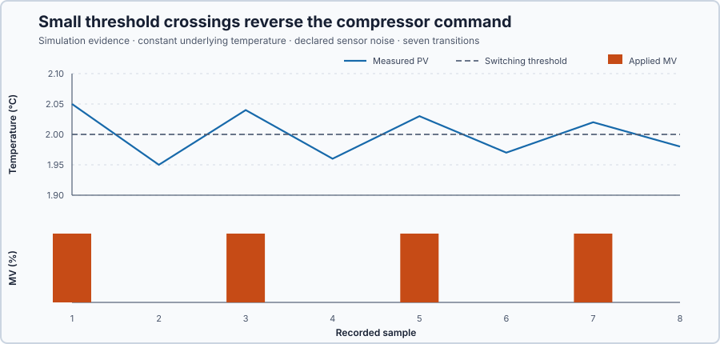

# Cold-storage ON/OFF control

Course position: Lesson 2 of 84. Previous lesson: [Loop anatomy](../01-cold-storage-loop-anatomy/README.md). Next lesson: [Hysteresis and dwell protection](../03-cold-storage-hysteresis-dwell/README.md).

**Lesson objective:** Derive a Boolean ON/OFF law, run it on the cold-storage room, measure temperature range and switch count, and explain why one noisy threshold causes chatter.

**Evidence class:** Simulation evidence. The intentionally unprotected
switching law and its results are not compressor, food-safety, or
physical-plant qualification evidence.

## The problem

The same cold-storage room refrigeration plant from Lesson 1 gains heat through its walls and an opened
door. Its refrigeration compressor is a binary actuator: it has two physical
states, off and on. In this lesson, off means 0 percent compressor demand and
on means 100 percent compressor demand. A real compressor also needs separate
pressure, temperature, overload, and restart protection; this teaching
controller does not replace those safeguards.

Lesson 1 showed that observing temperature is not regulation. With manual
demand returned to zero, the 60.0-to-90.0-second door load raised the measured
temperature by 1.89 °C. The room now needs feedback that can choose the
compressor state automatically. We begin with one switching threshold so that
both its useful regulation and its equipment-wear problem are visible.

## What we need

We need the measured room temperature to switch the binary compressor automatically. The rule must say exactly when cooling is on, when it is off, and what happens at the threshold so that its limitations can be measured rather than hidden.

## The new idea

The process value ($PV$) is the cold-room temperature measured and reported by
the sensor, in degrees Celsius. The setpoint ($SP$) is the desired cold-room
temperature, also in degrees Celsius. The manipulated variable ($MV$) is the
applied compressor demand. Because this actuator is binary, its only values are 0 percent and
100 percent.

A switching threshold is the temperature at which the controller changes the
compressor state. This lesson uses the setpoint as its only threshold. A
Boolean control law is a decision whose result is either true or false. Here,
true means cooling is requested and false means cooling is not requested.

The control direction states how the controller output must react when the
measured temperature changes. When the measured temperature rises to or above
the desired temperature, the controller must increase compressor demand. The
compressor then removes heat, so increasing its demand drives temperature
downward. In words, the law is:

> Request cooling when the measured temperature is at or above the desired
> temperature. Otherwise request no cooling.

Only after those quantities and the decision have been defined can the law be
written compactly:

`RequestedCooling := ProcessValue >= Setpoint`

Steady cycling is repeated temperature movement above and below a switching
threshold after the initial response has passed. With only one threshold,
temperature falling just below the setpoint turns cooling off. The room then
warms just above the setpoint and turns cooling on again. The stored thermal
energy and sampled decision therefore produce cycling instead of convergence
to one exact constant temperature.

Switching frequency is the number of output changes per unit of time. Chatter
is rapid repeated switching caused by small movements or
measurement noise around one threshold. A compressor may regulate temperature
while still switching far too often for acceptable equipment life.

We need two measures to separate temperature regulation from switching effort.
The maximum process value ($PV_{\mathrm{max}}$) is the highest measured
temperature in a declared window, and the minimum process value
($PV_{\mathrm{min}}$) is the lowest. Both are measured in degrees Celsius. The
temperature range ($PV_{\mathrm{range}}$) is the distance between them, so its
definition is maximum minus minimum:

$PV_{\mathrm{range}} = PV_{\mathrm{max}} - PV_{\mathrm{min}}$

Subtraction is used because a range is the distance from the lowest observed
value to the highest. For example, if a window contains a highest temperature
of 2.40 °C and a lowest temperature of 1.90 °C, then
$PV_{\mathrm{range}} = 2.40 - 1.90 = 0.50$ °C. The two temperatures have the
same unit, so their difference is also a temperature difference in degrees
Celsius.

The number of compressor transitions in a window ($N_{\mathrm{switch}}$) has no
physical unit. The window duration ($T_{\mathrm{window}}$) is measured in
seconds. Dividing transitions by seconds gives the switching frequency
($f_{\mathrm{switch}}$), measured in transitions per second:

$f_{\mathrm{switch}} = N_{\mathrm{switch}} / T_{\mathrm{window}}$

For example, suppose a count rises from 10 to 26 between 12.0 and 20.0
seconds. The number of changes in that window is `26 - 10 = 16`, and the
window duration is `20.0 s - 12.0 s = 8.0 s`. Substitution gives
`f_switch = 16 transitions / 8.0 s = 2.00 transitions/s`. Dividing a
transition count by seconds is why the result has the unit transitions per
second. This rate describes command changes; it is not a
manufacturer-approved compressor start rate.

## Prediction

Suppose the underlying room temperature remains exactly 2.00 °C while a
controlled sensor-input experiment adds the listed measurement noise. The
measured temperature is the underlying temperature plus that noise. Before
running the controller, apply the verbal rule to these eight measured samples:

| Sample | Underlying temperature | Measurement noise | Measured temperature | Predicted compressor demand |
| ---: | ---: | ---: | ---: | ---: |
| 1 | 2.00 °C | +0.05 °C | 2.05 °C | 100% |
| 2 | 2.00 °C | −0.05 °C | 1.95 °C | 0% |
| 3 | 2.00 °C | +0.04 °C | 2.04 °C | 100% |
| 4 | 2.00 °C | −0.04 °C | 1.96 °C | 0% |
| 5 | 2.00 °C | +0.03 °C | 2.03 °C | 100% |
| 6 | 2.00 °C | −0.03 °C | 1.97 °C | 0% |
| 7 | 2.00 °C | +0.02 °C | 2.02 °C | 100% |
| 8 | 2.00 °C | −0.02 °C | 1.98 °C | 0% |

The first sample establishes the initial output; it cannot yet be called a
transition because there is no preceding output to compare with it. Each of
the next seven samples lies on the opposite side of the threshold from its
predecessor. The eight samples therefore contain seven threshold crossings and
produce seven output transitions. The temperature changes are only a few
hundredths of a degree, but the compressor command reverses on every subsequent
sample.

## Implementation

The shipped Structured Text starts with automatic mode disabled. The complete
decision that runs is short enough to show here, including the safe mode path:

```st
IF AutoMode THEN
    RequestedCooling := ProcessValue >= Setpoint;
ELSE
    RequestedCooling := FALSE;
END_IF;

IF RequestedCooling <> CoolingEnabled THEN
    CoolingEnabled := RequestedCooling;
    SwitchCount := SwitchCount + DINT#1;
END_IF;

IF CoolingEnabled THEN
    ManipulatedValue := LREAL#100.0;
ELSE
    ManipulatedValue := LREAL#0.0;
END_IF;
```

The shipped configuration binds the mode and plant-facing signals explicitly:

```st
P1.ExperimentEnabled AT %MX16.2 : BOOL;
P1.ManipulatedValue AT %QL0 : LREAL;
P1.ProcessValue AT %IL0 : LREAL;
```

`ProcessValue` is mapped to `%IL0`, `Setpoint` to `%ML0`, experiment authority
to `%MX16.2`, the applied `ManipulatedValue` to `%QL0`, and `SwitchCount` to
`%MD24`. The simulated door-open indication is mapped to `%IL8`, and the
effective surrounding temperature is mapped to `%IL16`.

## Experiment in Control Studio

This procedure enables the shipped single-threshold law for one 120-second
Simulation run. Control Studio writes only `P1.ExperimentEnabled`; the project
derives Auto mode and owns the scheduled door event. Completion restores the
authority false and therefore restores Manual zero. The
deterministic seed is 20260828.

### Control Studio actions

1. **Monitor** — Select target **Simulator**, choose **Run**, then open **Control Studio → Monitor → Response**.
   - **Baseline check:** Wait until the header shows **Simulation**, **Running**, and current data. Confirm Cold-room temperature setpoint (SP, degC); Cold-room air temperature (PV, degC); Compressor demand (MV, %), including units, limits, mode, and quality. The initial operating point is PV = 4 degC, MV = 0 %. The unresolved baseline problem is: Manual observation from Lesson 1 cannot regulate temperature after an unplanned load change.
   - **Decision before action:** Read **Prediction** above, then state what should move first and in which direction. Use this decision rule: Command 100% cooling when PV is at or above SP and 0% otherwise. This is the rule to use because it keeps the compressor demand a direct, uncomplicated function of the measured error.
   - **Successful evidence:** The Response plot advances, the displayed values are finite and current, and **Start recording** is enabled. Select **Start recording** only after those conditions are visible.
   - **Recovery:** If recording is disabled or the plot reports unavailable or stale samples, stop the Simulator, correct the displayed runtime or binding problem, restart it, and repeat the baseline check.
   - **Record:** Write down the initial SP, PV, requested/applied MV where available, controller mode, and your predicted response before opening Test.

2. **Test** — Restart the **Simulator** from the declared initial state, then open **truST sidebar → Control Studio → Test**.
   - **Baseline check:** Confirm **Experiment** = **Observe without excitation**, **Amplitude** = **0** (disabled), and **Maximum duration (s)** = **120.1**. The reviewed authority is **Experiment authority** (`P1.ExperimentEnabled`). Control Studio sets it true; the project derives Auto mode, and the project and simulator own the single-threshold decisions and door event.
   - **Decision before action:** Before selecting **Review test**, predict that AutoMode will enable the Boolean law, the door will open at simulator time 60 s and close at 90 s, and small threshold crossings will repeatedly reverse compressor demand. Confirm the limits are Cold-room air temperature -10 degC to 10 degC and Compressor demand 0 % to 100 %.
   - **Successful evidence:** Select **Review test**, verify **P1.ExperimentEnabled**, the 120.1-second timeout, stop conditions, and false restoration, then select **Confirm and start**. The state changes to **Running**, **Abort test** remains available, the project derives Auto enabled, and the terminal state reports completion with experiment authority false, Auto false, and compressor demand restored to 0 percent.
   - **Recovery:** For a rejected, stale, unsafe, unavailable, failed, or aborted state, read the displayed reason, stop and restart the Simulator, correct that cause, restore the initial state, and review a new test. At the end of the run, disable Auto, confirm 0 percent compressor demand, and retain that safe restoration state.
   - **Record:** Compare the observed event with your prediction and retain the terminal state, restoration result, and deterministic seed **20260828**.

## Evidence and decision

Use the temperature-range and switching-frequency definitions established
before the experiment. The switch count includes applied compressor-demand
changes, not sensor samples that leave the output unchanged.

**Validity prerequisite:** the run is eligible only when SP, PV, MV, switch
count, and event signals are finite and synchronized; Auto remains enabled for
the declared 0.1-to-120.0-second experiment; MV is always 0 or 100 percent; the
complete door event is observed; and the seed, sample interval, plant, initial
state, limits, and duration match the declared experiment. A measure whose
signal or window fails this prerequisite is reported as `Invalid`, not as a
number. The separate safe-restoration sample is checked after the experiment
and is not included in its performance windows.

**Decision direction:** lower temperature range is preferred only while the
maximum-temperature constraint remains satisfied. Lower transition count and
lower switching frequency are preferred because they demand fewer compressor
state changes. This simulation lesson claims no physical compressor acceptance
threshold: manufacturer limits and the reviewed equipment topology are not
available. It therefore separates a numerically valid result from physical
acceptance instead of calling the result safe or unsafe for real equipment.

The door-event range uses 60.0–89.9 seconds and must be no more than 0.05 °C
with 0.01 °C tolerance: five times the sensor's declared 0.01 °C resolution,
tight enough to prove regulation rather than sensor rounding. Maximum
temperature uses the same window and must be no more than 3.00 °C with
0.05 °C tolerance, a design choice comfortably above the 1.89 °C open-loop
rise Lesson 1 measured with no control, so a compliant run must still
outperform that uncontrolled case by a clear margin. Switch count uses 0.1–120.0 seconds.
Switching frequency uses 20.0–60.0 seconds. The controlled sensor-input result
uses the eight declared noise values and requires exactly seven transitions.
All of these windows, limits, and directions are declared before viewing the
retained values.

The full-run figure is generated from the shipped Structured Text and plant
simulator. It shows that automatic feedback holds temperature near the
setpoint during the door load, while the lower panel exposes the repeated
compressor switching used to do it.


The retained count rises from 78 to 398 during the 40.0-second frequency
window. Therefore, `398 - 78 = 320` transitions occurred, while
`60.0 s - 20.0 s = 40.0 s` elapsed. Substituting those two measured
differences gives:

`f_switch = (398 - 78) transitions / (60.0 s - 20.0 s) = 320 transitions / 40.0 s = 8.00 transitions/s`

The unrounded door-window temperatures are 2.019948 °C maximum and 1.995103 °C
minimum. Their difference is 0.024845 °C. The table displays that result to
the sensor's two-decimal resolution as 0.02 °C; the acceptance decision uses
the unrounded retained samples, not the displayed rounding.

| Run status | Door-event temperature range | Maximum door-event temperature | Complete-run switch count | Pre-door switching frequency | Controlled noise transitions |
| --- | ---: | ---: | ---: | ---: | ---: |
| Numerically valid; physical acceptance not established | 0.02 °C | 2.02 °C | 760 transitions | 8.00 transitions/s | 7 transitions |

The focused crossing evidence holds the underlying temperature constant and
makes the isolated measurement-noise mechanism readable at its actual values:



From the retained recording, confirm that every temperature is finite, compressor demand is
always exactly 0 or 100 percent, door indication and effective surroundings
change at the declared event boundaries, and the temperature remains inside
the −10.00-to-10.00 °C abort range. Verify the separate 3.00 °C door-event
performance criterion and reproduce every reported measure from the retained
CSV samples. Confirm that the retained final row has Auto disabled, the phase
`safe_restoration`, and 0 percent demand. The 0.02 °C range is good temperature
regulation, but it does not establish whether 760 transitions are acceptable
for a real compressor.

## Conclusion

Feedback solves the limitation observed in Lesson 1: when temperature rises,
the controller turns cooling on without waiting for an operator. But a single
threshold provides no separation between the temperature that turns the
compressor on and the temperature that turns it off. Each small crossing can
therefore reverse the command. The full plant run shows sampled threshold
cycling without injected sensor noise; the separate controlled input experiment
proves that small measurement noise alone can also cause seven reversals while
the underlying temperature is constant. The controller regulates a narrow
temperature band while producing severe chatter, so temperature accuracy and
equipment protection must be evaluated separately.

## Reason for the next lesson

The unresolved problem is excessive switching. Lesson 3 repeats this cold-room
experiment and the same door event while adding separate on and off thresholds,
then minimum on-time and minimum off-time. It will compare temperature range,
starts, and shortest state durations to determine how equipment protection
changes the result.
