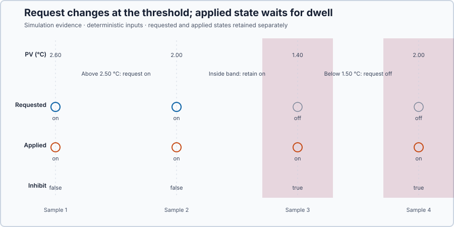

# Cold-storage hysteresis and dwell protection

Course position: Lesson 3 of 84. Previous lesson: [ON/OFF control](../02-cold-storage-on-off/README.md). Next lesson: [Proportional control](../04-water-heater-p/README.md).

**Lesson objective:** Compare single threshold, hysteresis, and dwell protection
on the same cold-storage room, then select the simplest configuration that
meets the common temperature and transition criteria, while separately proving
whether the dwell candidate enforces its declared minimum durations.

All retained results in this lesson are **Simulation evidence**. They are not
compressor-life, food-safety, or physical-plant qualification evidence.

## The problem

This cold-storage room refrigeration system uses the same room, compressor,
temperature sensor, and door disturbance as Lessons 1 and 2. The setpoint ($SP$)
is the desired cold-room air temperature, measured in degrees Celsius. The
process value ($PV$) is the air
temperature measured by the sensor, also in degrees Celsius. The manipulated
variable ($MV$) is the applied compressor demand: 0 percent means off and 100
percent means on. The compressor is a one-sided binary actuator; it can remove
heat while running but cannot actively heat the room.

The simulated room starts at 4.00 °C. Its temperature setpoint is 2.00 °C. The
door opens at 60.0 seconds, changes the no-cooling equilibrium from 4.00 °C to
6.00 °C, and closes at 90.0 seconds. The controller runs every 0.10 seconds.
The −10.00-to-10.00 °C range is the experiment abort boundary. The separate
door-event performance criterion is a maximum temperature of 3.00 °C with
0.05 °C tolerance.

Lesson 2 regulated the same room with one switching threshold. Its executable
120-second run retained **760 applied compressor transitions**, including the
initial safe-off to on transition, and measured **8.00 transitions per second**
before the door opened. A separate controlled sensor-input experiment also
showed seven command reversals from eight small noisy threshold crossings.

That is the problem this lesson must solve. A real compressor should not be
commanded to start and stop rapidly, but simply slowing every command can let
temperature move too far. We therefore need one mechanism to reject small
threshold crossings and a separate mechanism to enforce equipment timing.

## What we need

We need to stop measurement noise from toggling the compressor at one threshold and prevent rapid reversals that damage real equipment. The room must still remain inside its temperature requirement while the compressor receives enough off-time and run-time protection.

## The new idea

The upper switching threshold ($T_{\mathrm{on}}$) is the measured temperature at which the
controller starts cooling, in degrees Celsius. The lower switching threshold
($T_{\mathrm{off}}$) is the measured temperature at which the controller stops cooling, in
degrees Celsius. The hysteresis width ($H$) is the distance between those two
thresholds, in degrees Celsius.

Because width is the distance from the lower boundary to the upper boundary,
it is upper minus lower:

$H = T_{\mathrm{on}} - T_{\mathrm{off}}$

This lesson centers that band on the setpoint. Centered means the setpoint is
the midpoint, so half of the total width lies above it and half lies below it.
The distance from the midpoint to either boundary is therefore $H / 2$. Adding
that distance gives the upper threshold; subtracting it gives the lower:

$T_{\mathrm{on}} = SP + H / 2$

$T_{\mathrm{off}} = SP - H / 2$

Subtracting the second equation from the first returns
`T_on - T_off = H`, which checks that the two derived boundaries really have
the declared width.

State memory means that the controller retains its requested cooling state
while the measured temperature remains between the two thresholds. It does not
make a new on/off choice at the setpoint on every scan. The requested cooling
state ($Cooling_{\mathrm{requested}}$) is the state selected by the thresholds and that
memory. It is either off or on.

The complete threshold rule has three regions. At or above $T_{\mathrm{on}}$,
request cooling on. At or below $T_{\mathrm{off}}$, request cooling off. Between
the thresholds, leave the previous request unchanged. Inclusive comparisons at
the two boundaries make equality deterministic; the retained middle region is
what prevents repeated decisions at the setpoint.

A limit cycle is the repeated temperature rise and fall produced when a binary
actuator alternates between its two physical states. Hysteresis deliberately
permits a wider limit cycle in exchange for fewer threshold reversals. It does
not make a binary compressor hold one exact temperature.

Minimum on-time ($t_{\mathrm{on\,min}}$) is the number of seconds the compressor must remain
on before it may be switched off. Minimum off-time ($t_{\mathrm{off\,min}}$) is the number of
seconds it must remain off before it may be switched on. These are equipment-
protection constraints, not temperature thresholds.

The controller executes once per task interval, $T_s = 0.10$ s. After $n$
completed scans in the current applied state, elapsed dwell time is
$t_{\mathrm{dwell}} = n T_s$. A reversal may be applied only when
$t_{\mathrm{dwell}} \ge t_{\mathrm{on\,min}}$ for an on state or
$t_{\mathrm{dwell}} \ge t_{\mathrm{off\,min}}$ for an off state. With either
minimum set to 8.00 s, `8.00 s / 0.10 s = 80 scans`. An opposite request that
arrives before scan 80 is postponed; at scan 80 or later it may be applied.
The lesson qualifies the initial safe-off dwell so the first cooling request
can act immediately. Every later reversal must earn its full dwell time.

The applied cooling state ($Cooling_{\mathrm{applied}}$) is the state actually sent to the
compressor after dwell protection. Dwell inhibit means the requested state has
changed but cannot yet be applied because the current on-time or off-time is
too short. During an inhibited interval, $Cooling_{\mathrm{requested}}$ and
$Cooling_{\mathrm{applied}}$ are intentionally different. Both states must
therefore be retained and shown;
hiding one would hide the protection action.

The sequence is:

```text
measured temperature
        |
        v
upper/lower thresholds + state memory
        |
        v
requested cooling state
        |
        v
minimum on/off dwell constraint
        |
        v
applied cooling state -> 0% or 100% compressor demand
```

We need four measures to compare the candidates without confusing temperature
performance with equipment activity. For a declared sample window, let
$PV_{\mathrm{max}}$ be its highest temperature and $PV_{\mathrm{min}}$ its
lowest. Their distance is the temperature range:

$PV_{\mathrm{range}} = PV_{\mathrm{max}} - PV_{\mathrm{min}}$

For each retained sample $k$, define $I_{\mathrm{switch}}[k]$ as 1 when the
applied cooling state differs from the preceding applied state and 0 otherwise.
Adding those indicators gives transition count:

$N_{\mathrm{switch}} = \sum I_{\mathrm{switch}}[k]$

The comparison begins from a declared safe-off state, so the first safe-off to
applied-on change counts as a transition. Lower $N_{\mathrm{switch}}$ means
fewer commanded compressor state changes.

A completed on or off interval begins at sample $k_{\mathrm{start}}$ and ends
when the applied state changes at sample $k_{\mathrm{end}}$. Its duration is
the number of completed task intervals multiplied by the task interval:

$t_{\mathrm{on}} = (k_{\mathrm{end}} - k_{\mathrm{start}}) T_s$

$t_{\mathrm{off}} = (k_{\mathrm{end}} - k_{\mathrm{start}}) T_s$

Taking the smallest completed $t_{\mathrm{on}}$ and $t_{\mathrm{off}}$ checks
the two dwell requirements. An incomplete interval at the end of a run is not
used because its true ending time was never observed.

Finally, define $I_{\mathrm{inhibit}}[k]$ as 1 only when dwell inhibit is true
and requested cooling differs from applied cooling. The inhibited-sample count
is $N_{\mathrm{inhibit}} = \sum I_{\mathrm{inhibit}}[k]$. A value above zero
proves that dwell protection actually postponed at least one requested
reversal; a configured dwell value alone does not prove that the mechanism
acted.

Before running anything, declare the comparison rule. A candidate is eligible
only if its door-event maximum is at most 3.00 °C with 0.05 °C tolerance, its
door-event range is at most 1.30 °C with 0.01 °C tolerance, and it makes at
most 12 applied transitions. The dwell candidate has an additional mechanism
check: its shortest completed on and off intervals must each be at least
8.00 s with 0.001 s tolerance, and $N_{\mathrm{inhibit}}$ must be at least 1.
Among eligible candidates, choose the least complex; use fewer transitions and
then smaller temperature range only to break a tie in complexity. Declaring
this order now prevents the observed result from changing the selection rule.

## Prediction

For this lesson, the setpoint is 2.00 °C and the hysteresis width is 1.00 °C.
The predicted upper threshold is:

$T_{\mathrm{on}} = 2.00 {}^\circ\mathrm{C} + 1.00 {}^\circ\mathrm{C} / 2 = 2.50 {}^\circ\mathrm{C}$

The predicted lower threshold is:

$T_{\mathrm{off}} = 2.00 {}^\circ\mathrm{C} - 1.00 {}^\circ\mathrm{C} / 2 = 1.50 {}^\circ\mathrm{C}$

Starting from an off state, a measured temperature of 2.00 °C lies inside the
band and retains the off request. A later value of 2.60 °C requests cooling on.
When PV returns to 2.00 °C, it is again inside the band, but this time memory
retains the on request. The same 2.00 °C measurement can therefore correspond
to off or on depending on which threshold was crossed most recently. A value
of 1.40 °C requests cooling off. If that low value arrives before the selected
8.00-second minimum on-time is complete, applied cooling must remain on and
dwell inhibit must become true.

Write these predicted requested and applied states down before opening Control
Studio. The experiment is testing this prediction, not discovering the rule by
watching the answer.

## Implementation

The shipped Structured Text implements exactly that sequence. `RequestedCooling`
is $Cooling_{\mathrm{requested}}$, `CoolingEnabled` is
$Cooling_{\mathrm{applied}}$, and `DwellInhibit`
makes a postponed reversal observable:

```st
IF NOT Initialized THEN
    DwellElapsed := MAX(MinimumOnTime, MinimumOffTime);
    Initialized := TRUE;
END_IF;

IF AutoMode THEN
    DwellElapsed := DwellElapsed + CycleTime;
    DwellInhibit := FALSE;

    IF ProcessValue >= Setpoint + HysteresisWidth * LREAL#0.5 THEN
        RequestedCooling := TRUE;
    ELSIF ProcessValue <= Setpoint - HysteresisWidth * LREAL#0.5 THEN
        RequestedCooling := FALSE;
    END_IF;

    IF RequestedCooling <> CoolingEnabled THEN
        IF (CoolingEnabled AND (DwellElapsed >= MinimumOnTime - LREAL#1.0e-9))
            OR ((NOT CoolingEnabled) AND (DwellElapsed >= MinimumOffTime - LREAL#1.0e-9))
        THEN
            CoolingEnabled := RequestedCooling;
            DwellElapsed := LREAL#0.0;
            SwitchCount := SwitchCount + DINT#1;
        ELSE
            DwellInhibit := TRUE;
        END_IF;
    END_IF;
ELSE
    RequestedCooling := FALSE;
    DwellInhibit := FALSE;
    IF CoolingEnabled THEN
        CoolingEnabled := FALSE;
        DwellElapsed := LREAL#0.0;
        SwitchCount := SwitchCount + DINT#1;
    ELSE
        DwellElapsed := DwellElapsed + CycleTime;
    END_IF;
END_IF;

IF CoolingEnabled THEN
    ManipulatedValue := LREAL#100.0;
ELSE
    ManipulatedValue := LREAL#0.0;
END_IF;
```

`MAX(MinimumOnTime, MinimumOffTime)` qualifies only the initial safe-off
interval, allowing the first necessary cooling request immediately. After each
applied change, `DwellElapsed` resets to zero and must accumulate again. The
`1.0e-9`-second subtraction prevents binary floating-point rounding from
postponing a transition that has mathematically reached its boundary; it is a
numerical comparison allowance, not permission to shorten the physical dwell
requirement.

The real project binds the settings and observed states to the process image:

```st
P1.Setpoint AT %ML0 : LREAL;
P1.HysteresisWidth AT %ML8 : LREAL;
P1.MinimumOnTime AT %ML16 : LREAL;
P1.MinimumOffTime AT %ML24 : LREAL;
P1.DwellElapsed AT %ML32 : LREAL;
P1.SwitchCount AT %MD40 : DINT;
P1.AutoMode AT %MX44.0 : BOOL;
P1.RequestedCooling AT %MX44.1 : BOOL;
P1.CoolingEnabled AT %MX44.2 : BOOL;
P1.DwellInhibit AT %MX44.3 : BOOL;
P1.ManipulatedValue AT %QL0 : LREAL;
P1.ProcessValue AT %IL0 : LREAL;
```

## Experiment in Control Studio

This procedure runs the shipped hysteresis-with-dwell candidate for one
120-second Simulation experiment. Test runs the shipped hysteresis-with-dwell
candidate; the retained three-candidate comparison is generated separately by
the lesson's native evidence test from the same Structured Text, plant, initial
state, door event, sample interval, duration, and seed. Control Studio owns the
reviewed Boolean experiment authority and restores it disabled. The project
owns the scheduled door event. The deterministic seed is 20260828.

### Control Studio actions

1. **Monitor** — Start the **Simulator**, then open **truST sidebar → Control Studio → Monitor → Response**.
   - **Baseline check:** Wait until the header shows **Simulation**, **Running**, and current data. Confirm Cold-room temperature setpoint (SP, degC); Cold-room air temperature (PV, degC); Compressor demand (MV, %); Requested cooling state; Applied cooling state; Dwell inhibit; Dwell elapsed; and Switch count, including units, limits, mode, and quality. The initial operating point is PV = 4 degC, MV = 0%. Requested and applied cooling are initially false. The unresolved baseline problem is: The Lesson 2 single threshold switches on every noisy crossing and can short-cycle the compressor.
   - **Decision before action:** Read **Prediction** above, then state what should move first and in which direction. Use this decision rule: Use separate 2.50 degC on and 1.50 degC off thresholds, then require eight complete seconds before an opposite transition.
   - **Successful evidence:** The Response plot advances, the displayed values are finite and current, and **Start recording** is enabled. Select **Start recording** only after those conditions are visible.
   - **Recovery:** If recording is disabled or the plot reports unavailable or stale samples, stop the Simulator, correct the displayed runtime or binding problem, restart it, and repeat the baseline check.
   - **Record:** Write down the initial SP, PV, requested/applied MV where available, controller mode, and your predicted response before opening Test.

2. **Test** — Restart the **Simulator** from the declared initial state, then open **truST sidebar → Control Studio → Test**.
   - **Baseline check:** Confirm **Experiment** = **Observe without excitation**, **Amplitude** = **0** (disabled), and **Maximum duration (s)** = **120.1**. The sole Control Studio write is Boolean **P1.ExperimentEnabled**; the project derives Auto and owns the hysteresis, minimum times, and scheduled door event. Confirm the live values are current and the initial state is PV = 4 °C, MV = 0%.
   - **Decision before action:** Before selecting **Review test**, predict that AutoMode will enable the derived threshold-and-dwell sequence, the first cooling request can act immediately, the door will open at simulator time 60 s and close at 90 s, and any later early reversal will leave requested and applied cooling different until 80 scans are complete. Confirm the limits are Cold-room air temperature -10 °C to 10 °C and Compressor demand 0% to 100%.
   - **Successful evidence:** Select **Review test**, verify **P1.ExperimentEnabled**, the 120.1-second timeout, stop conditions, and false restoration, then select **Confirm and start**. The state changes to **Running**, **Abort test** remains available, Auto becomes enabled, and the terminal state reports completion with authority restored false and compressor demand restored to 0%.
   - **Recovery:** For a rejected, stale, unsafe, unavailable, failed, or aborted state, read the displayed reason, stop and restart the Simulator, correct that cause, restore the initial state, and review a new test. At the end of the run, disable Auto, confirm 0% compressor demand, and retain that safe restoration state.
   - **Record:** Compare the observed thresholds, retained state, inhibited reversals, and door response with your prediction. Retain the terminal state, restoration result, and deterministic seed **20260828**. Use the predeclared measures above when reading the retained comparison; do not treat its table as a newly executed Control Studio run.

## Evidence and decision

### Measures and comparison

Apply the decision measures derived before the experiment before inspecting
the retained plots or values.

The door-event temperature range uses the already-derived maximum-minus-minimum
measure from 60.0 through 89.9 seconds.

Transition count is the number of changes in the applied cooling state,
including the initial safe-off to applied-on change. Lower is preferred because
it commands fewer compressor state changes. The lesson's simulation criterion
is no more than 12 transitions. This simulation has no manufacturer transition
limit and therefore establishes no physical acceptance threshold for compressor
life.

The shortest completed on-time is the smallest duration, in seconds, of any
completed applied-on interval. The shortest completed off-time is the smallest
duration, in seconds, of any completed applied-off interval. The dwell-protected
candidate must have both values at least 8.00 seconds with 0.001-second
tolerance. Those teaching values demonstrate the mechanism; they are not a
manufacturer-approved setting.

An inhibited sample is a retained 0.10-second sample for which dwell inhibit is
true and requested cooling differs from applied cooling. At least one inhibited
sample is required before the run can prove that dwell protection actually
postponed a reversal.

**Validity prerequisite:** all named signals must be finite, synchronized, and
retained for all 1,200 samples; Auto must remain enabled for the declared run;
MV must always equal 0 or 100 percent and agree with the applied cooling state;
the complete door event must be present; and requested and applied cooling may
differ only while dwell inhibit is true. An invalid run is not ranked.

**Decision direction:** first reject an invalid run. A candidate is eligible
only when the door-event maximum remains no more than 3.00 °C with 0.05 °C
tolerance, the door-event range remains no more than 1.30 °C with 0.01 °C
tolerance, and the transition count is no more than 12. The additional
dwell-mechanism qualification applies only to the hysteresis-with-dwell
candidate: both completed dwell durations must be at least 8.00 seconds and at
least one inhibited sample must make a postponed reversal observable. Among
eligible candidates, select the least complex controller; if complexity is
equal, fewer applied transitions and then smaller temperature range are
preferred. Numerical validity and satisfaction of these simulation criteria do
not prove physical compressor acceptability.

The retained executable comparison is shown only after that decision contract:


| Candidate | Run status | Door-event temperature range | Door-event maximum | Applied transitions | Shortest completed on-time | Shortest completed off-time | Inhibited samples |
| --- | --- | ---: | ---: | ---: | ---: | ---: | ---: |
| Single threshold | Numerically valid; transition criterion failed; not eligible; physical acceptance not established | 0.02 °C | 2.02 °C | 760 | 0.10 s | 0.10 s | 0 |
| Hysteresis | Simulation criteria satisfied; eligible; selected; physical acceptance not established | 1.01 °C | 2.51 °C | 12 | 6.80 s | 5.10 s | 0 |
| Hysteresis with dwell | Simulation criteria satisfied; eligible; not selected; physical acceptance not established | 1.26 °C | 2.76 °C | 12 | 8.00 s | 8.00 s | 65 |

The focused state sequence makes the requested-versus-applied difference easier
to see than the full 120-second trace:



### Validation

From `figures/hysteresis-dwell-comparison.csv`, reproduce every table value in
`figures/hysteresis-dwell-comparison.csv`. Confirm that the single-threshold
baseline retains 760 transitions, both hysteresis cases retain 12, and the
dwell-protected case contains 65 inhibited samples. Confirm that its shortest
completed on-time and off-time are both 8.00 seconds and its 2.76 °C door-event
maximum satisfies the declared 3.00 °C simulation criterion.

Reject the single-threshold case because 760 transitions fails the declared
maximum of 12. Select **Hysteresis** as the simplest eligible configuration: it
has the same 12 transitions as hysteresis with dwell, a smaller 1.01 °C
temperature range, and no added timing mechanism. The dwell case remains an
eligible demonstration of minimum-duration protection, but this simulated run
provides no manufacturer requirement that would justify selecting that added
complexity.

Do not call the 8.00-second setting safe for a physical compressor. Physical
application requires manufacturer minimum on/off times, sensor accuracy,
product-temperature requirements, alarm design, an independently reviewed I/O
topology, and explicit approval immediately before operation.

## Conclusion

The single threshold keeps temperature in the narrowest simulated band, but it
does so by changing the applied compressor state 760 times. Hysteresis reduces
that count to 12 because values inside the 1.50-to-2.50 °C band retain the prior
request instead of reversing at 2.00 °C.

Adding 8.00-second dwell protection does not reduce the count below 12 in this
particular run. It changes *when* a requested reversal may reach the compressor:
65 retained samples expose the mismatch, and every completed applied interval
is at least 8.00 seconds. The postponed reversals widen the door-event range
from 1.01 °C to 1.26 °C and raise its maximum from 2.51 °C to 2.76 °C. That is
the measured equipment-protection versus temperature-variation trade-off.

## Reason for the next lesson

Use hysteresis when a binary actuator needs separate on and off thresholds, and
use dwell protection when its physical equipment requires a minimum time in a
state. Select both from sensor resolution, allowable process variation, and
manufacturer data rather than copying this simulation's 1.00 °C and 8.00-second
values.

The deliberate temperature cycle remains even after chatter and short cycling
are controlled. Lesson 4 therefore moves to a different real plant with a
continuously modulating heater and asks whether proportional feedback can trade
binary cycling for smoother output.
