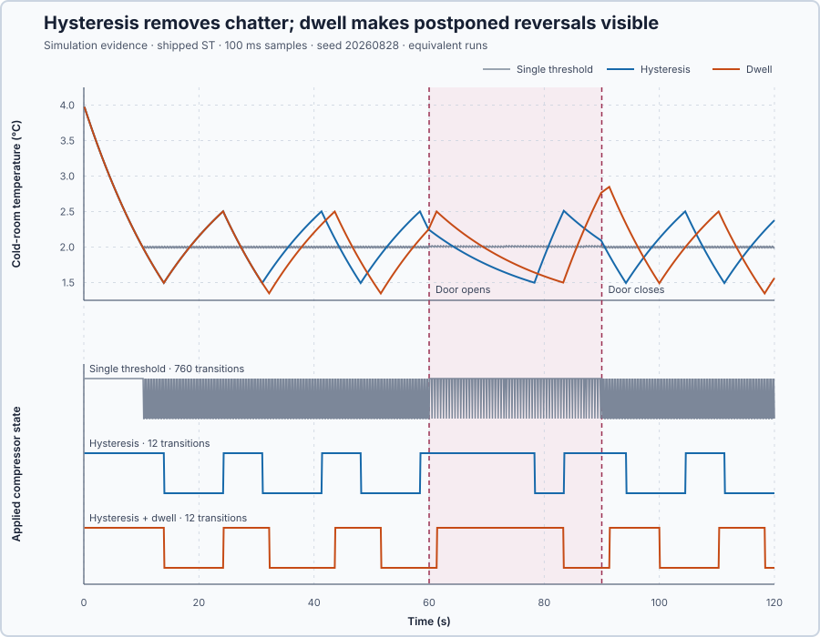

# 3. Hysteresis and dwell

In this lesson, you will use separate temperatures for switching refrigeration ON and OFF, then require refrigeration to remain in each state for a minimum time before it may change again.

## The problem

Lesson 2 used one temperature for both switching decisions. The room temperature changed gradually, but every small crossing of 2 °C could immediately reverse the refrigeration command. The command changed state 760 times in 120 s.

A physical compressor may also need to remain ON or OFF for a minimum time before it can safely change state. Preventing command reversals at small temperature crossings and preventing switches before that minimum time has passed are two different problems.

We will add a separate rule for each problem.

## What we need

We need to prevent small temperature fluctuations from repeatedly reversing
the refrigeration command, and ensure normal switching respects the
compressor's minimum ON and OFF times. These are two separate requirements.

## The new idea

**Hysteresis** switches on at one temperature and off at a lower one, and in between keeps doing what it did. **Dwell time** makes the compressor stay on or off for at least a set time before it may switch again.

**In words.** Lesson 2 reversed the command at every crossing of one boundary. Hysteresis uses two boundaries with a gap between them, so a small movement inside the gap changes nothing. Here hysteresis requests refrigeration ON at 2.5 °C and OFF at 1.5 °C:

| Measured room temperature | Requested refrigeration state |
| --- | --- |
| At or above 2.5 °C | ON |
| Between 1.5 and 2.5 °C | Keep the previous state |
| At or below 1.5 °C | OFF |

Dwell time is a second rule on top. Hysteresis decides which state is **requested**; dwell decides when that request may be **applied** to the refrigeration system: only after the present state has lasted the minimum time.

In PLC terms, hysteresis is a set–reset latch: set when the temperature reaches 2.5 °C, reset when it reaches 1.5 °C. Dwell is an on-delay timer that must have run out before the output may follow the latch.

**The formula.** The distance between the two switching temperatures is the **hysteresis width**:

$$H = T_{on} - T_{off}$$

- $H$ is the hysteresis width, in °C;
- $T_{on}$ is the temperature at which ON is requested and $T_{off}$ the one at which OFF is requested, both in °C.

A requested change may be applied only when the present state has lasted at least the dwell time:

$$t_{state} \ge T_{dwell}$$

- $t_{state}$ is how long the applied state has lasted, in seconds;
- $T_{dwell}$ is the dwell time, 8 s here.

**Example.** $H = 2.5 - 1.5 = 1.0$ °C: a temperature width, not a command percentage. The controller updates every 0.1 s, so the 8 s dwell is $8.0 / 0.1 = 80$ completed updates. Suppose refrigeration has been ON for 6 s when the temperature reaches 1.5 °C:

1. Hysteresis requests OFF.
2. The applied state remains ON, because $6 < 8$: the minimum ON time is not complete. At 7.9 s only 79 updates have passed, still too few.
3. At 8.0 s the OFF request may be applied, if it is still requested.

**Teaching choices and limits.** The 1 °C width and the 8 s dwell are chosen so the effects are easy to see. In a physical system, the width must come from the allowed temperature variation and the uncertainty of the measurement, and the dwell from the compressor's requirements. The simulator treats the initial OFF period as already complete, so cooling can start immediately. Stopping or aborting the experiment forces OFF at once, even if the minimum ON time is unfinished: dwell governs normal automatic switching, not shutdown.

## Prediction

Before running, answer these questions:

1. The room starts at 4 °C. Which state will hysteresis request?
2. What happens to the request as temperature falls through 2 °C but remains above 1.5 °C?
3. If refrigeration has been ON for only 6 s when the request changes to OFF, when may the applied state change?
4. Compared with Lesson 2, will refrigeration change state more or less often?
5. Why will using two switching temperatures produce a wider temperature cycle?

## Implementation

Open [`src/Main.st`](src/Main.st) and identify the requested state, applied state and state timer.

**ST practice.** Write the hysteresis decision using `IF` for the upper threshold and `ELSIF` for the lower threshold. `ELSIF` tests its condition when the first condition is false. Do not assign a new request between the thresholds: the Boolean retains its value between scans.

Write a separate condition that applies a changed request only when the elapsed time in the current applied state has reached its minimum. Use `AND` to require both conditions and `<>` to test that the states differ. Increment the state timer by the elapsed seconds and reset it when the applied state changes. Initialize the first OFF interval as complete, as described above.

Check both possible previous requests at 2 °C, then check an OFF request at 6 s and 8 s of ON-time. Keep the shutdown instruction separate from normal dwell so it can force OFF immediately.

## Experiment in Control Studio

1. Open this lesson's project and start **Simulator**. In the **truST** side bar, select **Control Studio**. On **Identify**, choose **Project experiment** from **Method**. **Signals** already shows `P1.Setpoint · Setpoint (°C)`, `P1.ProcessValue · Process value (°C)` and `P1.ManipulatedValue · Applied output (%)`; add `P1.DoorOpenIndication · state (1)`.
2. Confirm temperature setpoint 2 °C, measured temperature 4 °C, requested and applied refrigeration OFF, dwell restriction inactive, automatic control disabled, door closed, and `P1.ExperimentEnabled` false.
3. Also add `P1.RequestedCooling · state (1)` (requested state), `P1.CoolingEnabled · state (1)` (applied state), `P1.DwellInhibit · state (1)` (dwell restriction), `P1.DwellElapsed · state (s)` (time in the current state) and `P1.SwitchCount · state (1)` (number of state changes). The dwell restriction indicates that a requested switch is waiting for the minimum time to pass.
4. Answer the prediction questions before starting; **Confirm and start** begins the experiment recording.
5. Stay on **Identify**. Select **Review project test** and check the declared **120.1 s** duration, covering the initial cooling and repeated switching with the door closed and open. All event times start at **Confirm and start**.
6. Read the reviewed plan. Starting sets `P1.ExperimentEnabled` to true, enabling both switching rules; ending the experiment disables them and switches refrigeration OFF. Keep the setpoint, switching temperatures and minimum times unchanged during the run.
7. Select **Confirm and start**. Watch the request remain unchanged between 1.5 and 2.5 °C. When requested and applied states differ, confirm that the dwell restriction is active.
8. The experiment opens the door from 60 to 90 s. Continue observing both refrigeration states as the additional heat changes the process variable.
9. At completion, Control Studio shows **Project test completed. Outputs restored.** Confirm `P1.ExperimentEnabled` false, automatic control disabled, and both refrigeration states OFF.

Select **Abort test** to stop early or if temperature leaves −10 to 10 °C; the temperature check is yours to make. Confirm both refrigeration states OFF. If the runtime is unresponsive, stop the simulator with the debug toolbar. To repeat fairly, restart the simulator at 4 °C with the same initial states, completed OFF-time and door interval.

This project runs hysteresis with dwell. Compare your observations with the three saved cases below; they use the same room, starting temperature, door event and run duration, changing only the switching rule. The comparison does not require editing the program or assuming the project has a case selector.

## Evidence and decision

The numbered marks answer the predictions with the same numbers. The [retained simulation data](figures/hysteresis-dwell-comparison.csv) compares three rules. Temperature movement is the highest measured temperature minus the lowest **during the door-open interval, 60 to 89.9 s**. It excludes the initial cooldown from 4 °C. State changes are counted over the 120 s run:

| Rule | Temperature movement | State changes | Shortest completed ON/OFF times |
| --- | ---: | ---: | ---: |
| One switching temperature | 0.025 °C | 760 | 0.1 s / 0.1 s |
| Two switching temperatures | 1.013 °C | 12 | 6.8 s / 5.1 s |
| Two temperatures and 8 s dwell | 1.232 °C | 12 | 8.0 s / 8.0 s |

Two switching temperatures reduce the state changes from 760 to 12 because the measured temperature must travel from one boundary to the other before the request reverses. The wider temperature movement is the cost of waiting for that travel.

The first three predictions follow the request and its timing: at 4 °C the request is ON; crossing 2 °C at 10.3 s while cooling leaves that request ON until 1.5 °C at 13.9 s; an OFF request after only 6 s of ON-time must wait another 2 s, provided it remains OFF. The run shows the same case at 31.0 s: OFF is requested after 6.8 s ON and applied at 32.2 s, after 8 s. The table answers the last two predictions: switching is less frequent, but temperature moves through a wider range.

With hysteresis alone, some states last less than 8 s. In this saved run, adding dwell makes every completed ON and OFF period last at least 8 s. In 65 recorded samples, the requested and applied states differ while the dwell restriction is active. This shows that dwell postponed a change even though it did not further reduce the total count of 12. It can also carry temperature beyond a switching boundary while the actuator waits.

We therefore use both rules: hysteresis prevents small temperature movements from changing the request, and dwell time prevents the applied state from changing too soon.

## Conclusion

Hysteresis and dwell time solve different problems. Hysteresis decides when the requested state changes. Dwell time decides when that request may be applied.

Together they replace rapid chatter with slower, deliberate refrigeration cycles.

## Check yourself

1. **Refrigeration has been ON for 5.0 s when the request changes to OFF. With an 8 s dwell, when may it switch OFF?**
   After 3.0 s more, at 8.0 s ON-time, provided OFF is still requested.
2. **The room is at 2.0 °C. Is refrigeration requested ON or OFF?**
   It depends on the previous request: between 1.5 and 2.5 °C the request keeps its previous state. Coming down from
   2.5 °C it is ON; coming up from 1.5 °C it is OFF.
3. **Why does a wider hysteresis band make the temperature move further?**
   The request only reverses when the temperature reaches the other threshold, so the temperature must travel the
   whole band, 1.0 °C here, before each reversal.

## Reason for the next lesson

Hysteresis now prevents small temperature changes from reversing the request, and dwell postpones transitions that would occur too soon. Those separate rules must next be combined in a controller that meets the room’s temperature and switching requirements when the heat load changes.

[Cold-room commissioning](../../14-integrated-capstones/80-cold-storage/README.md) asks you to write that complete controller, choose a changed-load experiment and assess it against the stated requirements.
