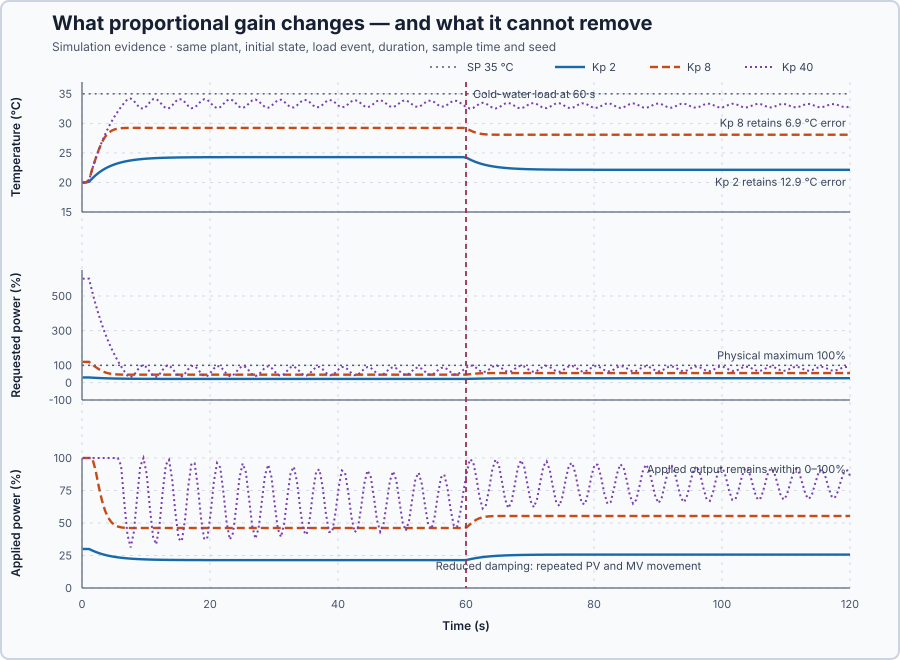

# Water-heater proportional control

Course position: Lesson 4 of 84. Previous lesson:
[Hysteresis and dwell protection](../03-cold-storage-hysteresis-dwell/README.md).
Next lesson: [Operating-point bias](../05-water-heater-bias/README.md).

**Lesson objective:** Compare three proportional gains under identical
conditions, run the selected candidate on the simulated heater, and explain why
the best acceptable proportional setting still leaves steady-state error.

**Evidence class:** Simulation evidence. These results are not physical-plant evidence.

## The problem

An electric recirculating water heater must deliver water at a chosen outlet
temperature. A sensor measures that temperature, a modulating element supplies
0–100 percent heat, and a scripted step increase in cold-water flow at 60
seconds into every run removes more heat.

The simulation starts at 20 °C with the heater off. Temperature must stay
within 0–80 °C; the safe state is manual mode at 0 percent heat. One perfectly
mixed thermal body and that fixed load change replace the
gradients, varying flow, sensor error, and changing losses of a physical
heater: a configured simulation value, not a measurement, in which each
percent of applied power steadily raises outlet temperature by 0.2 °C. Lesson
8 later reuses this same declared gain to check reachability.

The previous cold-room controller cycled fully on and off; this heater can
modulate continuously, so we test whether output proportional to temperature
error gives tighter control.

## What we need

We need a heater command that grows stronger as measured water moves farther from its desired temperature, and we must find how much response speed is possible before overshoot, oscillation, or actuator effort becomes unacceptable.

## The new idea

The **setpoint ($SP$)** is the desired outlet-water temperature. The **process
value ($PV$)** is the outlet-water temperature measured by the sensor. Both are
measured in degrees Celsius (°C).

The **error ($e$)** is the setpoint minus the process value. A positive error
means the measured water is colder than desired. A negative error means it is
hotter than desired.

$e = SP - PV$

The **proportional gain ($K_p$)** states how much heater output is requested for
each degree Celsius of error. Its unit is percent heater power per degree
Celsius (%/°C).

The **requested manipulated variable ($MV_{\mathrm{requested}}$)** is the heater-power
request calculated before a physical output limit is applied, in percent,
mapped to `%ML16` so Monitor can show it beside the applied heater output.

$MV_{\mathrm{requested}} = K_p e$

The **applied manipulated variable ($MV_{\mathrm{applied}}$)** is the heater-power command
after the **clamp** has limited the request to the heater's physical range.

$MV_{\mathrm{applied}} = \operatorname{clamp} \left(MV_{\mathrm{requested}}, 0\%, 100\%\right)$

Percent per degree Celsius multiplied by degrees Celsius gives percent heater
power. **Closed-loop feedback** means the sensor returns the latest process
value after every update; because heating raises temperature, positive error
must request positive power.

The heater can add heat but cannot actively remove it. Negative error therefore
produces 0 percent applied output rather than a negative heater command.

For this zero-bias controller with a 0–100 percent output range, the
**proportional band ($PB$)** is the error range that moves the unclamped heater
request from 0 to 100 percent. It is measured in degrees Celsius.

Zero error gives `Kp × 0 °C = 0%`; solving `100% = Kp × e` for e gives
`e = 100% / Kp`. The distance between those two errors is therefore:

$PB = \frac{100\%}{K_p}$

The numerator is the 100-percent output span; dividing percent by percent per
degree Celsius leaves degrees Celsius, so proportional band is a
temperature-error width.

**Damping** describes how repeated rises and falls die away. Because the
thermal process responds with lag, excessive gain can issue another
correction before the previous heater command has fully appeared in the
measurement, causing repeated over-correction.

**Steady-state error** is the remaining difference after a response has
settled. This heater is a **self-regulating thermal process**: at constant input
it approaches a constant temperature, but holding that temperature above the
surroundings still requires nonzero output.

The **required steady heater output ($MV_{\mathrm{required}}$)** is the output that balances
heat loss at the desired operating condition. The **steady-state error ($e_{\mathrm{ss}}$)**
is the error required to produce that output with zero bias. When the controller
is not saturated and the response has settled:

$MV_{\mathrm{required}} = K_p e_{ss}$

To isolate $e_{ss}$, divide both sides by $K_p$. The gain cancels on the
right, which gives:

$e_{ss} = \frac{MV_{\mathrm{required}}}{K_p}$

In plain notation, `e_ss = MV_required / Kp`. This explains the offset only
after settling and only when the requested output is not clamped; it does not
prove any final sample is equilibrium.

We also need a measure that rejects a gain which lowers average error only by
creating repeated movement. The **cumulative process-value travel** and
**cumulative applied-output travel** are each the sum of absolute differences
between successive samples from 60.1 through 120.0 seconds, in degrees
Celsius and percentage points (pp) respectively:

$\mathrm{travel} = \sum_k |\mathrm{value}_k - \mathrm{value}_{k-1}|$

Absolute value makes upward and downward motion add instead of cancel, so
repeated motion can total more than the 0-to-100-percent span.

Before calling a response settled, inspect its final 10-second window. Define
the final PV and applied-output ranges as maximum minus minimum:

$PV_{\mathrm{range,final}} = PV_{\mathrm{max,final}} - PV_{\mathrm{min,final}}$

$MV_{\mathrm{range,final}} = MV_{\mathrm{max,final}} - MV_{\mathrm{min,final}}$

The response is settled only if the process-value range is at most 0.1 °C and
the applied-output range is at most 1.0 pp — ten and a hundred times the PV
and output signals' declared 0.01 resolutions, tight enough to prove the
response stopped moving. Only then calculate final-window mean absolute
error, over that same trailing 10-second shape:

$e_{\mathrm{final}} = \operatorname{mean}(|SP-PV|), \quad 110.1\,\mathrm{s} \le t \le 120.0\,\mathrm{s}$

Absolute error prevents values above and below SP from cancelling, and the
mean puts candidates on a common scale — a settled-error estimate, not proof
of exact equilibrium.

**Validity prerequisite:** timestamps must increase; SP, PV, requested MV, and
applied MV must be finite and synchronized; every run must share plant,
initial state, load event, timing, limits, and seed; and applied MV must stay
within 0–100 percent. An invalid or unrestored run is not ranked.

**Decision direction:** a candidate is eligible only if it settles, cumulative
PV travel is at most 3.0 °C, and cumulative applied-output travel is at most
20 percentage points — both set near three times Kp = 8's own travel, tight
enough to reject a candidate that moves substantially more. Among eligible
candidates, select the smallest final-window mean absolute error; reject the
gain-40 diagnostic if reduced damping prevents settling or violates either
travel limit. These simulation criteria are not physical heater approval
limits.

## Prediction

The test setpoint is 35 °C and the initial process value is 20 °C. The
initial error is therefore:

$e = 35\,{}^\circ\mathrm{C} - 20\,{}^\circ\mathrm{C} = 15\,{}^\circ\mathrm{C}$

With a proportional gain of 2 %/°C, the initial heater request is:

$MV_{\mathrm{requested}} = 2\,\frac{\%}{{}^\circ\mathrm{C}} \times 15\,{}^\circ\mathrm{C} = 30\%$

At 8 %/°C the request is `8 %/°C × 15 °C = 120%`, so the applied output is
clamped to 100 percent. For gain 2, `PB = 100% / (2 %/°C) = 50 °C`. For gain
8, `PB = 100% / (8 %/°C) = 12.5 °C`.

If the heater needs an illustrative 50 percent steady output (not the plant's
measured holding power), `e_ss = 50% / (2 %/°C) = 25 °C` at gain 2 and
`e_ss = 50% / (8 %/°C) = 6.25 °C` at gain 8. Predict that gain 8 reduces
offset, and that an intentionally excessive gain of 40 %/°C causes repeated
temperature and output movement.

## Implementation

Integral and derivative gains are set to zero once, at initialization,
together with the 0-to-100-percent output clamp. Only proportional gain is
live: reconfiguring `Control.PID` with it every scan means a value entered in
Control Studio takes effect on the next 100 ms scan, before selecting the
Auto or Manual request:

```st
Parameters.ProportionalGain := ProportionalGain;
Controller.Configure(Parameters := Parameters);
Input.Setpoint := Setpoint;
Input.ProcessValue := ProcessValue;
IF AutoMode THEN
    Input.Mode := PIDMode#Auto;
    RequestedManipulatedValue := ProportionalGain * (Setpoint - ProcessValue);
ELSE
    Input.Mode := PIDMode#Manual;
    RequestedManipulatedValue := Input.ManualOutput;
END_IF;
ManipulatedValue := Controller.Update(Input := Input);
```

In Auto, `RequestedManipulatedValue` is the unclamped proportional
calculation; in Manual it is the operator's own request. `Controller.Update`
applies `Control.PID`'s clamp to produce `ManipulatedValue`, the bounded
applied output. Below, Control Studio runs the shipped `Kp = 8 %/°C`
candidate; the three-gain comparison runs separately, as native evidence.

## Experiment in Control Studio

Test runs the shipped Kp 8 candidate; the retained three-gain comparison is
generated separately by the lesson's native evidence test from the same
Structured Text, plant, initial state, load event, sample interval, duration,
limits, and seed 20260824. Control Studio owns the reviewed Boolean
`P1.ExperimentEnabled` authority and restores it disabled; the project derives
Auto mode and owns the scheduled cold-water load event.

### Control Studio actions

1. **Monitor** — Select target **Simulator**, choose **Run**, then open **Control Studio → Monitor → Response**.
   - **Baseline check:** Wait for **Simulation**, **Running**, current data, with units, limits, mode, and quality shown for SP, PV, Requested heater power, and Applied heater power (MV). Confirm SP = 35 °C, PV = 20 °C, MV = 0%, `Kp = 8 %/°C`, Auto disabled — the unresolved problem is low proportional gain leaving a large load-dependent offset.
   - **Decision before action:** Read **Prediction** above and predict which signal moves first and which way, because holding plant, initial state, load event, limits, duration, sample time and seed identical isolates gain as the one changed cause; reject a gain that cuts offset by destroying damping.
   - **Successful evidence:** The Response plot advances, values are finite and current, and **Start recording** is enabled; select it only once true.
   - **Recovery:** If recording is disabled or samples are unavailable or stale, stop the Simulator, correct the runtime or binding problem, restart, and repeat the baseline check.
   - **Record:** Write down initial SP, PV, requested/applied MV, controller mode, and your predicted response.

2. **Test** — Restart the **Simulator** from the declared initial state, then open **truST sidebar → Control Studio → Test**.
   - **Baseline check:** Confirm **Experiment** = **Observe without excitation**, **Amplitude** = **0** (disabled), and **Maximum duration (s)** = **120.1**. The reviewed authority is **Experiment authority** (`P1.ExperimentEnabled`); the project derives Auto and owns the 35 °C setpoint, `Kp = 8 %/°C`, and 60-second load event.
   - **Decision before action:** Before **Review test**, predict an initial 120% request clamped to 100%, decreasing heat as PV rises, and at 60 s a colder flow load raising error and demand; confirm limits Outlet-water temperature 0–80 °C and Applied heater power 0–100%.
   - **Successful evidence:** Select **Review test**, verify **P1.ExperimentEnabled**, the 120.1-second timeout, stop conditions, and false restoration, then **Confirm and start**. **Running** shows Auto enabled and **Abort test** available; completion restores authority false and heater power to 0%.
   - **Recovery:** For a rejected, stale, unsafe, unavailable, failed, or aborted state, read the reason, restart the Simulator, correct the cause, restore the initial state, and retry.
   - **Record:** Compare requested/applied heat, PV, the load response, and restoration with your prediction; retain the terminal state and seed **20260824**, and read the three-gain comparison against the measures above, not as a new run.

## Evidence and decision

Apply the validity, settling, travel, and selection definitions declared
before the experiment to the retained samples, not the rounded table; an
invalid or unrestored run is not ranked. Compare desired and measured
temperature in the upper plot, then requested and applied heater power below;
requested power may exceed the physical range, applied power may not.



| Proportional gain | Settled mean absolute error | Cumulative PV travel | Cumulative applied-output travel |
| ---: | ---: | ---: | ---: |
| 2 %/°C | 12.9 °C | 2.0 °C | 4.2 pp |
| 8 %/°C | 6.9 °C | 1.0 °C | 8.8 pp |
| 40 %/°C | Not settled | 22.7 °C | 908.6 pp |

Gains 2 and 8 settle and satisfy both travel limits; gain 40 satisfies
neither, so its last sample cannot prove equilibrium and reports no
steady-state error. Of the two eligible candidates, gain 8's smaller settled
mean absolute error makes it the best tested setting — and it still leaves
6.9 °C of steady-state error.

## Conclusion

At zero error this zero-bias controller requests zero power. Because the
self-regulating heater still loses heat, the water must remain below SP to
request the power that balances that loss.

Increasing gain reduces the required error, but the excessive case shows why
gain cannot rise without limit: a useful setting balances accuracy against
repeated movement and actuator effort.

## Reason for the next lesson

This conclusion applies to a self-regulating plant needing nonzero input at
the target, not to integrating plants generally. The next
lesson measures the holding power, adds it as **operating-point bias**, and
tests a changed load.
