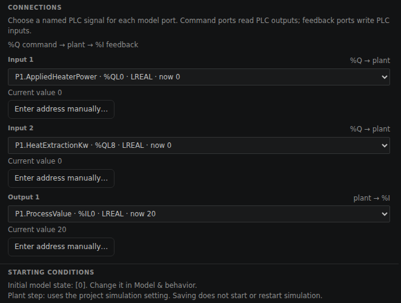
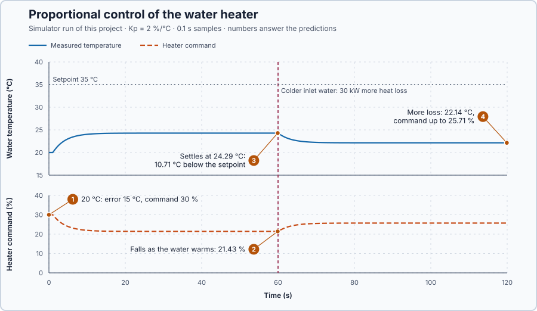

# 5. Proportional control

In this lesson, you will make the heater-power command increase with the difference between the temperature setpoint and measured water temperature. You will then observe why this correction alone cannot hold the temperature setpoint while heat is continually leaving the system.

## The problem

Lesson 4's cold-room assessment combined hysteresis and dwell in a controller whose output still had only two states. The temperature moved between 1.35 and 2.84 °C, because refrigeration could only be fully ON or fully OFF. We now need a rule for a heater whose power can vary continuously.

An electric heater can use intermediate power. We will make a large temperature shortfall produce a large heater command and a small shortfall produce a small command.

## What we need

We need to:

1. calculate how far the measured temperature is below the temperature setpoint;
2. convert that temperature difference into a heater command; and
3. reduce the command as the water approaches the temperature setpoint.

## The new idea

**Proportional control** sets the heater power in proportion to how far the water is below its target: twice the shortfall gives twice the power.

**In words.** Water stores thermal energy. The heater adds energy, while the surroundings and incoming colder water remove it. If the heater adds energy faster than it leaves, the temperature rises; if energy leaves faster, it falls.

The controller looks at the shortfall, how far the water is below 35 °C, and sets the heater power from it. We want two properties:

1. no shortfall gives no power from the controller; and
2. each additional degree of shortfall adds the same amount of power.

So the power follows a straight line through zero, and doubling the shortfall doubles the power. The slope of that line is the **proportional gain**: how many percentage points of heater power each degree of shortfall adds. In PLC terms, it is a scaling: the error times a constant, limited to the output range.

**The formula.**

$$
e = SP - PV, \qquad u = K_p\, e
$$

- $e$ is the temperature error, in °C: positive when the water is colder than wanted;
- $SP$ is the temperature setpoint, 35 °C, and $PV$ the measured temperature, in °C;
- $K_p$ is the proportional gain, in percentage points per °C;
- $u$ is the heater command, in percent: 0 % adds no heat and 100 % requests the simulator's maximum heater power.

A positive error must give positive power, because more power raises the temperature. The heater cannot remove heat, so a negative calculated command is applied as 0 %. A calculated command above 100 % is limited to 100 %; this experiment stays below that limit.

**Example.** This lesson uses $K_p = 2$ percentage points per °C, a teaching choice that keeps the command within its range, not a tuned value for physical equipment. Two percentage points means, for example, a command rising from 20 % to 22 %. With the water at 25 °C, $e = 35 - 25 = 10$ °C and $u = 2 \times 10 = 20\%$. At 34 °C, $e = 1$ °C and $u = 2\%$: one degree of shortfall gives two points of heater command.

**The limitation.** At a steady hot temperature, the heater must keep replacing the energy that leaves the water. But when the measured temperature equals 35 °C, the error is zero and this rule commands no power. The water must therefore settle below 35 °C, where a remaining positive error gives just enough power to balance the heat loss. This difference after the temperature has settled is the **steady-state error**.

We can calculate where it settles. This heater delivers 2 kW for each percentage point of command, and the water loses 10 kW for each degree it is above its 20 °C surroundings. At a steady temperature $T$, the heat in equals the heat out:

$$
2\,K_p\,(35-T)=10\,(T-20).
$$

With $K_p=2$: $4(35-T)=10(T-20)$, so $140+200=14T$ and $T=24.29$ °C. The steady-state error is $35-24.29=10.71$ °C. A larger gain moves $T$ closer to 35 °C but can never reach it, because the heater power is zero whenever the error is.

If colder incoming water removes an extra 30 kW, the balance becomes $4(35-T)=10(T-20)+30$, so $T=22.14$ °C: the error grows to 12.86 °C.

## Prediction

Before running, answer these questions:

1. The water starts at 20 °C. What is the first heater command?
2. How will the command change as the water warms?
3. At what temperature will the water settle, and how far below 35 °C?
4. After 60 s, colder incoming water removes 30 kW more. What happens to the temperature, the error and the command?

The simulation starts with a temperature setpoint of 35 °C and a measured temperature of 20 °C:

$e = 35\,^{\circ}\mathrm{C} - 20\,^{\circ}\mathrm{C} = 15\,^{\circ}\mathrm{C}$

With $K_p=2$ percentage points per degree Celsius:

$u = 2 \times 15 = 30\%$

Apply the same rule at two more temperatures:

| Measured temperature | Error | Predicted heater command |
| ---: | ---: | ---: |
| 20 °C | 15 °C | 30% |
| 30 °C | 5 °C | 10% |
| 35 °C | 0 °C | 0% |

The heat balance above answers questions 3 and 4.

## Implementation

[Main.st](src/Main.st) runs `Control.PID` as a P controller: $K_p$ = 2 percentage points/°C, no integral or derivative action, output limited to 0–100 %, updated every 0.1 s. Its output is the only command the heater receives. The lines

```st
ErrorC := Setpoint - ProcessValue;
RequestedHeaterPower := ProportionalGain * ErrorC;
```

compute the unlimited request $K_p e$ for the plot; they do not drive the heater. Before and after the experiment the controller holds 0 % in Manual. The simulator delivers the heater's power 1 s late, applies the extra extraction and returns the measured temperature. A temperature outside 0–80 °C latches `SafetyAbort`, which removes heat until the simulator is restarted.

Exercise: check the three rows of the prediction table with these lines, then write the limit that applies 0 % below 0 %, 100 % above 100 % and the request in between.

## Experiment in Control Studio

1. Open this lesson's project and start **Simulator**. First look at the new plant. In the **truST** side bar, select **Devices & Connections** and select **proportional-water-heater**; **Configure plant** opens. Under **CONNECTIONS**:
   - **Input 1** is `P1.AppliedHeaterPower` (%QL0), the heater command your program writes;
   - **Input 2** is `P1.HeatExtractionKw` (%QL8), the extra heat removed by colder inlet water, in kW, which the project's experiment sets;
   - **Output 1** is `P1.ProcessValue` (%IL0), the water temperature your program reads; it starts at 20 °C.

   On the left, **Input delays (s)** shows 1 for Input 1: the heater's power reaches the water 1 s after it is commanded. Close the panel with **Cancel**.

   

2. In the **truST** side bar, select **Control Studio**. On **Identify**, choose **Project experiment** from **Method**. **Signals** already shows `P1.Setpoint · Setpoint (°C)`, `P1.ProcessValue · Process value (°C)` and `P1.AppliedHeaterPower · Applied output (%)`; add `P1.HeatExtractionKw · disturbance (kW)`.
3. Confirm the water at 20 °C, the heater command at 0% and the extraction at 0 kW. Answer the predictions before starting.
4. Select **Review project test** and check the declared **120.1 s** duration: 60 s of warming and settling, then 60 s with the extra heat loss.
5. Select **Confirm and start**; this is time zero. P control starts at once; at 60 s colder inlet water removes 30 kW more.
6. Watch the command fall as the water warms. After 60 s, watch the temperature fall and the command rise. After the run, hover the first sample, the time just before 60 s and the end.
7. At completion, Control Studio shows **Project test completed. Outputs restored.** and the heater command is 0%.

Select **Abort test** to stop early. A temperature outside 0–80 °C latches `SafetyAbort`, which removes heat until you restart the simulator. To repeat, stop and restart **Simulator** so the water starts at 20 °C again.

## Evidence and decision



The numbered marks answer the predictions with the same numbers. The retained [simulation readings](figures/p-control-response.csv) show:

| Time | Measured temperature | Error | Heater command |
| --- | ---: | ---: | ---: |
| First controlled sample | 20.00 °C | 15.00 °C | 30.00% |
| Before the increased heat loss | 24.29 °C | 10.71 °C | 21.43% |
| End of the controlled run | 22.14 °C | 12.86 °C | 25.71% |

The first command matches the calculated 30%. As the water warms, both error and heater command decrease. When the heat loss increases, temperature falls, so error and heater command increase. Both settled temperatures, 24.29 °C and 22.14 °C, are the ones the heat balance predicts.

The controller increases heating when the water becomes colder, but the water still ends below 35 °C. The remaining shortfall produces the heater power needed to replace continuing heat loss. The rule responds in the right direction, yet does not achieve the temperature setpoint.

## Conclusion

Proportional control makes the correction larger when the error is larger and smaller when the error is smaller. The gain determines how strongly the command responds to each degree of error.

For this heater, proportional correction alone needs a remaining temperature error to produce the power that replaces continuing heat loss.

## Check yourself

1. **The water is at 27 °C. What command does P give with Kp = 2 percentage points per °C?**
   e = 35 − 27 = 8 °C, so u = 2 × 8 = 16%.
2. **With Kp = 4, where does the water settle? Does the larger gain reach 35 °C?**
   8(35 − T) = 10(T − 20) gives T = 26.67 °C. The error shrinks from 10.71 to 8.33 °C but never reaches zero,
   because P gives no power at zero error.
3. **Why did the command rise after the colder inlet water arrived at 60 s?**
   The extra loss cooled the water, the error grew, and P turned the larger error into more power: 25.71% instead of
   21.43%.

## Reason for the next lesson

At the temperature setpoint, proportional correction becomes zero even though the heater still needs power to replace heat loss.

[PI temperature control](../05-water-heater-pi/README.md) adds a stored correction that changes while error remains, forming a PI controller that can supply holding power at zero error.
