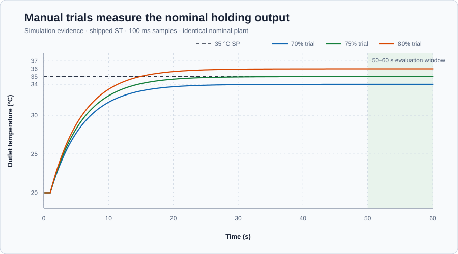
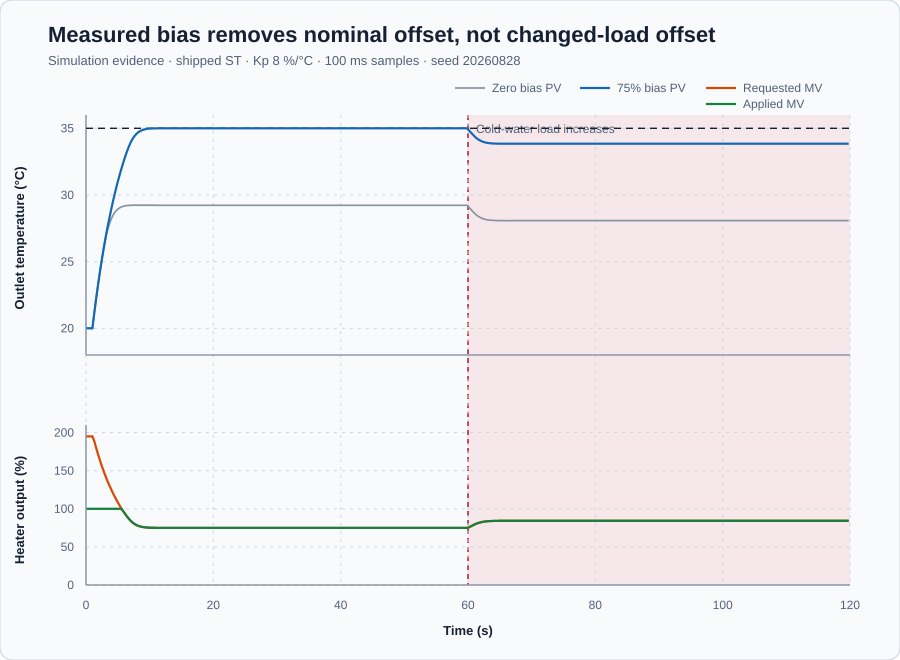

# Water-heater operating-point bias

Course position: Lesson 5 of 84. Previous lesson:
[Water-heater proportional control](../04-water-heater-p/README.md). Next lesson:
[Integral action in isolation](../06-water-heater-integral/README.md).

**Lesson objective:** Measure the nominal holding output, use it as controller
bias, compare the same proportional controller under a changed load, and
explain why fixed bias still leaves offset.

**Evidence class:** Simulation evidence. These results are not physical-plant
evidence.

## The problem

The same electric recirculating water heater from Lesson 4 must hold 35 degrees
Celsius. Its element adds 0–100 percent power but cannot cool. Increased
cold-water flow removes more heat. The mixed-body simulation omits gradients,
wear, sensor error, and changing ambient loss. Stay within 0–80 degrees Celsius
and restore Manual mode with zero power.

Lesson 4 selected gain 8 percent per degree Celsius but retained 6.9 degrees
Celsius error under the changed load. Keep that gain, measure the power that
holds normal operation, and add it as bias.

## What we need

We need the controller to supply the heater power required to hold the normal
operating temperature even when temperature error is zero. That holding power
must come from a bounded measurement, not from an unexplained guessed constant.

## The new idea

An **operating point** is a condition where the outlet temperature and heater
output remain steady. A steady temperature means stored thermal energy is no
longer changing, so heat entering the water must balance heat leaving it.

The **required steady heater output ($MV_{\mathrm{required}}$)** is the heater power that
balances normal heat loss, in percent. It follows from the steady heat balance:
if the stored heat is not changing, the heater must replace exactly the heat
being lost. Measure this output with bounded manual trials; do not read simulator
internals.

The **controller bias ($u_{0}$)** is that measured holding output, in percent. It
represents one operating point and does not adapt when load changes.

The **setpoint ($SP$)** is the desired outlet-water temperature. The **process
value ($PV$)** is the measured outlet-water temperature. Both are measured in
degrees Celsius.

The **error ($e$)** is the setpoint minus the process value. A positive error
means the measured water is colder than desired.

$e = SP - PV$

The **proportional gain ($K_p$)** requests percent heater power per degree Celsius
of error; it remains 8 percent per degree Celsius.

The **temperature deviation** is the current temperature minus the
operating-point temperature, in degrees Celsius. It describes motion around the
chosen operating point; zero deviation means the process is at that point.

The **requested manipulated variable ($MV_{\mathrm{requested}}$)** is the percent heater
power the controller calculates before limits.

The **applied manipulated variable ($MV_{\mathrm{applied}}$)** is the percent heater power
the heater receives after the 0–100 percent limit.

At the measured operating point, zero error must still request
$MV_{\mathrm{required}}$. The zero-bias law from Lesson 4 cannot do that because
$K_p \times 0 = 0$. We therefore use the measured holding output as the constant
starting request, $u_0 = MV_{\mathrm{required}}$, and add the proportional
correction $K_p \times e$. This gives

$MV_{\mathrm{requested}} = u_{0} + K_p \times e$

The units also agree: percent plus percent-per-degree-Celsius times degrees
Celsius produces percent. The one-sided heater then limits that request:

$MV_{\mathrm{applied}} = \operatorname{clamp}\left(MV_{\mathrm{requested}}, 0\%, 100\%\right)$

At equilibrium, zero error leaves the in-range measured bias:

$e = 0 {}^\circ\mathrm{C}$

$MV_{\mathrm{requested}} = MV_{\mathrm{applied}} = u_{0} = MV_{\mathrm{required}}$

If the load changes, the new required output may no longer equal the fixed
bias. At a settled, unsaturated condition the controller must satisfy

$MV_{\mathrm{required,new}} = u_0 + K_p \times e_{ss}$

Subtract $u_0$ from both sides and divide by $K_p$:

$e_{ss} = \dfrac{MV_{\mathrm{required,new}} - u_0}{K_p}$

This derivation explains why bias removes error only at the operating point
where it was measured. If the new load requires more power, the numerator is
positive, so positive settled error is needed to create the extra request.

Before measuring a holding output, define how a trial qualifies. In a declared
final window, PV range, the **requested-output range**, and the
**applied-output range** are maximum minus minimum. The two output ranges are
measured in percentage points. In
plain notation, `requested range = max(MV_requested) - min(MV_requested)` and
`applied range = max(MV_applied) - min(MV_applied)`. Both output ranges use
percentage points because they subtract two percentages. A window is settled
only when PV range is at most 0.10 °C and applied range is at most 1.0
percentage point.

For a settled window, the **final-window mean absolute temperature error** is
measured in degrees Celsius and is

$MAE = \operatorname{mean}(|SP_k-PV_k|)$

Absolute values prevent errors above and below SP from cancelling; the mean
compares equal-length windows on one degree-Celsius scale. The load response is
measured by subtracting nominal mean applied output from changed-load mean
applied output: `Delta MV_applied = mean(MV_applied,load) -
mean(MV_applied,nominal)`. Its unit is percentage points.

**Validity prerequisite:** all samples must be finite, synchronized, and inside
the 0-to-80 °C PV and 0-to-100% applied-output limits; the declared windows must
settle; final windows must be unsaturated; and every run must use the same
plant, initial state, event, duration, interval, and seed and restore Manual at
0%. An invalid run is not selected.

**Decision direction:** among valid 70%, 75%, and 80% manual trials, select the
smallest MAE, requiring no more than 0.10 °C. Accept that measured value as bias
only if the nominal biased run also has at most 0.10 °C MAE and applied output
increases after the load. Retain rather than hide any changed-load error.

## Prediction

Try 70, 75, and 80 percent manual power. A candidate that holds PV at the
35-degree SP with settled near-zero error measures $MV_{\mathrm{required}}$. For a 75 percent
holding trial:

$e = 35 {}^\circ\mathrm{C} - 35 {}^\circ\mathrm{C} = 0 {}^\circ\mathrm{C}$

The zero-error request remains the holding power:

$MV_{\mathrm{requested}} = 75\% + 8 \%/{}^\circ\mathrm{C} \times 0 {}^\circ\mathrm{C} = 75\%$

The applied output is also 75 percent. Predict positive temperature error after
the changed load because fixed bias cannot know the new heat loss.

## Implementation

The Structured Text configures `Control.PID` once with I and D disabled and
keeps raw request separate from applied output:

```st
Parameters.ProportionalGain := ProportionalGain;
Parameters.IntegralGain := LREAL#0.0;
Parameters.DerivativeGain := LREAL#0.0;
Parameters.Bias := OperatingPointBias;
Controller.Configure(Parameters := Parameters);

RequestedHeaterPower := OperatingPointBias
    + ProportionalGain * (Setpoint - ProcessValue);
AppliedHeaterPower := Controller.Update(Input := Input);
```

Bias is initialization-only: restore, restart, then enable Auto explicitly.

## Experiment in Control Studio

This procedure runs the shipped measured-bias candidate for 120 seconds. Test
runs the shipped measured-bias candidate. The retained manual trials and
zero-bias comparison come from the native evidence test, which executes the
same Structured Text under equivalent declared conditions. Control Studio does
not pretend to sequence those four additional runs. It writes the reviewed
Boolean `P1.AutoMode` authority and restores it false. The project owns the
measured 75% bias and scheduled load event. The seed is 20260828.

### Control Studio actions

1. **Monitor** — Start the **Simulator**, then open **truST sidebar → Control Studio → Monitor → Response**.
   - **Baseline check:** Wait until the header shows **Simulation**, **Running**, and current data. Confirm Outlet-temperature setpoint (SP, degC); Outlet-water temperature (PV, degC); requested and applied heater power (%); operating-point bias (%); proportional gain (%/degC); mode; limits; and quality. Before Auto is enabled, the declared safe initial state is SP = 35 degC, PV = 20 degC, requested output = 0%, applied output = 0%, bias = 75%, gain = 8 %/degC, and Manual mode. The 35 degC / 75% operating point is the state the controller is intended to reach, not the initial state. The unresolved baseline problem is: Lesson 4 selected proportional gain 8 percent per degree Celsius, but the zero-bias controller retained 6.9 degrees Celsius changed-load mean absolute error.
   - **Decision before action:** Read **Prediction** above, then state what should move first and in which direction. Use this decision rule: Measure the nominal holding output with bounded manual trials, add only that measured bias, and repeat the identical proportional-controller experiment.
   - **Successful evidence:** The Response plot advances, the displayed values are finite and current, and **Start recording** is enabled. Select **Start recording** only after those conditions are visible.
   - **Recovery:** If recording is disabled or the plot reports unavailable or stale samples, stop the Simulator, correct the displayed runtime or binding problem, restart it, and repeat the baseline check.
   - **Record:** Write down the initial SP, PV, requested and applied MV, bias, gain, controller mode, and your predicted response before opening Test.

2. **Test** — Restart the **Simulator** from the declared initial state, then open **truST sidebar → Control Studio → Test**.
   - **Baseline check:** Confirm **Experiment** = **Observe without excitation**, **Amplitude** = **0** (disabled), and **Maximum duration (s)** = **120**. The reviewed authority is **P1.AutoMode**. Control Studio sets it true; the project owns `Kp = 8 %/°C`, the measured 75% bias, and the timed load event.
   - **Decision before action:** Before selecting **Review test**, predict the response to Cold-water flow increases at 60 s and shifts the zero-power equilibrium from 20 to 17 degC. Confirm the live values are current and the reviewed plan stays inside Outlet-water temperature 0 degC to 80 degC; Applied heater power 0 % to 100 %.
   - **Successful evidence:** Select **Review test**, verify **P1.AutoMode**, the timeout, stop conditions, and false restoration, then select **Confirm and start**. The state changes to **Running**, **Abort test** remains available, and completion restores Auto false and requested and applied power to 0%.
   - **Recovery:** For a rejected, stale, unsafe, unavailable, failed, or aborted state, read the displayed reason, stop and restart the Simulator, correct that cause, restore the initial state, and review a new test. Return to Manual mode and confirm zero percent requested and applied output as the restoration state.
   - **Record:** Compare the observed event with your prediction and retain the terminal state, restoration result, and deterministic seed **20260828**.

## Evidence and decision

### Measures and comparison

Apply the validity, settling, MAE, output-range, load-increase, and selection
definitions declared before the experiment. Use 50.1–60.0 seconds for manual
and nominal windows and 110.1–120.0 seconds after the load. Retained startup
saturation is allowed, but final-window saturation invalidates that window.
There is no physical-plant acceptance threshold.

CSV traces and `figures/qualification-summary.csv` retain the calculations;
tables below are rounded presentations.



| Candidate | Run status | Mean PV | Final-window mean absolute error | Requested-output range | Applied-output range | Decision |
| ---: | --- | ---: | ---: | ---: | ---: | --- |
| 70% manual | Settled; valid | 34.00 °C | 1.00 °C | 0.00 pp | 0.00 pp | Eligible, not selected |
| 75% manual | Settled; valid | 35.00 °C | 0.00 °C | 0.00 pp | 0.00 pp | Selected holding output |
| 80% manual | Settled; valid | 36.00 °C | 1.00 °C | 0.00 pp | 0.00 pp | Eligible, not selected |

The trials select 75 percent as nominal holding output and controller bias.



| Controller case | Run status | Nominal-window error | Changed-load-window error | Mean applied output, nominal | Mean applied output, changed load | Applied-output increase |
| --- | --- | ---: | ---: | ---: | ---: | ---: |
| Gain 8, zero bias | Both windows settled; valid baseline | 5.77 °C | 6.92 °C | 46.15% | 55.38% | 9.23 pp |
| Gain 8, measured 75% bias | Both windows settled; valid comparison | 0.00 °C | 1.15 °C | 75.00% | 84.23% | 9.23 pp |

Startup requests exceed 100 percent but applied output clamps correctly. Final
windows are unsaturated with 0.00 percentage-point output ranges.

### Validation

Values are finite and bounded, windows settle, and every run restores Manual
zero output. The 75 percent trial is valid, meets the criterion, and is selected;
the other equilibria are valid but not selected. Bias reduces nominal error
from 5.77 to 0.00 degrees Celsius. After load, output rises 9.23 percentage
points but 1.15 degrees Celsius settled error remains, so it is a limitation.

## Conclusion

Bias supplies the nominal 75 percent at zero error. After load it remains fixed;
only positive error raises output to 84.23 percent, leaving 1.15 degrees Celsius
error. This conclusion applies near this measured operating point. Re-measure
bias after material changes; fixed bias cannot remove changing-load error.

## Reason for the next lesson

For another self-regulating process, measure holding input with bounded trials,
qualify settling, and keep requested and applied output distinct. Lesson 6 adds
integral action to change holding output while error persists.
