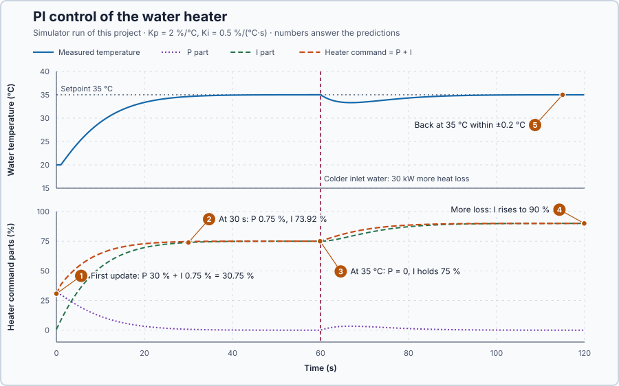

# 6. PI control

In this lesson, you will add a second part to the proportional controller that keeps adding up the temperature error, so the heater can hold the water exactly at 35 °C. You will then check that it still holds 35 °C when colder water flows in.

## The problem

Lesson 5's P controller left the water at 24.29 °C, 10.71 °C below the 35 °C setpoint. With colder inlet water it settled at 22.14 °C, 12.86 °C below. The water needs power to stay warm: it loses 10 kW for each degree it is above its 20 °C surroundings. P gives power only while an error remains, so the water settles where the remaining error produces exactly the power that is lost.

We will add a part to the controller that can keep supplying power when the error is zero.

## What we need

We need to:

1. keep increasing the heater command while the water stays below the setpoint;
2. keep that extra command at the setpoint, so the heater replaces the continuing heat loss; and
3. reduce it again if the water becomes too warm.

## The new idea

**Integral action** adds up the error over time and adds the total to the command. As long as the water is too cold, it keeps raising the power, so the power stays on even after the error has gone. A controller with a proportional part and an integral part is a **PI controller**.

**In words.** Lesson 5's proportional part reacts only to how far the water is below 35 °C now. The integral part remembers how long, and by how much, it has been below: at every update it adds a little, in proportion to the present error. While the water is too cold, the integral grows; while it is too warm, the integral shrinks; at zero error it stops changing but keeps its value. That kept value is what lets the heater hold its power when the error is zero. In PLC terms, the integral is a totalizer: a value kept from scan to scan that adds error × time in every scan.

> **Math you need: adding up small pieces.** Suppose the error stays at 15 °C for 0.1 s, then at 14 °C for the next 0.1 s. Each interval is a thin rectangle under the error–time curve, with area error × time: 15 × 0.1 + 14 × 0.1 = 2.9 °C·s. Adding up many such rectangles gives the total area under the curve, called the **integral** of the error. A large error for a short time and a small error for a long time can give the same area.

**The formula.** At each update the controller adds one rectangle, scaled by $K_i$, and the command is the sum of both parts:

$$
\Delta I = K_i\, e\, \Delta t, \qquad I_{new} = I_{old} + \Delta I, \qquad u = K_p\, e + I .
$$

- $e$ is the temperature error $SP - PV$, in °C;
- $\Delta t$ is the time between controller updates, 0.1 s here;
- $K_i$ is the **integral gain**, in percentage points per °C per second;
- $I$ is the integral part of the command, in percent of the heater range;
- $K_p$ is the proportional gain and $u$ the heater command, in percent, as in Lesson 5.

This lesson keeps $K_p = 2$ percentage points per °C and uses $K_i = 0.5$ percentage points per °C per second: with a 1 °C error, the integral grows by 0.5 points every second. These are teaching values, not tuned values for physical equipment.

**Example.** Follow the first updates from 20 °C, starting with $I = 0$:

1. The error is $35 - 20 = 15$ °C, so $P = 2 \times 15 = 30\%$.
2. $\Delta I = 0.5 \times 15 \times 0.1 = 0.75$ point, so $I = 0.75\%$ and $u = 30.75\%$.
3. The heater's power reaches the water 1 s late, so the water has not moved yet. The next update adds another 0.75 point: $I = 1.50\%$ and $u = 31.50\%$.

As the water warms, P shrinks with the error while I keeps growing, more slowly as the error gets smaller.

The important case is zero error. At 35 °C, $P = 0$ and the next $\Delta I = 0$, but the integral keeps the value it has built up:

$$
u = K_p \times 0 + I = I .
$$

The integral is now the holding power. At 35 °C the water is 15 °C above its surroundings and loses $10 \times 15 = 150$ kW; at 2 kW per percentage point, holding it needs $150 / 2 = 75\%$. Any remaining positive error keeps adding to the integral until it reaches 75 %.

If colder water then removes 30 kW more, the water cools a little, the error becomes positive again, and the integral grows until it supplies the extra $30 / 2 = 15$ points: 90 % in total. If the water rises above 35 °C, the error is negative and the integral shrinks.

**The limitation.** The integral needs time to build up, and it remembers past errors. Too large an integral gain makes the water overshoot, and a sudden extra loss pulls the water below the setpoint until the integral has caught up.

## Prediction

Before running, answer these questions:

1. What are the integral part and the command after the first update, and after the second?
2. How will P and I change as the water warms?
3. When the water has settled at 35 °C, what are P, I and the heater command?
4. After colder water removes 30 kW more at 60 s, where will the integral settle?
5. Will the water return to within ±0.2 °C of 35 °C after the extra loss?

| Situation | P | I | Command |
| --- | ---: | ---: | ---: |
| First update, 20 °C | 30% | 0.75% | 30.75% |
| Second update, 20 °C | 30% | 1.50% | 31.50% |
| Settled at 35 °C | 0% | 75% | 75% |
| Settled after the extra 30 kW | 0% | 90% | 90% |

## Implementation

Open [`src/Main.st`](src/Main.st). Written in ST, one update of the calculation above is:

```st
Error := Setpoint - ProcessValue;
ProportionalContribution := ProportionalGain * Error;
IntegralIncrement := IntegralGain * Error * CycleTime;
IntegralContribution := IntegralContribution + IntegralIncrement;
RequestedHeaterPower := ProportionalContribution + IntegralContribution;
```

**Exercise.** Work these lines by hand with $K_p = 2$, $K_i = 0.5$ and 0.1 s: after two updates at 15 °C error, I = 1.50%; at zero error it stays 1.50%; at −1 °C the next increment is −0.05 point, so I = 1.45%, P = −2% and the request −0.55% is applied as 0%. `trust-dev test --project tests` checks two more worked cases.

The program runs `Control.PID` with these gains and output limits 0–100%, updated every 0.1 s; its output alone drives the heater, and the plotted integral part is its output minus P. Before and after the run it holds 0% in Manual; a temperature outside 0–80 °C latches `SafetyAbort`, which removes heat until the simulator is restarted.

## Experiment in Control Studio

The requirement, fixed before the run: the temperature stays within 34.8–35.2 °C during the last 10 s before the 60 s load change and during the last 10 s of the run.

1. Open this lesson's project and start **Simulator**. The water is at 20 °C, the heater command at 0% and the integral at zero. In the **truST** side bar, select **Control Studio**.
2. On **Identify**, choose **Project experiment** from **Method**. **Signals** already shows `P1.Setpoint · Setpoint (°C)`, `P1.ProcessValue · Process value (°C)` and `P1.AppliedHeaterPower · Applied output (%)`; add `P1.ProportionalContribution · state (%)` (P), `P1.IntegralContribution · state (%)` (I) and `P1.HeatExtractionKw · disturbance (kW)`.
3. Answer the predictions before starting.
4. Select **Review project test** and check the declared **120.1 s** duration: 60 s of warming and holding, then 60 s with the extra loss.
5. Select **Confirm and start**; this is time zero. PI control starts at once. At 60 s colder inlet water removes 30 kW more, as in Lesson 5.
6. After the run, hover the first two updates, the windows 50–60 s and 110–120 s, and the lowest temperature after 60 s.
7. At completion, Control Studio shows **Project test completed. Outputs restored.** and the heater command is 0%.

Select **Abort test** to stop early. To repeat, stop and restart **Simulator** so the water starts at 20 °C with the integral at zero.

## Evidence and decision



The numbered marks answer the predictions with the same numbers. From the recorded run:

| Time | Measured temperature | P | I | Command |
| --- | ---: | ---: | ---: | ---: |
| First update | 20.00 °C | 30.00% | 0.75% | 30.75% |
| 0.1 s | 20.00 °C | 30.00% | 1.50% | 31.50% |
| 30 s | 34.62 °C | 0.75% | 73.92% | 74.67% |
| 59.9 s, before the extra loss | 35.00 °C | 0.00% | 75.01% | 75.01% |
| 119.9 s, end | 35.00 °C | 0.00% | 90.00% | 90.00% |

1. The first two updates match the hand calculation.
2. As the water warmed, P fell towards zero while I kept rising, more slowly as the error shrank.
3. At 35 °C the error was zero, yet the integral held the heater at 75.01%: the holding power the heat balance predicts.
4. After the extra 30 kW loss, the integral rose to 90.00%, the predicted 75% + 15 points.
5. The temperature stayed within 34.991–35.000 °C from 50 to 60 s and within 34.989–34.998 °C from 110 to 120 s, inside the ±0.2 °C requirement, and never exceeded 35.0002 °C.

The benefit is clear: the 10.71 °C error that P left is gone, before and after the change in heat loss. The cost is time. The water first came within 0.2 °C of 35 °C at 34.0 s, and after the extra loss it dipped to 33.32 °C at 66.9 s and was back within 0.2 °C only from 90.4 s, while the integral caught up.

PI is accepted for this heater: it meets the requirement in both windows. These are simulation results.

## Conclusion

Integral action adds up the error over time. Because the total remains when the error is zero, a PI controller can supply the power needed to balance a continuing heat loss, and so remove the steady-state error that P alone leaves.

For this heater, the integral built up to 75% to hold 35 °C, and to 90% after the extra loss, without any change to the gains.

## Check yourself

1. **With Ki = 0.5 percentage points per °C per second and an error of 4 °C, how much does the integral grow in one 0.1 s update?**
   ΔI = 0.5 × 4 × 0.1 = 0.2 percentage point.
2. **At 35 °C the error is zero. Why does the heater not switch off?**
   The command is P + I. P is zero, but I keeps the value it has built up, 75%, which replaces the heat loss.
3. **Why did the integral rise from 75% to 90% after 60 s?**
   The colder inlet water cooled the water slightly. The positive error kept adding to the integral until it
   supplied the extra 30 kW: 15 more percentage points.

## Reason for the next lesson

This experiment kept the command within the heater's 0–100% range. If the setpoint asks for more than the heater can deliver, the heater stays at 100% while the error remains positive, and the integral keeps adding to a command the heater can never apply.

[Saturation and windup](../06-water-heater-saturation-windup/README.md) creates that situation on purpose and shows what the piled-up integral does when the setpoint is reduced again.
