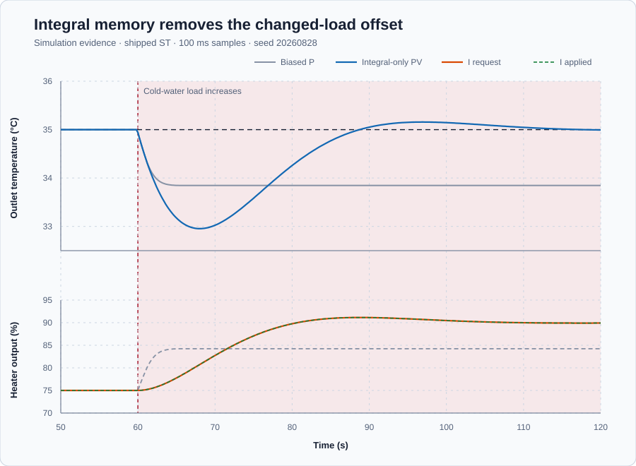

# Water-heater integral action

Course position: Lesson 6 of 84. Previous lesson: [Operating-point bias](../05-water-heater-bias/README.md). Next lesson: [PI control](../07-water-heater-pi/README.md).

**Lesson objective:** Calculate the integral heater-output change per scan, then use an equivalent load experiment to explain why integral action removes constant-load offset but gives a slower transient response on its own.

**Evidence class:** Simulation evidence. These results are not physical-plant evidence.

## The problem

The same electric recirculating water heater must hold its outlet water at 35 degrees Celsius. A temperature sensor measures the outlet water. A modulating electric element can add between 0 and 100 percent heater power but cannot actively remove heat. Increased cold-water flow removes more heat and is the disturbance.

The simulation treats the water as one well-mixed thermal body. Temperature must remain between 0 and 80 degrees Celsius. The safe state is Manual mode with zero heater power.

Lesson 5 retained proportional gain 8 percent per degree Celsius and measured 75 percent heater power as the nominal holding output. That controller settled with only 0.00 degrees Celsius nominal error, but a larger cold-water load changed the required holding power and left 1.15 degrees Celsius mean absolute error.

A fixed bias cannot discover a new holding output. The controller needs a stored contribution that continues changing while error remains and can retain the new heater power when error returns to zero.

## What we need

We need the controller to remember persistent temperature error and gradually change heater power until a constant load no longer leaves an offset. We must isolate that memory effect so its slower initial response is visible as well as its benefit.

## The new idea

The **setpoint ($SP$)** is the desired outlet-water temperature, and the **process value ($PV$)** is the measured outlet-water temperature. Both are measured in degrees Celsius.

The **error ($e$)** is the setpoint minus the process value, measured in degrees Celsius. Positive error means the water is too cold. After those quantities are defined, their relationship is:

$e = SP - PV$

The **integral contribution (uI)** is the stored part of the heater command produced by integral action. It is measured in percent heater power. Unlike fixed bias, it can change with operating conditions and remain nonzero when error becomes zero.

The **integral gain ($K_i$)** states how many percentage points the stored heater output changes per degree Celsius-second of error. This lesson uses 0.5 percentage point per degree Celsius-second.

The **cycle time ($\Delta t$)** is the number of seconds between controller updates. This project updates every 0.1 second.

The **requested manipulated variable ($MV_{\mathrm{requested}}$)** is the heater output calculated before physical limits. The **applied manipulated variable ($MV_{\mathrm{applied}}$)** is the command the heater receives, bounded between 0 and 100 percent.

Integral action is based on accumulated error. Over one scan, the current error
occupies a small rectangle: its height is $e$ in degrees Celsius and its width
is $dt$ in seconds. The rectangle area is therefore $e \times dt$ in degree-
Celsius-seconds. Multiplying that area by $K_i$ converts it to a heater-output
change:

$\Delta uI = K_i \times e \times dt$

The units show why elapsed time is required:

$\dfrac{\text{percentage points}}{{}^\circ\mathrm{C}\,s} \times {}^\circ\mathrm{C} \times s = \text{percentage points}$

The new stored contribution equals the old contribution plus that change:

$uI,new = uI,old + K_i \times e \times dt$

This is a derived update, not a rule to memorize: measure error for one scan,
convert its error-time area to an output increment, and add that increment to
the stored output. For a constant error over $N$ scans, repeated substitution
gives

$uI_N = uI_0 + N \times K_i \times e \times dt$

Because $N \times dt$ is elapsed time $t$, the same result is

$uI(t) = uI_0 + K_i \times e \times t$

This is why a constant error makes integral output ramp rather than stop at one
fixed correction. When error reaches zero, the next increment is zero, so the
stored contribution remains at the newly learned holding output.

With proportional gain, derivative gain, and bias set to zero, the integral
contribution is the request before limits. The measured 75 percent holding
output from Lesson 5 supplies $uI_0$ when Auto starts. The integrator then adds
or subtracts increments as the load changes.

Integral-only control has no immediate term proportional to the present error.
It must accumulate its correction over several scans. That additional lag can
make its transient response slower and less well damped even when its final
error is smaller.

Before running either controller, define how the comparison will be judged.
The final window is 110.1 through 120.0 seconds. It is valid and settled only
when all samples are finite and synchronized, PV remains inside 0–80 degrees
Celsius, applied output remains inside 0–100 percent, PV range is no greater
than 0.1 degrees Celsius, applied-output range is no greater than 1.0
percentage point, and applied output does not remain at a limit. An ineligible
window reports `Not settled` or `Saturated`, not an equilibrium error.

The **early-load mean absolute temperature error** measures the average size of
the temperature error from 60.1 through 75.0 seconds:

$early MAE = \operatorname{mean}\left(|SP_k - PV_k|\right),\quad 60.1\,s \le t \le 75.0\,s$

Subtracting PV from SP gives each error, absolute value prevents positive and
negative errors from cancelling, and the mean compares equal-length windows.
Its unit is degrees Celsius. Lower is preferred because it means more prompt
disturbance correction; no physical acceptance threshold has been established.

The **final-window mean absolute temperature error** uses the same derivation
after settling, from 110.1 through 120.0 seconds:

$final MAE = \operatorname{mean}\left(|SP_k - PV_k|\right),\quad 110.1\,s \le t \le 120.0\,s$

The integral-only simulation criterion is at most 0.2 degrees Celsius. It is a
teaching criterion for this deterministic model, not a physical-heater
acceptance threshold.

The **cumulative applied-output movement** adds the magnitude of every applied-
output change after the load:

$applied movement = \sum_k\left|MV_{\mathrm{applied},k} - MV_{\mathrm{applied},k-1}\right|$

The subtraction gives one change in percentage points; absolute value makes
opening and closing movement add instead of cancel; summation gives total
actuator travel. Lower is preferred when temperature performance is otherwise
adequate.

**Validity prerequisite:** both cases must use the same plant, initial state,
50-second Manual preparation at the measured 75 percent holding output, Auto
transfer, 60-second load event, 0.1-second sample interval, 120-second duration,
limits, and seed. Each run must finish in Manual with zero requested and applied
output. An invalid run is not ranked.

**Decision direction:** reject biased proportional control if constant offset
remains. Do not select integral-only control merely because final error is
smaller; retain its offset-removal mechanism for PI when early response and
actuator movement are worse.

## Prediction

Suppose the outlet is temporarily 2 degrees Celsius colder than the setpoint. With integral gain 0.5 percentage point per degree Celsius-second and cycle time 0.1 second, one scan should add:

$0.5 \%/({}^\circ\mathrm{C}·s) \times 2 {}^\circ\mathrm{C} \times 0.1 s = 0.10 percentage point$

If the error remained unchanged, ten scans would add 1.0 percentage point. Record both predictions. The real error changes, so later increments will differ.

The shipped Control Studio run begins safely at SP 35 degrees Celsius, PV 20
degrees Celsius, Manual mode, and zero applied output. Its first Auto scan has
$e = 15$ degrees Celsius, so the predicted increment is 0.75 percentage point.
After preloading the measured 75 percent holding output, the unsaturated request
should therefore be 75.75 percent. In the retained comparison, both cases first
hold 35 degrees Celsius at 75 percent in Manual; after the load, predict that
biased P moves first but retains positive error, while integral-only moves more
slowly and eventually stores the higher holding output at near-zero error.

## Implementation

The shipped Structured Text uses `Control.PID` in integral-only form. It starts
in Manual at zero output. On explicit transfer to Auto, the visible measured
holding output inherited from Lesson 5 preloads the controller state.

```st
Parameters.ProportionalGain := LREAL#0.0;
Parameters.IntegralGain := IntegralGain;
Parameters.DerivativeGain := LREAL#0.0;
Parameters.Bias := LREAL#0.0;

IF AutoMode AND NOT PreviousAutoMode THEN
    InitialState.NominalOutput := MeasuredHoldingOutput;
    InitialState.SaturatedOutput := MeasuredHoldingOutput;
    Controller.Initialize(State := InitialState);
END_IF;

Error := Setpoint - ProcessValue;
IntegralIncrement := IntegralGain * Error * Input.CycleTime;
IF NOT PreviousAutoMode THEN
    RequestedHeaterPower := MeasuredHoldingOutput + IntegralIncrement;
ELSE
    RequestedHeaterPower := AppliedHeaterPower + IntegralIncrement;
END_IF;
AppliedHeaterPower := Controller.Update(Input := Input);
```

The gain is initialization-only, so changing it requires safe restoration and restart. The block limits the request and supplies `AppliedHeaterPower` to the plant.

## Experiment in Control Studio

Test runs the shipped integral-only candidate for 120 seconds from its safe
initial state by writing only the reviewed `P1.ExperimentEnabled` authority.
The project derives Auto and owns
the measured 75 percent preload and the load event at 60 seconds. The retained
biased-P comparison and its 50-second Manual preparation come from the native
evidence test, which executes both controllers from the same qualified
operating point. Control Studio does not pretend to sequence that additional
case. Completion restores Auto false, so Manual zero output is applied. The
deterministic Simulation seed is 20260828.

### Control Studio actions

1. **Monitor** — Start the **Simulator**, then open **truST sidebar → Control Studio → Monitor → Response**.
   - **Baseline check:** Wait until the header shows **Simulation**, **Running**, and current data. Confirm outlet-temperature setpoint (degC), outlet-water temperature (degC), requested and applied heater power (%), integral contribution (%), integral gain (%/(degC·s)), measured holding output (%), mode, limits, and quality. Before Auto is enabled, the declared safe initial state is SP = 35 degC, PV = 20 degC, requested output = 0%, applied output = 0%, measured holding output = 75%, integral gain = 0.5 %/(degC·s), and Manual mode. The qualified 35 degC / 75% operating point belongs to the retained native comparison; it is not the shipped initial state. The unresolved baseline problem is the 1.15 degC changed-load error retained in Lesson 5.
   - **Decision before action:** Read **Prediction** above, then state what should move first and in which direction. Use this decision rule: Isolate integral action from the same measured holding output so offset removal and slower early-load correction are compared directly.
   - **Successful evidence:** The Response plot advances, the displayed values are finite and current, and **Start recording** is enabled. Select **Start recording** only after those conditions are visible.
   - **Recovery:** If recording is disabled or the plot reports unavailable or stale samples, stop the Simulator, correct the displayed runtime or binding problem, restart it, and repeat the baseline check.
   - **Record:** Write down the initial SP, PV, requested and applied MV, integral contribution, gain, measured holding output, controller mode, and first-scan prediction before opening Test.

2. **Test** — Restart the **Simulator** from the declared initial state, then open **truST sidebar → Control Studio → Test**.
   - **Baseline check:** Confirm **Experiment** = **Observe without excitation**, **Amplitude** = **0** (disabled), and **Maximum duration (s)** = **120.1**. The reviewed authority is **Experiment authority** (`P1.ExperimentEnabled`). The project derives Auto and owns the measured holding-output preload and timed load event.
   - **Decision before action:** Before selecting **Review test**, predict the response to Cold-water flow increases at 60 s. Confirm the live values are current and the reviewed plan stays inside Outlet-water temperature 0 degC to 80 degC; Applied heater power 0 % to 100 %.
   - **Successful evidence:** Select **Review test**, verify **P1.ExperimentEnabled**, the timeout, stop conditions, and false restoration, then select **Confirm and start**. The state changes to **Running**, **Abort test** remains available, the first unsaturated request is predicted as 75.75%, and completion restores authority false with zero requested and applied output.
   - **Recovery:** For a rejected, stale, unsafe, unavailable, failed, or aborted state, read the displayed reason, stop and restart the Simulator, correct that cause, restore the safe Manual-zero initial state, and review a new test. Confirm zero requested and applied output after restoration. The native comparison, separately, begins each case in the declared Manual 75 percent settled holding condition and gives each case its own Manual-zero restoration sample.
   - **Record:** Compare the first request and the load response with your predictions. Retain the terminal state, restoration result, and deterministic seed **20260828**.

## Evidence and decision

### Measures and comparison

Apply the validity, settling, early/final MAE, applied-movement, and decision
definitions declared before the experiment. Requested- and applied-output
ranges are retained separately. There is no physical-plant acceptance
threshold. The executable samples are in
[`figures/integral-comparison.csv`](figures/integral-comparison.csv), and their
validity and decision fields are in
[`figures/qualification-summary.csv`](figures/qualification-summary.csv).



| Controller case | Run status | Early-load mean absolute error | Final-window mean absolute error | Cumulative applied-output movement | Decision |
| --- | --- | ---: | ---: | ---: | --- |
| Gain 8, measured 75% bias | Settled; valid baseline | 1.07 °C | 1.15 °C | 9.24 pp | Not selected: constant offset remains |
| Integral-only, $K_i$ 0.5 | Settled; simulation criterion passes | 1.62 °C | 0.02 °C | 17.38 pp | Not selected alone: retain its offset-removal mechanism for PI |

### Validation

Both final windows satisfy the declared settling and saturation rules. The inherited biased proportional controller reproduces Lesson 5's 1.15 degrees Celsius changed-load error. Integral-only control reduces that error to 0.02 degrees Celsius and therefore passes the simulation offset-removal criterion.

Integral-only control is not the better complete controller. Its early-load error is 1.62 degrees Celsius rather than 1.07 degrees Celsius, and its applied output travels 17.38 rather than 9.24 percentage points. Every value remains finite and within limits, requested and applied output remain distinct retained signals, and both runs finish in Manual with zero requested and applied heater power.

## Conclusion

The proportional baseline changes output as soon as measured error appears, so it limits the early temperature departure. It then needs a permanent error to request the additional 9.23 percentage points required by the new load.

The integral-only controller begins from the measured 75 percent holding output and adds small increments while the outlet is too cold. The accumulated contribution approaches about 90 percent and remains there when error approaches zero. That stored output removes the constant-load offset. Because the correction had to accumulate, the temperature initially moved farther and the actuator moved more.

## Reason for the next lesson

For another self-regulating process, you can calculate one integral increment, establish the real holding output before Auto, and test whether stored action rejects a constant disturbance. Do not conclude that every plant needs integral action: an integrating plant already accumulates its manipulated input and is an important boundary.

Lesson 7 keeps the prompt proportional correction demonstrated by the biased-P baseline and adds the offset-removing integral state demonstrated here. The goal is a proportional-integral controller that improves both parts of this measured trade-off.
