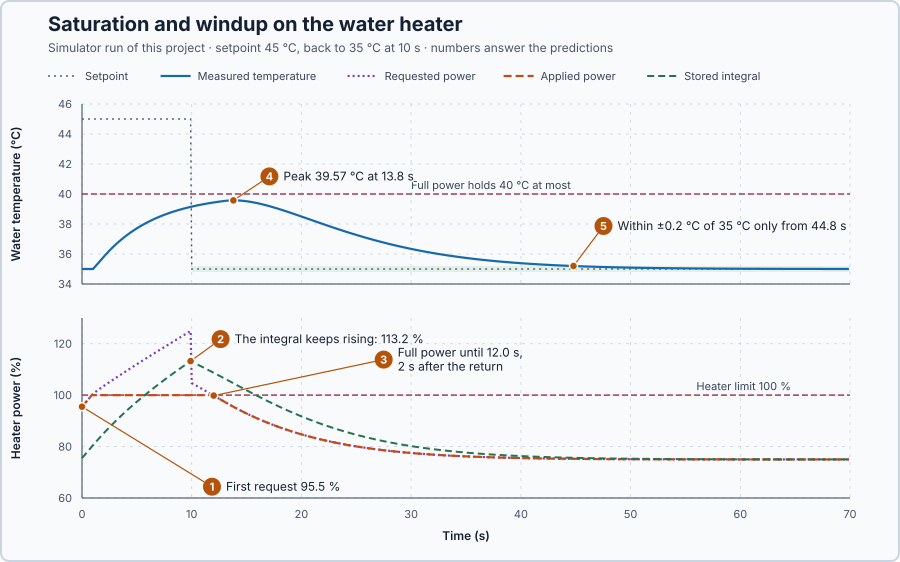

# 7. Saturation and windup

In this lesson, you will ask the heater for a temperature it cannot reach and then return to 35 °C. You will observe that the PI controller keeps the heater at full power after it is no longer wanted, because its integral has piled up a demand the heater could never deliver.

## The problem

Lesson 6's PI controller held the water at 35 °C with 75% heater power, and raised the integral to 90% when colder water removed 30 kW more. In both cases the heater had power to spare, so every command the controller asked for could be applied.

A heater has a maximum power. We will ask for 45 °C, more than the heater can hold, and then return to 35 °C after 10 s, to see what the integral does while the heater is at its limit.

## What we need

We need to:

1. tell apart what the controller asks for from what the heater actually delivers;
2. find out whether a temperature is reachable at all with the heater's full power; and
3. see what happens to the integral while the heater cannot follow the request, and what that does when the setpoint returns to a reachable value.

## The new idea

**Actuator saturation** means the actuator is at its limit and cannot do more: for this heater, saturation means it is at full power, and a larger command cannot add more heat. **Integral windup** is the integral piling up a demand the heater cannot deliver. When the target becomes reachable again, that pile must be worked off before the heater turns down, so the water overshoots for a long time.

**In words.** The controller calculates a **requested output**; the heater can apply only part of it, the **applied output**. Between 0 and 100 % the two are equal; above 100 %, the heater gives 100 % whatever is requested. While the heater is at 100 % and the water is still below the setpoint, the error stays positive, so the integral keeps growing, although the extra demand adds no heat. Later, the request stays above 100 % until the integral has come down again, and only then does the heater turn down. In PLC terms: the output is clamped to its range, but the integral inside the controller does not know that it was clamped.

**The formula.**

$$
u_r = K_p\, e + I, \qquad u_a = \min(100, \max(0, u_r)), \qquad \Delta I = K_i\, e\, \Delta t .
$$

- $u_r$ is the requested output and $u_a$ the applied output, in percent;
- max selects the larger value and min the smaller, so $u_a$ is the request limited to 0–100 %;
- $e$, $K_p$, $K_i$, $I$ and $\Delta t$ are the error, the two gains, the integral part and the update interval, as in Lesson 6.

The integral update does not look at $u_a$: a positive error keeps adding to $I$ even while $u_a$ is stuck at 100 %.

Which temperatures can the heater reach at all? At a steady temperature $T$, the heat in equals the heat out: $2\,u_a = 10\,(T - 20)$, with $u_a$ in percent and the heat in kW. So:

$$
T = 20 + 0.2\, u_a .
$$

At full power, $T = 20 + 0.2 \times 100 = 40$ °C. No controller can hold 45 °C with this heater; that is a **capacity** limit, the most the equipment can deliver.

**Example.** A 125 % request gives 100 % applied: the extra 25 points add no heat. Follow the test with $K_p = 2$ and $K_i = 0.5$ as in Lesson 6, starting settled at 35 °C with $I = 75\%$:

1. The setpoint jumps to 45 °C. The error is 10 °C, so $P = 20\%$, $\Delta I = 0.5 \times 10 \times 0.1 = 0.5$ point, and the request is $20 + 75.5 = 95.5\%$.
2. The water warms slowly, the integral keeps rising, and within about a second the request passes 100 %. The heater delivers 100 %, but the integral keeps rising, because the water is still far below 45 °C.
3. At 10 s the setpoint returns to 35 °C. The water is at about 39 °C, so the error is about −4 °C and $P \approx -8\%$. If the integral has piled up above 108 %, the request is still above 100 % and the heater stays at full power.
4. Only the negative error can now reduce the integral, 0.5 point per second for each degree of error, so the heater keeps heating water that is already too warm.

**The delay.** The heater's power also reaches the water 1 s late, so the water keeps warming for a while after the power falls.

## Prediction

Before running, answer these questions:

1. What is the first request when the setpoint jumps to 45 °C?
2. While the water stays below 45 °C, what happens to the request and to the integral once the heater is at 100%? Can the water ever reach 45 °C?
3. When the setpoint returns to 35 °C at 10 s, can the applied power fall at once?
4. How high will the water go?
5. How long will it take to be back within 0.2 °C of 35 °C?

## Implementation

Open [`src/Main.st`](src/Main.st). The program runs `Control.PID` with $K_p = 2$ and $K_i = 0.5$, updated every 0.1 s. It tells the controller that its output may go up to 200%:

```st
OutputMaximum := LREAL#200.0,
```

The heater can apply only 100%, so the controller does not know when the heater has reached its limit, and nothing stops the integral from piling up. This is a deliberate setup error; the next lesson corrects it.

The controller starts from the hot state: 35 °C, 75% and the integral at 75%. The experiment steps the setpoint to 45 °C at once and back to 35 °C at 10 s. The heater reports the power it applied one update later, so `PairedRequestedHeaterPower`, the request of that same update, is the one to compare with `AppliedHeaterPower`. `IntegralCorrection` is the stored integral. After the run, or on a temperature outside 0–80 °C, the command is 0%.

**Exercise.** Find the line that calculates `UnavailablePower`. By hand: at 9.9 s the paired request is 124.9% and the heater applies 100%, so 24.9 percentage points are asked for but cannot be delivered. With a 6 °C error, how fast does the integral grow? 0.5 × 6 = 3 points per second. `trust-dev test --project tests` checks the worked arithmetic.

## Experiment in Control Studio

1. Open this lesson's project and start **Simulator**. The heater holds 35 °C with 75% power and the integral at 75%. In the **truST** side bar, select **Control Studio**.
2. On **Identify**, choose **Project experiment** from **Method**. **Signals** already shows `P1.Setpoint · Setpoint (°C)`, `P1.ProcessValue · Process value (°C)` and `P1.AppliedHeaterPower · Applied output (%)`; add `P1.PairedRequestedHeaterPower · state (%)` (the request) and `P1.IntegralCorrection · state (%)` (the stored integral).
3. Answer the predictions before starting.
4. Select **Review project test** and check the declared **70.1 s** duration: 10 s at the 45 °C setpoint, then 60 s to recover at 35 °C.
5. Select **Confirm and start**; this is time zero, and the setpoint jumps to 45 °C.
6. Watch the request rise above 100% while the applied power stays at 100% and the integral keeps rising. At 10 s, watch the request drop but stay above 100%, then the applied power leave 100% and the temperature peak. After the run, hover these moments. A time you read can differ by one 0.1 s sample from the table below, depending on the update in which the test started.
7. At completion, Control Studio shows **Project test completed. Outputs restored.** and the heater command is 0%.

Select **Abort test** to stop early. To repeat, stop and restart **Simulator**; it starts again from the hot state.

## Evidence and decision



The numbered marks answer the predictions with the same numbers. From the recorded run; the lesson's native test checks the same run sample by sample:

| Time | Measured temperature | Request | Integral | Applied output |
| --- | ---: | ---: | ---: | ---: |
| 0 s | 35.00 °C | 95.5% | 75.5% | 95.5% |
| 1.0 s | 35.00 °C | 100.5% | 80.5% | 100% |
| 9.9 s, before the return | 39.14 °C | 124.9% | 113.2% | 100% |
| 10.0 s, setpoint back to 35 °C | 39.16 °C | 104.7% | 113.0% | 100% |
| 11.9 s, last full-power sample | 39.42 °C | 100.1% | 108.9% | 100% |
| 13.8 s, peak | 39.57 °C | 95.5% | 104.6% | 95.5% |

1. The first request, 95.5%, matches the hand calculation.
2. From 1.0 s the request exceeded 100% and the heater delivered all it could, yet the integral kept rising: by 9.9 s it had reached 113.2%, 13 points more than the heater can ever deliver. The water was at 39.14 °C, approaching the 40 °C that full power can hold; 45 °C was out of reach.
3. When the setpoint returned to 35 °C, P fell to −8.3%, but the wound-up integral still held the request at 104.7%. The heater stayed at full power until 12.0 s, 2 s after the return.
4. With the 1 s delivery delay, the water kept warming to 39.57 °C at 13.8 s.
5. It was back within 0.2 °C of 35 °C only at 44.8 s, almost 35 s after the setpoint was reduced.

Two separate results follow. The heater cannot reach 45 °C: that is a capacity limit, and no tuning can change it. The slow recovery is a controller defect: the piled-up integral kept full power after it was no longer wanted. This lesson only shows the problem. These are simulation results.

## Conclusion

Saturation limits the power the heater applies, but it does not limit the integral. While the heater is at its limit and the error stays positive, the integral piles up a demand that can never be delivered, and that pile keeps the heater at full power after the setpoint is reduced.

For this heater, the integral reached 113.2%, kept full power for 2 s after the return to 35 °C, and delayed the recovery until 44.8 s.

## Check yourself

1. **The request is 118% and the heater's limit is 100%. What is applied, and how much is unavailable?**
   100% is applied; 18 percentage points are requested but cannot be delivered.
2. **Why did the heater stay at full power for 2 s after the setpoint returned to 35 °C?**
   The integral had piled up to 113%. Even with P = −8.3%, the request stayed above 100% until the negative error
   had worked the integral down.
3. **Could better gains make the water reach 45 °C?**
   No. At full power the heater holds 20 + 0.2 × 100 = 40 °C at most. That is a capacity limit, not a tuning
   problem.

## Reason for the next lesson

Returning to a reachable setpoint does not remove the piled-up integral; the controller still asks for more than the heater can deliver, and the water overshoots for a long time.

[Anti-windup](../07-water-heater-anti-windup/README.md) keeps the integral in step with the power the heater actually delivers and repeats the same 45-to-35 °C test.
