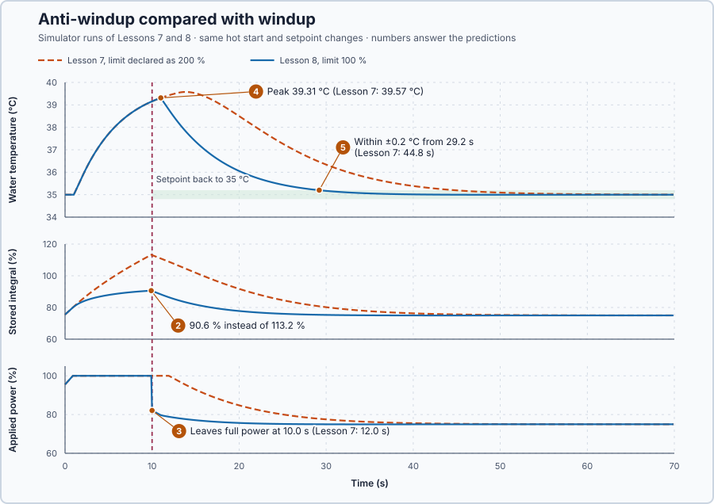

# 8. Anti-windup

In this lesson, you will stop the integral from piling up a demand the heater cannot deliver. You will repeat Lesson 7's test and compare how quickly the water recovers when the setpoint returns to 35 °C.

## The problem

Lesson 7 asked for 45 °C, which this heater cannot hold, and returned to 35 °C after 10 s. While the heater was at full power, the integral kept rising to 113.2%, 13 points more than the heater can ever deliver. After the return, that piled-up integral kept the heater at full power for another 2 s, the water peaked at 39.57 °C, and it was back within 0.2 °C of 35 °C only at 44.8 s.

We will keep the integral in step with the power the heater actually applies, and repeat the same test.

## What we need

We need to:

1. notice when the heater applies less than the controller requests;
2. stop the integral from growing beyond what the heater can deliver during that time; and
3. leave the PI controller unchanged whenever the request can be applied.

## The new idea

**Anti-windup** stops the integral from piling up a demand the heater cannot deliver. Whenever the requested power is above what is applied, it pulls the integral back towards what the heater actually does.

**In words.** At every update the controller compares its request with what the heater applied. If they differ, it moves the integral part of the way towards the value that would make them equal; if they agree, it changes nothing, and the controller is the ordinary PI controller of Lesson 6. For this heater, the integral then stays close to the value that makes the request about 100 % while the heater is at full power, so the controller can turn down as soon as the water no longer needs full power. The method used here is called **back-calculation**: the integral is calculated back from the applied output. In PLC terms: the controller reads back what its output really did and corrects its own memory.

**The formula.** First the ordinary update gives $I^* = I_{old} + K_i\, e\, \Delta t$ and the request $u_r = P + I^*$. The integral that would make the request equal to the applied output is $u_a - P$. It differs from $I^*$ by $(u_a - P) - I^* = u_a - u_r$. Back-calculation removes a fraction of that difference at every update:

$$
I_{next} = I^* + \frac{\Delta t}{T_t}\,(u_a - u_r).
$$

- $P = K_p\, e$ is the proportional part, in percent;
- $I^*$ is the integral after the ordinary update, in percent;
- $u_r$ is the requested output and $u_a$ the applied output, in percent;
- $T_t$ is the **tracking time**, in seconds: how quickly the integral is pulled back;
- $\Delta t$ is the update interval, 0.1 s.

With $T_t = 1$ s and $\Delta t = 0.1$ s, the fraction is $0.1/1 = 0.1$: one tenth of the mismatch is removed at each update.

**Example.** The old integral is 110 % and the error 5 °C, with $K_p = 2$ and $K_i = 0.5$ as in Lesson 7.

1. $I^* = 110 + 0.5 \times 5 \times 0.1 = 110.25\%$.
2. $u_r = 2 \times 5 + 110.25 = 120.25\%$, applied as 100 %.
3. The correction is $0.1 \times (100 - 120.25) = -2.025$ points.
4. $I_{next} = 110.25 - 2.025 = 108.225\%$.

The sign of the correction follows the limit. At the upper limit the request is too high, so the correction is negative. At the lower limit, for example a −20 % request applied as 0 %, it is $0.1 \times (0 - (-20)) = +2$ points. When request and applied output agree, the correction is zero, so ordinary PI control is unchanged.

**The limitation.** Anti-windup changes only the stored integral. It cannot make the heater stronger: 45 °C stays out of reach, because full power holds at most 40 °C. The tracking time is a controller choice. A shorter tracking time pulls the integral back faster, but it must still be checked on the delayed heater.

## Prediction

Before running, answer these questions:

1. For an old integral of 110% and an error of 5 °C, calculate $I^*$, the request, the correction and the next integral. What is the correction for a −20% request applied as 0%, and for equal request and applied output?
2. How large will the integral get before the setpoint returns at 10 s?
3. When the setpoint returns to 35 °C, will the heater leave full power at once?
4. Will the peak temperature be lower than Lesson 7's 39.57 °C?
5. Will the water be back within 0.2 °C of 35 °C sooner than Lesson 7's 44.8 s?

## Implementation

Open [`src/Main.st`](src/Main.st). It is Lesson 7's program with one correction: the controller is now told the heater's real limit.

```st
OutputMaximum := LREAL#100.0,
TrackingTime := LREAL#1.0,
AntiWindup := PIDAntiWindup#BackCalculation
```

`Control.PID` applies back-calculation with $T_t$ = 1 s whenever its request exceeds 100%. `TrackingCorrection` shows the correction of the integral at each update. The hot start, the 45 °C step and the return at 10 s are unchanged, as are Lesson 7's signals.

**Exercise.** Work the four steps of the worked update by hand, then the −20% case. `trust-dev test --project tests` checks the same arithmetic.

## Experiment in Control Studio

1. Use your recording of Lesson 7's run for the comparison; if you have none, run Lesson 7 first.
2. Open this lesson's project and start **Simulator**. The heater holds 35 °C with 75% power and the integral at 75%. In the **truST** side bar, select **Control Studio**.
3. On **Identify**, choose **Project experiment** from **Method**. **Signals** already shows `P1.Setpoint · Setpoint (°C)`, `P1.ProcessValue · Process value (°C)` and `P1.AppliedHeaterPower · Applied output (%)`; add `P1.PairedRequestedHeaterPower · state (%)`, `P1.IntegralCorrection · state (%)` (the stored integral) and `P1.TrackingCorrection · state (percentage points)`.
4. Answer the predictions before starting.
5. Select **Review project test** and check the declared **70.1 s** duration, the same as in Lesson 7.
6. Select **Confirm and start**; this is time zero, and the setpoint jumps to 45 °C.
7. Watch the tracking correction turn negative whenever the request exceeds 100%. After the run, hover 9.9 s, the return at 10 s, the peak temperature and the time the water is back within 0.2 °C of 35 °C, and compare each with Lesson 7. A time you read can differ by one 0.1 s sample from the table below, depending on the update in which the test started.
8. At completion, Control Studio shows **Project test completed. Outputs restored.** and the heater command is 0%.

Select **Abort test** to stop early. To repeat, stop and restart **Simulator**.

## Evidence and decision



The numbered marks answer predictions 2–5. The worked update gives $I^* = 110.25\%$, $u_r = 120.25\%$, a correction of −2.025 points and $I_{next} = 108.225\%$; the −20% case gives +2 points and equal values give zero, which answers prediction 1.

From the two recorded runs, both from the same hot start:

| | Lesson 7, limit declared as 200% | Lesson 8, limit 100% |
| --- | ---: | ---: |
| Tracking correction at 9.9 s | 0 | −0.26 point per update |
| Integral at 9.9 s | 113.2% | 90.6% |
| Request at 9.9 s | 124.9% | 102.6% |
| Applied output first below 100% | 12.0 s | 10.0 s |
| Peak temperature | 39.57 °C at 13.8 s | 39.31 °C at 11.0 s |
| Within 34.8–35.2 °C from | 44.8 s | 29.2 s |

2. The correction was negative whenever the request exceeded 100%, and it held the integral at 90.6% instead of letting it climb to 113.2%.
3. When the setpoint returned, P fell to −8.3% and the request dropped at once to 82.1%, so the heater left full power immediately instead of 2 s later.
4. The water peaked 0.26 °C lower, at 39.31 °C.
5. It was back within 0.2 °C of 35 °C at 29.2 s, 15.6 s sooner: 19.2 s after the setpoint reduction instead of 34.8 s.

Both runs have the same 40 °C full-power limit, so neither could reach 45 °C; that is capacity, not anti-windup. Anti-windup is accepted: with the heater's real limit declared, the integral stays consistent with what the heater can deliver, and the recovery is not delayed by a piled-up demand. These are simulation results.

## Conclusion

Anti-windup feeds the applied output back into the integral. While the heater is at its limit, back-calculation pulls the integral towards the value that matches the power actually delivered; when the request can be applied, it does nothing, and PI control is unchanged.

For this heater, the integral stayed near 90%, the heater turned down at the moment the setpoint returned, and the water recovered 15.6 s sooner than in Lesson 7.

## Check yourself

1. **The request is 130% and the heater applies 100%. With Δt = 0.1 s and Tt = 1 s, what is the correction to the integral at this update?**
   0.1 × (100 − 130) = −3 percentage points.
2. **Why does anti-windup not change the response when the heater is not at a limit?**
   Then the applied output equals the request, so $u_a - u_r = 0$ and the correction is zero.
3. **With anti-windup, why could the water still not reach 45 °C?**
   Anti-windup only changes the stored integral, not the heater's power. Full power holds at most 40 °C.

## Reason for the next lesson

The integral now accounts for the heater's limit, and we have tested recovery from an unreachable setpoint. Normal operation poses two other questions: how well does the loop follow a reachable setpoint change, and how well does it recover when extra heat is lost while the setpoint stays fixed? So far no requirement says what a good response is.

[Setpoint and disturbance response](../09-setpoint-and-disturbance-response/README.md) separates those two events and states a requirement for each before the test.
