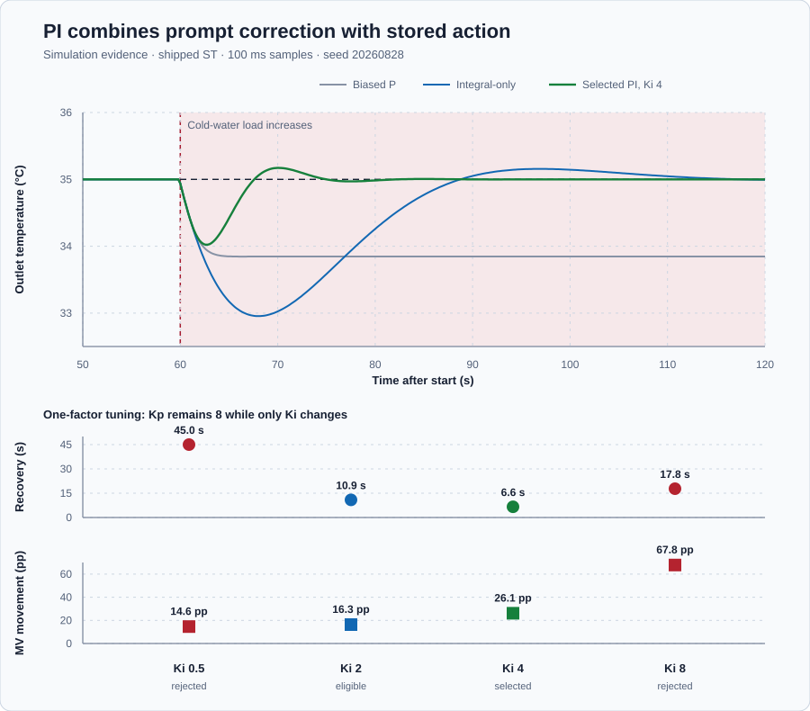

# Water-heater PI control

Course position: Lesson 7 of 84. Previous lesson: [Integral action](../06-water-heater-integral/README.md). Next lesson: [Actuator saturation](../08-water-heater-saturation/README.md).

**Lesson objective:** Keep the proven proportional gain fixed, vary only integral gain in a bounded comparison, and select a PI controller that restores temperature promptly without excessive overshoot, saturation, or actuator movement.

**Evidence class:** Simulation evidence. These results are not physical-plant evidence.

## The problem

The same electric recirculating water heater must hold outlet water at 35 degrees Celsius. Its sensor measures outlet temperature. A one-sided electric element adds 0 to 100 percent heater power but cannot actively cool. Increased cold-water flow is the disturbance.

The safe state is Manual mode with zero heater power. Every comparison begins from the same measured operating point: 35 degrees Celsius held by 75 percent heater power.

Lesson 5's proportional controller reacted promptly but retained 1.15 degrees Celsius final error. Lesson 6's integral-only controller reduced final error to 0.02 degrees Celsius, but early-load error increased from 1.07 to 1.62 degrees Celsius and heater movement from 9.24 to 17.38 percentage points.

The heater needs proportional action for an immediate correction and integral action for a stored holding output. Merely enabling both terms does not establish how strongly they should act together.

## What we need

We need one controller that reacts promptly to a new temperature error and also removes the remaining constant-load error. The immediate and accumulated contributions must stay visible so integral gain can be varied without changing the proven proportional action.

## The new idea

The **setpoint ($SP$)** is the desired outlet-water temperature, and the **process value ($PV$)** is the measured outlet-water temperature. Both use degrees Celsius. The **error ($e$)** is the setpoint minus the process value. Positive error means the water is too cold.

$e = SP - PV$

The **proportional gain ($K_p$)** is requested-output percentage points per degree Celsius of present error. The **integral gain ($K_i$)** is stored-output change in percentage points per degree Celsius-second. The **cycle time ($\Delta t$)** is seconds between updates.

The **proportional increment ($\Delta u_P$)** is the requested-output change caused by the change in error during one scan, in percentage points. The **integral increment ($\Delta u_I$)** is the change caused by present error and cycle time. The **requested manipulated variable ($MV_{\mathrm{requested}}$)** is the preliminary request before limits. The **applied manipulated variable ($MV_{\mathrm{applied}}$)** is the bounded heater command. The **previous requested output ($MV_{\mathrm{previous}}$)** is the value from the last update that the current update uses, in percent.

Conceptually, parallel PI adds an immediate proportional contribution to the
stored integral contribution ($u_I$):

$MV_{\mathrm{requested}} = K_p \times e + u_I$

The shipped controller executes the same law incrementally. Write the
positional law for the current and previous scans:

$MV_{\mathrm{requested},k} = K_p \times e_k + u_{I,k}$

$MV_{\mathrm{previous},k-1} = K_p \times e_{k-1} + u_{I,k-1}$

Subtract the previous equation from the current equation. The left side is the
required output change. On the right, proportional output changes with error,
and Lesson 6 established that the integral-state change is
$K_i \times e_k \times \Delta t$:

$MV_{\mathrm{requested},k} - MV_{\mathrm{previous},k-1} = K_p \times (e_k-e_{k-1}) + K_i \times e_k \times \Delta t$

For this constant-setpoint, unsaturated experiment, name the two terms:

$\Delta u_{P,k} = K_p \times (e_{k} - e_{k-1})$

$\Delta u_{I,k} = K_i \times e_{k} \times \Delta t$

$MV_{\mathrm{requested},k} = MV_{\mathrm{previous},k-1} + \Delta u_{P,k} + \Delta u_{I,k}$

The proportional increment reacts to a change in error during the current
scan. The integral increment continues whenever present error is nonzero. Their
units are both percentage points, so they can be added to the previous percent
output. Once a limit is active, requested and applied output need not be equal;
Lesson 8 studies that boundary.

The **integral time ($T_i$)** is the seconds integral action needs to accumulate
the same output contribution as proportional action produces from unchanged
error. Proportional action contributes $K_p e$. Over $T_i$ seconds, integral
action contributes $K_i e T_i$. Set them equal:

$K_p \times e = K_i \times e \times T_i$

For nonzero error, cancel $e$ and divide by $K_i$:

$T_i = K_p / K_i$

The units are seconds because
$(\%/{}^\circ\mathrm{C}) /(\%/({}^\circ\mathrm{C}\,s)) = s$. At fixed $K_p$,
increasing $K_i$ shortens $T_i$ but may increase overshoot, saturation,
oscillation, and actuator movement.

Define the comparison before seeing its results. The final window is 110.1
through 120.0 seconds. It is settled only when all samples are finite and
synchronized, PV and applied output remain within their hard limits, PV range
is at most 0.1 degrees Celsius, applied-output range is at most 1.0 percentage
point, and output does not remain limited. Otherwise final error is `Not
settled`.

Early-load and final-window mean absolute error use the Lesson 6 calculation:

$MAE = \operatorname{mean}(|SP_k-PV_k|)$

The early window is 60.1–75.0 seconds; the final window is 110.1–120.0 seconds.
The **recovery time** starts at the 60-second load and ends at the first sample
where absolute error is at most 0.2 degrees Celsius and remains there:

$\text{recovery time} = t_{\text{first sustained}} - 60.0\,s$

The **post-load overshoot** is the largest positive excursion above setpoint
from 60.1 through 120.0 seconds; negative excursions do not count as overshoot:

$\text{post-load overshoot} = \max_k\left(\max(PV_k-SP_k,0)\right)$

The **cumulative applied-output movement** is total actuator travel after the
load:

$\text{applied movement} = \sum_k |MV_{\mathrm{applied},k}-MV_{\mathrm{applied},k-1}|$

Absolute values make upward and downward movement add instead of cancel. The
unit is percentage points. The **saturation duration** is the number of samples
at the lower or upper output limit multiplied by the 0.1-second cycle:

$\text{saturation duration} = N_{\mathrm{limited}} \times \Delta t$

**Validity prerequisite:** every normal candidate must use Kp 8 and differ only
in Ki; it must use the same plant, 50-second Manual preparation at the measured
75 percent holding output, Auto transfer, load event, timing, limits, and seed.
Every run must restore at 120.1 seconds to Manual with zero requested and
applied output. The separate 45 degrees Celsius exposure is diagnostic evidence, never
a tuning candidate.

**Decision direction:** a candidate is eligible only if it is finite, settled,
recovers within 15 seconds, has at most 0.2 degrees Celsius final MAE, at most
0.25 degrees Celsius overshoot, and zero normal-run saturation duration. These
are simulation teaching criteria, not physical-plant acceptance threshold
values: they are declared teaching values chosen so the requirement actually
discriminates candidates. 15 seconds is faster than Lesson 6's 25.5-second
integral-only recovery, so a passing candidate must genuinely improve on that
baseline; 0.2 degrees Celsius reuses the same band that defines recovery time
above, so the final-error and recovery criteria stay consistent; and 0.25
degrees Celsius permits the small overshoot fast integral action produces
without excusing the much larger overshoot the $K_i$ 8 candidate later shows.
Select shortest recovery; when two results differ by no more than one sample
(0.1 second), prefer lower movement.

## Prediction

With unchanged 2 degrees Celsius error, $K_p$ 8, $K_i$ 4, cycle time 0.1 second, and previous output 75 percent, the proportional increment is 0 percentage points. Integral action adds:

$\Delta u_I = 4 \times 2 \times 0.1 = 0.8\text{ percentage point}$

The preliminary request is therefore 75.8 percent.

At $K_p$ 8, $K_i$ 0.5, 2, 4, and 8 give $T_i$ 16, 4, 2, and 1 second. Predict the fastest and most aggressive candidate before viewing results.

The shipped Control Studio run starts safely at SP 35 degrees Celsius, PV 20
degrees Celsius, Manual mode, and zero output. Auto resets the error history, so
the first proportional increment is zero. The integral increment is
$4 \times 15 \times 0.1 = 6$ percentage points. Added to the inherited measured
75 percent holding output, the first unsaturated request is therefore 81
percent. This startup calculation is distinct from the qualified four-candidate
comparison, which begins each case settled at 35 degrees Celsius and 75 percent.

## Implementation

The program configures `Control.PID`, exposes both increments and the request,
starts safely at Manual zero, and preloads the visible measured holding output
inherited from Lesson 5 before Auto. This is the shipped per-scan logic
verbatim, after the one-time startup block that runs only once:

```st
(* Control Studio gain edits are adopted together at the next scan boundary.
   Configure changes parameters without resetting the retained PI state. *)
Parameters.ProportionalGain := ProportionalGain;
Parameters.IntegralGain := IntegralGain;
Controller.Configure(Parameters := Parameters);

Input.Setpoint := Setpoint;
Input.ProcessValue := ProcessValue;
Input.ManualOutput := ManualHeaterPower;
IF AutoMode THEN
    IF NOT LastAutoMode THEN
        (* Seed PI from the measured Manual holding output so Auto starts
           from the same physical operating point without an output bump. *)
        InitialState.Setpoint := Setpoint;
        InitialState.ProcessValue := ProcessValue;
        InitialState.NominalOutput := MeasuredHoldingOutput;
        InitialState.SaturatedOutput := MeasuredHoldingOutput;
        Controller.Initialize(State := InitialState);
        PreviousSetpoint := Setpoint;
        PreviousProcessValue := ProcessValue;
    END_IF;
    ProportionalIncrement := ProportionalGain
        * ((Setpoint - PreviousSetpoint) - (ProcessValue - PreviousProcessValue));
    IntegralIncrement := IntegralGain * (Setpoint - ProcessValue) * LREAL#0.1;
    IF NOT LastAutoMode THEN
        RequestedHeaterPower := MeasuredHoldingOutput
            + ProportionalIncrement + IntegralIncrement;
    ELSE
        RequestedHeaterPower := AppliedHeaterPower
            + ProportionalIncrement + IntegralIncrement;
    END_IF;
    Input.Mode := PIDMode#Auto;
ELSE
    ProportionalIncrement := LREAL#0.0;
    IntegralIncrement := LREAL#0.0;
    RequestedHeaterPower := ManualHeaterPower;
    Input.Mode := PIDMode#Manual;
END_IF;
Input.CycleTime := LREAL#0.1;
AppliedHeaterPower := Controller.Update(Input := Input);
```

It uses **positive action**: Lesson 4 established that because heating raises temperature, positive error must request positive heater power, so the controller's sign convention is never reversed. It also uses a 0.1-second cycle, zero derivative and bias, and 0-to-100-percent limits. Constraint handling may alter retained state after a request exceeds a limit; Lesson 8 studies that case.

The shipped Control Studio run keeps Kp 8 and Ki 4 fixed. Those project-owned
gain values are live-mapped into the parameter structure and take effect at
the next 0.1-second scan; the program calls `Configure` without
reinitializing retained controller state, so a gain edit changes the running
case immediately and is not a case reset. The exposed increments and
`Controller.Update` therefore use the same gains. The native comparison, not
Control Studio, creates fresh restored runs for the other Ki candidates.

## Experiment in Control Studio

Test runs the shipped selected PI candidate, Kp 8 and Ki 4, for 120.1 seconds by
writing the sole reviewed Boolean authority, `P1.ExperimentEnabled`. The project derives Auto mode and owns the measured 75
percent preload and the load event at 60 seconds. The retained Ki sweep,
inherited P/I references, and separate unreachable-setpoint exposure come from
the native evidence test. Control Studio does not pretend to generate or apply
those additional candidates through Tune. Completion restores Auto false and
therefore Manual zero output. The deterministic Simulation seed is 20260828.

### Control Studio actions

1. **Monitor** — Select target **Simulator**, choose **Run**, then open **Control Studio → Monitor → Response**.
   - **Baseline check:** Wait until the header shows **Simulation**, **Running**, and current data. Confirm SP and PV (degC); requested and applied output (%); Kp (%/degC); Ki (%/(degC·s)); proportional and integral increments (percentage points); measured holding output (%); mode; limits; and quality. The real safe initial state is SP = 35 degC, PV = 20 degC, requested output = 0%, applied output = 0%, Kp = 8 %/degC, Ki = 4 %/(degC·s), measured holding output = 75%, and Manual mode. The 35 degC / 75% condition is the qualified starting point for the retained native comparison, not the shipped initial state. The unresolved trade-off is Lesson 5's 1.15 degC final error versus Lesson 6's slower 1.62 degC early-load error and 17.38 pp movement.
   - **Decision before action:** Read **Prediction** above, then state what should move first and in which direction. Use this decision rule: Keep Kp fixed at 8, qualify each Ki candidate, and select Ki 4 by shortest eligible recovery before separately exposing an unreachable setpoint.
   - **Successful evidence:** The Response plot advances, the displayed values are finite and current, and **Start recording** is enabled. Select **Start recording** only after those conditions are visible.
   - **Recovery:** If recording is disabled or the plot reports unavailable or stale samples, stop the Simulator, correct the displayed runtime or binding problem, restart it, and repeat the baseline check.
   - **Record:** Write down the initial SP, PV, requested and applied output, both gains, both increments, measured holding output, mode, and your predicted 81% first request before opening Test.

2. **Test** — Restart the **Simulator** from the declared initial state, then open **truST sidebar → Control Studio → Test**.
   - **Baseline check:** Confirm **Experiment** = **Observe without excitation**, **Amplitude** = **0** (disabled), and **Maximum duration (s)** = **120.1**. The reviewed authority is **Experiment authority** (`P1.ExperimentEnabled`). Control Studio sets it true; the project derives Auto mode and owns selected Kp 8, selected Ki 4, the measured holding-output preload, and the timed load event. The native sweep restores the Manual holding condition before starting the next candidate and restores every run at 120.1 seconds to Manual with zero requested and applied output.
   - **Decision before action:** Before selecting **Review test**, predict the response to Cold-water flow increases at 60 s in the normal comparison. Confirm the live values are current and the reviewed plan stays inside Outlet-water temperature 0 degC to 80 degC; Applied heater power 0 % to 100 %.
   - **Successful evidence:** Select **Review test**, verify **P1.ExperimentEnabled**, the timeout, stop conditions, and false restoration, then select **Confirm and start**. The state changes to **Running**, **Abort test** remains available, the project derives Auto mode, the first unsaturated request is predicted as 81%, and completion restores experiment authority false, Auto false, and zero requested and applied output.
   - **Recovery:** For a rejected, stale, unsafe, unavailable, failed, or aborted state, read the displayed reason, stop and restart the Simulator, correct that cause, restore the safe Manual-zero initial state, and review a new test.
   - **Record:** Compare the first request and load response with your predictions. Retain the terminal state, restoration result, and deterministic seed **20260828**.

## Evidence and decision

Apply the validity, settling, MAE, recovery, overshoot, movement, saturation,
eligibility, and ranking definitions declared before the experiment. The normal
comparison and the separate unreachable exposure remain distinct evidence.



| Controller case | Run status | Early error | Final error | Recovery | Overshoot | Applied movement | Decision |
| --- | --- | ---: | ---: | ---: | ---: | ---: | --- |
| Gain 8, measured 75% bias | Settled reference | 1.07 °C | 1.15 °C | Not recovered | 0.00 °C | 9.24 pp | Reference; constant offset remains |
| Integral-only, $K_i$ 0.5 | Settled reference | 1.62 °C | 0.02 °C | 25.5 s | 0.16 °C | 17.38 pp | Reference; slower than criterion |
| PI, $K_i$ 0.5 | Settled | 0.88 °C | 0.13 °C | 45.0 s | 0.00 °C | 14.60 pp | Rejected: recovery too slow |
| PI, $K_i$ 2 | Settled; eligible | 0.49 °C | <0.01 °C | 10.9 s | <0.01 °C | 16.32 pp | Eligible; not fastest |
| PI, $K_i$ 4 | Settled; eligible | 0.34 °C | <0.01 °C | 6.6 s | 0.17 °C | 26.11 pp | Selected |
| PI, $K_i$ 8 | Settled; saturated | 0.38 °C | <0.01 °C | 17.8 s | 0.51 °C | 67.79 pp | Rejected: overshoot and saturation |

The complete samples are in [`figures/pi-comparison.csv`](figures/pi-comparison.csv), and their qualification and selection fields are in [`figures/qualification-summary.csv`](figures/qualification-summary.csv).

$K_i$ 4 is selected: recovery is 6.6 seconds, overshoot 0.17 degrees Celsius, normal saturation zero, and final error below 0.01 degrees Celsius. $K_i$ 8 is rejected despite shorter $T_i$: it overshoots 0.51 degrees, saturates 0.7 seconds, and moves 67.79 percentage points.

In the separate 45 degrees Celsius exposure, the selected controller requests 159.00 percent while the heater applies at most 100.00 percent. It remains saturated for 60.1 seconds and reaches only 40.00 degrees Celsius. [`figures/unreachable-exposure.csv`](figures/unreachable-exposure.csv) retains that distinct experiment. Every normal run and the exposure end in Manual with zero requested and applied output.

## Conclusion

Proportional action responds when temperature falls. Integral action changes stored output until additional heat loss is balanced at zero error. Excessive $K_i$ keeps changing output while delayed temperature response is still arriving, producing overshoot, saturation, and movement.

For this self-regulating heater near the qualified operating point, PI supplies both prompt correction and zero constant-load offset. The selected numbers are simulation results, not an approved physical tuning.

## Reason for the next lesson

On another self-regulating process, hold the already justified proportional gain fixed, vary one integral setting at a time, qualify every run before ranking it, and select against requirements declared before testing. Do not assume the same gains or thresholds transfer to another plant.

The unreachable exposure leaves a measured problem: preliminary requested output and applied physical output differ. Lesson 8 examines amplitude saturation and the controller-state behavior created by that mismatch.
