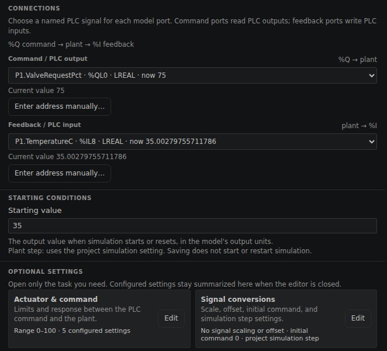
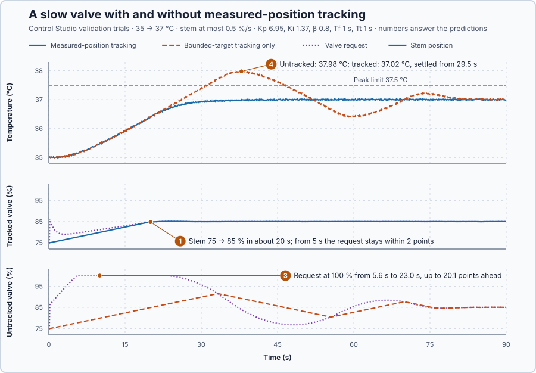

# 31. Actuator tracking

You will control the water temperature through a motor-driven hot-water valve whose stem moves slowly, and keep the integral consistent with the position the valve has actually reached.

## The problem

Lesson 30 commissioned the complete heater controller: every declared trial passed, the setpoint step settled in 6.7 s, and the heater applied each command at once. Here the heat comes from hot water through a valve, and the valve moves more slowly than its command: its motor moves the stem at most 0.5 % per second, so a request from 75 % to 85 % takes at least 20 s to arrive.

While the stem travels, the temperature error persists, the integral keeps growing and the request runs far ahead of the stem, up to 100 %. When the water finally reaches the setpoint, the request is much too high and the slow stem needs many seconds to come back: the temperature overshoots. This is **rate-limit windup**. The request stays inside 0–100 % while the stem lags, so the anti-windup at the output limits does not see it.

We will feed the position the stem has actually reached back into the controller.

## What we need

We need the integral to stay consistent with what the valve actually delivers, not with what was requested.

## The new idea

**Actuator tracking** feeds the valve's actual position back into the controller, so the integral does not pile up while the valve is still travelling: a valve needs time to move. For this heater, the integral then grows only as fast as the heat it asks for can arrive through the slow stem.

**In words.** Lesson 8's anti-windup handled one way in which a command fails to arrive: the request goes beyond 0–100 %, and the heater gives only the limit. A slow valve fails in a second way, inside the range: the request is possible, but the stem needs time to get there. Three positions must therefore be told apart:

- the **requested position**, the PI request before any limit (`NominalRequestPct`);
- the **bounded target**, the request limited to 0–100 % and sent to the valve (`ValveRequestPct`); and
- the **measured position**, where the stem actually is (`StemPositionPct`).

While the stem travels, the water is still too cold, so the integral keeps growing as if the requested heat were already arriving. Comparing the request with its 0–100 % limits shows nothing wrong, because the bounded target is inside the range; only the measured position tells the truth. Tracking uses it: at every update, the gap between the measured position and the bounded target pulls the integral towards the stem. Many PLC valve blocks already compare the command with the position feedback to raise a discrepancy alarm; tracking uses the same comparison to correct the integral.

For this heater, the request then stays a little ahead of the stem instead of running far ahead, and when the water reaches the setpoint there is no large surplus of request to unwind.

**The formula.** Hot water delivers heat by cooling down:

$$
Q = c_p\, q\,(T_{in} - T).
$$

After each ordinary PI update, tracking corrects the integral:

$$
I_{next} = I^* + \frac{\Delta t}{T_t}\,(x - u_r).
$$

- $Q$ is the delivered heat, in kilowatts;
- $c_p$ is the specific heat of water, in kilojoules per kilogram and °C: the energy that warms 1 kg by 1 °C;
- $q$ is the hot-water mass flow, in kilograms per second;
- $T_{in}$ is the supply temperature and $T$ the water temperature, in degrees Celsius;
- $I^*$ is the integral after the ordinary update and $I_{next}$ the integral after the correction, in percent;
- $u_r$ is the bounded target and $x$ the measured position, in percent; and
- $\Delta t$ is the 0.1 s update interval, and $T_t$ the tracking time of Lesson 8, here the controller's own 1 s `TrackingTime`.

While the stem lags behind, $x < u_r$ and the correction is negative: each update removes $\Delta t/T_t = 0.1$ of the gap from the integral.

**Example: a 35 → 37 °C step through the slow valve.** The commissioned controller has $K_p = 6.95$ %/°C, $K_i = 1.37$ %/(°C·s) and $\beta = 0.8$. Follow the numbers:

1. With $c_p = 4$ kJ/(kg·°C), 1.5 kg/s of hot water that enters at 60 °C and leaves at the water's 35 °C delivers $4 \times 1.5 \times (60 - 35) = 150$ kW, the 75 % holding power. If the flow is 0.02 kg/s per percent of stem position, each percent delivers $4 \times 0.02 \times 25 = 2$ kW, as each percent of the electric heater's command did. This lesson's simulated valve heater keeps those 2 kW per percent at every opening and temperature, a teaching simplification.
2. Holding 37 °C therefore needs $10 \times 17 / 2 = 85$ %. The stem must travel 10 points, and at 0.5 % per second that takes 20 s.
3. At the step, P jumps by $6.95 \times 0.8 \times 2 = 11.1$ points, so the request jumps to about 86 %, while the stem can move only 0.05 point per update.
4. With a 2 °C error, the integral grows by $1.37 \times 2 \times 0.1 = 0.27$ point per update, 2.7 points per second: more than five times the stem's 0.5 point per second. Without measured-position tracking nothing holds it back, and the request runs far ahead of the stem.
5. With tracking, a stem at 75 % and a request at 80.1 % give a correction of $0.1 \times (75 - 80.1) = -0.51$ point. The pull grows with the gap: right after the step it removes about a tenth of the 11-point lead at every update, and at a gap of 2.7 points it just cancels the 0.27 point of growth. So within a few seconds of the step the request is pulled back to 2–3 points ahead of the stem, and it comes closer as the error shrinks.

**The limitation.** Tracking needs a measured position. Without position feedback, or with a feedback value outside 0–100 %, the program cannot correct the integral, and the slow stem winds it up again. The 2 kW per percent also assumes that the flow follows the stem in proportion, which the next lesson measures.

## Prediction

Before running, answer these questions:

1. How long does the stem take from 75 % to 85 %?
2. With the stem at 75 %, a request of 80.1 %, $\Delta t = 0.1$ s and $T_t = 1$ s, what is the integral correction?
3. After a 35 → 37 °C step without measured-position tracking, how far will the request run ahead of the stem?
4. How will the temperature respond with and without measured-position tracking?

| Quantity | Value |
| --- | ---: |
| Stem travel 75 → 85 % at 0.5 %/s | 20 s |
| Stem needed for 37 °C | 85 % |
| Correction at $x = 75$ %, $u_r = 80.1$ % | −0.51 point |

## Implementation

The simulator's actuator moves the stem at 0.5 % per second and publishes the position it has reached to `%IL16`, read as `StemPositionPct`. Open [`src/Main.st`](src/Main.st). After each ordinary PI update, it applies the correction:

```st
ValveRequestPct := Controller.Update(Input := Input);
...
IF TrackMeasuredPosition AND StemPositionPct >= LREAL#0.0 AND StemPositionPct <= LREAL#100.0 THEN
    TrackingCorrectionPct := MeasuredTrackingCorrection(StemPosition := StemPositionPct,
        Request := ValveRequestPct, Elapsed := ElapsedS, TrackingTime := ConfiguredParameters.TrackingTime);
    ObservedState := Controller.GetState();
    ObservedState.NominalOutput := ObservedState.NominalOutput + TrackingCorrectionPct;
    Controller.Initialize(State := ObservedState);
ELSE
    ...
END_IF;
```

In `Control.PID`'s incremental form the stored `NominalOutput` is $P + I$, so correcting it corrects $I$. $T_t$ is the controller's own `TrackingTime`, the one its anti-windup uses at 0 % and 100 %. `TrackMeasuredPosition` = FALSE tracks only the bounded target: the counterexample. The rest of the program is the controller commissioned in Lesson 30. `control-loop.json` declares the stem position as the valve's feedback, so Control Studio identifies the water from the stem.

**Exercise.** Run the tests in [`src/tests.st`](src/tests.st) from the **Testing** view. They check the −0.51 point correction, no correction for a stem that has arrived, and the 20 s travel time.

## Experiment in Control Studio

This loop is slower than the heater, so its requirements are declared for it before any result: a 35 → 37 °C step over 90 s, which needs 85 % and therefore 20 s of stem travel. The **tracked step** must peak at or below 37.5 °C, be within ±0.2 °C from 60 s and settle within ±0.1 °C by 60 s. The **untracked step**, with tracking off, carries only the operating limits: its rows show what happens.

1. Open this lesson's project and start **Simulator**. First look at the new plant: in the **truST** side bar, select **Devices & Connections** and select **valve-heater-lesson-30**; **Configure plant** opens. The model is **First order with dead time**: response gain 0.2, response time 5 s, delay 1 s. Under **CONNECTIONS**, **Command / PLC output** is `P1.ValveRequestPct · %QL0`, the valve request your program writes, and **Feedback / PLC input** is `P1.TemperatureC · %IL8`, the water temperature. Under **OPTIONAL SETTINGS**, **Actuator & command** holds the valve motor: range 0–100 % and five settings, among them 0.5 % per second in each direction; the stem position it reaches goes to `P1.StemPositionPct` (%IL16). Close the panel with **Cancel**.

   

2. The water holds 35 °C with the valve at 75 % in Manual. Select **Control Studio**. On **Identify**, select **Identify plant**. From the stem position, Control Studio fits **x[k+1] = [0.9811] x[k] + [0.003773] (u[k] − 75)**: in steady state $x\,(1 - 0.9811) = 0.003773\,(u - 75)$, a gain of 0.2 °C per percent, and a 0.1 s step shrinks the remaining gap by the factor 0.9811, a time constant of $-0.1/\ln 0.9811 = 5.2$ s.
3. On **Tune**, choose **P1.Controller · PI** and **Manual**. Enter the commissioned controller: **Proportional gain (Kp)** 6.95, **Integral gain (Ki)** 1.37, **Setpoint weight (β)** 0.8 and **Measurement filter time (Tf)** 1.
4. Select **Requirements…** and enter **Setpoint change (°C)** 2, **Maximum steady-state error (°C)** 0.2, **Maximum settling time (s)** 60, **Settling band (±°C)** 0.1 and **Validation duration (s)** 90. Select **Done**, then **Tune controller**.
5. On **Validate**, select **Validate controller** and compare the two steps: request, stem, integral and temperature.
6. Select **Apply**. Control Studio shows **Applied**.

## Evidence and decision



The numbered marks answer predictions 1, 3 and 4; the tests answer 2. From the validation:

| Result | Measured-position tracking | Bounded-target tracking only |
| --- | --- | --- |
| Valve request | 75–86.28 % | 75–100 %; 100 % from 5.6 s to 23.0 s |
| Stem position | 75–85.13 % | 75–91.50 % |
| Integral | up to 87.79 % | up to 101.10 % |
| Water temperature | peak 37.02 °C; within ±0.1 °C from 29.5 s | peak 37.98 °C; within ±0.1 °C from 78.2 s |

1. The stem moved at its 0.5 % per second and reached 85 % about 20 s after the step.
3. Without measured tracking, the request ran to 100 % at 5.6 s and stayed there until 23.0 s, up to 20.1 points ahead of the stem. The integral wound up to 101.1 %, 16 points above the 85 % the new operating point needs.
4. The untracked stem overshot to 91.50 % and the water to 37.98 °C, above the 37.5 °C limit; the request then had to fall to 76.77 % to bring the slow stem back. With measured tracking, the request also jumped to 86.28 % at the step, but it was within 2 points of the stem from 5 s; the water peaked at 37.02 °C and settled from 29.5 s.

Control Studio's own 2 °C step settled in 25.9 s. Tracking removes the overshoot at no visible cost, so we keep it and apply the controller; Control Studio reports **Applied**. These are simulation results for this valve loop, not a physical qualification.

## Conclusion

A slow actuator makes the requested and the delivered position differ inside the output range, where limit-based anti-windup does not see it. Tracking the measured position, $I_{next} = I^* + \frac{\Delta t}{T_t}(x - u_r)$, keeps the integral consistent with what the actuator delivers and removes rate-limit windup.

For this valve, tracking held the request near the stem and the water at most 0.02 °C above 37 °C; without it, the integral wound up to 101 % and the water overshot by almost 1 °C.

## Check yourself

1. **With the stem at 80 %, a request of 90 %, $\Delta t = 0.1$ s and $T_t = 1$ s, what correction does tracking apply?**
   $0.1 \times (80 - 90) = -1.0$ point.
2. **Why does the anti-windup at 0 % and 100 % not prevent rate-limit windup?**
   It compares the request only with the 0–100 % bounds. While the stem lags inside that range, nothing tells the
   integral that the heat has not arrived.
3. **Why does Control Studio identify the water from the stem position rather than from the request?**
   Fitted to the request, the 20 s stem ramp would look like part of the water's own dynamics, and the model would
   be too slow.

## Reason for the next lesson

Tracking used the stem position and assumed that each percent of it delivers 2 kW. But the valve position does not tell the flow: that also depends on the pressure across the valve.

[Valve characteristics](../../09-industrial-control-structures/58-valve-characterization/README.md) measures how much flow each opening gives.
