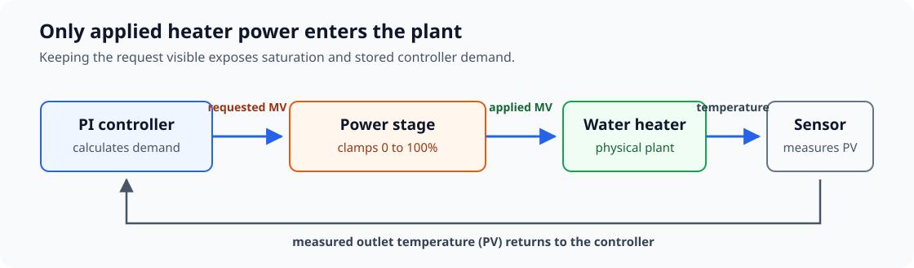
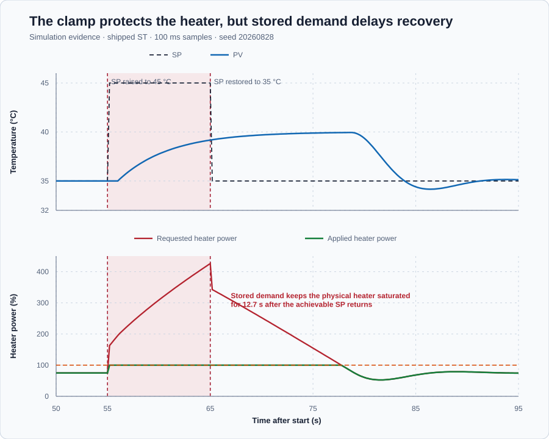

# Water-heater amplitude saturation

Course position: Lesson 8 of 84. Previous lesson: [PI control](../07-water-heater-pi/README.md). Next lesson: [Valve rate limitation](../09-rate-limit/README.md).

**Lesson objective:** Use requested and applied heater power to determine whether a temperature is reachable, diagnose actuator saturation, and explain the resulting integral windup.

**Evidence class:** Simulation evidence. The unreachable temperature request in this lesson is not approved for a physical heater.

## The problem

The equipment is an electric recirculating water heater with a 0 to 100 percent power stage. It is the same heater used in Lesson 7. The element can add heat, but it cannot actively cool the water. Its outlet-temperature sensor reports the water temperature.

Lesson 7 selected proportional gain $K_p = 8$ and integral gain $K_i = 4$. During a separate test, that PI controller requested 159 percent heater power while the physical power stage applied only 100 percent. The water still remained below the requested 45 degrees Celsius. This measured mismatch is the problem investigated here.

Looking only at the applied command is not enough. A flat 100-percent trace cannot tell us whether the controller requested 101 percent or 400 percent. That hidden difference matters because a PI controller remembers past error. A large stored request can keep the heater at full power even after the setpoint becomes reachable again.

## What we need

We need two separate signals: the power calculated by the controller and the power that the heater can actually receive. We also need a simple check that tells us whether the requested temperature can be maintained with the available heater.

With those two pieces of information, we can recognize saturation, explain its cause, and observe what happens when the setpoint returns to a reachable value.

## The new idea

The **setpoint ($SP$)** is the desired outlet-water temperature, measured in degrees Celsius. The **process value ($PV$)** is the measured outlet-water temperature from the sensor, also in degrees Celsius. The **error ($e$)** is the setpoint minus the process value. A positive error means the measured water is colder than desired.

$e = SP - PV$

The **requested manipulated variable ($MV_{\mathrm{requested}}$)** is the heater command that the controller calculates before the physical limit, measured in percent. The **applied manipulated variable ($MV_{\mathrm{applied}}$)** is the command that the heater physically receives, also measured in percent. Only the applied manipulated variable enters the simulated plant.



The **lower heater limit ($MV_{\mathrm{min}}$)** is 0 percent because the element cannot actively cool. The **upper heater limit ($MV_{\mathrm{max}}$)** is 100 percent because the power stage cannot deliver more than full power. The power stage clamps the requested value into that physical range:

The inner minimum is evaluated first: it prevents the request from exceeding
the upper limit. The outer maximum is evaluated second: it prevents that
already upper-bounded value from falling below the lower limit. Therefore a
request inside the range passes unchanged, a request above 100 percent becomes
100 percent, and a request below 0 percent becomes 0 percent.

$\displaystyle MV_{\mathrm{applied}} = \max\left(\min\left(MV_{\mathrm{requested}}, MV_{\mathrm{max}}\right), MV_{\mathrm{min}}\right)$

The **saturation error ($e_{\mathrm{sat}}$)** is requested heater power minus applied heater power, measured in percentage points. A positive saturation error means that the controller is asking for heating power that the actuator cannot deliver.

$e_{\mathrm{sat}} = MV_{\mathrm{requested}} - MV_{\mathrm{applied}}$

The **stored integral contribution ($u_I$)** is the part of the requested heater power accumulated from past temperature error, measured in percent heater power. If positive error continues while the applied output is already 100 percent, this stored contribution can keep growing without producing additional heat. This behavior is called **integral windup**.

Lesson 6 derived one integral update as $K_i e_k dt$. Applying that update for
$N$ scans gives the stored contribution:

$uI_N = uI_0 + \sum_{k=1}^{N} K_i \times e_k \times dt$

When $K_i$, $dt$, and the error are positive, every term in the sum is
positive, so $u_I$ continues to grow. The external clamp prevents extra power
from reaching the heater, but it does not remove terms already stored by this
controller. That is why a bounded applied trace does not by itself prove that
the controller state is bounded.

Before blaming the controller, we must check whether the target is physically reachable. The **ambient or zero-power outlet temperature ($T_0$)** is 20 degrees Celsius in this simulation. The **steady heater gain ($K_h$)** is 0.2 degrees Celsius per percent heater power. The **required steady heater power ($MV_{\mathrm{required}}$)** is the power needed to balance heat loss at the desired steady temperature.

At steady state the simplified heater model says that outlet temperature is
ambient temperature plus heater power multiplied by the steady heater gain:

$PV_{ss} = T_0 + K_h \times MV_{\mathrm{required}}$

At the desired steady condition, $PV_{ss}=SP$. Substitute SP, subtract $T_0$
from both sides, and divide by $K_h$:

$MV_{\mathrm{required}} = (SP - T_{0}) / K_h$

This derivation answers a physical question before controller tuning begins:
how much steady heater power must balance the modelled heat loss at the target?

This relationship belongs to the lesson's simplified linear heater model near this operating region. It is not a measurement of a physical heater.

The **reachability margin ($R$)** is available maximum power minus required
steady power, measured in percentage points:

$\text{reachability margin} = R = MV_{\mathrm{max}} - MV_{\mathrm{required}}$

A nonnegative margin means the model has enough steady authority. A negative
margin means the target requires more than the power stage can deliver, so
changing PI gains cannot make that target reachable.

Define the remaining measures before seeing a result. During the 10.0-second
exposure, peak requested power and peak applied power are the largest sample of
each signal, and peak saturation error is the largest requested-minus-applied
difference:

$\text{peak saturation error} = \max_k(MV_{\mathrm{requested},k}-MV_{\mathrm{applied},k})$

The **post-restoration saturation hold** is the elapsed time after SP restoration
until applied power first leaves the upper limit. Let $t_{restore}=65.0$ seconds
be the instant SP returns to 35 degrees Celsius.
If $t_{release}$ is the first later sample at which applied power leaves the
100-percent upper limit, then:

$\text{post-restoration saturation hold} = t_{release}-t_{restore}$

The **recovery time** ends when absolute temperature error is at most 0.2
degrees Celsius for 2.0 continuous seconds. If $t_{\text{first sustained}}$ is the
first sample after restoration for which
absolute temperature error is at most 0.2 degrees Celsius and remains there
for 2.0 continuous seconds, then:

$\text{recovery time} = t_{\text{first sustained}}-t_{restore}$

If no qualifying sample exists, report `Not recovered`.

**Validity prerequisite:** A run is valid only
when every signal is finite, applied power stays within 0 to 100 percent,
saturation error equals requested minus applied power, SP returns to 35 degrees
Celsius, and the run ends in Manual with zero requested and applied power.

**Decision direction:** the lesson is confirmed only if the 45-degree target
has negative reachability margin, requested power exceeds 100 percent, applied
power stays bounded, and the applied output remains saturated for measurable
time after SP returns to 35 degrees Celsius.

## Prediction

At 35 degrees Celsius, the required power equals the 15-degree temperature rise above ambient divided by the temperature rise produced by one percent heater power.

$\displaystyle MV_{\mathrm{required}} = \frac{35\,{}^\circ\mathrm{C} - 20\,{}^\circ\mathrm{C}}{0.2\,{}^\circ\mathrm{C}/\%} = 75\%$

The heater has 100 percent available, so the **reachability margin** is positive 25 percentage points. The 35-degree-Celsius target is reachable in this model.

At 45 degrees Celsius, the same calculation gives:

$\displaystyle MV_{\mathrm{required}} = \frac{45\,{}^\circ\mathrm{C} - 20\,{}^\circ\mathrm{C}}{0.2\,{}^\circ\mathrm{C}/\%} = 125\%$

The reachability margin is minus 25 percentage points. The 45-degree-Celsius target is therefore unreachable in this model, regardless of how the PI gains are adjusted.

Now predict the first controller update after the setpoint changes from 35 to 45 degrees Celsius while the measured temperature is still 35 degrees Celsius. The **new error ($e_{\mathrm{new}}$)** is 10 degrees Celsius. The **previous error ($e_{\mathrm{previous}}$)** was 0 degrees Celsius. The **controller interval ($\Delta t$)** is 0.1 second.

The **proportional increment ($\Delta u_P$)** is the immediate change in requested power caused by the change in error:

$\Delta u_P = K_p \times (e_{\mathrm{new}} - e_{\mathrm{previous}})$

$\Delta u_P = 8 \times (10 - 0) = 80\text{ percentage points}$

The **integral increment ($\Delta u_I$)** is the power added during this controller interval because the new error is nonzero:

$\Delta u_I = K_i \times e_{\mathrm{new}} \times \Delta t$

$\Delta u_I = 4 \times 10 \times 0.1 = 4\text{ percentage points}$

The controller was requesting 75 percent before the step. It should therefore request:

$MV_{\mathrm{requested}} = 75\% + 80\text{ pp} + 4\text{ pp} = 159\%$

The power stage can apply only 100 percent, so the predicted saturation error is 59 percentage points. Write down these four predictions before running the experiment: 125 percent required, 159 percent first request, 100 percent applied, and 59 percentage points unavailable.

## Implementation

The same positive-acting incremental PI controller from Lesson 7 runs every 0.1 second. Its internal output limits are deliberately wide in this lesson. The separate clamp represents the real power stage, so the controller cannot see that its request has been limited.

The shipped project starts safely in Manual at SP 35 degrees Celsius, PV 20
degrees Celsius, and zero requested and applied power. Control Studio writes
one `P1.ExperimentEnabled` authority. The project then counts scans and owns the
entire sequence: safe start, 75-percent Manual preparation, Auto baseline,
10-second unreachable exposure, reachable recovery, and Manual-zero
restoration. This makes the interactive Test execute the same timing as the
native evidence rather than asking the learner to perform six unsynchronised
manual actions.

In physical order, the sequence begins at Manual zero, applies 75 percent until
the model reaches 35 degrees Celsius, transfers to Auto, requests 45 degrees
Celsius for 10 seconds, restores 35 degrees Celsius, and finally restores
Manual zero.

The running Structured Text follows the signal path introduced above: configure the PI, initialize Auto from the Manual holding power, calculate requested power, clamp applied power, and publish the difference.

```st
Parameters.ProportionalGain := ProportionalGain;
Parameters.IntegralGain := IntegralGain;
Controller.Configure(Parameters := Parameters);

IF AutoMode AND NOT LastAutoMode THEN
    // Start Auto from the power that was already holding 35 degC.
    InitialState.NominalOutput := ManualHeaterPower;
    InitialState.SaturatedOutput := ManualHeaterPower;
    Controller.Initialize(State := InitialState);
END_IF;

RequestedHeaterPower := Controller.Update(Input := Input);

// The plant receives the bounded command, not the unrestricted request.
AppliedHeaterPower := MAX(MIN(RequestedHeaterPower, LREAL#100.0), LREAL#0.0);
SaturationError := RequestedHeaterPower - AppliedHeaterPower;
```

The project keeps the selected Lesson 7 gains fixed during this observation.
It applies them on every 0.1-second scan without resetting the retained
integral state. Any separate gain comparison belongs in a fresh restored native
run; Control Studio writes only experiment authority here.

## Experiment in Control Studio

Test runs the shipped project-owned saturation sequence for 95.1 seconds by
writing the reviewed `P1.ExperimentEnabled` authority. The project changes only
SP during the experiment; it introduces no cold-water disturbance. The native
evidence test executes the same sequence and owns the retained comparison
table and trace. Completion restores the authority false and the project to SP
35 degrees Celsius, Manual mode, and zero requested and applied output. The
deterministic Simulation seed is 20260828.

### Control Studio actions

1. **Monitor** — Start the **Simulator**, then open **truST sidebar → Control Studio → Monitor → Response**.
   - **Baseline check:** Wait until the header shows **Simulation**, **Running**, and current data. Confirm the real safe initial state: SP = 35 degC, PV = 20 degC, requested power = 0%, applied power = 0%, Manual mode, and experiment authority false. Use **Signals** to show requested power, applied power, saturation error, both PI increments, mode, and experiment authority. The 35 degC / 75% condition is prepared by the project after Test starts; it is not the shipped initial state.
   - **Decision before action:** Retain the real PID request separately and clamp only the applied plant command so saturation and windup can be measured before anti-windup is introduced. Keep the two signals visible because the applied trace alone hides unavailable controller demand. Compare your four written predictions with the live traces after the test.
   - **Successful evidence:** The Response plot advances, values are finite and current, quality is good, and **Start recording** is enabled. Select **Start recording**.
   - **Recovery:** If recording is disabled or samples are unavailable or stale, stop the Simulator, correct the runtime or signal-binding message, restart, and repeat the baseline check. Do not continue with invalid data.
   - **Record:** Note the initial SP, PV, requested power, applied power, saturation error, controller mode, and your four written predictions.

2. **Test** — Open **truST sidebar → Control Studio → Test**.
   - **Baseline check:** Confirm **Experiment** = **Observe without excitation**, **Amplitude** = **0** (disabled), and **Maximum duration (s)** = **95.1**. The reviewed authority is **Experiment authority** (`P1.ExperimentEnabled`). Its false-to-true transition starts one project-owned sequence: 0.1 s safe Manual zero, Manual 75% through 50.0 s, Auto at SP 35 degC through 55.0 s, SP 45 degC through 65.0 s, SP 35 degC recovery through 95.0 s, and Manual zero at 95.1 s.
   - **Decision before action:** Confirm that the reviewed plan changes only experiment authority and that the project owns every timed SP, mode, and output transition. The 45-degree target is intentionally unreachable in Simulation, but applied heater power remains bounded from 0 to 100 percent.
   - **Successful evidence:** Select **Review test**, verify **P1.ExperimentEnabled**, the 95.1-second timeout, stop conditions, and false restoration, then select **Confirm and start**. Keep **Abort test** visible. The Response plot must show Manual preparation, the Auto baseline, SP rising at 55.1 seconds, requested power exceeding 100 percent while applied power stops at 100 percent, SP returning to 35 degrees Celsius at 65.1 seconds, and Manual zero at completion.
   - **Recovery:** Select **Abort test** if any signal is nonfinite, PV leaves 0 to 80 degrees Celsius, applied heater power leaves 0 to 100 percent, or the UI reports unsafe or stale data. Confirm authority false, SP 35 degrees Celsius, Manual mode, and zero requested and applied power before retrying.
   - **Record:** Compare required power, first request, applied power, and saturation error with your predictions. Retain peak request, peak saturation error, post-restoration saturation hold, recovery time, terminal state, and false restoration.

## Evidence and decision

Apply the reachability, peak, saturation-hold, recovery, validity, and decision
definitions declared before the experiment. Invalid runs are not interpreted.



The upper plot shows that the unreachable setpoint is not reached. The lower plot shows why: requested heater power continues above the physical 100-percent limit while applied heater power remains clamped.

| Phase or target | Run status | Required steady power | Reachability margin | Peak request | Peak applied | Peak saturation error | Result |
| --- | --- | ---: | ---: | ---: | ---: | ---: | --- |
| 35 °C baseline | Valid and reachable | 75.00% | +25.00 pp | 75.00% | 75.00% | 0.00 pp | Requested and applied agree |
| 45 °C exposure | Valid but unreachable | 125.00% | -25.00 pp | 426.05% | 100.00% | 326.05 pp | 10.0 s at upper limit |
| Restore 35 °C | Valid and recovering | 75.00% | +25.00 pp | — | 100.00% initially | Positive while limited | 12.7 s saturated; 25.1 s recovery |

The measured first request is 159.00 percent, matching the prediction. Continued positive error drives the peak request to 426.05 percent and the peak saturation error to 326.05 percentage points during the 10.0-second exposure. Applied power never exceeds 100.00 percent. After SP returns to 35 degrees Celsius, applied power remains saturated for 12.7 seconds and completes the declared recovery after 25.1 seconds because the stored integral contribution must unwind.

The 95.1-second sample proves Manual zero requested and applied power at the declared safe-restoration boundary. The complete native samples are in [`figures/saturation-trace.csv`](figures/saturation-trace.csv), and the calculated measures are in [`figures/saturation-summary.csv`](figures/saturation-summary.csv). These results are deterministic Simulation qualification evidence, not physical-heater acceptance criteria.

## Conclusion

The prediction and measurement agree. The 45-degree-Celsius target requires 125 percent steady power in this model, so the 0-to-100-percent heater cannot reach it. The clamp works correctly: it protects the actuator, and the plant receives only bounded applied power.

The PI controller does not know about this external clamp. Positive temperature error therefore continues increasing its stored integral contribution. Restoring a reachable setpoint does not erase that stored demand, so requested power must fall below 100 percent before applied power can leave the limit.

This conclusion applies to a controller with stored integral action that cannot observe the active actuator constraint. A proportional-only controller has no integral state to wind up, and a controller with effective anti-windup behaves differently.

## Reason for the next lesson

This lesson showed that an actuator may reject a request because the requested amplitude lies outside its physical range. An actuator can also reject an in-range request because it cannot move fast enough.

Lesson 9 introduces a motor-operated valve whose position is limited to 0 through 100 percent and whose movement per second is also limited. The learner will again compare requested and applied output, but this time the difference is caused by travel rate rather than amplitude.
