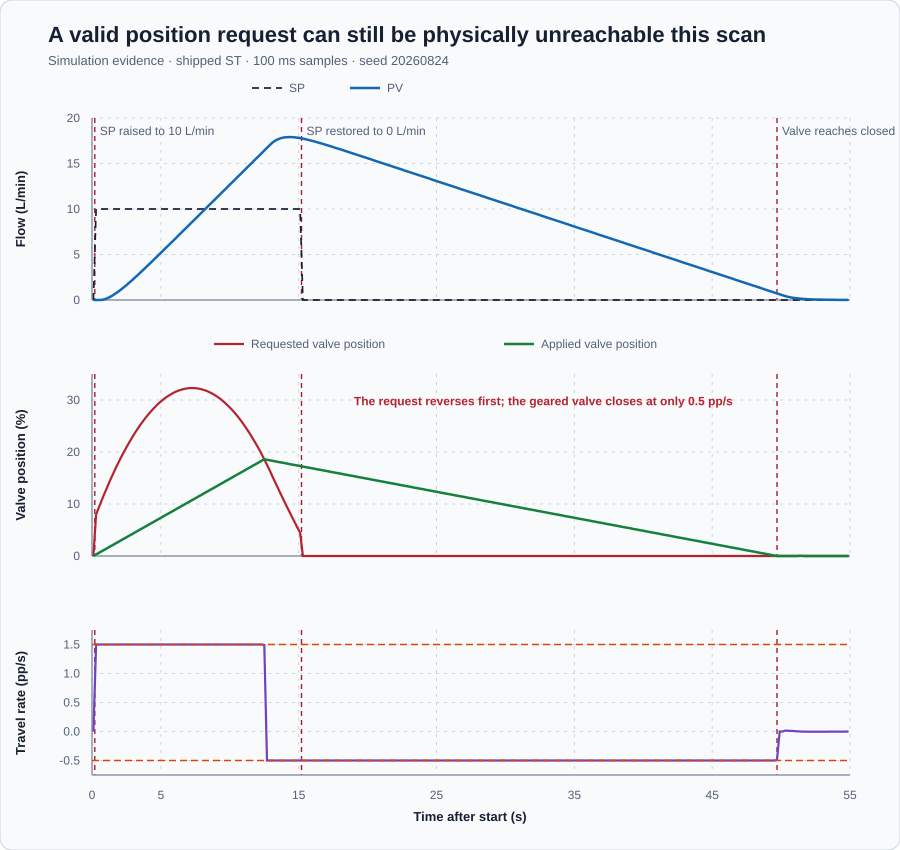

# Motor-operated heating-valve rate limitation

Course position: Lesson 9 of 84. Previous lesson: [Actuator saturation](../08-water-heater-saturation/README.md). Next lesson: [Anti-windup](../10-saturation-antiwindup/README.md).

**Lesson objective:** Distinguish amplitude and rate constraints, calculate the admissible position interval per sample, and prove how actuator travel limits achievable loop response.

This lesson uses deterministic Simulation evidence. It is not evidence that a
physical heating valve moved at the declared rate or reached its safe state.

## The problem

The equipment is a motor-operated hot-water control valve and heating-coil flow transmitter.

A geared electric valve regulates hot-water flow through a building heating
coil. A flow transmitter measures the water delivered to the coil. The valve
can move only from fully closed at 0 percent to fully open at 100 percent.

The simulated actuator opens no faster than 1.5 percentage points per second
and closes no faster than 0.5 percentage point per second. The two rates differ
because a real actuator can have direction-dependent gearing, loading, or
safety behavior. These particular rates describe this lesson, not every valve.
Upstream pressure remains fixed so actuator travel is the only changed cause.
The experiment starts with zero flow and a closed valve. Its safe restoration
is a controlled return to closed followed by Manual mode at zero output.

Lesson 8 showed that requested and applied actuator output can differ when the
requested amplitude is unavailable. A second limitation remains: an in-range
position can still be unreachable during the current update because a motor
needs time to move.

If this motion gap is hidden, an engineer may increase controller gain or
mistake actuator travel for slow plant behavior. This lesson therefore keeps
the calculated request and reachable valve trajectory separate.

## What we need

We need the command applied to the heating valve to respect how far the actuator can physically travel during one controller interval. The requested and applied positions must remain separate so a slow response is not misdiagnosed as poor controller tuning.

## The new idea

An amplitude limit bounds position. This valve must remain between 0 and 100
percent opening. A rate limit bounds how quickly that position may change.

The setpoint ($SP$) is the desired heating-water flow in litres per minute. The
process value ($PV$) is the flow reported by the flow transmitter in litres per
minute.

The requested manipulated variable ($MV_{\mathrm{requested}}$) is the valve position that
the controller calculates, in percent. The applied manipulated variable
($MV_{\mathrm{applied}}$) is the rate- and amplitude-constrained valve position sent to the
simulated plant, also in percent. The requested value is a calculation; it is
not proof that the geared valve has already reached that position.

The previous applied position ($MV_{\mathrm{previous}}$) is the valve position from the last
update that the current update uses, in percent. The configured controller task
interval ($\Delta t$) is the intended time between updates, in seconds.

In this deterministic lesson, $\Delta t$ is a configured nominal interval, not a
scheduler-derived measurement. Three settings must agree: the Structured Text
`TASK` interval is 100 ms, runtime `cycle_interval_ms` is 100, and
`ConfiguredCycleTime` is 0.1 second. The calculation is valid only while those
settings remain synchronized and the task executes predictably. Lesson 14 adds
measured elapsed time and jitter; this lesson does not claim to handle either.

The maximum opening rate ($r_{\mathrm{open}}$) is the largest permitted positive position
change, in percentage points per second. The maximum closing rate ($r_{\mathrm{close}}$) is
the largest permitted closing magnitude, also in percentage points per second.

The lowest admissible position ($MV_{\mathrm{low}}$) is the smallest position the valve may
reach during the current update, in percent. The highest admissible position
($MV_{\mathrm{high}}$) is the largest position it may reach during that update, in percent.
After defining those physical quantities, their relationships are:

A rate is position change divided by time. Multiplying both sides by the
positive update time gives the greatest permitted change during one update:

$maximum\ opening\ change = r_{\mathrm{open}} \times dt$

$maximum\ closing\ change = r_{\mathrm{close}} \times dt$

Opening adds its permitted change to the previous position; closing subtracts
its permitted change. Intersect those two motion bounds with the valve's 0-to-
100-percent amplitude range. The lowest position is therefore the larger of
zero and previous position minus the closing change. The highest position is
the smaller of 100 percent and previous position plus the opening change:

$MV_{\mathrm{low}} = \max\left(0\%, MV_{\mathrm{previous}} - r_{\mathrm{close}} \cdot dt\right)$

$MV_{\mathrm{high}} = \min\left(100\%, MV_{\mathrm{previous}} + r_{\mathrm{open}} \cdot dt\right)$

$MV_{\mathrm{applied}} = \max\left(MV_{\mathrm{low}}, \min\left(MV_{\mathrm{requested}}, MV_{\mathrm{high}}\right)\right)$

The measured travel rate ($r_{\mathrm{measured}}$) is the applied position change divided by
the configured controller task interval, in percentage points per second:

$r_{\mathrm{measured}} = (MV_{\mathrm{applied}} - MV_{\mathrm{previous}}) / dt$

A positive measured rate means the valve is opening. A negative measured rate
means it is closing. On a physical installation, independent position feedback
would still be required to prove that the mechanism followed the command.

This is a finite-difference measurement: take the change in applied position
from the retained previous sample to the current sample, then divide by the
positive configured $dt$. Retaining that exact previous value prevents the
calculation from accidentally using the already-updated state.

Define the decision measures before running. Maximum measured opening rate is
the largest positive $r_{measured}$ during opening. Maximum closing magnitude is
the absolute value of the most negative $r_{measured}$ after restoration.
Maximum unavailable-position gap is
$\max|MV_{requested}-MV_{applied}|$. The 5-second flow is the PV sample at
exactly 5.0 seconds; it is a transient value, not a steady-state measure.

Directional limit exposure is the number of samples at the relevant rate bound
multiplied by $dt$. If $t_{restore}=15.1$ seconds and $t_{closed}$ is the first
later sample with applied position equal to zero, then:

$return\text{-}to\text{-}closed\ time = t_{closed}-t_{restore}$

All measures require finite signals, positive synchronized $dt$, no abort,
applied position within 0 through 100 percent, and a reproduced measured rate
from the retained previous and current positions.

**Decision direction:** opening must remain between 1.4 and 1.5 percentage
points per second, closing magnitude between 0.4 and 0.5, the requested/applied
gap must reach at least 1 percentage point, 5-second flow must remain below 6
litres per minute, both directional limits must be exercised, and the valve
must return closed before Manual-zero restoration.

## Prediction

During one 0.1-second update, the 1.5-percentage-point-per-second opening limit
allows this movement:

$1.5 pp/s \cdot 0.1 s = 0.15 percentage point$

The 0.5-percentage-point-per-second closing limit allows:

$0.5 pp/s \cdot 0.1 s = 0.05 percentage point$

An uninterrupted 10-percentage-point move therefore needs at least 6.67
seconds while opening and 20.0 seconds while closing. Increasing controller
gain cannot shorten those physical minimum travel times. Predict that
$MV_{\mathrm{requested}}$ will change first, $MV_{\mathrm{applied}}$ will form a steeper opening ramp and
a shallower closing ramp, and the early PV cannot follow the request.

## Implementation

The shipped program uses `Control.PID` to calculate the unconstrained valve
request. Its internal rate bounds are deliberately wide so the explicit
actuator constraint remains visible. The program then calculates the reachable
interval and sends only the applied valve position to the plant:

```st
Input.CycleTime := ConfiguredCycleTime;
RequestedValvePosition := Controller.Update(Input := Input);

PreviousPositionUsedForUpdate := PreviousAppliedValvePosition;
LowerAdmissiblePosition := MAX(
    LREAL#0.0,
    PreviousPositionUsedForUpdate - MaximumClosingRate * ConfiguredCycleTime
);
UpperAdmissiblePosition := MIN(
    LREAL#100.0,
    PreviousPositionUsedForUpdate + MaximumOpeningRate * ConfiguredCycleTime
);
AppliedValvePosition := MAX(
    MIN(RequestedValvePosition, UpperAdmissiblePosition),
    LowerAdmissiblePosition
);
MeasuredTravelRate :=
    (AppliedValvePosition - PreviousPositionUsedForUpdate) / ConfiguredCycleTime;
PreviousAppliedValvePosition := AppliedValvePosition;
```

`PreviousPositionUsedForUpdate` is the snapshot used by all three equations in
that scan. It remains visible in the retained trace even after the internal
previous-position state advances for the next scan. This ordering lets another
engineer reproduce the reported rate from the evidence.

The proportional and integral controller does not track the externally
rate-constrained position in this lesson. That deliberate limitation will
produce the evidence needed for Lesson 10.

The shipped project starts at SP 0 litres per minute, PV 0, a closed valve, and
Manual mode. Control Studio writes one `P1.ExperimentEnabled` authority. The
project owns the 90.1-second sequence: one safe Manual-zero scan, a 15-second
Auto opening request at SP 10, an Auto closing interval at restored SP 0, and a
final Manual-zero scan.

In physical order, it begins with SP = 0 and a closed valve, requests 10 litres
per minute for 15 seconds, restores SP = 0 without resetting controller state,
waits for the valve to close, and then restores Manual zero.

## Experiment in Control Studio

Test runs the shipped project-owned rate-limit sequence for 90.1 seconds by
writing the reviewed `P1.ExperimentEnabled` authority. The native evidence test
executes the same sequence and owns the retained trace and measures. Completion
restores authority false, SP 0 litres per minute, a closed valve, Manual mode,
and zero requested and applied position. The deterministic Simulation seed is
20260824.

### Control Studio actions

1. **Monitor** — Start the **Simulator**, then open **truST sidebar → Control Studio → Monitor → Response**.
   - **Baseline check:** Wait until the header shows **Simulation**, **Running**, and current data. Confirm SP = 0 L/min, PV = 0 L/min, requested position = 0%, applied position = 0%, Manual mode, and experiment authority false. Show the opening and closing limits, configured interval, previous position used, low and high admissible positions, measured travel rate, units, limits, and quality. The unresolved problem is that an in-range request can change faster than the geared valve can travel.
   - **Decision before action:** Read **Prediction** above, then state what should move first and in which direction. Use this decision rule: Retain requested position and constrain applied position to the asymmetric interval calculated from the previous position used by the update and a task interval synchronized across ST and runtime configuration.
   - **Successful evidence:** The Response plot advances, the displayed values are finite and current, and **Start recording** is enabled. Select **Start recording** only after those conditions are visible.
   - **Recovery:** If recording is disabled or the plot reports unavailable or stale samples, stop the Simulator, correct the displayed runtime or binding problem, restart it, and repeat the baseline check.
   - **Record:** Write down the initial SP, PV, requested/applied MV where available, controller mode, and your predicted response before opening Test.

2. **Test** — Open **truST sidebar → Control Studio → Test**.
   - **Baseline check:** Confirm **Experiment** = **Observe without excitation**, **Amplitude** = **0** (disabled), and **Maximum duration (s)** = **90.1**. The reviewed authority is **P1.ExperimentEnabled**. Its false-to-true transition starts one project-owned sequence: 0.1 s safe Manual zero; SP 10 L/min in Auto through 15.1 s; SP 0 in Auto through 90.0 s so the slower closing motion can finish; and Manual zero at 90.1 s.
   - **Decision before action:** Before selecting **Review test**, confirm the plan changes only experiment authority. Predict requested position moving first, applied position opening at no more than 1.5 %/s, then closing at no more than 0.5 %/s after SP restoration.
   - **Successful evidence:** Select **Review test**, verify **P1.ExperimentEnabled**, the 90.1-second timeout, stop conditions, and false restoration, then select **Confirm and start**. Keep **Abort test** visible. Response must show the 15-second request, asymmetric ramps, return to a closed valve, and Manual-zero completion.
   - **Recovery:** For a rejected, stale, unsafe, unavailable, failed, or aborted state, read the displayed reason. Confirm experiment authority false, SP 0, a closed valve, Manual mode, and zero output before reviewing a new test.
   - **Record:** Compare both per-scan movements and both measured slopes with your predictions. Retain the maximum gap, 5-second flow, directional exposure, return-to-closed time, terminal state, restoration result, and deterministic seed **20260824**.

## Evidence and decision

### Measures and comparison

Apply the decision measures, validity prerequisites, and direction declared
before the experiment. Numerical validity, satisfaction of a declared
criterion, and the final engineering conclusion remain separate decisions.

### Validation

The native run retained 901 samples, including final Manual restoration:

| Measure | Validity | Declared criterion | Retained result | Decision |
| --- | --- | --- | ---: | --- |
| Maximum measured opening rate | Valid | 1.4 to 1.5 pp/s | 1.500 pp/s | Pass; opening limit exercised |
| Maximum measured closing magnitude | Valid | 0.4 to 0.5 pp/s | 0.500 pp/s | Pass; closing limit exercised |
| Maximum unavailable-position gap | Valid | At least 1.0 pp | 22.668 pp | Pass; request and applied motion differ |
| 5-second flow | Valid transient sample | Below 6.0 L/min | 5.191 L/min | Pass for this simulation |
| Opening-limit exposure | Valid | Nonzero | 12.3 s | Pass |
| Closing-limit exposure | Valid | Nonzero | 34.5 s | Pass |
| Return to closed after restoration | Valid | Required | 34.6 s | Pass |
| Safe restoration | Valid | Manual, 0% request, 0% applied | Achieved at 90.1 s | Pass |

Every retained value is finite, and every row reproduces its measured rate from
the previous position actually used by that update. Applied valve position
remains between 0 and 100 percent. The measured rate never exceeds either
directional bound. The result is valid Simulation evidence; it does not prove a
physical valve's travel time, fail position, interlocks, or pressure suitability.



The upper panel shows that flow cannot instantly follow the requested change.
The middle panel shows the controller request separating from the reachable
valve trajectory. The lower panel proves the steeper 1.5 pp/s opening ramp and
the slower -0.5 pp/s closing ramp directly from the retained samples.

## Conclusion

$MV_{\mathrm{requested}}$ changes first because it is a calculation. The geared motor makes
$MV_{\mathrm{applied}}$ a physical trajectory. During opening, the plant receives less valve
position than the controller asks for, so early flow is restricted. After SP
returns to zero, the controller request reverses before the valve can close.
The deliberately slower closing direction then requires 34.6 seconds to reach
the closed position.

The controller's integral state does not track the external rate-constrained
position. The 22.668-percentage-point gap therefore leaves stored demand that
contributes to the high flow after the setpoint is restored. Lesson 10 will
compare anti-windup methods that make controller state aware of constrained
actuation.

## Reason for the next lesson

For another actuator, obtain its permitted movement range and separate opening
and closing rates. For deterministic scheduling, synchronize the configured
interval used by the limiter with the task configuration. Retain requested and
applied motion plus the previous position used by each update, verify both
signed slopes, and close the equipment safely before accepting the test.

This conclusion applies to the declared simulated geared valve, fixed upstream
pressure, synchronized positive configured time, and local operating range. It
does not prove behavior under task jitter or missed scans. A fast actuator may
make rate limitation negligible. Backlash, stiction, deadband, a position-loop
fault, or changing pressure requires additional measurements and models. A
physical test requires independently reviewed valve travel times, fail
position, interlocks, pressure limits, and explicit authorization immediately
before motion.
