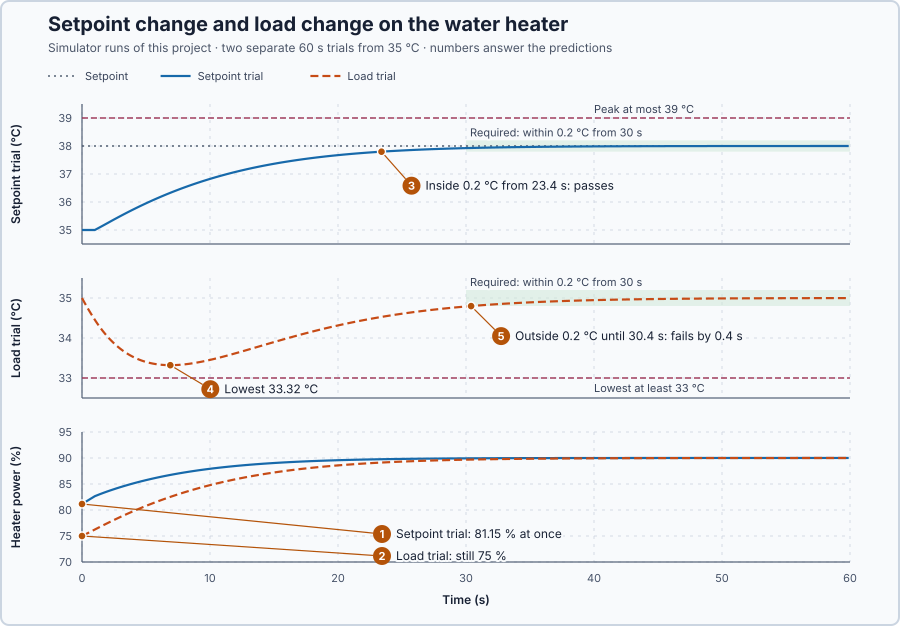

# 9. Setpoint and disturbance response

In this lesson, you will state requirements before a test and judge the PI heater against them in two situations: a new setpoint, and an extra heat loss at an unchanged setpoint. You will see why the controller reacts to the first at once but to the second only after the water has cooled.

## The problem

Lesson 8's anti-windup brought the water back within 0.2 °C of 35 °C at 29.2 s, after an unreachable 45 °C request. That shows recovery from a limit, but nothing yet says what a good response is in normal operation: when the operator asks for a new temperature, or when colder water arrives while the setpoint stays at 35 °C.

We will write down requirements for both situations before testing, then check each one on the same heater.

## What we need

We need to:

1. separate following a new setpoint from recovering from an outside change;
2. describe each response with numbers: how far the temperature goes past or away from its target, and how long it takes to settle; and
3. decide pass or fail against limits chosen before the test.

## The new idea

The **setpoint response** is how the loop follows a new desired temperature. The **disturbance response** is how the loop recovers when something outside changes the temperature, such as colder inlet water, while the setpoint stays the same. We judge both by numbers decided before the test: how far the temperature overshoots, how long it takes to settle, and how far a disturbance pushes it.

**In words.** The two events enter the loop at different places. A setpoint change enters the controller directly: the error jumps at the next update, before the water has moved. A disturbance acts on the water, and the controller learns about it only when the measured temperature changes. With feedback alone, the first part of a disturbance's effect is therefore unavoidable, and the heater's 1 s delivery delay adds to it. In PLC terms, the three numbers are the acceptance criteria of a loop test, written down before it runs.

**The formula.** Three numbers describe a response:

- **Overshoot**: how far the temperature goes past the new setpoint, as a fraction of the step, $(T_{peak} - T_{target}) / \Delta T_{step}$.
- **Settling time**: the last time the temperature is outside a band around its target; after that it stays inside.
- **Excursion**: how far a disturbance pushes the temperature away from its setpoint, $SP - T_{low}$ for a loss of heat.

Here $T_{peak}$ is the highest temperature, $T_{target}$ the new setpoint, $\Delta T_{step}$ the size of the setpoint step and $T_{low}$ the lowest temperature, all in °C.

**Example.** Invented numbers first: a 3 °C step that peaks at 38.6 °C overshoots by $0.6 / 3 = 20\%$. With a ±0.2 °C band, a temperature last outside the band at 17.0 s settles at 17.0 s. A loss that pulls the water from 35 °C down to 34.1 °C is an excursion of 0.9 °C.

Now follow this lesson's setpoint step from 35 to 38 °C, starting settled with the integral at 75 %:

1. At the next update the error jumps from 0 to 3 °C, before the water has moved.
2. The request becomes $75 + 2 \times 3 + 0.5 \times 3 \times 0.1 = 81.15\%$: P gives 6 points and the integral 0.15 point more.
3. The water warms, the error shrinks, and the integral grows until it supplies the new holding power.

Follow the extra 30 kW loss at a 35 °C setpoint:

1. At the instant the loss starts, the water is still at 35 °C, so the error is 0 and the request stays 75 %.
2. The water cools. Only then does the error become positive and the controller raise the power.
3. The integral grows until it supplies the extra loss.

Both situations end at the same power. Holding 38 °C needs $(38 - 20) \times 10 / 2 = 90\%$. At 35 °C with the extra loss, $75 + 30/2 = 90\%$ as well. Equal final power does not mean equal responses.

**The requirements.** They are set before the test, so a result cannot change them:

| Trial | Requirement through 60 s |
| --- | --- |
| Setpoint 35 → 38 °C | Peak ≤ 39 °C; within ±0.2 °C of 38 °C by 30 s and from then on |
| Setpoint 35 °C, extra loss 30 kW | Lowest ≥ 33 °C; within ±0.2 °C of 35 °C by 30 s and from then on |

The heater power must stay within 0–100 % in both trials. A 39 °C peak allows an overshoot of $1/3 = 33\%$. These are teaching requirements for this simulated heater.

## Prediction

Before running, answer these questions:

1. In the setpoint trial, which signals change first, and what is the first request?
2. In the load trial, what is the request at the instant the 30 kW loss begins?
3. Will the setpoint trial meet both of its requirements?
4. How far will the loss push the temperature down: will it stay above 33 °C?
5. Will the load trial be within ±0.2 °C of 35 °C by 30 s?

## Implementation

Open [`src/Main.st`](src/Main.st). The program runs Lesson 8's `Control.PID`: $K_p$ = 2, $K_i$ = 0.5, anti-windup with $T_t$ = 1 s, output 0–100%, updated every 0.1 s, from the hot state. `TrialKind` selects the trial: 0 steps the setpoint to 38 °C, 1 starts the 30 kW loss at 35 °C. Change it with the simulator stopped; a restart returns to the hot state. The loss acts on the water at once, while the heater's power arrives 1 s late. After the run, or on a temperature outside 0–80 °C, the program removes heat and load.

**Exercise.** From an integral of 75%, calculate the first request for setpoint/measurement 38/35 °C (81.15%), 35/35 °C (75%) and 35/34.9 °C: $75 + 2 \times 0.1 + 0.5 \times 0.1 \times 0.1 = 75.205\%$. Find where the load is written in the program, and check that it is sent to the plant, not to the controller.

## Experiment in Control Studio

1. Check that `TrialKind := 0;` in `src/Main.st`, open this lesson's project and start **Simulator**. The heater holds 35 °C with 75% power. In the **truST** side bar, select **Control Studio**.
2. On **Identify**, choose **Project experiment** from **Method**. **Signals** already shows `P1.SetpointC · Setpoint (°C)`, `P1.TemperatureC · Process value (°C)` and `P1.AppliedPowerPct · Applied output (%)`; add `P1.IntegralPct · state (%)` and `P1.ErrorC · state (°C)`.
3. Write down the requirements and answer the predictions before starting.
4. Select **Review project test** and check the declared **60.1 s** duration.
5. Select **Confirm and start**; this is time zero, and the setpoint steps to 38 °C.
6. After the run, hover the first sample, the peak and the last time the water is more than 0.2 °C from 38 °C. Right-click the plot and choose **Save recording…** to keep the run.
7. Stop the simulator, change to `TrialKind := 1;`, start **Simulator** again and repeat steps 2–6, adding `P1.DisturbanceKw · disturbance (kW)` to **Signals**. Hover the first sample, the lowest temperature and the last time the water is more than 0.2 °C from 35 °C.
8. At the end of each run, Control Studio shows **Project test completed. Outputs restored.**, and heater and load return to 0.

Select **Abort test** to stop early. A temperature outside 0–80 °C latches `SafetyAbort`, which removes heat until you restart the simulator.

## Evidence and decision

The numbered marks answer the predictions with the same numbers. From the two recorded trials:

| Trial | First request | Extreme | Last outside ±0.2 °C | Largest error 30–60 s | Result |
| --- | ---: | ---: | ---: | ---: | --- |
| Setpoint 35 → 38 °C | 81.15% | peak 38.00 °C | 23.4 s | 0.075 °C | passes |
| Extra loss 30 kW at 35 °C | 75.00% | lowest 33.32 °C | 30.4 s | 0.212 °C | fails by 0.4 s |

1. In the setpoint trial, the setpoint and the error changed at the first update, and the request rose to the calculated 81.15% before the water moved.
2. In the load trial, the first update still read 35 °C, so the request stayed at 75%. Error and power rose only after the water had cooled.
3. The setpoint response peaked at 38.00 °C, with no overshoot, and stayed within ±0.2 °C of 38 °C from 23.4 s: it passes.
4. The loss pushed the temperature down to 33.32 °C, an excursion of 1.68 °C, inside the 33 °C limit.
5. The temperature was still more than 0.2 °C from 35 °C at 30.4 s, so the load trial fails its settling requirement by 0.4 s.

Both trials ended at 90% power, as calculated, and the power stayed within 0–100%. The setpoint response meets its requirements; the disturbance response narrowly does not. A good setpoint response does not establish good disturbance rejection, because the controller meets the two events at different points in the loop.

Keep that failure for the next lesson. Do not change the gains or widen the requirement to make this result pass. These are simulation results.

## Conclusion

A setpoint change reaches the controller directly, so it acts before the temperature moves. A disturbance acts on the process, so feedback can only respond after the measurement has changed. Each needs its own test and its own requirements, set before the test.

For this heater, the PI controller follows the 3 °C setpoint step well, but its recovery from the extra 30 kW loss is 0.4 s too slow for the stated requirement.

## Check yourself

1. **A 35 → 38 °C step peaks at 38.45 °C. What is the overshoot, and does it meet the 39 °C limit?**
   (38.45 − 38) / 3 = 15%. It meets the limit, which allows 33%.
2. **Why did the heater power not change at the moment the 30 kW loss began?**
   The controller sees only the measured temperature. The loss acts on the water, so the power changes only after
   the water has cooled.
3. **The water was last more than 0.2 °C from 35 °C at 30.4 s. What is the settling time, and the verdict against "by 30 s"?**
   The settling time is 30.4 s; the requirement fails by 0.4 s.

## Reason for the next lesson

The load trial failed its settling requirement, but the result does not say why. The controller could be too slow, the measurement could be wrong, the heater could fail to deliver what is commanded, or the load could be too large for the heater.

[Loop diagnosis](../../09-industrial-control-structures/60-loop-diagnosis/README.md) checks the measurement, the actuator and the capacity before anyone changes a gain.
