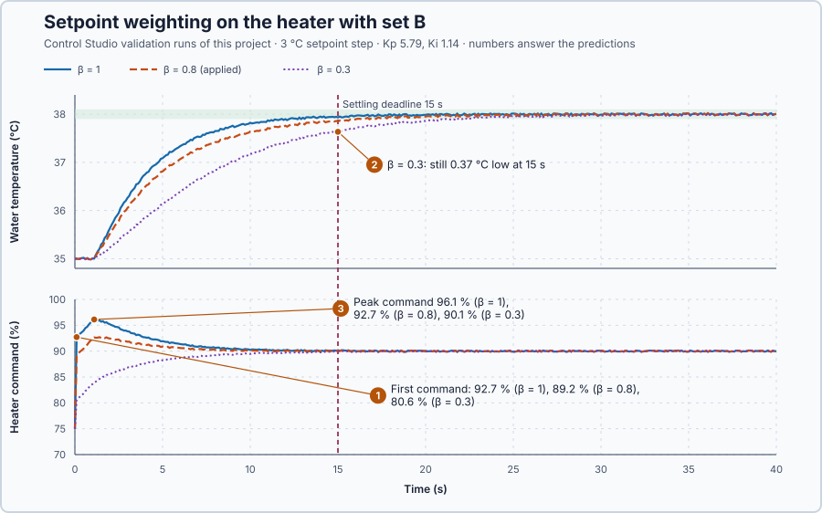

# 23. Setpoint weighting

In this lesson, you will make the heater command react less to a change of setpoint while it still reacts fully to the measured temperature. You will see that the gentler push costs speed, and that the speed requirement decides how much gentler it can be.

## The problem

Lesson 22 designed set B for its requirements and applied it: $K_p = 5.79$ %/°C and $K_i = 1.14$ %/(°C·s), with the water within 0.2 °C of a 3 °C higher setpoint from 9.9 s. The design looked only at the temperature. The heater command tells a second story. A 3 °C setpoint step changes the error by 3 °C at once, so P jumps by $5.79 \times 3 = 17.4$ points in one update, before the water has moved. The command leaps from 75 % to 92.7 % and climbs to 96.1 % while the water is still cold, which leaves less than 4 points of the heater's range for anything else.

Lowering $K_p$ would soften the jump, but it would also weaken the correction when colder water cools the heater. We will make the setpoint push the P part less than the measurement does.

## What we need

We need to:

1. reduce how strongly the P part reacts to a change of setpoint;
2. keep its full reaction to a change of the measured temperature, so disturbances are corrected as before; and
3. keep the integral working on the full error, so the water still reaches the setpoint.

## The new idea

**Setpoint weighting** lets the P part react only partly to a change of target, while it still reacts fully to the measured temperature. This heater then gets a gentler push when the setpoint changes, while disturbances such as colder inlet water are fought as hard as before.

**In words.** The P part reacts to the error, the setpoint minus the measured temperature. The error can change for two quite different reasons:

1. **The setpoint changes.** The operator chooses a new target. Nothing has happened to the water yet; the only question is how hard to start heating it.
2. **The measured temperature changes.** Something has happened to the water, for example colder inlet water has cooled it. The controller should fight that at once, with its full strength.

An ordinary PI cannot tell the two apart, because it sees only their difference. Setpoint weighting gives the P part two separate inputs: the measured temperature with its full weight, and the setpoint with a smaller weight, the **setpoint weight**. The integral keeps the full error, so it goes on working until the water is exactly at the setpoint. A driver does the same: when the speed limit rises, they press the accelerator gently and let the car gather speed; when a hill slows the car, they press harder at once.

For this heater, the command jumps less when the setpoint changes, and the integral supplies the rest of the extra heat over the following seconds. The price is time: part of the push now comes from the integral, which grows only gradually, so the water arrives later.

**The formula.** The P part, the integral and the heater command are

$$
P = K_p\,[\beta\,(SP - T_0) - (PV - T_0)], \qquad I_{new} = I_{old} + K_i\,(SP - PV)\,\Delta t, \qquad u = P + I .
$$

- $SP$ and $PV$ are the setpoint and the measured temperature, in degrees Celsius;
- $T_0$ is the 35 °C operating point from which P is counted: where $SP = PV = T_0$, P is zero and the integral holds the whole command;
- $\beta$ is the setpoint weight, a number between 0 and 1 without unit;
- $K_p$ is the proportional gain, in percent per °C, and $K_i$ the integral gain, in percent per °C and second;
- $\Delta t$ is the 0.1 s between updates; and
- $P$, $I$ and the command $u$ are in percent of the heater's power.

With $\beta = 1$ the brackets become $SP - PV$: the ordinary PI. A setpoint change $\Delta SP$ moves P by $\beta K_p\,\Delta SP$; a change $\Delta PV$ of the measurement moves it by $-K_p\,\Delta PV$, whatever $\beta$ is.

**Example: a 3 °C setpoint step with set B.** Set B has $K_p = 5.79$ %/°C and $K_i = 1.14$ %/(°C·s). The heater holds 35 °C with 75 %, and holding 38 °C needs 90 %. Follow the numbers:

1. Before the step, $SP = PV = 35$ °C, so $P = 0$ and $I = 75$ %: the command is 75 %.
2. The setpoint jumps to 38 °C with $\beta = 1$: $P = 5.79 \times 3 = 17.4$ %, and the integral adds $1.14 \times 3 \times 0.1 = 0.34$ point. The command leaps to $17.4 + 75.34 = 92.7$ %, although the water has not moved.
3. The same step with $\beta = 0.3$: $P = 5.79 \times 0.3 \times 3 = 5.2$ %, so the command rises only to $5.2 + 75.34 = 80.6$ %. The jump is 5.6 points instead of 17.7, less than a third.
4. At a fixed 35 °C setpoint, colder inlet water lowers the reading by 0.5 °C: $P = 5.79 \times [0 - (-0.5)] = 2.9$ %, with any $\beta$. The disturbance is fought exactly as before.
5. When the water has reached 38 °C with $\beta = 0.3$, P does not return to zero: $P = 5.79 \times (0.3 \times 3 - 3) = -12.2$ %. To give the 90 % that 38 °C needs, the integral must climb to $90 + 12.2 = 102.2$ %, 27.2 points above its 75 %. With $\beta = 1$, P is 0 at 38 °C and the integral has to climb only 15 points.

**The limitation.** The integral climbs only while an error remains, and more slowly as the error shrinks, so the extra 12.2 points come late and the last part of the approach is slow. A smaller weight therefore means a gentler start and a later arrival. How small the weight may be is decided by the speed requirement: set B must still settle within 0.1 °C by 15 s. The weights 0.8 and 0.3 compared below are teaching choices that show both sides of this trade.

## Prediction

Before running, answer these questions:

1. What is the first heater command after the 3 °C step with $\beta = 1$, $0.8$ and $0.3$?
2. Which of these weights still settle within 0.1 °C by 15 s?
3. How high does the heater command climb with each weight?
4. Will the load trial, colder inlet water at a fixed 35 °C setpoint, change with the weight?

| $\beta$ | Jump of P | First command, with 0.34 point of integral |
| ---: | ---: | ---: |
| 1 | 17.4 points | 92.7 % |
| 0.8 | 13.9 points | 89.2 % |
| 0.3 | 5.2 points | 80.6 % |

## Implementation

Open [`src/Main.st`](src/Main.st). The program runs the real `Control.PID`; $\beta$ is the record field `ProportionalSetpointWeight`, which Control Studio writes together with the gains. The change of the weighted P part is also written as a function:

```st
WeightedProportionalChange := ProportionalGain
    * (SetpointWeight * SetpointChange - MeasurementChange);
```

**Exercise.** Open [`src/tests.st`](src/tests.st). Its test checks 6 and 3 points for a 3 °C step with $K_p = 2$ and $\beta = 1$ and $0.5$. Change the gain to 5.79 and the expected values to 17.37 and 8.685, run the tests from the **Testing** view, then restore the file.

## Experiment in Control Studio

Two trials belong to the project and run during every validation: the **setpoint trial**, 35 → 38 °C for 60 s with the peak at most 39 °C and the command within 0–100 %, and the **load trial**, 30 kW of extra heat loss at 35 °C, with the lowest temperature at least 33 °C, the error within 0.2 °C from 30 s and settling within 30 s. Both record the command activity.

1. Open this lesson's project and start **Simulator**. The heater holds 35 °C with 75 % in Manual. In the **truST** side bar, select **Control Studio**.
2. On **Identify**, keep **Method** at **Automatic** and select **Identify plant**. Check the model: **First-order model with delay**, G(s) = (0.2) / (5.1s +1) · e^(−1s).
3. On **Tune**, choose **P1.Controller · PI** in **Controller** and **Manual** in **Tuning method**. Enter **Proportional gain (Kp)** 5.79, **Integral gain (Ki)** 1.14 and **Setpoint weight (β)** 1.
4. Select **Requirements…** and enter set B's requirements: **Setpoint change (°C)** 3, **Maximum steady-state error (°C)** 0.2, **Maximum settling time (s)** 15, **Settling band (±°C)** 0.1 and **Validation duration (s)** 60, the length of the project's trials. Select **Done**, then **Tune controller**.
5. On **Validate**, select **Validate controller** and record every row. **Measured response** shows the tuned controller against the program's current one.
6. Repeat steps 3 to 5 with **Setpoint weight (β)** 0.3, then 0.8. Each change needs **Tune controller** before **Validate controller**.
7. Validate the weight you choose last, then select **Apply**: Apply acts on the last passing validation. Control Studio shows **Applied**.

## Evidence and decision



The numbered marks answer predictions 1–3; the table answers 4. From the three validations:

| Result | β = 1 | β = 0.8 | β = 0.3 |
| --- | ---: | ---: | ---: |
| Settling time, limit 15 s | 10 s | 13.2 s | not reached: fails |
| Steady-state error, limit 0.2 °C | 0.068 °C | 0.153 °C | 0.366 °C: fails |
| Heater command, setpoint trial | 75–96.11 % | 75–92.71 % | 75–90.12 % |
| Command activity, setpoint trial | 67.3 points | 62.3 points | 55.5 points |
| Load trial: lowest, settling, error | 33.8 °C, 22.5 s, 0.039 °C | the same | the same |

1. The first commands were 92.7 %, 89.2 % and 80.6 %, as calculated.
2. β = 1 settled in 10 s and β = 0.8 in 13.2 s. With β = 0.3 the water was still 0.37 °C low at 15 s and reached 38 °C only near 40 s, while the integral climbed to 102 %: it fails the requirement. Two more weights narrow the limit: 0.9 settled in 11.4 s, and 0.7 in 14.5 s with a 0.196 °C error, right at the limits.
3. The command climbed to 96.1 %, 92.7 % and 90.1 %.
4. The load trial was identical with every weight: lowest 33.8 °C, settled in 22.5 s.

β = 0.8 cuts the jump from 17.4 to 13.9 points and keeps 3.4 more points of the heater's range free, for a 3.2 s later arrival that still meets the requirement with margin. β = 0.3 would be far gentler, but set B's 15 s requirement cannot afford it. We apply β = 0.8; Control Studio reports **Applied**. These are simulation results for this heater.

## Conclusion

Setpoint weighting scales the P part's reaction to a setpoint change while keeping its full reaction to the measurement. The integral, still driven by the full error, removes the remaining error and supplies the part of the holding command that the weighted P part no longer gives.

For this heater, the weight trades the size of the jump against the time to arrive. Set B's 15 s requirement allows a weight down to about 0.8; a weight of 0.3 would make the heater too slow.

## Check yourself

1. **With $K_p = 5.79$ and $\beta = 0.8$, how much does P jump for a 2 °C setpoint step, and for a 0.5 °C fall of the measured temperature?**
   $0.8 \times 5.79 \times 2 = 9.26$ points for the setpoint step; $5.79 \times 0.5 = 2.90$ points for the fall, the
   same as without weighting.
2. **Why does a smaller weight make the water arrive later?**
   At the new setpoint the weighted P part ends below zero, so the integral must climb further to supply the holding
   power, and it climbs only while an error remains.
3. **Why was the load trial identical for every weight?**
   The extra heat loss reaches the controller only through the measured temperature, and $\beta$ multiplies only the
   setpoint.

## Reason for the next lesson

Weighting changes only the setpoint's path into P. The measured temperature still enters P with its full gain, so the sensor's small random wandering moves the heater command at every update even when the water barely changes: the command moved 62.3 points in the setpoint trial, about three times the 20 points of its rise to 92.7 % and its return to 90 %.

[Measurement filtering](../11-measurement-filtering/README.md) smooths the noisy reading before the controller uses it and measures what that costs.
