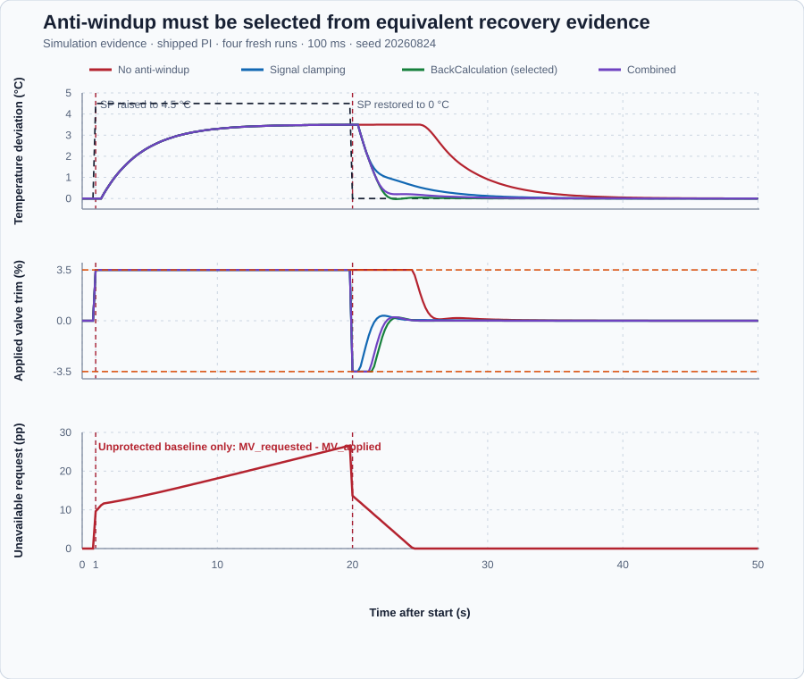

# Batch-vessel anti-windup strategies

Course position: Lesson 10 of 84. Previous lesson: [Valve rate limitation](../09-rate-limit/README.md). Next lesson: [Servo and regulatory objectives](../11-reactor-servo-regulatory/README.md).

**Lesson objective:** Explain integral windup and direction, calculate tracking correction, and select anti-windup from measured recovery and actuator trade-offs rather than complexity.

**Evidence class:** Simulation evidence. It is not physical evidence
that a steam valve, vessel, interlock, or relief system is safe to operate.

## The problem

Steam-heated batch vessel, temperature transmitter, and bounded steam control valve are the exact equipment in this lesson. The controller works with
temperature deviation around an established operating point rather than
absolute vessel temperature.

The transmitter reports degrees Celsius above or below that operating point.
The valve command is heating trim around its normal steam flow. Zero percent
trim is the operating-point flow. Negative trim means less steam than that
flow; it does not mean active cooling.

The simulated valve accepts only -3.5 through 3.5 percent trim. Feed
temperature, steam pressure, vessel contents, controller gains, timing, and
initial state remain identical across four fresh runs. Manual zero trim is the
safe restoration state for this simulation.

The **plant gain** is 1 degree Celsius of steady temperature deviation per
percentage point of steam-valve trim. This is a **declared teaching value**
for this local model, not a manufacturer's rating or a value calculated from
vessel geometry; a learner characterizing a real vessel would instead run
Lesson 16's step-identification procedure at the operating point and fit this
relationship from the measured response. The vessel also does not settle at
its new temperature the instant trim changes: it continues changing gradually
for some time afterward, the same delayed, gradual response Lesson 15 later
explains from first principles. Applying Lesson 8's reachability check: at 1
degree Celsius per percentage point, a 4.5-degree-Celsius temperature request
needs 4.5 percentage points of trim, but the valve accepts only ±3.5 percent,
so that request is unreachable in steady state before any controller or
anti-windup strategy is chosen. Anti-windup changes how the controller's
stored state responds to an unreachable request; it does not make the request
itself reachable.

Lessons 8 and 9 showed that requested and applied actuator output can differ.
They also exposed retained state: while a controller requests output the
actuator cannot apply, integral demand can continue accumulating. The valve can
therefore remain at its limit after the setpoint is restored.

Clipping only the final valve command does not correct the stored controller
demand. We now need to compare ways of making controller state respond to the
physical output constraint.

## What we need

We need the controller's stored demand to respond when the steam valve cannot deliver the requested position. Several correction rules may solve that problem differently, so they must be compared under the same limit and recovery event.

## The new idea

Integral windup is stored controller demand that accumulates while the actuator
cannot apply the requested output. Anti-windup changes how that stored demand is
updated when the controller reaches a limit.

The setpoint ($SP$) is the desired batch-temperature deviation, in degrees
Celsius. The process value ($PV$) is the measured batch-temperature deviation
reported by the transmitter, also in degrees Celsius.

The requested manipulated variable ($MV_{\mathrm{requested}}$) is the steam-valve trim
returned by the controller, in percent. The applied manipulated variable
($MV_{\mathrm{applied}}$) is the trim the bounded simulated valve receives, in percent.

The nominal controller output ($MV_{\mathrm{nominal}}$) is the incremental proportional-
integral controller state before the current output limit, in percent. The
saturated candidate ($MV_{\mathrm{saturated}}$) is that nominal output constrained to the
controller's internal output range, in percent.

The saturation error ($e_{\mathrm{sat}}$) is nominal output minus saturated candidate, in
percentage points. The integral increment ($\Delta MV_I$) is the change that
integral action proposes during the current update, in percentage points.

The cycle time ($\Delta t$) is the configured time between controller updates, in
seconds. The tracking time ($T_t$) states how quickly back calculation should move
stored demand toward constrained output, in seconds. The tracking coefficient
($\alpha$) is the fraction of saturation error removed during one update.

The saturation error measures the unavailable part of nominal demand. A
difference answers that question, so subtract the saturated candidate from the
nominal output:

$e_{\mathrm{sat}} = MV_{\mathrm{nominal}} - MV_{\mathrm{saturated}}$

For example, a nominal request of 13.5 percent and a saturated candidate of 3.5
percent give 10 percentage points of unavailable demand. A positive saturation
error means nominal state lies above the upper bound; a negative value means it
lies below the lower bound.

Back calculation asks the stored state to close this gap over $T_t$ seconds.
The correction rate needed to close $e_{\mathrm{sat}}$ in the tracking time is

$\text{correction rate} = e_{\mathrm{sat}} / T_t$

in percentage points per second. One update lasts $\Delta t$ seconds. Multiplying the
rate by that duration gives the correction for one update:

$\text{correction} = (e_{\mathrm{sat}} / T_t) \cdot \Delta t = (\Delta t / T_t) \cdot e_{\mathrm{sat}}$

The ratio is dimensionless and appears repeatedly, so define

$\alpha = \Delta t / T_t$

The **stored controller output ($MV_{\mathrm{stored}}$)** is the corrected
value written back into the PI's retained state after the update, in percent
— the same retained quantity Lesson 7 called $MV_{\mathrm{previous}}$ and
Lesson 8 called the stored integral contribution ($u_I$), now adjusted for
saturation instead of left to grow unchecked. Subtract the correction from
nominal state:

$MV_{\mathrm{stored}} = MV_{\mathrm{nominal}} - \alpha \cdot e_{\mathrm{sat}}$

Four state-handling configurations are compared:

1. **No anti-windup.** The controller has deliberately wide internal limits.
   Only the downstream valve command is clamped, so the controller does not see
   the physical limit and stored nominal output can continue to grow.
2. **Control-signal clamping.** Set $T_t = \Delta t$. Then $\alpha = \Delta t/\Delta t = 1$.
   Substituting $\alpha=1$ and
   $e_{\mathrm{sat}}=MV_{\mathrm{nominal}}-MV_{\mathrm{saturated}}$ gives

$MV_{\mathrm{stored}} = MV_{\mathrm{nominal}} - (MV_{\mathrm{nominal}} - MV_{\mathrm{saturated}}) = MV_{\mathrm{saturated}}$

   This substitution proves $MV_{\mathrm{stored}} = MV_{\mathrm{saturated}}$: the complete
   unavailable gap is removed in one update.
3. **BackCalculation.** The derived stored-state equation removes a chosen
   fraction of saturation error. A larger $T_t$ makes $\Delta t/T_t$ smaller, so each
   update corrects less of the gap. The implemented BackCalculation equation
   does not silently limit $\alpha$ when $\Delta t/T_t$ exceeds one.
4. **Combined.** The controller first tests the product

$\Delta MV_I \cdot e_{\mathrm{sat}} > 0$

   A positive product means $\Delta MV_I$ and $e_{\mathrm{sat}}$ have the same sign.
   At an upper limit both are positive; at a lower limit both are negative. In
   either case integral action points farther into saturation. The controller
   then removes at most the smaller magnitude of the integral increment and
   saturation error. Integration away from a limit remains permitted. It then
   applies back calculation with:

$\alpha_{\mathrm{combined}} = \min\left(\Delta t / T_t, 1\right)$

   giving the same stored-state update as back calculation,
   $MV_{\mathrm{stored}} = MV_{\mathrm{nominal}} - \alpha_{\mathrm{combined}} \cdot e_{\mathrm{sat}}$,
   but only on scans where the sign check passes; otherwise the nominal output
   is retained unchanged. For the same 10-percentage-point gap and $T_t=3.25$
   seconds used above, $\alpha_{\mathrm{combined}} = \min(0.1/3.25, 1) = 0.030769$
   and the one-scan correction is $0.030769 \times 10 = 0.30769$ percentage
   points — identical to back calculation's correction on a scan where both
   strategies agree the controller is moving farther into saturation. The
   strategies differ only in which scans apply that correction.

Anti-windup changes controller state handling; it does not replace the physical
valve limit. The same downstream -3.5 to 3.5 percent clamp remains active in
all four runs.

This lesson uses a proportional-integral controller. Derivative gain is zero
because derivative action is not introduced until Lesson 20. The valve rate
limit is deliberately nonbinding so this comparison changes one causal
mechanism: amplitude saturation and its stored-state response.

## Prediction

Suppose nominal demand exceeds the saturated candidate by 10 percentage points
and the cycle time is 0.1 second. With $T_t$ = 3.25 seconds:

For the displayed configuration, dt = 0.1 s and Tt = 3.25 s.

$\alpha = 0.1 s / 3.25 s = 0.030769$

$correction = 0.030769 \cdot 10 pp = 0.30769 percentage point$

With $T_t$ equal to $\Delta t$, $\alpha$ = 1 and the complete 10-percentage-point gap is
removed from stored nominal state in that update.

Predict that the unprotected controller will hold the valve at its upper limit
after SP restoration. Predict that all protected strategies will leave the
limit earlier. Do not assume that the fastest internal correction must produce
the best temperature response or the least valve travel.

Before running anything, define how that prediction will be judged:

- **Recovery time** starts when SP returns to zero at 20.0 seconds. It ends at
  the first sample for which absolute PV is at most 0.05 degree Celsius and
  remains inside that band through the 50.0-second end of the automatic
  observation. This persistence condition prevents a brief crossing from being
  called recovery. The numerical evaluation is the 20.0-to-50.0-second
  automatic observation window. Report **Not recovered** if the response never
  reaches and remains within the band through that window.
- **Post-restoration upper-limit duration** counts consecutive time after SP
  restoration while $MV_{\mathrm{applied}}$ remains at 3.5 percent. Multiplying the
  number of consecutive samples by $\Delta t$ converts the count to seconds.
- **Recovery undershoot** is the magnitude of the most negative PV after
  restoration. Taking the magnitude makes a downward excursion a positive
  quantity in degrees Celsius. Report zero if PV never crosses below the
  operating point.
- **Total applied-valve travel** is cumulative absolute applied movement over
  the complete run, in percentage points. It is the path length followed by the
  valve: each movement is the absolute difference between two consecutive
  applied positions, and those movements are summed:

$\text{travel} = \sum\left(\left|MV_{\mathrm{applied},k} - MV_{\mathrm{applied},k-1}\right|\right)$

  The complete run begins with the retained initial Manual sample and ends with
  the retained final Manual-zero sample, so the final Auto-to-Manual transition
  is included.
- **Peak unavailable request** is the largest positive value of
  $MV_{\mathrm{requested}}-MV_{\mathrm{applied}}$ in the unprotected run. It directly measures
  the largest request the valve could not deliver.
- **Safe restoration** requires a retained final Manual sample with SP zero,
  finite PV, requested output zero, and applied output zero.

Every run must remain finite, exercise the upper limit, use the same event
sequence, respect the valve and temperature bounds, and reach safe restoration.
Otherwise it is ineligible for comparison. The unprotected baseline must show
at least 0.1 percentage point of unavailable request and at least 1.0 second of
post-restoration upper-limit hold.

A protected strategy is eligible only if it recovers at least 1.0 second sooner
than the baseline, holds the upper limit for no more than 0.1 second after
restoration, and has no more than 0.05 degree Celsius of undershoot. Among
eligible strategies, select the shortest recovery. Differences smaller than
0.1 second are indistinguishable. Recovery differences smaller than 0.1 second
are therefore tied; break that tie with lower complete-run applied-valve
travel. Travel differences smaller than 0.1 percentage point are also
indistinguishable; only then prefer the simpler state equation. These are local
Simulation comparison rules, not physical acceptance limits.

Each threshold is a declared teaching value with a stated reason, not a
physical specification: the 0.05-degree-Celsius recovery band and undershoot
limit are both one-fifth of the 0.25-degree-Celsius overshoot criterion
Lesson 7 already used, tight enough to require genuine settling; the
1.0-second recovery-improvement requirement is ten 0.1-second cycles, large
enough that a protected strategy's advantage cannot be a rounding artefact of
this deterministic simulation; the 0.1-second upper-limit-hold and tie
tolerances are one controller cycle, the smallest interval this 0.1-second
simulation can resolve; and the 0.1-percentage-point travel tie tolerance is
the same one-cycle resolution applied to actuator movement.

## Implementation

The shipped program uses the same `Control.PID` instance and PI gains for every
fresh run. Strategy selection is read during initialization and therefore
requires a fresh run; it is not a live mid-run switch.

$K_p = 2.83$ percentage points per degree Celsius and $K_i = 0.8708$
percentage points per degree Celsius-second are **declared teaching values**
for this plant, chosen so the unprotected baseline visibly winds up without
the loop becoming unstable; they are not inherited from Lesson 9's flow-loop
gains ($K_p = K_i = 0.667$, a different plant and units) and not derived from
a tuning rule taught so far in this course — Module 6 later shows how to
calculate PI gains from an identified plant model. The **tracking time
($T_t$)** used by strategies 2 and 3 follows the rule $T_t = T_i = K_p / K_i$
that Lesson 7 already established for integral time: $2.83 / 0.8708 = 3.25$
seconds exactly. A learner would choose $T_t$ the same way on real equipment,
from the controller's own already-selected integral time, rather than as an
independent guess.

```st
Parameters.ProportionalGain := LREAL#2.83;
Parameters.IntegralGain := LREAL#0.8707692307692307;
Parameters.DerivativeGain := LREAL#0;

IF SelectedStrategy > 0 THEN
    Parameters.OutputMinimum := LREAL#-3.5;
    Parameters.OutputMaximum := LREAL#3.5;
    Parameters.RateMinimum := LREAL#-100;
    Parameters.RateMaximum := LREAL#100;
ELSE
    Parameters.OutputMinimum := LREAL#-1000000;
    Parameters.OutputMaximum := LREAL#1000000;
    Parameters.RateMinimum := LREAL#-1000000;
    Parameters.RateMaximum := LREAL#1000000;
END_IF;

IF SelectedStrategy = 1 THEN
    Parameters.TrackingTime := LREAL#0.1;
    Parameters.AntiWindup := PIDAntiWindup#BackCalculation;
ELSIF SelectedStrategy = 2 THEN
    Parameters.TrackingTime := LREAL#3.25;
    Parameters.AntiWindup := PIDAntiWindup#BackCalculation;
ELSE
    Parameters.TrackingTime := LREAL#3.25;
    Parameters.AntiWindup := PIDAntiWindup#Combined;
END_IF;

RequestedOutput := Controller.Update(Input := Input);
ManipulatedValue := MAX(MIN(RequestedOutput, LREAL#3.5), LREAL#-3.5);
```

Strategy 0 reaches the final downstream clamp with hidden nominal demand.
Strategies 1 through 3 give the PI controller the real amplitude range before
the same downstream safety clamp is applied.

## Experiment in Control Studio

Control Studio runs the shipped selected strategy: strategy 2,
BackCalculation with $T_t=3.25$ seconds. It does not pretend that one running
controller can switch among four initialization-time strategies. The native
evidence test creates four fresh runtimes, executes the same project-owned
sequence once for each strategy, and owns the retained comparison table and
figure.

Test runs the shipped project-owned selected-strategy sequence for 50.1 seconds
by writing the reviewed `P1.ExperimentEnabled` authority. Completion restores
authority false, SP zero, Manual mode, and zero requested and applied trim. The
native evidence test executes the same sequence in four fresh runtimes for the
comparison. The deterministic Simulation seed is 20260824.

### Control Studio actions

1. **Monitor** — Select target **Simulator**, choose **Run**, then open **Control Studio → Monitor → Response**.
   - **Baseline check:** Wait until the header shows **Simulation**, **Running**, and current data. Confirm SP = 0 degC, PV = 0 degC, requested trim = 0%, applied trim = 0%, strategy = 2, tracking time = 3.25 s, configured cycle time = 0.1 s, Manual mode, and experiment authority false. Also show Kp, Ki, zero Kd, signal units, valve limits, quality, and Simulation source. The unresolved baseline problem is that downstream clamping alone can leave unavailable demand in controller state.
   - **Decision before action:** Read **Prediction**, calculate $\alpha=0.030769$ and the 0.30769-percentage-point correction for a 10-point gap, then predict an upward PV response followed by bounded recovery after SP restoration.
   - **Successful evidence:** The Response plot advances, the displayed values are finite and current, and **Start recording** is enabled. Select **Start recording** only after those conditions are visible.
   - **Recovery:** If recording is disabled or the plot reports unavailable or stale samples, stop the Simulator, correct the displayed runtime or binding problem, restart it, and repeat the baseline check.
   - **Record:** Write down the initial SP, PV, requested/applied MV where available, controller mode, and your predicted response before opening Test.

2. **Test** — Open **truST sidebar → Control Studio → Test**.
   - **Baseline check:** Confirm **Experiment** = **Observe without excitation**, **Amplitude** = **0** (disabled), and **Maximum duration (s)** = **50.1**. The reviewed authority is **Experiment authority** (`P1.ExperimentEnabled`). Its false-to-true transition runs this project sequence: retain the initial Manual sample with SP = 0 and zero trim; enter Auto at SP = 0; request 4.5 degrees Celsius beginning at 1.0 seconds; restore SP = 0 at 20.0 seconds without resetting controller state; continue the automatic recovery observation through 50.0 seconds; and select Manual zero at 50.1 seconds. This includes the initial Manual sample, final Manual sample, and Auto-to-Manual transition in complete-run travel.
   - **Decision before action:** Before selecting **Review test**, confirm that the plan changes only experiment authority. Predict requested trim will reach the positive limit first, PV will rise, and BackCalculation will remove stored unavailable demand after SP restoration. Confirm the declared PV, requested-output, and applied-trim bounds.
   - **Successful evidence:** Select **Review test**, verify `P1.ExperimentEnabled`, the 50.1-second timeout, stop conditions, and false restoration, then select **Confirm and start**. Keep **Abort test** visible. Response must show the baseline, unreachable request, restoration, recovery, and final Manual-zero state. The terminal state must confirm completion and authority restoration.
   - **Recovery:** For a rejected, stale, unsafe, unavailable, failed, or aborted state, read the displayed reason. Confirm experiment authority false, SP zero, Manual mode, and zero output before reviewing a new test.
   - **Record:** Compare the response with your prediction and retain the terminal state, restoration result, and deterministic seed **20260824**.

## Evidence and decision

Apply the definitions, validity requirements, eligibility thresholds, and tie
rules declared in **Prediction**. The unprotected baseline is evidence of the
failure and is not a selectable anti-windup strategy.

The native PI experiment retained these results:

| Strategy | Validity | Recovery | Upper-limit hold after restoration | Recovery undershoot | Total applied-valve travel | Decision |
| --- | --- | ---: | ---: | ---: | ---: | --- |
| 0 — No anti-windup | Valid baseline | 20.0 s | 4.5 s | 0.000 °C | 7.169 pp | Reproduces windup; not eligible |
| 1 — Signal clamping | Valid | 13.1 s | 0.0 s | 0.000 °C | 14.700 pp | Eligible; not selected |
| 2 — BackCalculation | Valid | 2.7 s | 0.0 s | 0.029 °C | 14.463 pp | Selected: shortest recovery among eligible strategies |
| 3 — Combined | Valid | 9.2 s | 0.0 s | 0.000 °C | 14.507 pp | Eligible; not selected |

The unprotected baseline retains a peak unavailable request of 26.697
percentage points. Each protected strategy recovers more than one second faster
than the baseline and removes post-restoration upper-limit hold. The declared
undershoot limit is 0.05 degree Celsius; all protected strategies pass it.

BackCalculation is selected because it has the shortest recovery among the
eligible strategies in this experiment: 2.7 seconds, with 0.029-degree
undershoot and 14.463 percentage points of complete-run valve travel. The state-
equation simplicity tie-breaker is not needed because the recovery difference
is larger than 0.1 second. Combined is not selected merely because it is more
elaborate; complexity is never an acceptance argument.



Notice that the unprotected trace (strategy 0) stays pinned at the 3.5 percent
upper limit for 4.5 seconds after SP is restored, while every protected trace
leaves the limit at the same instant SP returns to zero — the visible signature
of stored demand that anti-windup removes before it can act.

## Conclusion

The unprotected PI retains output the downstream valve cannot apply. When SP
returns to zero, that stored demand keeps $MV_{\mathrm{applied}}$ at the upper limit for 4.5
seconds. Every protected strategy exposes the internal amplitude constraint to
the PID, so the retained state stops driving farther into unavailable output.

Signal clamping makes the strongest one-update correction, yet its PV recovery
is the slowest protected result. Ordinary BackCalculation with $T_t$ = 3.25
seconds gives the fastest recovery here, with a small accepted undershoot.
Combined avoids undershoot but recovers more slowly. These results show why the
method must be selected from declared plant evidence rather than its name or
complexity.

## Reason for the next lesson

For another constrained loop, first reproduce the unprotected failure under a
safe approved experiment. Retain requested and applied actuation, calculate
$\Delta t$/$T_t$, define recovery, overshoot or undershoot, saturation duration, and
actuator travel before viewing results, then select the simplest eligible
strategy.

This conclusion is limited to the declared PI tuning, symmetric amplitude
limit, event, deterministic simulation, and local vessel behavior. Noise,
unmeasured process delay, asymmetric limits, valve rate, stiction, and process
safety can change the ranking. When actuator rate also constrains motion, anti-windup must
track the actual applied trajectory rather than assuming amplitude saturation
is the only limitation. Physical operation requires independent steam,
pressure, temperature, relief, interlock, and batch review plus explicit
authorization immediately before action.

This experiment changes and then restores the setpoint. It does not prove how
the same controller rejects an independently applied plant disturbance. That
unresolved distinction leads to Lesson 11, which compares servo and regulatory
control objectives on a jacketed reactor.
