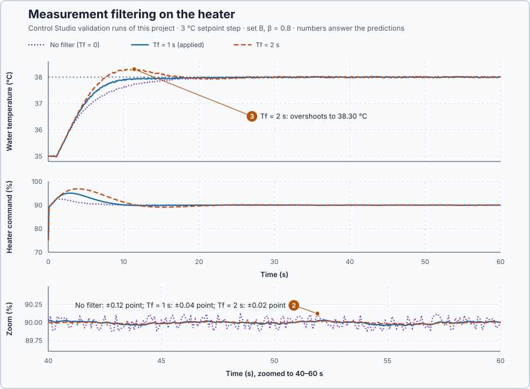

# 24. Measurement filtering

In this lesson, you will smooth the measured temperature before the controller uses it, so that sensor noise moves the heater command less. You will measure what the smoothing costs: the controller notices real changes later.

## The problem

Lesson 23 applied set B with a setpoint weight of 0.8. The heater command still moved 62.3 points in the 60 s setpoint trial, about three times the 20 points of its rise and return, and 53.6 points in the load trial. The cause is the sensor. Its reading wanders by up to ±0.02 °C around the true water temperature, and every new reading enters P with the full gain: a 0.02 °C change moves the command by $5.79 \times 0.02 = 0.12$ point, ten times a second. The heater works all the time for nothing.

We will smooth the reading before the controller uses it, and measure the cost.

## What we need

We need to:

1. reduce the fast, random part of the measurement that the controller reacts to;
2. keep the slow, real changes of the water temperature in the reading; and
3. find how much smoothing the loop can take before it misses its requirements.

## The new idea

A **measurement filter** smooths a noisy reading by following it only part of the way at each update. It calms the command, but it also notices real changes later. For this heater, the controller then acts on a calm temperature instead of one that jumps by up to 0.02 °C ten times a second.

**In words.** Each reading has two parts: the true water temperature, which changes slowly, over seconds, and the sensor's noise, a small random error that is different in every reading. One reading cannot show which part is which. The filter separates them by how they behave over time.

The filter keeps a value of its own, as a PLC program keeps a variable from one scan to the next. At every update it compares the new reading with that value and moves its value a fixed part of the way towards the reading:

1. **Noise** pushes the value up at some updates and down at others. Each push moves it only a little, and the pushes mostly cancel, so the filtered value hardly moves.
2. **A real change** pushes in the same direction at every update, so the filtered value follows it, step by step, until it has caught up.

How large that part is depends on the **filter time constant**: the larger it is, the smaller the part, the calmer the filtered value and the later it catches up with a real change. The filter behaves like a second, small thermometer that warms slowly: it cannot follow fast wiggles, and it needs time to follow the water. Many PLC libraries offer this filter as a PT1 block.

For this heater, the command stops twitching with the noise, but the controller sees the water warm, or cool under a load, later than it really does. That lateness is the price.

**The formula.** The filtered value moves towards the raw reading at a speed proportional to the gap between them:

$$
T_f\,\frac{dy_f}{dt} + y_f = y_r, \qquad\text{that is,}\qquad \frac{dy_f}{dt} = \frac{y_r - y_f}{T_f} .
$$

At each update the program replaces the derivative by the change over one interval, $(y_{f,new} - y_{f,old})/\Delta t$. Multiplying by $\Delta t$ and collecting $y_{f,new}$ gives $(T_f + \Delta t)\,y_{f,new} = T_f\,y_{f,old} + \Delta t\,y_r$, which is the same as

$$
y_{f,new} = y_{f,old} + \alpha\,(y_r - y_{f,old}), \qquad \alpha = \frac{\Delta t}{T_f + \Delta t}.
$$

- $y_r$ is the raw reading, in degrees Celsius;
- $y_f$ is the filtered value, in degrees Celsius: $y_{f,old}$ before the update and $y_{f,new}$ after it;
- $T_f$ is the filter time constant, in seconds;
- $\Delta t$ is the 0.1 s between updates; and
- $\alpha$ is the part of the gap covered at each update, a number between 0 and 1 without unit.

With $T_f = 0$, $\alpha = 1$: the filtered value jumps to each reading, and the filter is bypassed. After $T_f$ seconds, the filtered value has covered about 63 % of a lasting step, $1 - e^{-1} = 0.63$.

**Example: the heater's reading with $T_f = 1$ s.** Then $\alpha = 0.1/(1 + 0.1) = 1/11$: each update covers about a tenth of the gap. Follow the numbers:

1. Noise: the filtered value is 35.000 °C and one reading comes 0.02 °C high. The filtered value moves by $0.02/11 = 0.0018$ °C, so P moves by $5.79 \times 0.0018 = 0.011$ point instead of $5.79 \times 0.02 = 0.12$ point. The next reading is as likely to be low as high and pulls the value back.
2. A real change: suppose the water really steps from 35 to 36 °C. After the first update the filtered value shows $35 + 1/11 = 35.091$ °C. Each update leaves $10/11$ of the remaining gap, so after 10 updates, 1 s, the gap is $(10/11)^{10} = 0.39$ of the step: the filter shows 35.61 °C, 61 % of the change, close to the 63 % of the equation. After 2 s it shows 35.85 °C.
3. For those 2 s the controller believes the water is colder than it is, and acts on that belief.

**The limitation.** The filter cannot tell noise from a real change, so it delays both. For slow changes, a filter with time constant $T_f$ acts almost like an extra delay of $T_f$ seconds, added to the heater's 1 s delivery delay: with $T_f = 1$ s, the controller sees the effect of its own command about 2 s after giving it instead of 1 s. A little extra delay is harmless; too much makes the response swing past its target. The filter times 1 s and 2 s compared below are teaching choices that show both sides.

## Prediction

Before running, answer these questions:

1. What are $\alpha$ and the first filtered value after a 35 → 36 °C raw step, for $T_f = 1$ s and 2 s?
2. How much will the filter reduce the command's wandering when nothing else changes?
3. Will the setpoint response overshoot 38 °C with $T_f = 2$ s?
4. How will the lowest temperature in the load trial change with $T_f$?

| $T_f$ | $\alpha$ | First filtered value after 35 → 36 °C |
| ---: | ---: | ---: |
| 0 | 1 | 36 °C |
| 1 s | 1/11 | 35.091 °C |
| 2 s | 1/21 | 35.048 °C |

## Implementation

Open [`src/Main.st`](src/Main.st). It filters the measurement before `Control.PID` uses it:

```st
FilterAlpha := FilterFraction(CycleTime := LREAL#0.1, FilterTime := MAX(FilterTimeS, LREAL#0.0));
FilteredC := FilterUpdate(PreviousFilteredValue := FilteredC, RawValue := SafeProcessValueC,
    FilterFraction := FilterAlpha);
Input.ProcessValue := FilteredC;
```

`FilterTimeS` is $T_f$; Control Studio writes it together with the gains and the setpoint weight. In Manual, and in the scan that enters Auto, `FilteredC` restarts from the fresh measurement, so the controller does not start from an old filtered value.

**Exercise.** Run the tests in [`src/tests.st`](src/tests.st) from the **Testing** view: they check $\alpha = 1/11$ and 35.0909 °C. Then calculate by hand what one noisy reading 0.02 °C off does to P with $K_p = 5.79$, without the filter and with $T_f = 1$ s: 0.116 and 0.0105 point.

## Experiment in Control Studio

The project validates three trials: the **setpoint trial** and the **load trial** of Lesson 23, and a **noise trial**, 60 s at 35 °C with no disturbance, where only the sensor noise moves the command.

1. Open this lesson's project and start **Simulator**. The heater holds 35 °C with 75 % in Manual. In the **truST** side bar, select **Control Studio**.
2. On **Identify**, keep **Method** at **Automatic** and select **Identify plant**; the model is G(s) = (0.2) / (5.1s +1) · e^(−1s).
3. On **Tune**, choose **P1.Controller · PI** and **Manual**. Enter **Proportional gain (Kp)** 5.79, **Integral gain (Ki)** 1.14, **Setpoint weight (β)** 0.8 and **Measurement filter time (Tf)** 0.
4. Select **Requirements…** and enter set B's requirements: **Setpoint change (°C)** 3, **Maximum steady-state error (°C)** 0.2, **Maximum settling time (s)** 15, **Settling band (±°C)** 0.1 and **Validation duration (s)** 60. Select **Done**, then **Tune controller**.
5. On **Validate**, select **Validate controller** and record every row, especially the three **Command activity** rows.
6. Repeat steps 3 to 5 with **Measurement filter time (Tf)** 2, then 1. Each change needs **Tune controller** before **Validate controller**.
7. Validate your chosen filter time last and select **Apply**. Control Studio shows **Applied**.

## Evidence and decision



The numbered marks answer predictions 2 and 3; the table answers 1 and 4. From the three validations:

| Result | $T_f$ = 0 | $T_f$ = 1 s | $T_f$ = 2 s |
| --- | ---: | ---: | ---: |
| Command activity, noise trial | 48.4 points | 3.35 points | 1.75 points |
| Command wandering at 90 % | ±0.12 point | ±0.04 point | ±0.02 point |
| Setpoint settling, limit 15 s | 13.3 s | 8.5 s | 13.5 s |
| Rise above 38 °C | 0.02 °C | 0.02 °C | 0.30 °C |
| Load trial: lowest temperature | 33.81 °C | 33.61 °C | 33.47 °C |
| Load trial: settling, limit 30 s | 22.4 s | 18.9 s | 14.9 s |
| Command activity, setpoint / load trial | 66.2 / 57.3 points | 28.0 / 18.2 points | 31.8 / 20.1 points |

1. $\alpha$ is 1/11 and 1/21, so the first filtered values after a 35 → 36 °C step are 35.091 °C and 35.048 °C; the tests confirm the 1 s case.
2. With $T_f = 1$ s the command moved 3.35 points in the noise trial instead of 48.4: 93 % less. Around 90 % it wandered by ±0.04 point instead of ±0.12.
3. With $T_f = 2$ s the water overshot to 38.30 °C; with 0 and 1 s it rose only 0.02 °C above 38 °C.
4. The lowest temperature under the 30 kW load fell from 33.81 °C to 33.61 °C with 1 s and to 33.47 °C with 2 s: the controller sees the cooling later.

The setpoint response even settled sooner with the 1 s filter, 8.5 s instead of 13.3 s. The filtered reading lags the warming water, so P falls more slowly and the heater stays a little higher during the approach, up to 95.1 % instead of 92.7 %. With 2 s the same lag lasts so long that the heater keeps heating past 38 °C. All three filter times meet every requirement, but 2 s leaves the least margin: 0.47 °C above the 33 °C limit in the load trial.

We apply $T_f = 1$ s: a fifteenth of the noise-driven movement, no overshoot, and a load dip only 0.2 °C deeper. Control Studio reports **Applied**. These are simulation results for this heater.

## Conclusion

A first-order measurement filter trades noise for delay. It strongly reduces the command movement that sensor noise causes, but it shows the controller every real change later, and beyond some filter time the response swings past its target.

For this heater, a 1 s filter removed 93 % of the noise-driven movement while every requirement was still met with margin; a 2 s filter calmed the command a little more but made the water overshoot.

## Check yourself

1. **With $T_f = 0.5$ s and $\Delta t = 0.1$ s, what is $\alpha$, and what is the first filtered value after a raw step from 35 to 36 °C?**
   $\alpha = 0.1/0.6 = 1/6$, so the filtered value moves to $35 + 1/6 = 35.167$ °C.
2. **Why did the 2 s filter make the water overshoot?**
   The controller saw the warming water up to about 2 s late, so it kept heating as if the water were colder than it
   was, and the extra heat carried it past 38 °C.
3. **Why does the filter make the dip under a real load deeper, not shallower?**
   The filter cannot tell noise from a real change. It slows the controller's view of the cooling, so the heater
   reacts later and the water cools further first.

## Reason for the next lesson

The filter and the integral both assume that a new reading arrives every 0.1 s, and both use that time step in their arithmetic. A filter cannot bring back changes that happened between two readings, and if readings arrive late, or the program uses the wrong time step, every update is wrong.

[Sampling and timing](../12-elapsed-time-and-sampling/README.md) shows what sampling can and cannot see, and why every update must use the time that really passed.
