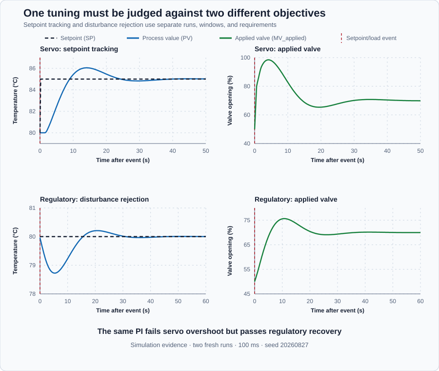

# Reactor servo and regulatory objectives

Course position: Lesson 11 of 84. Previous lesson: [Anti-windup](../10-saturation-antiwindup/README.md). Next lesson: [Setpoint weighting](../12-reactor-setpoint-weighting/README.md).

**Lesson objective:** Distinguish setpoint and load paths, calculate objective-specific metrics, and demonstrate that one unchanged tuning can pass regulatory requirements while failing servo overshoot.

**Evidence class:** Simulation evidence. Not evidence from a physical reactor.

## The problem

Jacketed stirred reactor, product-temperature transmitter, and jacket heating valve are the exact equipment in this lesson. The transmitter measures product temperature. A
steam or hot-water supply through the valve changes heat delivered by the
jacket. Colder incoming feed removes more heat and acts as a load disturbance.

The local operating point is 80 degrees Celsius with the heating valve 50
percent open. The simulated valve accepts commands from 0 through 100 percent.
It can add heat but cannot actively cool the reactor. Product temperature must
remain between 60 and 100 degrees Celsius during these exercises. Manual mode
with a zero-percent valve command is the reviewed final simulation state.

The model represents one well-mixed thermal state near this operating point.
It omits reaction heat, composition changes, fouling, utility-pressure changes,
valve nonlinearities, independent trips, relief protection, and runaway
chemistry. A physical reactor experiment requires a separate hazards review and
explicit authorization immediately before action.

The **plant gain** is 0.25 degree Celsius of equilibrium temperature per
percentage point of valve opening. This is a **declared teaching value** for
this local model, valid only near the 80-degree-Celsius, 50-percent operating
point stated above; it is not transcribed from a heat-exchanger datasheet or
calculated from reactor geometry. A learner characterizing a real reactor
would obtain it the way Lesson 5 obtained the water heater's holding output:
hold the valve at two nearby steady openings, measure the resulting
equilibrium temperatures, and divide the temperature difference by the
opening difference. The reactor also does not reach a new equilibrium the
instant the valve moves: it waits briefly and then continues changing
gradually for some seconds afterward; a learner would characterize that
delayed, gradual shape the way Lesson 16 characterizes the water heater's,
from a measured step response applied to the same event.

Lesson 10 used a setpoint-restoration experiment to compare anti-windup
strategies. That result did not prove how the controller rejects an independent
plant disturbance. A production reactor must follow intentional recipe changes
and reject changes in feed heat load. Lesson 11 therefore tests both objectives
with the same plant and unchanged PI controller.

The important question is not whether the tuning is simply “good.” The question
is whether it satisfies each requirement for the job the loop must perform.

## What we need

We need separate evidence for changing the desired reactor temperature and for rejecting an independent heat-load change. One unchanged controller may be acceptable for one objective and unacceptable for the other, so neither result may stand in for both.

## The new idea

The **setpoint ($SP$)** is the desired reactor temperature in degrees
Celsius. The **process value ($PV$)** is the measured product temperature
reported by the transmitter in degrees Celsius. The **applied manipulated variable
($MV_{\mathrm{applied}}$)** is the heating-jacket valve opening delivered to the simulated
plant, in percent. The **error ($e$)** is the setpoint minus the process value in
degrees Celsius.

The **sample index ($k$)** identifies one retained controller update. The **cycle
time ($\Delta t$)** is the 0.1-second interval between updates. The **event-elapsed time
($t_{\mathrm{event},k}$)** is the time in seconds from the setpoint or disturbance event to
sample k.

The controller's output also obeys a **rate limit**: $MV_{\mathrm{applied}}$ cannot
change by more than 50 percentage points per second in either direction, the
same amplitude-versus-rate distinction Lesson 9 introduced for a valve
actuator. Here the limit constrains the controller's own calculated output
directly, before it reaches the valve, so a large calculated proportional
demand still reaches the plant as a ramp rather than a step.

Only after those physical meanings are clear do we write the sampled error:

$e_{k} = SP_{k} - PV_{k}$

A **servo test** changes the setpoint while the disturbance remains fixed. It
measures how the loop follows a new production target. In a **regulatory test**,
the setpoint remains fixed while a disturbance changes. It measures how the loop
rejects a process load. Because the two changes enter through different paths,
they need separate experiments, windows, requirements, and decisions.

One retained sample represents an error-time rectangle. Its height is the error
magnitude $|e_k|$ in degrees Celsius and its width is the cycle time
($\Delta t$) in seconds. Its area is therefore $|e_k|\Delta t$ in
degree-Celsius seconds. Summing every rectangle gives
the **integral of absolute error ($IAE$)**:

$IAE=\sum_k |e_k|\,\Delta t$

Absolute value makes positive and negative error contribute equally. If large
errors should count more strongly, square the error before calculating each
rectangle. Doubling error then multiplies its contribution by four. Summing
those squared-error rectangles gives the **integral of squared error ($ISE$)**,
in degree-Celsius squared seconds — that is, squared-degree-
Celsius seconds:

$ISE = \sum\left(e_{k}^{2} \cdot \Delta t\right)$

If late error should cost more than early error, multiply each absolute-error
rectangle by event-elapsed time $t_{\mathrm{event},k}$. Summing those weighted
rectangles gives the **time-weighted integral of absolute error ($ITAE$)**.
The extra seconds factor makes the unit degree-Celsius seconds squared:

$ITAE=\sum_k t_{\mathrm{event},k}|e_k|\,\Delta t$

Servo **overshoot** is the greatest positive temperature excess above the new
target after the setpoint step. Taking the maximum with zero prevents a
response that never crosses the target from being assigned negative overshoot:

$\text{servo overshoot} = \max_k\left(PV_k - 85 {}^\circ\mathrm{C}, 0\right)$

Servo **settling time** is the elapsed time until the absolute
error enters the 0.5-degree-Celsius band and remains there through the end of
the automatic observation.

Regulatory **peak deviation** is the greatest absolute departure from the fixed
80-degree-Celsius target after the colder-feed event:

$\text{regulatory peak deviation} = \max_k\left|80 {}^\circ\mathrm{C} - PV_k\right|$

Regulatory **recovery
time** is the elapsed time until the absolute error enters the same 0.5-degree-
Celsius band and remains there. A response that does not meet this condition is
reported as `Not recovered`; its last sample is not equilibrium evidence.

The **final-window absolute error** is the mean absolute error over a declared
settled window, not one convenient final sample. The **complete-event applied-
valve travel** measures actuator activity as the sum of absolute changes in
$MV_{\mathrm{applied}}$. Its unit is percentage points:

$MV_{\mathrm{travel}} = \sum\left(\left|MV_{\mathrm{applied},k} - MV_{\mathrm{applied},k-1}\right|\right)$

This lesson does not invent a requested-output trace. The bounded output from
the PID is connected directly to the simulated valve, so the constrained
controller output and plant input are both $MV_{\mathrm{applied}}$. Later actuator models
may require separate requested and applied signals.

## Prediction

For the servo test, the setpoint rises by 5 degrees Celsius. The proportional
gain requests 8 percentage points of additional valve opening for every degree
Celsius of error. The initial proportional contribution is therefore:

$5\,{}^\circ\mathrm{C} \cdot 8\text{ percentage points}/{}^\circ\mathrm{C} = 40\text{ percentage points}$

Adding that contribution to the 50-percent operating value predicts a
calculated demand of about 90 percent before the current integral update. The
50-percentage-point-per-second rate limit prevents $MV_{\mathrm{applied}}$ from
reaching that demand instantly: it can move at most 5 percentage points per
0.1-second scan, so predict a visible ramp — 55, 60, 65, 70, 75, 80 percent
over the first six scans after the step — reaching the roughly 90-percent
demand only about 1.5 seconds later, not immediately. We predict a fast
response with a risk of overshoot because the thermal process continues to
respond after earlier valve action has been applied.

For the regulatory test, the simulated 5-degree-Celsius cold-feed equivalent
removes heat from the local equilibrium. Near this operating point, one
additional percentage point of valve opening contributes 0.25 degree Celsius
to equilibrium temperature. The additional steady valve opening is therefore:

$5\,{}^\circ\mathrm{C} / 0.25\,{}^\circ\mathrm{C}\text{ per percentage point} = 20\text{ percentage points}$

Adding 20 percentage points to the 50-percent operating value predicts about
70 percent steady valve opening after recovery. We predict that temperature
will first fall and the PI controller will then increase valve opening.

Before either run, declare how every result will be judged. Decisions use
unrounded retained values. An upper-bound requirement passes when its value is
no greater than the threshold plus tolerance; a lower-bound requirement passes
when its value is no less than the threshold minus tolerance. Rounded table and
plot labels are presentation only.

The 0.5-degree-Celsius settling band has a 0.01-degree-Celsius numerical
comparison tolerance. Servo settling time has a 0.1-second reproduction
tolerance but no physical acceptance threshold in this lesson.

Every threshold below is a declared teaching value with a stated reason, not
a physical specification. The 1.0-degree-Celsius overshoot bound is twice the
0.5-degree-Celsius settling band, distinguishing a controller that merely
enters the band from one that visibly overshoots past it. The 40.0-second
regulatory recovery bound is long enough for the reactor's gradual response,
declared above, to settle from this size of disturbance. The 1.0-degree-Celsius
regulatory-peak-deviation floor is chosen so the disturbance is clearly large
enough to exercise rejection rather than being lost in numerical tolerance,
and the 0.5-degree-Celsius final-window bound is set no looser than the servo
settling band so neither objective is judged by a weaker standard.

- Servo overshoot uses PV from 5.1 through 55.0 seconds. It fails when the
  derived overshoot exceeds the 1.0-degree-Celsius upper bound after applying
  its 0.01-degree-Celsius tolerance. In words, the servo run fails when
  overshoot exceeds 1.0 degree Celsius after tolerance.
- Servo settling time uses that same window and requires absolute error to
  remain inside the 0.5-degree-Celsius band through 55.0 seconds. Lower is
  preferred, but this is a diagnostic measure without a physical threshold.
- Regulatory peak deviation uses absolute error from 60.1 through 120.0
  seconds. Its lower-bound requirement is at least 1.0 degree Celsius, with
  0.01-degree-Celsius tolerance, because a smaller event would not prove useful
  excitation.
- Regulatory recovery time uses the same persistent 0.5-degree-Celsius band.
  It must be no greater than 40.0 seconds, with 0.1-second tolerance.
- Regulatory final-window absolute error is the mean absolute error from 110.1
  through 120.0 seconds. Averaging the window avoids treating one convenient
  final sample as equilibrium evidence. It is valid only after recovery and
  must be no greater than 0.5 degree Celsius, with 0.001-degree-Celsius
  tolerance.
- IAE, ISE, ITAE, and applied-valve travel use 5.1 through 55.0 seconds for the
  servo response and 60.1 through 120.0 seconds for the regulatory response.
  Travel also includes the 5.0- or 60.0-second pre-event sample so the first
  automatic movement is counted. All four are diagnostic with lower preferred
  and no physical acceptance threshold. IAE, ISE, and ITAE use 0.01
  reproduction tolerance in their units; applied-valve travel uses 0.01
  percentage point. The Manual shutdown ramp is separate safety evidence and
  is not mixed into automatic controller-effort measures.

## Implementation

Both experiments execute this configuration from the shipped Structured Text
program. The controller is an incremental PI: integral action is enabled,
derivative action is disabled, and the complete setpoint change enters
proportional action. $K_p = 8$ and $K_i = 2$ are not inherited from an
earlier lesson's plant; the shipped source states their purpose directly:
this is deliberately a regulatory-focused tuning that rejects the feed-load
disturbance promptly, and running it with full proportional setpoint weight
is what exposes the servo overshoot Lesson 12 addresses without retuning the
PI.

```st
ProportionalGainUsed := LREAL#8.0;
IntegralGainUsed := LREAL#2.0;
DerivativeGainUsed := LREAL#0.0;
ProportionalSetpointWeightUsed := LREAL#1.0;
BiasUsed := LREAL#50.0;
ConfiguredCycleTime := LREAL#0.1;

Parameters.ProportionalGain := ProportionalGainUsed;
Parameters.IntegralGain := IntegralGainUsed;
Parameters.DerivativeGain := DerivativeGainUsed;
Parameters.ProportionalSetpointWeight := ProportionalSetpointWeightUsed;
Parameters.Bias := BiasUsed;
Parameters.OutputMinimum := LREAL#0.0;
Parameters.OutputMaximum := LREAL#100.0;
Parameters.RateMinimum := LREAL#-50.0;
Parameters.RateMaximum := LREAL#50.0;
Parameters.TrackingTime := LREAL#1.0;
Parameters.AntiWindup := PIDAntiWindup#Combined;
Controller.Configure(Parameters := Parameters);

Input.Setpoint := Setpoint;
Input.ProcessValue := ProcessValue;
Input.ManualOutput := ManualOutput;
Input.CycleTime := ConfiguredCycleTime;
ManipulatedValue := Controller.Update(Input := Input);
```

The program uses the same proportional gain, integral gain, zero derivative
gain, bias, limits, anti-windup strategy, and cycle time in both runs. Changing
one of those values would invalidate the comparison.

The ±50-percentage-point-per-second rate limit is a **declared teaching
value** representing how far a real jacket valve actuator can travel in one
update; it is what produces the ramp predicted above instead of an instant
step. The **tracking time ($T_t = 1.0$ second)** is also a declared teaching
value: Lesson 10 showed one rule for choosing it, $T_t = T_i = K_p / K_i$,
which would give $8 / 2 = 4$ seconds here, but this lesson uses a shorter
1.0-second value instead of that inherited rule, so a learner should not
assume $T_t$ was simply carried over. A learner tuning $T_t$ on real
equipment would still start from $K_p / K_i$ and then shorten or lengthen it
against measured recovery, the same comparison Lesson 10 performed.

## Experiment in Control Studio

Control Studio runs the shipped servo objective, selected objective 0. The
native evidence test creates a fresh runtime with selected objective 1 for the
regulatory objective and executes the same project-owned sequence authority.
This preserves the required independent initial states; one running controller
does not pretend to be two fresh experiments.

In that fresh regulatory runtime, SP remains 80 degC in Auto, the retained
60.0-second boundary precedes the cold-feed load response at 60.1 seconds, the
automatic observation continues through 120.0 seconds, and Manual zero begins
at 120.1 seconds and continues until the applied valve reaches zero.

Test writes only the reviewed `P1.ExperimentEnabled` authority. The project
owns the setpoint step, mode changes, observation window, and Manual-zero
restoration. The deterministic Simulation seed is 20260827.

### Control Studio actions

1. **Monitor** — Select target **Simulator**, choose **Run**, then open **Control Studio → Monitor → Response**.
   - **Baseline check:** Wait until the header shows **Simulation**, **Running**, and current data. Confirm SP = 80 degC, PV = 80 degC, applied valve = 50%, Manual command = 50%, selected objective = 0, Manual mode, and experiment authority false. Verify units, limits, current quality, and Simulation source. The unresolved problem is that full proportional setpoint action may violate the 1.0-degree-Celsius servo-overshoot requirement even though the unchanged PI rejects the independent load acceptably.
   - **Decision before action:** Read **Prediction** and state that the 5-degree-Celsius SP step should add 40 percentage points to the 50-percent operating command, producing a calculated demand near 90 percent that the 50-percentage-point-per-second rate limit spreads into a visible ramp reaching that demand about 1.5 seconds later, not instantly. Predict PV will rise and may cross 85 degrees Celsius.
   - **Successful evidence:** The Response plot advances, the displayed values are finite and current, and **Start recording** is enabled. Select **Start recording** only after those conditions are visible.
   - **Recovery:** If recording is disabled or the plot reports unavailable or stale samples, stop the Simulator, correct the displayed runtime or binding problem, restart it, and repeat the baseline check.
   - **Record:** Write down the initial SP, PV, requested/applied MV where available, controller mode, and your predicted response before opening Test.

2. **Test** — Open **truST sidebar → Control Studio → Test**.
   - **Baseline check:** Confirm **Experiment** = **Observe without excitation**, **Amplitude** = **0** (disabled), and **Maximum duration (s)** = **56.5**. The reviewed authority is **Experiment authority** (`P1.ExperimentEnabled`). Its false-to-true transition enters Auto at SP 80 degC through 5.0 seconds, steps SP to 85 degC at 5.1 seconds, observes the servo response through 55.0 seconds, then selects Manual zero from 55.1 seconds until the applied valve reaches zero. The initial Manual sample and complete restoration ramp are retained.
   - **Decision before action:** Before selecting **Review test**, verify that the plan changes only experiment authority. Repeat the rate-limited ramp prediction — 5 percentage points per scan toward a 90-percent demand, reached about 1.5 seconds after the step — and confirm the declared 60-to-100-degree-Celsius PV and 0-to-100-percent valve bounds.
   - **Successful evidence:** Select **Review test**, verify `P1.ExperimentEnabled`, the 56.5-second timeout, stop conditions, and false restoration, then select **Confirm and start**. Keep **Abort test** visible. Response must show the 80-to-85-degree-Celsius step, PV and valve response, and complete Manual-zero restoration. The terminal state must confirm completion and authority restoration.
   - **Recovery:** For a rejected, stale, unsafe, unavailable, failed, or aborted state, read the displayed reason. Confirm experiment authority false, SP 80 degC, Manual mode, and zero valve before reviewing a new test.
   - **Record:** Compare the observed event with your prediction and retain the terminal state, restoration result, and deterministic seed **20260827**.

## Evidence and decision

Apply the equations, windows, tolerances, persistence conditions, and separate
servo/regulatory requirements declared in **Prediction**. The native evidence
owns both fresh runs; the visible Control Studio run does not turn its servo
trace into newly executed regulatory evidence.

### Validation

| Objective | Status | Requirement-bearing result | Decision |
| --- | --- | --- | --- |
| Servo setpoint tracking | **Fail** | Overshoot `1.05 degC` > `1.00 degC` | The servo run fails the declared overshoot requirement of 1.0 degree Celsius. |
| Regulatory disturbance rejection | **Pass** | Peak `1.28 degC`; recovery `11.6 s`; final-window error `0.004 degC` | Excitation is sufficient, recovery is no greater than 40.0 seconds, and final-window error is below 0.5 degree Celsius. |

| Objective | Settling or recovery | IAE | ISE | ITAE | Applied-valve travel |
| --- | ---: | ---: | ---: | ---: | ---: |
| Servo | `19.7 s` | `36.77 degC*s` | $107.29 {}^\circ\mathrm{C}^{2} \cdot s$ | $278.53 {}^\circ\mathrm{C} \cdot s^{2}$ | `87.84 pp` |
| Regulatory | `11.6 s` | `13.84 degC*s` | $11.62 {}^\circ\mathrm{C}^{2} \cdot s$ | $131.20 {}^\circ\mathrm{C} \cdot s^{2}$ | `33.49 pp` |

The metrics come from two independently initialized native executions. Every
automatic sample is finite, PV remains within `60..100 degC`, $MV_{\mathrm{applied}}$ remains
within `0..100%`, and both runs retain the complete Manual-zero restoration.
Neither objective is “selected”; each is judged against its own requirement.



The upper pair of panels shows the setpoint step, temperature response, and
valve action for the servo objective. The lower pair shows the fixed setpoint,
cold-feed-equivalent event, temperature recovery, and valve action for the
regulatory objective. The graph is generated from the same retained samples as
the tables.

## Conclusion

The unchanged PI controller is neither globally good nor globally bad. In the
servo run, full proportional response to the 5-degree-Celsius setpoint change
immediately drives the valve toward the predicted 90 percent. The reactor has
thermal lag: its measured temperature has not yet shown all the effect of
earlier valve movement, so aggressive correction continues and produces 1.05
degrees Celsius of overshoot.

In the regulatory run, the setpoint does not change. The feed disturbance first
lowers PV, after which proportional and integral action increase the valve. The
same gains recover in 11.6 seconds and integral action restores the holding
output needed for nearly zero settled error. The final-window statistic is
0.004 degree Celsius; no conclusion depends on one final sample.

This conclusion is limited to the simulated self-regulating reactor near the
80-degree-Celsius operating point, the declared disturbance, constraints, and
deterministic model. Different chemistry, delay, valve behavior, operating
point, or requirements can reverse the decision. Simulation evidence is not
physical reactor evidence.

## Reason for the next lesson

For another loop, write separate servo and regulatory requirements before
testing. Use fresh equivalent runs, retain objective-specific samples, qualify
each measure before comparing it, and report separately which requirements pass
or fail. Do not hide conflicting results inside one unexplained score.

The remaining problem is precise: setpoint tracking overshoots, while the
unchanged disturbance path already passes. Lesson 12 introduces proportional
setpoint weighting so the servo response can be softened without weakening the
nominal disturbance response or retuning the PI gains.
