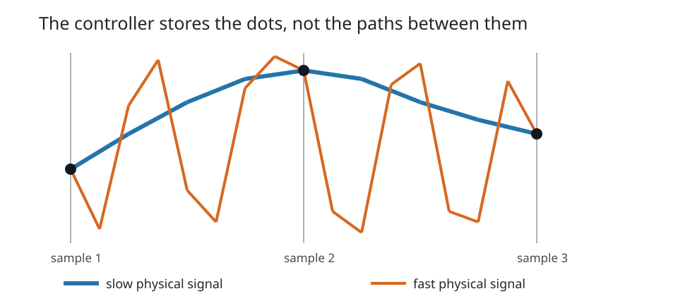
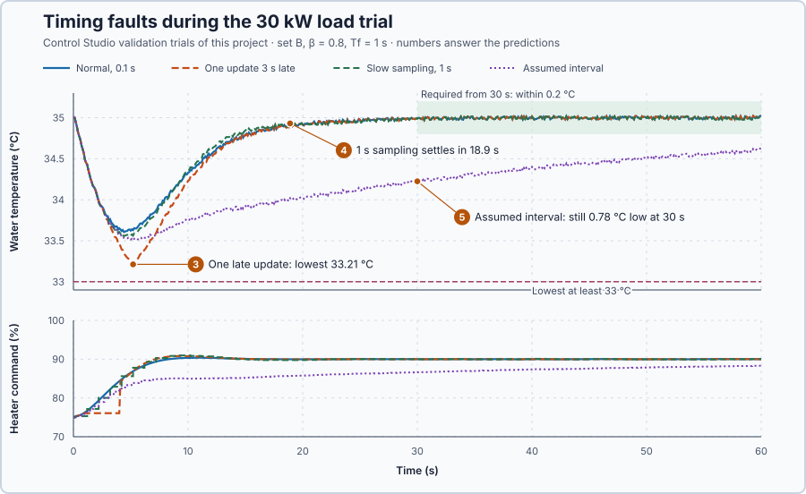

# 25. Sampling and timing

In this lesson, you will see what happens when the controller looks at the temperature less often, late, or with a wrong idea of how much time has passed. You will learn why every update must use the time that really passed, and which intervals the controller must refuse.

## The problem

Lesson 24 applied a 1 s measurement filter: the command's noise-driven movement fell from 48.4 to 3.35 points, and the setpoint step still settled in 8.5 s. Both the filter and the integral do arithmetic with the time between readings. The filter moves the fraction $\alpha = 0.1/1.1$ of the way at each update, and the integral adds $K_i\,e \times 0.1$ s. Both assume that a new reading arrives every 0.1 s. If a reading comes late, or the program uses the wrong time step, every update is wrong; and no filter can bring back a change that happened between two readings.

We will make every update use the time that really passed, refuse intervals that cannot be used, and see what sampling can and cannot see.

## What we need

We need to:

1. make every update use the time that really passed since the previous one;
2. refuse intervals that cannot be used, and hold the command instead; and
3. know which changes of the process the chosen sampling can and cannot see.

## The new idea

**Sampling** means the controller looks at the temperature only at separate moments. Anything that changes faster than it looks can be missed or misread, and every update must use the time that really passed. For this heater the controller looks every 0.1 s, ten times a second, and holds its last command between two looks.

**In words.** A PLC already works this way. A cyclic task reads its inputs at the start of each cycle, calculates, and writes its outputs, which keep their values until the next cycle writes them again. A controller in such a task meets three consequences:

1. **It sees only snapshots.** What happens between two readings is invisible. A slow change is followed well, but a change much faster than the readings can be missed, or can look like a slow change that is not there at all. A film camera does the same to a turning wagon wheel: at 24 pictures a second, a fast wheel can seem to turn slowly backwards. This false slow signal is called **aliasing**. No filter after sampling can repair it, because the true signal was never read.
2. **Its command is held.** Between updates the heater keeps the last command, which grows older until the next update. On average it is half an interval old, so slower sampling adds delay to the loop.
3. **Its arithmetic needs the interval.** The integral adds error times time, and the filter's part $\alpha$ depends on the time between updates. If an update comes late, or the program assumes the wrong interval, the calculation is wrong.

So every update must use the time that really passed since the previous one. An interval that cannot be used is refused: zero or negative, because nothing new was read or the clock went back, or longer than the loop can tolerate. The controller then updates nothing and holds its command. For this heater, whose water changes over seconds, looking every 0.1 s is plenty.

**The formula.** Every update moves the integral and the filter with the measured interval:

$$
\Delta I = K_i\,e\,\Delta t, \qquad \alpha = \frac{\Delta t}{T_f + \Delta t}.
$$

At the sample times $t = k\,T_s$, a sine wave of frequency $f$ gives exactly the samples of a sine of frequency $f - f_s$. Subtracting $f_s$ removes a whole number of turns, $2\pi k$, and that leaves a sine unchanged:

$$
\sin(2\pi f\,kT_s) = \sin(2\pi f\,kT_s - 2\pi k) = \sin(2\pi\,(f - f_s)\,kT_s), \qquad f_s = \frac{1}{T_s}.
$$

Only frequencies below half the sampling rate, $f_s/2$, are seen as what they are. The same reasoning limits the interval: to show an oscillation of the loop at all, readings must come at least twice per period, so the usable intervals are

$$
0 < \Delta t \le \frac{P_u}{2}.
$$

The lower bound also protects `Control.PID`, which divides by $\Delta t$.

- $\Delta t$ is the time since the previous accepted update, in seconds;
- $e$ is the temperature error, in degrees Celsius; $K_i$ is the integral gain, in percent per °C and second; and $\Delta I$ is the change of the integral, in percentage points;
- $T_f$ is the filter time constant, and $\alpha$ the part of the gap the filter covers, as in Lesson 24;
- $T_s$ is the sampling period, in seconds, and $f_s$ the sampling rate, in hertz (Hz): samples per second;
- $f$ is the frequency of a sine wave, in hertz: cycles per second;
- $k = 0, 1, 2, \dots$ counts the samples; and
- $P_u$ is the loop's ultimate period from Lesson 20: the period with which it would oscillate at the edge of stability.

**Example: the heater sampled 10 times a second.** Here $T_s = 0.1$ s and $f_s = 10$ Hz. Follow the numbers:

1. A normal update with a 1 °C error adds $\Delta I = 1.14 \times 1 \times 0.1 = 0.114$ point.
2. One update arrives late, after 0.3 s. The same error has lasted three times as long, so $\Delta I = 1.14 \times 1 \times 0.3 = 0.342$ point. A program that assumed 0.1 s would add only 0.114 point and lose two thirds of the correction.
3. A program that updates every 0.5 s but tells the controller 0.1 s adds 0.114 point where 0.57 point belongs: a fifth at every update, as if $K_i$ were five times smaller, 0.228 %/(°C·s).
4. The filter must use the real interval too. With 1 s updates and $T_f = 1$ s, $\alpha = 1/(1 + 1) = 0.5$: each update covers half the gap, and the filter still follows the water with its 1 s time constant.
5. An 8 Hz sine sampled at 10 Hz: at $k = 1$, $\sin(2\pi \cdot 8 \cdot 0.1) = \sin 288° = -0.951$, while a 2 Hz sine gives $\sin 72° = +0.951$; at $k = 2$, $-0.588$ against $+0.588$. Since $8 - 10 = -2$ and $\sin(-x) = -\sin x$, every sample of the 8 Hz wave equals that of a 2 Hz wave turned upside down. A 10 Hz sine is caught at the same point of every cycle, $\sin(2\pi k) = 0$: it looks like no signal at all.
6. Lesson 20 measured $P_u = 4.42$ s, so readings may be at most $4.42/2 = 2.21$ s apart; the program accepts $0 < \Delta t \le 2.2$ s.



**The limitation.** Sampling loses information for good: what changed between two readings, or during a late update, cannot be recovered afterwards. Holding adds delay: 1 s sampling would make the held command on average 0.5 s old, on top of the heater's 1 s delivery delay and the 1 s filter. Over a refused interval the program updates nothing and holds the command; the next update restarts the filter from the fresh measurement.

## Prediction

Before running, answer these questions:

1. How much does the integral grow for a 1 °C error over 0.1 s and over 1 s?
2. Which of these intervals can the controller use: 0 s, 0.1 s, 1 s, 3.1 s?
3. Under the 30 kW load, which trial dips deepest: normal timing, one update 3 s late, 1 s sampling, or 0.5 s updates with an assumed 0.1 s?
4. Will 1 s sampling still settle within 30 s?
5. What happens to the recovery when the integral is five times too weak?

| Interval | Integral step at 1 °C | Usable? |
| ---: | ---: | --- |
| 0 s | — | no: nothing new acquired |
| 0.1 s | 0.114 point | yes |
| 1 s | 1.14 points | yes |
| 3.1 s | — | no: longer than 2.2 s |

## Implementation

Open [`src/Main.st`](src/Main.st). It measures the time since the previous update with a timer, checks it, and only then updates the filter and `Control.PID`:

```st
IF UpdateDue THEN
    ElapsedS := SinceLastUpdateS;
    TimingUsable := IntervalUsable(ElapsedTime := ElapsedS, MaximumInterval := MaximumIntervalS);
    IntervalTimer(IN := FALSE, PT := T#1h);  (* the next interval starts at this reading *)
    IntervalTimer(IN := TRUE, PT := T#1h);
END_IF;
IF UpdateDue AND NOT TimingUsable THEN
    RejectedUpdates := RejectedUpdates + 1;  (* no state update: the command is held *)
    FilterWasActive := FALSE;                (* the next update restarts the filter *)
ELSIF UpdateDue THEN
    FilterAlpha := FilterFraction(CycleTime := ElapsedS, FilterTime := MAX(FilterTimeS, LREAL#0.0));
    ...
    Input.CycleTime := SEL(AssumedCycleS > LREAL#0.0, ElapsedS, AssumedCycleS);
    AppliedPowerPct := Controller.Update(Input := Input);
END_IF;
```

`MaximumIntervalS` is the 2.2 s limit. `ControllerPeriodS` sets the sampling period, and `DelayUpdateS` makes one update late. `AssumedCycleS` = 0 passes the measured interval to `Control.PID`; a positive value replaces it with a fixed one, the wrong arithmetic tested below.

**Exercise.** Run the tests in [`src/tests.st`](src/tests.st) from the **Testing** view. They check the interval rule (0, −0.1 and 3.1 s refused; 0.1 and 1 s accepted) and the two aliasing cases. Then work out by hand how much a 0.5 s update adds to the integral at a 1 °C error when the controller is told 0.1 s: 0.114 point instead of 0.57.

## Experiment in Control Studio

The project validates four load trials, each with 30 kW of extra heat loss at a 35 °C setpoint: **load trial** (normal 0.1 s timing), **delayed update** (the update due at 1 s comes 3 s late, so its 3.1 s interval is refused), **slow sampling** (1 s updates) and **assumed interval** (0.5 s updates, but `Control.PID` is told 0.1 s). Each must stay at or above 33 °C, be within 0.2 °C from 30 s and settle within 30 s. The setpoint trial of Lesson 24 runs as well.

1. Open this lesson's project and start **Simulator**. The heater holds 35 °C with 75 % in Manual. In the **truST** side bar, select **Control Studio**.
2. On **Identify**, keep **Method** at **Automatic** and select **Identify plant**; the model is G(s) = (0.2) / (5.1s +1) · e^(−1s).
3. On **Tune**, choose **P1.Controller · PI** and **Manual**. Enter Lesson 24's controller: **Proportional gain (Kp)** 5.79, **Integral gain (Ki)** 1.14, **Setpoint weight (β)** 0.8 and **Measurement filter time (Tf)** 1.
4. Select **Requirements…** and enter **Setpoint change (°C)** 3, **Maximum steady-state error (°C)** 0.2, **Maximum settling time (s)** 15, **Settling band (±°C)** 0.1 and **Validation duration (s)** 60. Select **Done**, then **Tune controller**.
5. On **Validate**, select **Validate controller** and read the rows of each trial.
6. The assumed-interval trial fails, so Control Studio shows **The recorded response did not settle within 30 s. Next: Tune again.** and does not offer **Apply**. The evidence below explains why no tuning repairs it.

## Evidence and decision



The numbered marks answer predictions 3–5; the table above answers 1 and 2. From the validation:

| Load trial | Lowest temperature | Error from 30 s | Settling, limit 30 s | Result |
| --- | ---: | ---: | ---: | --- |
| Normal, 0.1 s | 33.61 °C | 0.027 °C | 19.2 s | Pass |
| One update 3 s late, 3.1 s refused | 33.21 °C | 0.028 °C | 19.7 s | Pass |
| Slow sampling, 1 s | 33.56 °C | 0.029 °C | 18.9 s | Pass |
| Assumed interval, 0.5 s told 0.1 s | 33.51 °C | 0.78 °C | not reached | **Fail** |

The setpoint trial settled in 8.7 s, as in Lesson 24.

3. The delayed update dipped deepest, to 33.21 °C, 0.40 °C below the normal trial: while the update was late, the old command stayed on and the load cooled the water unopposed. The 3.1 s interval was refused, so the integral did not jump on one reading; the correction missed during the gap was lost either way.
4. Slow sampling dipped only 0.05 °C deeper than normal and settled in 18.9 s: for this loop, 1 s is still fast enough.
5. With the assumed interval, each 0.5 s update added only a fifth of the true integral step. P still reacted, so the dip was ordinary, but the integral rose so slowly that the water was still 0.78 °C low after 30 s and never settled.

No gains repair the assumed interval. A five times larger $K_i$ would rescue this trial and make every correctly timed update five times too strong: the fault is the program's arithmetic, not the tuning. We keep the measured interval, the interval check and 0.1 s sampling, which the program already uses, so nothing needs to be applied. These are simulation results for this heater.

## Conclusion

A sampled controller sees the process only at its updates and holds its command in between. Every update must use the measured time since the previous one, and an interval that is not positive, or too long to show the loop's oscillation, must be refused. Information missed between readings or during a late update cannot be recovered afterwards.

For this heater, a late update cost 0.4 °C of extra dip and 1 s sampling cost almost nothing, but telling the controller the wrong interval made it fail its requirement, whatever the gains.

## Check yourself

1. **With $K_i = 1.14$ %/(°C·s), how much does a 2 °C error add to the integral over a correct 0.5 s interval?**
   $1.14 \times 2 \times 0.5 = 1.14$ points.
2. **Why is an interval of 3.1 s refused for this heater, although the temperature changes slowly?**
   Readings further apart than half the 4.42 s ultimate period cannot show the loop oscillating, so an update over
   3.1 s would integrate an error the controller never saw.
3. **Why did a larger $K_i$ not count as a repair for the assumed-interval trial?**
   The integral step was wrong because the program used the wrong time, not because the gain was wrong. A larger
   gain would fix only that trial and make every correctly timed update too strong.

## Reason for the next lesson

Every update continues from values the controller stored at the previous one: its last command, the last setpoint and measurement, the filtered temperature. Correct update equations still give a wrong first command if those stored values start wrong, for example from 0 while the hot heater needs 75 %.

[Controller initialization](../../03-production-quality-digital-pid/39-controller-mode-initialization/README.md) sets those values from the running heater before the controller takes over.
