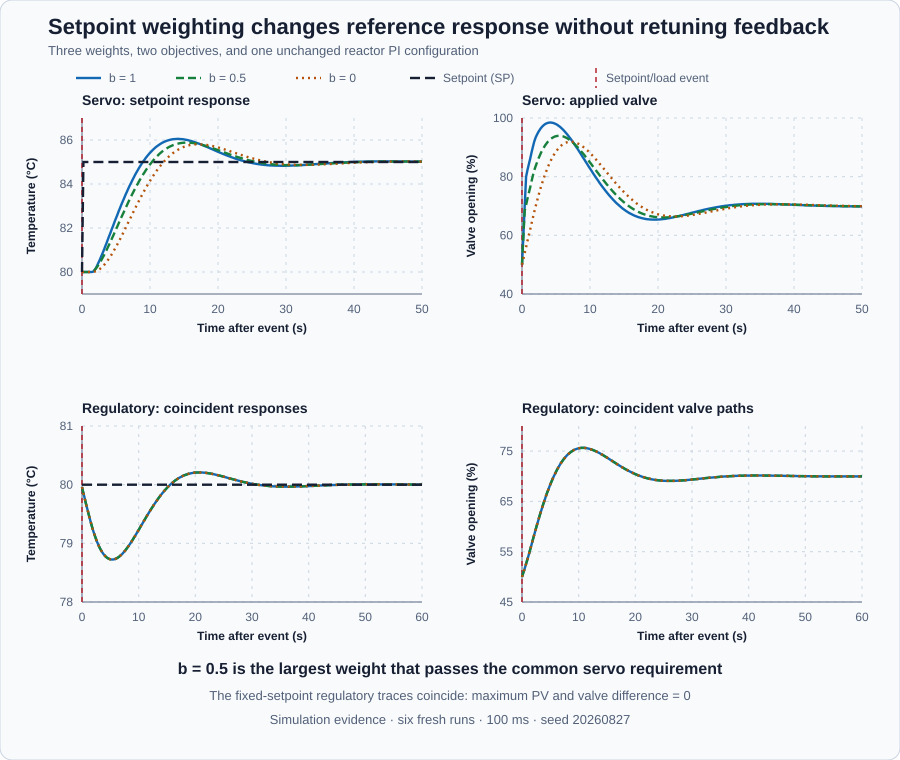

# Reactor proportional setpoint weighting

Course position: Lesson 12 of 84. Previous lesson: [Servo and regulatory objectives](../11-reactor-servo-regulatory/README.md). Next lesson: [Measurement filtering](../13-measurement-noise/README.md).

**Lesson objective:** Configure and compare proportional setpoint weights of one, one-half, and zero on the same jacketed-reactor PI loop; predict each controller's immediate valve response to a setpoint step; and use retained servo and regulatory evidence to select the largest weight that satisfies the setpoint-overshoot requirement without changing the fixed-setpoint disturbance path.

**Evidence class:** Simulation evidence. Not evidence from a physical
reactor. Do not reproduce either experiment on physical equipment without an
independent process-safety review and explicit authorization immediately before
the action.

## The problem

The jacketed stirred reactor, product-temperature transmitter, and jacket heating valve are unchanged from Lesson 11, including the ±50-percentage-point-per-second rate limit Lesson 11 already disclosed and used to predict a
ramp rather than a step. The transmitter measures product
temperature in degrees Celsius. The valve adds heat from 0 to 100 percent
opening; it cannot actively cool the reactor. The 50-percentage-point-per-second
figure is implemented as the controller's own `RateMinimum`/`RateMaximum`
parameters, a declared teaching value standing in for how far a real valve
actuator can travel in one update, not a separate downstream valve model.

At the operating point, reactor temperature is 80 degrees Celsius and the valve
is 50 percent open. Lesson 11 used one PI tuning for two independent tests. Its
80-to-85-degree-Celsius setpoint step produced 1.049 degrees Celsius of
overshoot and failed the 1.0-degree-Celsius servo requirement. Its fixed-80-
degree-Celsius disturbance test recovered in 11.6 seconds and met the
regulatory requirements.

Retuning the feedback gains could repair the failed servo response while
damaging disturbance rejection that already works. We need a smaller change:
soften the controller's immediate reaction to a new setpoint without weakening
its reaction to measured process motion or its accumulated error correction.

The valid simulated temperature range is 60 through 100 degrees Celsius. Every
run must finish in Manual mode with a zero-percent request and a zero-percent
applied valve position.

## What we need

We need to understand exactly where a setpoint change enters the incremental PI
equation, introduce one dimensionless weight at that location, and predict the
first valve movement before running anything. We then need separate fresh servo
and regulatory runs for each weight, because the weight is sampled only when the
controller is initialized. One running controller cannot honestly stand in for
six fresh initial states.

## The new idea

The **setpoint ($SP$)** is the desired product temperature in degrees Celsius.
The **process value ($PV$)** is the measured product temperature in degrees
Celsius. The **true error ($e$)** is the setpoint minus the process value, in
degrees Celsius:

$e_k = SP_k - PV_k$

The **sample index ($k$)** identifies the current retained controller update;
$k-1$ identifies the preceding update. The **cycle time ($\Delta t$)** is the
0.1 second between updates. The **setpoint change ($\Delta SP$)** is the current
setpoint minus the preceding setpoint, in degrees Celsius:

$\Delta SP = SP_k - SP_{k-1}$

The **process-value change ($\Delta PV$)** is the current process value minus
the preceding process value, also in degrees Celsius:

$\Delta PV = PV_k - PV_{k-1}$

Both changes are measured in degrees Celsius. This subtraction matters because
an incremental controller calculates what to add to its preceding nominal valve
output, rather than recalculating the complete output from zero on every scan.

To see where the ordinary incremental proportional term comes from, subtract
the preceding error from the current error:

$e_k-e_{k-1}=(SP_k-PV_k)-(SP_{k-1}-PV_{k-1})$

Grouping the setpoint terms and the process-value terms gives:

$e_k-e_{k-1}=\Delta SP_k-\Delta PV_k$

Ordinary incremental PI therefore uses
$K_p(\Delta SP_k-\Delta PV_k)$ for its proportional change. A sudden setpoint
change and a measured process change both receive the full proportional gain.
The purpose of setpoint weighting is to change only the reference part. Replace
$\Delta SP_k$ with $b\Delta SP_k$, where the **proportional setpoint weight
($b$)** is dimensionless and lies from zero through one. $K_p$ is measured in
percentage points of valve movement per degree Celsius. The **proportional valve
increment ($\Delta MV_P$)** is therefore measured in percentage points:

$\Delta MV_P = K_p(b\Delta SP-\Delta PV)$

The negative $\Delta PV_k$ term is not weighted. Every value of $b$ retains the
same proportional feedback to measured reactor motion.

Integral action is also unchanged. $K_i e_k$ is the requested valve-change rate
in percentage points per second. Multiplying that rate by the 0.1-second cycle
time $\Delta t$ gives the **integral valve increment ($\Delta MV_I$)**, measured
in percentage points, for one update:

$\Delta MV_I = K_i e\Delta t$

The nominal incremental update is consequently:

$MV_{nom,k}=MV_{nom,k-1}+\Delta MV_{P,k}+\Delta MV_{I,k}$

The controller then applies its 0-to-100-percent amplitude limit and its
50-percentage-point-per-second rate limit. The returned value is the **applied
manipulated variable ($MV_{applied}$)**, the actual simulated valve opening in
percent. There is no separate downstream actuator in this lesson, so inventing
a second requested-output trace would be misleading.

The three weights now have precise meanings. At $b=1$, the proportional term
receives the complete setpoint change. At $b=0.5$, it receives half. At $b=0$,
it receives none, while PV feedback and true-error integration remain complete.

For a fixed setpoint regulatory test, $SP_k=SP_{k-1}$ and
$\Delta SP_k=0$. Substitution makes the weighted term zero for every $b$:

$b\Delta SP_k=b\cdot0=0$

With the same initial controller state, plant state, disturbance, limits,
timing, and numerical execution, changing $b$ should therefore make no change
to the deterministic regulatory path. This is a prediction to test within a
declared numerical tolerance, not a general claim that physical runs are
perfectly identical.

## Prediction

The servo setpoint increases by 5 degrees Celsius. On the first post-step
controller update, PV has not yet moved, so $\Delta PV=0$. With
$K_p=8$ percentage points per degree Celsius:

$\Delta MV_P(b=1)=8(1\cdot5-0)=40\text{ percentage points}$

$\Delta MV_P(b=0.5)=8(0.5\cdot5-0)=20\text{ percentage points}$

$\Delta MV_P(b=0)=8(0\cdot5-0)=0\text{ percentage points}$

The three predicted proportional increments are therefore 40 percentage
points, 20 percentage points, and zero percentage points, respectively.

Starting from 50 percent valve opening, those proportional increments predict
preliminary nominal positions of 90, 70, and 50 percent before the current
integral increment and physical limiting. Reducing $b$ should reduce the
initial reference kick and overshoot, but it can also slow reference tracking.
For the fixed-setpoint disturbance runs, predict no aligned PV or applied-valve
difference beyond the numerical agreement tolerance.

Before practice, define how those predictions will be judged. Decisions use
unrounded retained values. Display precision is presentation only; rounded
tables and plot labels do not change a decision.
An upper-bound requirement passes when its value is no greater than the limit
plus tolerance. A lower-bound requirement passes when its value is no less than
the limit minus tolerance.

Servo overshoot is the largest positive PV excess above the 85-degree-Celsius
target from 5.1 through 55.0 seconds. Taking the maximum with zero prevents a
response that never crosses the target from being assigned negative overshoot:

$\text{servo overshoot} = \max_k(PV_k-85{}^\circ\mathrm{C},0)$

Its upper requirement is 1.0 degree Celsius; its numerical tolerance is 0.01
degree Celsius. Settling time is elapsed time after the 5.0-second event until
$|SP-PV|$ is no greater than the 0.5-degree-Celsius band plus its
0.01-degree-Celsius comparison tolerance and remains there through 55.0
seconds. A failure to remain there is `Not settled`. The reported time has a
0.1-second reproduction tolerance but no physical acceptance threshold here.

Applied-valve travel adds the absolute movement between every adjacent retained
sample, including the 5.0-second pre-event sample through the final automatic
sample at 55.0 seconds:

$MV_{travel} = \sum_k|MV_{applied,k}-MV_{applied,k-1}|$

Its unit is percentage points. It has 0.01-percentage-point reproduction
tolerance and no physical acceptance threshold. Manual shutdown is excluded
because it is safety evidence, not automatic control effort.

For each regulatory run, peak deviation is the largest absolute error from
60.1 through 120.0 seconds:

$\text{regulatory peak deviation} = \max_k|SP_k-PV_k|$

Its lower requirement is 1.0 degree Celsius and its tolerance is 0.01 degree
Celsius, so the disturbance is large enough to test rejection. Recovery time
uses the same persistent 0.5-degree-Celsius band and must not exceed 40.0
seconds; its tolerance is 0.1 second. Final-window absolute error is the mean
absolute error from 110.1 through 120.0 seconds, calculated only after recovery
qualifies:

$MAE_{final}=\frac{1}{N}\sum_{k=1}^{N}|SP_k-PV_k|$

Here $N$ is the number of retained samples in the 110.1-through-120.0-second
window. It must not exceed 0.5 degree Celsius, with 0.001-degree-Celsius tolerance. The
mean prevents one convenient final sample from masquerading as equilibrium.

Regulatory path disagreement is calculated separately for PV and
$MV_{applied}$. Each is the maximum absolute difference between aligned samples
from a weighted run and the $b=1$ reference over 60.0 through 120.0 seconds:

$\Delta PV_{max} = \max_k|PV_{candidate,k}-PV_{b=1,k}|$

$\Delta MV_{max} = \max_k|MV_{applied,candidate,k}-MV_{applied,b=1,k}|$

Each must be no greater than `1e-10` in its own unit — a declared
floating-point agreement tolerance many orders below the 0.001-degree-Celsius
final-window tolerance above, chosen to accept ordinary arithmetic rounding
between two runs while still rejecting any genuine difference in the
deterministic result. Missing or misaligned
samples make the comparison Invalid, never zero. First decide numerical
validity, then physical acceptability, then regulatory equivalence. Finally
select the largest tested $b$ that passes the servo requirement and has complete
equivalent regulatory evidence.

## Implementation

The weight is sampled only while `Control.PID` is initialized. Changing its
mapped value cannot reconfigure an already initialized controller; every other
weight requires a restored, restarted runtime.

```st
ProportionalGainUsed := LREAL#8.0;
IntegralGainUsed := LREAL#2.0;
DerivativeGainUsed := LREAL#0.0;
ProportionalSetpointWeightUsed := SetpointWeight;
BiasUsed := LREAL#50.0;
ConfiguredCycleTime := LREAL#0.1;

Parameters.ProportionalGain := ProportionalGainUsed;
Parameters.IntegralGain := IntegralGainUsed;
Parameters.DerivativeGain := DerivativeGainUsed;
Parameters.ProportionalSetpointWeight := ProportionalSetpointWeightUsed;
Parameters.DerivativeSetpointWeight := LREAL#0.0;
Parameters.Bias := BiasUsed;
Parameters.OutputMinimum := LREAL#0.0;
Parameters.OutputMaximum := LREAL#100.0;
Parameters.RateMinimum := LREAL#-50.0;
Parameters.RateMaximum := LREAL#50.0;
Parameters.TrackingTime := LREAL#1.0;
Parameters.AntiWindup := PIDAntiWindup#Combined;
Controller.Configure(Parameters := Parameters);

Input.Setpoint := Setpoint;
Input.ProcessValue := ProcessValue;
IF AutoMode THEN
    Input.Mode := PIDMode#Auto;
ELSE
    Input.Mode := PIDMode#Manual;
END_IF;
Input.ManualOutput := ManualOutput;
Input.CycleTime := ConfiguredCycleTime;
ManipulatedValue := Controller.Update(Input := Input);
```

The shipped project selects $b=0.5$, the largest qualified weight, and exposes
one reviewed `ExperimentEnabled` authority. The project owns the setpoint,
mode, timing, observation window, and Manual-zero restoration. The native
evidence selects each weight and objective before initialization in six
independently initialized runs and then uses that same project-owned sequence.

## Experiment in Control Studio

Control Studio runs the shipped selected-weight servo objective. The native
evidence creates six fresh runtimes—three weights for servo and three for
regulatory—and executes the same project-owned sequence authority. The UI does
not pretend that one initialized controller is six independent experiments.
The deterministic Simulation seed is 20260827.

### Control Studio actions

1. **Monitor** — Select target **Simulator**, choose **Run**, then open **Control Studio → Monitor → Response**.
   - **Baseline check:** Wait for **Simulation**, **Running**, and current data. Confirm SP = 80 degC, PV = 80 degC, applied MV = 50%, Manual command = 50%, proportional setpoint weight = 0.5, selected objective = 0, Manual mode, and experiment authority false. Verify units, limits, quality, 0.1-second sampling, and Simulation source. The unresolved problem is Lesson 11's failed $b=1$ servo overshoot.
   - **Decision before action:** State the predicted 20-percentage-point proportional increment and preliminary 70-percent nominal valve position for $b=0.5$. Predict lower overshoot than $b=1$ while PV feedback and true-error integral remain unchanged.
   - **Successful evidence:** The Response plot advances with finite current values and **Start recording** is enabled. Select **Start recording** only then.
   - **Recovery:** If data are stale, unavailable, nonfinite, or outside limits, stop the Simulator, correct the runtime or binding problem, restart, and repeat the baseline check.
   - **Record:** Retain the initial SP, PV, applied MV, Manual command, weight, objective, mode, and prediction before opening Test.
2. **Test** — Open **truST sidebar → Control Studio → Test**.
   - **Baseline check:** Confirm **Experiment** = **Observe without excitation**, **Amplitude** = **0** (disabled), and **Maximum duration (s)** = **56.5**. The reviewed authority is **Experiment authority** (`P1.ExperimentEnabled`). Test must change only that Boolean from false to true and restore false.
   - **Decision before action:** Before selecting **Review test**, verify the plan does not write SP or weight. The project enters Auto at SP 80 degC through 5.0 seconds, steps SP to 85 degC at 5.1 seconds, observes through 55.0 seconds, then selects Manual zero from 55.1 seconds until the applied valve reaches zero. This run is made so that full proportional setpoint response produces 1 is measured rather than assumed.
   - **Successful evidence:** Select **Review test**, verify the Boolean authority, duration, false restoration, and stop conditions, then select **Confirm and start**. Require **Running**, an available **Abort test**, retained boundary samples, terminal completion, experiment authority false, and complete Manual-zero restoration.
   - **Recovery:** If the run is rejected, stale, unavailable, failed, or aborted, keep or return the authority false, wait for Manual zero and current data, then review a fresh test. Never claim six-run comparison evidence from this one UI runtime.
   - **Record:** Compare the observed initial movement and overshoot with the prediction. Retain terminal state,
     restoration result, selected weight 0.5, and seed 20260827. The inherited limitation under test
     is: Full proportional setpoint response produces 1.049 degC overshoot and fails the declared 1.0 degC servo requirement despite acceptable regulatory recovery. The decision this run
     supports is: Change only proportional setpoint weight, restart after each initialization-only setting change, retain true-error integral action, and repeat both objective tests from fresh identical initial states.

The native regulatory comparison is separate. In each fresh objective-1 runtime,
SP remains 80 degC in Auto, the retained 60.0-second boundary precedes the
cold-feed response at 60.1 seconds, automatic observation continues through
120.0 seconds, and Manual zero begins at 120.1 seconds and continues until the
applied valve reaches zero.

## Evidence and decision

Apply the equations, windows, tolerances, validity order, and selection rule
declared before practice to the six retained native runs.

| Weight b | Run status | Servo overshoot | Servo result | Settling time | Applied-valve travel | Selected |
| ---: | --- | ---: | --- | ---: | ---: | --- |
| 1 | Settled | 1.049 °C | Fail | 19.7 s | 87.84 pp | No |
| 0.5 | Settled | 0.882 °C | Pass | 20.3 s | 77.08 pp | **Yes** |
| 0 | Settled | 0.807 °C | Pass | 21.6 s | 72.21 pp | No |

Weight zero has the lowest overshoot and valve travel, but the rule does not
select the smallest measured value. Weight 0.5 is the largest tested weight
that meets the common overshoot requirement, so it retains more immediate
reference response without violating that requirement.

| Weight b | Excitation peak | Recovery | Final-window error | Maximum PV disagreement | Maximum MV disagreement | Regulatory result |
| ---: | ---: | ---: | ---: | ---: | ---: | --- |
| 1 | 1.276 °C | 11.6 s | 0.0037 °C | 0 °C | 0 pp | Pass; reference path |
| 0.5 | 1.276 °C | 11.6 s | 0.0037 °C | 0 °C | 0 pp | Pass; equivalent |
| 0 | 1.276 °C | 11.6 s | 0.0037 °C | 0 °C | 0 pp | Pass; equivalent |



The figure is generated from the complete native
[trace](figures/setpoint-weighting-trace.csv). The six-row
[qualification summary](figures/setpoint-weighting-summary.csv) retains
unrounded measures, thresholds, tolerances, and separate decision states.

All six automatic traces are finite and remain inside the declared temperature
and valve limits. Gains, true-error integral path, reactor configuration,
initial state, event schedule, limits, cycle time, and seed agree. Every run
retains complete Manual-zero restoration. The $b=1$ servo run fails; $b=0.5$
and $b=0$ pass. All regulatory runs meet excitation, recovery, and final-window
requirements, and their aligned PV and applied-MV disagreements are exactly
zero in this deterministic run. The selected weight is therefore $b=0.5$.

This proves the declared simulation decision. It does not authorize a setpoint
or feed test on a physical reactor.

## Conclusion

Setpoint weighting follows directly from separating the setpoint-change and
process-value-change parts of incremental proportional action. Reducing $b$
reduces only the immediate proportional reference increment. The complete
negative PV-change term and true-error integral term remain, so the controller
has not been made generally weaker.

With fixed SP, $\Delta SP=0$ and the weighted contribution is zero for every
$b$. Equivalent fresh regulatory runs therefore coincide in this deterministic
implementation, as predicted. The conclusion is bounded to this PI form,
tuning, limits, initialization procedure, simulation, and local operating
region. Another process or reference-tracking requirement may prefer another
weight.

Because it gives the controller two independent tuning handles — the ordinary
feedback gains and this separate setpoint weight — instead of one, this
technique is sometimes called **two-degree-of-freedom** control.

## Reason for the next lesson

Setpoint weighting changes the SP path. Measurement noise changes PV, so it
still enters the unweighted negative $\Delta PV$ term and can make a
valve move unnecessarily for every value of $b$. Lesson 13 introduces a
pressure-transmitter measurement path and derives the trade-off between noise
attenuation and filter lag.
