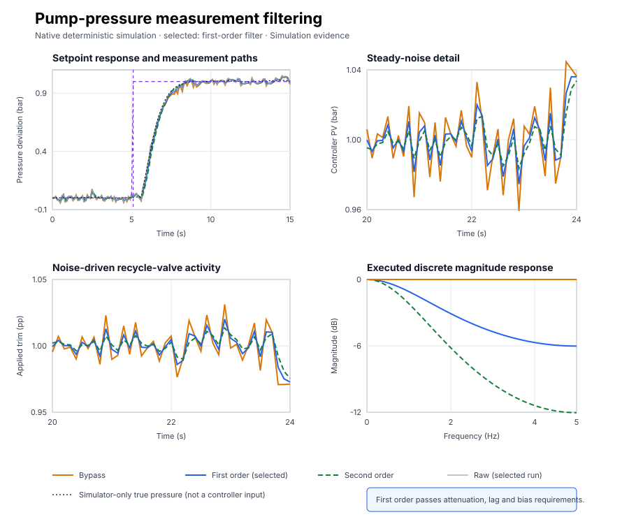

# Pump-pressure measurement filtering

Course position: Lesson 13 of 84. Previous lesson: [Setpoint weighting](../12-reactor-setpoint-weighting/README.md). Next lesson: [Sampling and jitter](../14-sampling-interval/README.md).

**Lesson objective:** Configure bypass, first-order, and cascaded second-order measurement paths for the same simulated centrifugal-pump pressure loop; predict their discrete first-sample response and frequency attenuation; use three equivalent retained runs to select the weakest filter that satisfies the declared pressure-noise and recycle-valve-activity requirements without exceeding the allowed measurement-path lag or final-window pressure bias; and explain why smoothing cannot reconstruct information lost before sampling.

**Evidence class:** Simulation evidence. This lesson's results are not
evidence from a physical pump, transmitter, or recycle valve. The simulator
exposes one signal that cannot normally be measured on a real installation. It
is labelled explicitly below and is never connected to the controller.

## The problem

The centrifugal pump, discharge-pressure transmitter, and recycle control valve form one pressure-deviation loop. The pump operates around a normal pressure. This lesson
controls pressure deviation from that operating point rather than absolute
discharge pressure.

The discharge-pressure setpoint is the desired pressure deviation in bar. The
transmitter reports pressure deviation in bar. The recycle valve is adjusted
in percentage points around its operating position and is limited to minus ten
through plus ten percentage points. Positive trim increases pressure deviation
in this reduced-order model. Manual zero trim is the safe simulated state.

The local simulated pressure response is fixed across all three runs. Its
mathematical plant structure and parameters are deliberately not derived here;
that theory begins in Lesson 15. This lesson uses the response only to study
one measurement path. It does not reproduce a pump curve, cavitation, pipe
resonance, valve stiction, transmitter dynamics, plant trips, or physical
interlocks.

Lesson 12 changed proportional setpoint weighting. That reduced the immediate
valve response to a setpoint change, but setpoint weighting does not filter the
measured process value. Vibration and electrical noise in a pressure
transmitter therefore still enter proportional feedback.

The controller cannot know from one sample whether a rapid reported movement
came from the water system or from the transmitter. If it reacts to every
reported movement, the recycle valve moves unnecessarily. A measurement filter
may reduce this activity, but it must not hide genuine pressure motion for too
long. That is the engineering decision in this lesson.

## What we need

We need to reduce valve movement caused by transmitter noise without adding so much measurement delay that real pressure changes are hidden. The weakest useful smoothing must therefore be selected from both noise reduction and lag evidence.

## The new idea

The physical pressure ($P_{\mathrm{true}}$) is the plant's pressure state in bar. On real
equipment it is the unknown quantity we want the transmitter to represent. The
simulator provides it only as a separately labelled evidence channel so that
we can check the injected noise. The controller program never reads it.

Measurement noise ($n$) is transmitter-path variation in bar that does not move
the simulated plant state. The raw process value ($PV_{\mathrm{raw}}$) is the sampled
transmitter value in bar. The controller process value ($PV_{\mathrm{controller}}$) is the
pressure value in bar after the selected measurement path. These meanings give
the measurement relationship:

$PV_{\mathrm{raw}} = P_{\mathrm{true}} + n$

The filtered value is an estimate formed from past and current raw samples. It
is not a new measurement of physical truth.

A spectrum describes how variation in a signal is distributed over frequency.
Slow pressure changes occupy lower frequencies than rapid sample-to-sample
variation. The simulator generates one deterministic, approximately normal
broadband noise sequence with a standard deviation of 0.02 bar. A finite
record will not have a perfectly flat spectrum, so this lesson does not claim
that every frequency has equal measured power.

Quantization rounds a measurement to discrete levels. It is different from
broadband noise. The declared pressure resolution is 0.001 bar, but that value
is metadata and display precision in this lesson. The simulator applies no
separate quantizer. We therefore discuss quantization so it is not confused
with noise, but we do not claim to measure quantization error here.

The cycle time (`dt`) is the elapsed time between controller and filter updates.
It is 0.1 second. One **hertz (Hz)** means one sample, or one repeating cycle,
per second. The sampling frequency ($f_s$) is the number of samples per
second. Here it is 10 hertz. The Nyquist frequency ($f_{N}$) is half the sampling
frequency, here 5 hertz. Input content at or above that boundary cannot be
distinguished from a lower, false frequency once it is sampled: two genuinely
different signals can produce identical sampled values. This false appearance
is called **aliasing**. A filter applied after sampling can reduce recorded
high-frequency content, but it cannot undo aliasing that already occurred
before sampling, because the samples it receives no longer carry the
information needed to tell the two signals apart.

A low-pass filter retains slower movement while reducing faster variation.
Physically, its state moves toward the current raw value at a rate
proportional to how far apart they still are: a large gap produces fast
correction, and a gap of zero leaves the filter unchanged. Lesson 9 measured a
rate as position change divided by elapsed time, a finite difference; the same
idea now applies to the filter's own output. The **filter input ($x$)** is the
raw value entering the low-pass calculation, in bar, and the **filter output
($y$)** is the filter's retained estimate, also in bar. "Output rate is
proportional to the remaining gap, scaled by one over the time constant" is
written $dy/dt=(x-y)/\tau_{\mathrm{f}}$. The filter time constant
($\tau_{\mathrm{f}}$) is 0.1 second: it sets how quickly the gap closes. The
filter coefficient ($a$) is the fraction of the difference between the current
raw value and the retained filter state that is applied during one update.

Multiplying $dy/dt=(x-y)/\tau_{\mathrm{f}}$ by $\tau_f$ and moving $y$ to the
left recovers the continuous lag equation used to derive the coefficient that
actually runs:
$\tau_f\,dy/dt+y=x$. Over one update, approximate the derivative by the same
finite-difference rate idea, $(y_k-y_{k-1})/dt$. Because the true output during
the interval is unknown, approximate it by the midpoint of its two known
endpoints, $(y_k+y_{k-1})/2$, so the estimate is not systematically biased
toward the start or the end of the interval, and hold the current input at
$x_k$:

$\tau_f\frac{y_k-y_{k-1}}{dt}+\frac{y_k+y_{k-1}}{2}=x_k$

Multiply by $dt$, collect the new $y_k$ terms on the left, and then solve for
$y_k$:

$y_k=y_{k-1}+\frac{dt}{\tau_f+0.5dt}(x_k-y_{k-1})$

The fraction multiplying the current difference is the filter coefficient, so
the shipped `Control.LowPass` block calculates:

$a = dt / (\tau_{\mathrm{f}} + 0.5 \cdot dt)$

The previous first-stage value (`y1[k-1]`) is the retained result from the
preceding sample. The current first-stage value (`y1[k]`) is updated from the
current raw process value (`PV_raw[k]`):

$y_{1,k} = y_{1,k-1} + a \cdot (PV_{\mathrm{raw},k} - y_{1,k-1})$

Bypass sends the raw value directly to the controller. First order sends the
first stage. Cascaded second order applies the same update again to a second
retained state (`y2`) driven by the first stage:

$\text{bypass: } PV_{\mathrm{controller},k} = PV_{\mathrm{raw},k}$

$\text{first order: } PV_{\mathrm{controller},k} = y_{1,k}$

$\text{second order: } PV_{\mathrm{controller},k} = y_{2,k}$

Each filter state retained from one update to the next is called a **pole**:
bypass keeps no state and has zero poles, the first-order filter has one pole
(`y1`), and the cascaded second-order filter has two poles (`y1` and `y2`).

A **sinusoid** is a signal that oscillates smoothly and repeats after a fixed
period, such as a sine or cosine wave. When a sinusoidal pressure variation
passes through this filter, the filtered output is also a sinusoid at the same
frequency, but with a smaller amplitude and a time shift. The **amplitude
ratio ($|H(f)|$)** is the output sinusoid's amplitude divided by the input
sinusoid's amplitude at frequency $f$; because both amplitudes are in bar, the
ratio has no unit. A **decibel (dB)** expresses an amplitude ratio on a
logarithmic scale, $\mathrm{dB}=20\log_{10}(|H(f)|)$; the factor 20 is the same
power-versus-amplitude reasoning used for the signal-to-noise decibel
definition in Lesson 16. The **corner (or cutoff) frequency** is where the
ratio has fallen to $1/\sqrt2$, about minus 3 dB: below it the response stays
close to flat, and above it the response keeps falling. Away from the corner,
that falling response approaches a straight line on a log-log plot, called an
**asymptote**. **Phase lag** is the time shift between the input and output
sinusoid, expressed as an angle: it means the filtered signal reports genuine
pressure motion later than it happened.

The continuous reference cutoff frequency ($fc_{\mathrm{reference}}$) follows
from the continuous first-order magnitude
$|H(f)|=1/\sqrt{1+(2\pi f\tau_f)^2}$. Minus three decibels means the amplitude
has fallen to one over square root of two. Setting the magnitude to
$1/\sqrt{2}$, square both sides, and solve for the cutoff frequency:

$fc_{\mathrm{reference}} = 1 / (2 \cdot \pi \cdot \tau_{\mathrm{f}})$

It is 1.5915 hertz for this time constant. It is not the exact sampled
filter's minus-three-decibel frequency: the discrete filter's magnitude has no
equally short closed form, so its crossing is instead found numerically, by
evaluating the executed filter's exact magnitude response at closely spaced
frequencies up to the 5-hertz Nyquist limit and reporting where it first
crosses $1/\sqrt2$. The executed discrete one-stage filter
has a minus-three-decibel frequency of approximately 1.9591 hertz. Two
cascaded stages together reach minus three decibels at approximately 1.2118
hertz. The generated magnitude plot performs exactly that numerical search on
the executed discrete response; it does not fit an ideal continuous
substitute.

Magnitude attenuation in decibels states how strongly a sinusoidal component
is reduced. Away from its corner, one continuous pole approaches 20 decibels
per decade of attenuation and two cascaded poles approach 40 decibels per
decade. The discrete response departs from that simple asymptote near the
5-hertz Nyquist boundary. Every filter state also contributes phase lag: the
controller sees genuine pressure motion later than it appears in the raw
measurement.

The pressure error ($e$) is the setpoint (`SP`) minus the controller process
value ($PV_{\mathrm{controller}}$), all in bar. The applied manipulated variable
($MV_{\mathrm{applied}}$) is the bounded recycle-valve trim in percentage points that the
incremental PI calculates and sends directly to the simulated plant. This
lesson has no separately exposed preliminary request, so it does not invent a
requested-output trace.

The proportional gain ($K_p$) is 0.667 requested percentage points per bar. The
integral gain ($K_i$) is 0.667 requested percentage points per bar-second. The
derivative gain ($K_d$) is zero. Both gains are a configured teaching baseline,
declared in `lesson.json`, chosen to give a brisk response on this reduced-order
plant without the model-based design tools introduced later: Lesson 18 derives
comparable gains from a plant's gain, time constant, and dead time once Lesson
15 has taught that model. A rapid controller-process-value increment
therefore contributes an immediate proportional valve increment in the
opposite direction. Filtering reduces that noise transmission, but it also
delays genuine pressure information.

## Prediction

First calculate the coefficient from the implementation that will actually
run:

$a = 0.1 / (0.1 + 0.5 \cdot 0.1) = 2/3$

The coefficient is two thirds, not one half. If the initialized raw pressure
jumps by 0.10 bar, one stage moves by two thirds of that difference on its first
update:

$\text{first stage} = 0.10 \cdot 2/3 = 0.0667\text{ bar}$

The second cascaded stage receives 0.0667 bar and also moves by two thirds, so
its first output change is 0.0444 bar:

$\text{second stage} = 0.0667 \cdot 2/3 = 0.0444\text{ bar}$

Also calculate the sampling quantities before running:

$f_s = 1 / 0.1 = 10\text{ Hz}$

$f_{N} = 10 / 2 = 5\text{ Hz}$

$fc_{\mathrm{reference}} = 1 / (2 \cdot \pi \cdot 0.1) = 1.5915\text{ Hz}$

Write down your prediction: bypass should show the largest sample-to-sample
pressure and valve movement; one pole should reduce both and add some lag; two
poles should reduce them further and add more lag. Do not decide that two poles
are best merely because their trace should look smoothest.

Before practice, define every comparison. Controller-PV increment RMS uses the
steady-noise window from 20.1 through 40.0 seconds and is measured in bar.
Applied-valve increment RMS uses the same 20.1-through-40.0-second window and is
measured in percentage points. For each consecutive pair, first calculate the
controller-PV increment $\Delta PV_k=PV_{controller,k}-PV_{controller,k-1}$. Root mean
square means: square every increment so signs cannot cancel, average those
squares, then take the square root to return to bar:

$RMS_{\Delta PV} = \sqrt{\frac{1}{N-1}\sum_k(\Delta PV_k)^2}$

Apply the same derivation to consecutive applied-valve increments to obtain
$RMS_{\Delta MV}$ in percentage points. Lower RMS means less sample-to-sample
activity. Candidate attenuation is measured relative to bypass, so:

$R_{pressure} = \frac{RMS_{\Delta PV,candidate}}{RMS_{\Delta PV,bypass}}$

$R_{valve} = \frac{RMS_{\Delta MV,candidate}}{RMS_{\Delta MV,bypass}}$

Pressure-noise attenuation must be no greater than 0.80, with 0.01 tolerance.
Valve-activity attenuation must also be no greater than 0.80, with 0.01
tolerance. Bypass supplies the denominators and is not an eligible filter.

Complete-window applied-valve travel adds the magnitude of every applied move
over the same window:

$MV_{travel} = \sum_k|MV_{applied,k}-MV_{applied,k-1}|$

Its unit is percentage points. Lower is preferred, with no physical acceptance
threshold in this lesson.

The response window is 5.1 through 15.0 seconds. Measurement-path lag area adds
the signed raw-minus-controller pressure gap from every sample and multiplies
by cycle time, turning bar into bar-seconds:

$lag_{area} = \sum_k(PV_{raw,k}-PV_{controller,k})dt$

This is measurement-path lag, not process transport delay or phase margin.
Measurement-path lag must be no greater than 0.08 bar-seconds, with 0.005-bar-
second tolerance.

Final-window absolute mean controller error uses 35.1 through 40.0 seconds. It
first averages signed setpoint-minus-controller-pressure error so random noise
can cancel, then takes the magnitude of that average:

$E_{final} = \left|\frac{1}{N}\sum_k(SP_k-PV_{controller,k})\right|$

It is not true-plant error and not one final sample. Final-window pressure bias
must be no greater than 0.05 bar, with 0.001-bar tolerance.

The simulator also checks that the three aligned noise realizations,
$PV_{raw}-P_{true}$, differ by no more than `1e-12 bar`. Missing or misaligned
samples make the comparison Invalid. Decisions use unrounded retained values;
display precision is presentation only. First establish numerical validity,
then apply all four physical requirements. Among passing candidates, select the
fewest filter poles; a smoother appearance cannot override failed lag.

## Implementation

These are the governing lines from the shipped Structured Text program, quoted
verbatim. The selector is read when the program initializes:

```st
    FilterParameters.TimeConstant := FilterTimeConstantUsed;
    InitializedFilterSelection := FilterSelection;
    InitializedFilterTimeConstant := FilterTimeConstantUsed;
    InitializedCycleTime := ConfiguredCycleTime;
    (* 0 bypasses filtering, 1 selects one pole, and 2 selects two cascaded
       poles. The selection is fixed for each fresh comparison run. *)
    IF FilterSelection = 1 THEN
        FilterParameters.Order := FilterOrder#FirstOrder;
    ELSIF FilterSelection = 2 THEN
        FilterParameters.Order := FilterOrder#SecondOrder;
    ELSE
        (* Bypass and invalid selections use a valid internal filter object;
           invalid selections are denied automatic authority below. *)
        FilterParameters.Order := FilterOrder#FirstOrder;
    END_IF;
    Filter.Configure(Parameters := FilterParameters);
    Filter.Initialize(Input := ProcessValue);
```

Changing the selector in Control Studio requires a restore and fresh restart;
it does not silently replace the state of a running filter. Every scan then
gates the filter and the controller behind the same validity check:

```st
IF ConfigurationValid THEN
    FilterOutput := Filter.Update(
        Input := ProcessValue,
        CycleTime := ConfiguredCycleTime
    );
    IF FilterSelection <> 0 THEN
        FilteredValue := FilterOutput;
    END_IF;
END_IF;
Input.ProcessValue := FilteredValue;
IF ConfigurationValid THEN
    Input.ManualOutput := ManualOutput;
ELSE
    (* Invalid filter configuration removes both automatic authority and any
       operator request so the declared restoration is deterministically zero. *)
    Input.ManualOutput := LREAL#0.0;
END_IF;
IF AutoMode AND ConfigurationValid THEN
    Input.Mode := PIDMode#Auto;
ELSE
    Input.Mode := PIDMode#Manual;
END_IF;
Input.CycleTime := ConfiguredCycleTime;
ManipulatedValue := Controller.Update(Input := Input);
```

`FilteredValue` starts each scan at the raw `ProcessValue` and is only
overwritten by the filter output when selection is not bypass, so bypass
(selection 0) sends the raw value straight to the controller. `ConfigurationValid`
checks that selection is zero through two, the time
constant and cycle time are positive and unchanged since initialization, and
pressure and Manual demand remain inside their declared ranges. An invalid
selection or changed initialization-only setting removes automatic authority
and applies Manual zero. The simulator-only true-pressure variable is declared
for evidence but is not used by the controller calculation.

## Experiment in Control Studio

Control Studio runs the shipped selected first-order filter. The native evidence
creates three fresh runtimes for bypass, first order, and second order and drives
the same project-owned sequence authority. The UI does not pretend that one
initialized filter can become three fresh filter states. The deterministic
Simulation seed is 20260824.

### Control Studio actions

1. **Monitor** — Start the **Simulator**, then open **truST sidebar → Control Studio → Monitor → Response**.
   - **Baseline check:** Wait for **Simulation**, **Running**, and current data. Confirm SP = 0 bar, raw PV and controller PV are current near 0 bar, applied MV = 0%, Manual command = 0%, filter selection = 1, Manual mode, and experiment authority false. Verify units, limits, quality, 0.1-second sampling, and that simulator-only true pressure is labelled as evidence and never as controller input.
   - **Decision before action:** Predict the run Test actually applies: after the 1-bar SP step at 5.1 seconds the first incremental PI move should be about 0.7337 percentage points (0.667 proportional plus 0.0667 integral), and first order must pass both attenuation limits without exceeding lag or final-window bias. Keep the standalone 0.10-bar-raw-jump example above as a hand exercise for the coefficient; that isolated jump is not the signal this Test applies.
   - **Successful evidence:** The Response plot advances with finite current values and **Start recording** is enabled. Select **Start recording** only then.
   - **Recovery:** If data are stale, unavailable, nonfinite, or outside limits, stop the Simulator, correct the runtime or binding problem, restart, and repeat the baseline check.
   - **Record:** Retain initial SP, raw PV, controller PV, applied MV, filter selection, mode, and prediction before opening Test.
2. **Test** — Open **truST sidebar → Control Studio → Test**.
   - **Baseline check:** Confirm **Experiment** = **Observe without excitation**, **Amplitude** = **0** (disabled), and **Maximum duration (s)** = **40.1**. The reviewed authority is **Experiment authority** (`P1.ExperimentEnabled`). Test changes only that Boolean from false to true and restores false.
   - **Decision before action:** Before **Review test**, verify the plan does not write SP or filter selection. The project enters Auto at SP 0 bar through 5.0 seconds, steps SP to 1 bar at 5.1 seconds, observes through 40.0 seconds, then selects Manual zero at 40.1 seconds.
   - **Successful evidence:** Select **Review test**, verify the Boolean authority, duration, false restoration, and stop conditions, then select **Confirm and start**. Require **Running**, an available **Abort test**, retained boundary samples, terminal completion, experiment authority false, and Manual zero.
   - **Recovery:** If the run is rejected, stale, unavailable, failed, or aborted, keep or return authority false, wait for Manual zero and current data, then review a fresh test. Never claim the three-run comparison from this one UI runtime.
   - **Record:** Compare the selected first-order response with the prediction and retain terminal state, restoration, filter selection 1, and seed 20260824.

The native comparison starts three independently initialized runtimes with
selection 0, 1, and 2. Each uses the same noise seed, PI settings, timing,
limits, 5.0-second boundary, 5.1-second setpoint step, 40.0-second final Auto
sample, and 40.1-second Manual-zero restoration.

## Evidence and decision

Apply the RMS, attenuation, travel, lag-area, final-window, numerical-validity,
and fewest-poles rules declared before practice to the three retained native
runs. Bypass supplies the comparison denominators but is not an eligible
filter.

| Filter | Controller-PV increment RMS | Pressure ratio | Valve increment RMS | Valve ratio | Valve travel | Lag area | Final-window bias | Decision |
| --- | ---: | ---: | ---: | ---: | ---: | ---: | ---: | --- |
| Bypass | 0.0255 bar | 1.000 | 0.0179 pp | 1.000 | 2.88 pp | 0.0000 bar·s | 0.0033 bar | Baseline; not eligible |
| First order | 0.0146 bar | 0.574 | 0.0103 pp | 0.575 | 1.67 pp | 0.0486 bar·s | 0.0034 bar | Pass; selected |
| Second order | 0.0089 bar | 0.350 | 0.0063 pp | 0.351 | 1.03 pp | 0.0983 bar·s | 0.0034 bar | Fails lag requirement |

The complete native records are
[`measurement-filter-trace.csv`](figures/measurement-filter-trace.csv) and
[`measurement-filter-summary.csv`](figures/measurement-filter-summary.csv).
They retain unrounded values, thresholds, tolerances, individual dispositions,
safe restoration, seed, and evidence class.



The upper-left panel compares the response paths. The upper-right and lower-left
panels use equal scales to show pressure and valve activity. The lower-right
panel is calculated from the coefficient used by the actual discrete filter.
The black dotted true-pressure line is simulator-only and is not a controller
input.

Initialization preserves the externally supplied filter selection and
operating mode. A fresh run therefore tests the requested bypass, one-pole, or
two-pole case, while an invalid first-scan selection removes automatic
authority and applies manual zero.

All three runs remained finite and inside their pressure and valve limits. Each
ended in Manual with zero applied trim. Reproduced measurement-noise sequences
agree exactly at retained precision, so the comparison is deterministic even
though different valve trajectories cause slightly different physical-pressure
trajectories.

First order passes both attenuation ratios, the lag requirement, and the
final-window bias requirement. Second order suppresses more pressure and valve
variation, but its 0.0983 bar-second lag area exceeds the allowed 0.08 plus
0.005 bar-second tolerance. Bypass supplies the denominator and performs no
filtering. The rule therefore selects the first-order filter as the weakest
qualified measurement path.

Numerical validity, each physical requirement, eligibility, and selection are
separate retained decisions. The smoother second-order trace cannot be ranked
as acceptable after it fails the lag requirement.

## Conclusion

Bypass passes every sampled transmitter movement directly into the PI. Each
retained filter stage applies only part of a rapid raw-pressure difference on
the current scan. That is why controller-pressure increment RMS, valve-increment
RMS, and valve travel all fall as poles are added.

The retained state is also why lag grows. When physical pressure genuinely
changes, the controller continues to see part of the older measurement. A
second state smooths the trace again but delays information again. The
smoothest curve is therefore not automatically the soundest engineering
choice. For this plant, noise record, tuning, sample time, and requirement set,
one pole gives sufficient attenuation without exceeding the allowed lag.

This result does not prove that first order is universally best. A noisier
transmitter, slower process, different controller bandwidth, resonance, or
different valve-wear and response requirements can change the decision.

## Reason for the next lesson

For another pressure loop, first identify what the sensor actually reports,
its resolution and sampled spectrum, the process bandwidth, the controller
sample time, and the valve-activity limit. Calculate the coefficient used by
the real implementation, not a similar textbook formula. Compare equivalent
recorded or safely generated data, define noise and lag measures before seeing
results, and select the weakest filter that satisfies both sides of the
trade-off.

A physical pump additionally requires transmitter and valve dynamics,
cavitation protection, stability-margin review, an independently reviewed
topology, and explicit authorization immediately before any experiment or
filter change. The simulator-only true-pressure channel does not exist on such
an installation.

Filtering after sampling cannot reconstruct aliased information. Lesson 14
therefore investigates sampling and timing: the controller must use the actual
execution interval safely before its filtered measurement can be trusted.
Derivative-specific noise amplification remains deferred until derivative
action is introduced in Lesson 20.
