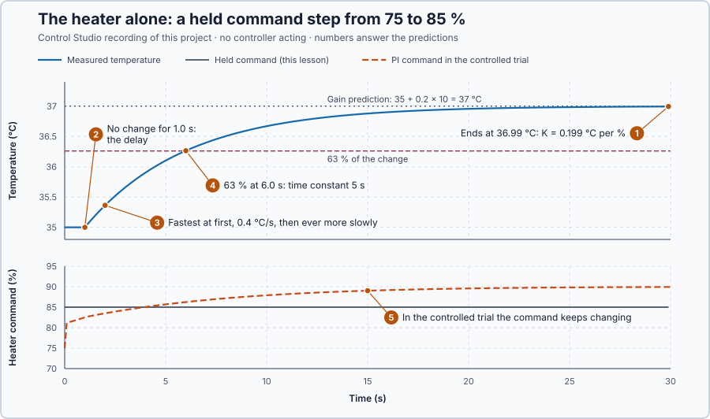

# 12. Process dynamics

In this lesson, you will step the heater's command with no controller acting and read from the response how far the temperature moves, after what delay it starts, and how quickly it gets there.

## The problem

Lesson 11's best gains, $K_p$ = 2 and $K_i$ = 0.6, passed both trials: the load recovery was back within 0.2 °C at 25.4 s. But in every trial the controller kept changing the heater's power, from 81.15% at the first update to 90% at the end of the setpoint trial. The temperature trace therefore shows controller and heater together: a slow recovery could come from the gains or from a slow heater, and the trace cannot tell which.

We will hold the heater's command fixed, step it once with no controller acting, and read the heater's own response.

## What we need

We need to:

1. hold the heater's command at a known value, with no controller changing it;
2. change the command once by a known amount; and
3. read from the recorded temperature how far, how soon and how quickly the heater responds.

## The new idea

**Process dynamics** describe how the heater itself answers a change of power, with no controller involved: how much the temperature finally changes, how quickly, and after what delay. For this heater they are what the water does when the power command steps once and is then held.

**In words.** A controller that computes the command from the measurement forms a **closed loop**: the command changes the temperature, and the temperature changes the command, so a closed-loop trace always shows both together. In an **open loop** the command is set independently of the measurement, here held constant, so the response belongs to the heater alone. In PLC terms, an open-loop test is like forcing the heater output to a fixed value and trending the temperature input: the control logic is out of the path.

Three numbers describe the open-loop response to a step:

1. **How far.** The **process gain** is how much the temperature finally changes per percent of command.
2. **When it starts.** The **delay** is how long after the step the temperature starts to move. For this heater, power commanded now reaches the water 1 s later.
3. **How quickly.** The **time constant** is how long the temperature needs, after it starts to move, to cover 63% of its total change. The shorter it is, the faster the process. The 63% is a convention; the next lesson shows where it comes from.

The physics decides these numbers. The water warms when the heater gives more than the water loses, and cools when it gives less. The loss grows with the water's temperature, 10 kW for every °C above the 20 °C surroundings, so as the temperature moves, the loss moves with it, until loss and heater power balance again and the temperature stops changing. A process that settles at a new value by itself, because its own losses change until they balance the input, is **self-regulating**.

**The formula.** The process gain is the final change of the temperature per unit change of the command:

$$
K = \frac{\Delta T_{steady}}{\Delta u}.
$$

- $K$ is the process gain, in °C per % of command;
- $\Delta T_{steady}$ is the final change of the temperature, from the steady value before the step to the steady value after it, in °C;
- $\Delta u$ is the step of the command, in percentage points;
- $L$ is the delay, in seconds, and $\tau$ the time constant, in seconds, both read from the recorded response.

For this heater the gain also follows from the heat balance. At a steady temperature the heater's power, 2 kW per %, equals the heat loss: $2u = 10(T - 20)$, so $T = 20 + 0.2u$. Every percentage point of command is worth 0.2 °C in the end: $K$ = 0.2 °C per %. At 75% this gives $20 + 0.2 \times 75 = 35$ °C, the temperature the heater holds now.

**Example: a step down from 75% to 70%.** Calculated from the heat balance, not run in this lesson:

1. The final change is $\Delta T_{steady} = 0.2 \times (-5) = -1$ °C, so the water should settle at 34 °C. Check: at 34 °C the loss is $10 \times 14 = 140$ kW, and 70% gives $2 \times 70 = 140$ kW.
2. For the first second nothing happens: the reduced power has not reached the water yet. That is the delay, $L$ = 1 s.
3. Then the heater gives 140 kW while the water, still at 35 °C, loses 150 kW: a 10 kW shortfall, all of it cooling the water.
4. At 34.5 °C the loss has fallen to $10 \times 14.5 = 145$ kW, so the shortfall is 5 kW, half as large, and the water cools half as fast as at first.
5. At 34 °C loss and power balance at 140 kW, and the temperature settles by itself.
6. The 63% mark of this step is $35 - 0.632 \times 1 = 34.37$ °C. The time from the start of the fall to that mark is the time constant.

**The limitation.** The three numbers summarize one recorded response. They predict where any step ends, $K\,\Delta u$, as long as the command stays within 0–100%: no held command can take this heater above $20 + 0.2 \times 100 = 40$ °C. But they do not explain why the response has its shape, so they cannot give the temperature at a chosen moment for another step, another starting point or another heater.

## Prediction

Before running, answer these questions:

1. The command steps from 75% to 85% and is held for 30 s. What final temperature does the gain predict?
2. When should the temperature start to move?
3. Will it rise at a constant rate, fastest at the start, or fastest at the end?
4. Which temperature marks 63% of the change?
5. In Lesson 11's baseline setpoint trial the water settled within 0.2 °C of 38 °C after 23.4 s. Does that time tell you how fast the heater responds?

| Quantity | Predicted |
| --- | ---: |
| Temperature change, $0.2 \times 10$ | 2 °C |
| Final temperature | 37 °C |
| Start of the rise | after 1 s |
| 63% level, $35 + 0.632 \times 2$ | 36.26 °C |

## Implementation

Open [`src/Main.st`](src/Main.st). It contains no controller. It holds 75%, the command that keeps the water at 35 °C. When Control Studio starts the experiment, it applies 85% for 30 s, counting `TrialElapsedMs` up by 100 ms per update, then removes heat. A temperature outside 33–39 °C sets `SafetyAbort`, which also removes heat. The end state is latched; restart the simulator to return to 35 °C with 75%.

**Exercise.** If you changed `AppliedPowerPct := LREAL#85.0;` to `LREAL#80.0`, what would the gain predict? $35 + 0.2 \times 5 = 36$ °C, with the 63% level at $35 + 0.632 \times 1 = 35.63$ °C. Keep 85% for the experiment below.

## Experiment in Control Studio

1. Open this lesson's project and start **Simulator**. The heater holds 35 °C with 75%. In the **truST** side bar, select **Control Studio**.
2. On **Identify**, choose **Project experiment** from **Method**. **Signals** shows `P1.TemperatureC · Process value (°C)` and `P1.AppliedPowerPct · Applied output (%)`. There is no setpoint, because no controller runs.
3. Answer the predictions before starting.
4. Select **Review project test** and check the declared **30.1 s** duration: the 30 s step and one more sample.
5. Select **Confirm and start**; this is time zero, and the command steps to 85%.
6. Watch the command stay at 85% while the temperature responds. After the run, hover 0.9 s, 1.1 s, 2 s, 6 s and the end. Compare the held command with the changing command in your Lesson 11 recording.
7. At completion, Control Studio shows **Project test completed. Outputs restored.** and the command is 0%.

Select **Abort test** to stop early. To repeat, stop and restart **Simulator** so the water starts at 35 °C with 75% again.

## Evidence and decision

The numbered marks answer the predictions with the same numbers. From the recorded run:

| Time | 0–1.0 s | 1.1 s | 2 s | 6 s | 10 s | 29.9 s |
| --- | ---: | ---: | ---: | ---: | ---: | ---: |
| Temperature | 35.00 °C | 35.04 °C | 35.36 °C | 36.26 °C | 36.67 °C | 36.99 °C |

1. The temperature ended at 36.99 °C, 1.99 °C higher: $K = 1.99/10 = 0.199$ °C per %, the predicted 0.2.
2. It did not move for 1.0 s after the step: that is the delay.
3. It then rose fastest, 0.04 °C in the first 0.1 s, which is 0.4 °C/s, and ever more slowly afterwards.
4. It crossed 36.26 °C, 63% of the change, at 6.0 s: 5 s after it started to move, so the time constant is 5 s.
5. No. In the controlled trial the command was never held: it jumped to 81.15% and kept changing until it reached 90%. Its 23.4 s belongs to the heater and the PI together.

The held command separates the heater's response: gain 0.2 °C per %, delay 1 s, time constant 5 s. The cost is a test without control, so it must start from a steady state and stay inside safe limits. These are simulation results.

## Conclusion

A closed-loop trace shows controller and process together; an open-loop step with a held command shows the process alone. Its response is described by the process gain (how far), the delay (when it starts) and the time constant (how quickly it gets there).

For this heater, a 10% step moved the temperature by 1.99 °C after a 1 s delay, with a 5 s time constant: a self-regulating process that settles by itself.

## Check yourself

1. **The command steps from 75% to 80%. What final temperature does the gain predict?**
   $35 + 0.2 \times 5 = 36$ °C.
2. **Why does the temperature rise more and more slowly?**
   As the water gets warmer it loses more heat, so less of the extra power is left to warm it further.
3. **A controlled trial settled in 23.4 s. Why can you not read the heater's time constant from it?**
   The controller changed the command throughout, so the time belongs to heater and controller together. Only a
   held command shows the heater alone.

## Reason for the next lesson

We can now measure the gain, delay and time constant, and we know what a model must predict. We do not yet know the physics that produces the curve, so we cannot predict it for another step or another heater.

[Energy balance](../15-water-heater-energy-balance/README.md) derives the heater's response from the heat going in and out of the water.
