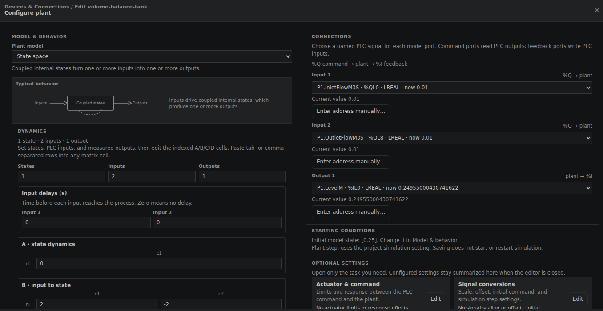
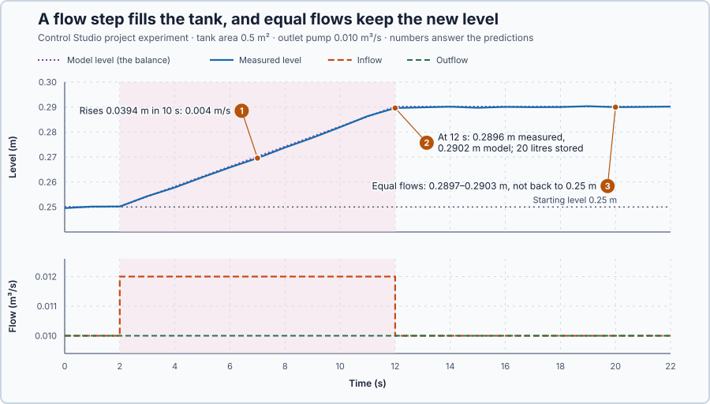

# 43. Volume balance

In this lesson, you will predict a tank's level from its inflow and outflow, and show that equal flows hold the level the tank has reached instead of restoring an earlier one.

## The problem

In Lesson 42, Control Studio chose the controller from the process: PI for the heater, within 0.2 °C of its target from 19.1 s, and PID for the loaded shaft, within 0.02 rad from 3.12 s. Each choice rested on what we knew about the process: the heater settles by itself, and the shaft keeps moving unless something brakes it.

The next process is a tank with a pump on each side. We do not yet know how pumping changes the level, so we cannot choose or tune anything for it. We will derive the tank's level from what flows in and out, and check it on the running tank.

## What we need

We need to:

1. relate the inflow and outflow to the stored water and the level;
2. predict how fast the level changes and where it ends up; and
3. check the prediction against the measured level.

## The new idea

A **volume balance** says the water in the tank changes by what flows in minus what flows out. Equal flows hold the level where it is; they do not bring it back to where it was.

**In words.** A tank keeps account of its water:

1. **Nothing is lost.** Water does not compress and does not vanish, so every litre that enters and does not leave stays in the tank. This growth of stored water is called **accumulation**; when more leaves than enters, the store shrinks.
2. **Volume becomes level.** In a tank with straight sides, the stored volume is the floor area times the level, so a stored litre raises the level by the same amount wherever the level is.
3. **Only the difference counts.** How fast the level moves depends only on how much more flows in than out. 0.011 m³/s in with 0.010 m³/s out fills the tank exactly as fast as 0.501 in with 0.500 out.
4. **Equal flows freeze the level.** With equal flows the level stops changing, wherever it is. Nothing pulls it back to an earlier level: the outlet pump moves the same flow whether the tank is nearly empty or nearly full.

A PLC engineer knows this behaviour from a flow totalizer. The tank adds up the net flow: when the net flow is zero, it stops counting, but it never resets itself. The heater was different: it loses more heat the warmer it gets, so it settles at a temperature set by its power. This tank has no such self-correction.

For this lesson's tank, two pumps set the flows, and the level stays at 0.25 m only while they move exactly the same flow.

**The formula.** Over a short time $\Delta t$ the flows add the volume $\Delta V = (q_{in} - q_{out})\,\Delta t$, and in a straight-sided tank $\Delta V = A\,\Delta h$. Dividing by $\Delta t$ and letting it shrink gives the balance:

$$
A\,\frac{dh}{dt} = q_{in} - q_{out} .
$$

Adding up the net flow over time, the same adding up of small pieces as the integral in Lesson 6, gives the level itself; $\int_0^t \ldots\,dt$ is that area under the curve from time 0 to $t$:

$$
h(t) = h(0) + \frac{1}{A}\int_0^t \left(q_{in} - q_{out}\right) dt .
$$

- $A$ is the tank's floor area, in m²;
- $h$ is the water level, in m, and $h(0)$ the level at the start;
- $V = A\,h$ is the stored volume, in m³; one m³ is 1000 litres;
- $q_{in}$ and $q_{out}$ are the inflow and the outflow, in m³/s; and
- $dh/dt$ is how fast the level changes, in m/s.

**Example: this lesson's tank.** The floor area is $A = 0.5$ m², and both pumps move 0.010 m³/s with the level at 0.25 m. Follow the numbers:

1. **Equal flows.** $dh/dt = (0.010 - 0.010)/0.5 = 0$: the level stays at 0.25 m.
2. **A small extra inflow.** The inlet pump steps to 0.011 m³/s: $dh/dt = (0.011 - 0.010)/0.5 = 0.002$ m/s, so the level rises 2 mm every second.
3. **After 30 s.** The tank has stored $0.001 \times 30 = 0.030$ m³, which is 30 litres, and the level has risen $0.030/0.5 = 0.06$ m, to 0.31 m.
4. **Equal flows again.** The inlet returns to 0.010 m³/s: $dh/dt = 0$ again, now at 0.31 m. The 30 litres stay; only a time with less in than out would remove them.
5. **The outlet alone.** With the inlet pump stopped, $dh/dt = (0 - 0.010)/0.5 = -0.02$ m/s: from 0.31 m the tank would be empty after $0.31/0.02 = 15.5$ s.

**Teaching choices:** the outlet is a pump with a fixed 0.010 m³/s, so the outflow does not depend on the level, and the program updates once per second. Because the flows stay constant during each second, advancing the level by its rate times one second is exact here. The level sensor reads within ±0.0005 m.

**The limitation.** Equal flows hold the level only if they are exactly equal. If the outlet pump moves 1 % more, 0.0101 m³/s, the level falls $0.0001/0.5 = 0.0002$ m/s: 0.72 m in an hour, nearly the whole 1 m tank. Nothing in the tank corrects this.

## Prediction

Before running, answer these questions:

1. How fast does the level rise while 0.012 m³/s flows in and 0.010 m³/s flows out?
2. Which level does the tank reach after 10 s, and how many litres were added?
3. Which level does it keep when the inflow returns to 0.010 m³/s?

| | Predicted |
| --- | ---: |
| Rise rate | 0.004 m/s |
| Rise in 10 s | 0.04 m |
| Water added | 20 litres |
| Level after 10 s, from 0.25 m | 0.29 m |
| Level afterwards, with equal flows | 0.29 m |

## Implementation

Open [`src/Main.st`](src/Main.st). The function `LevelRate` is the balance divided by the area. Every second, `ModelLevelM` advances by `LevelRate` times one second, with the flows applied during that second; it starts from the measured `LevelM` and never replaces it. When Control Studio starts the project experiment, the program sets the inflow to 0.012 m³/s for 10 s and then back to 0.010 m³/s.

```st
ModelLevelRateMS := LevelRate(InletFlow := AppliedInletM3S, OutletFlow := AppliedOutletM3S, Area := TankAreaM2);
ModelLevelM := ModelLevelM + ModelLevelRateMS * LREAL#1.0;
```

**ST practice.** Write, in ST, the level after 10 s of 0.012 m³/s in and 0.010 m³/s out, starting from 0.25 m, and check 0.29 m. Then open [`src/tests.st`](src/tests.st) and run its tests from the **Testing** view: they check the 0.004 m/s rise, no change with equal flows, the −0.02 m/s fall with the outlet alone, and the 20 litres and 0.29 m.

## Experiment in Control Studio

1. Open this lesson's project and start **Simulator**; the tank holds 0.25 m with equal flows. First look at the tank: in the **truST** side bar, select **Devices & Connections**, then **volume-balance-tank**. In **Configure plant**, **Plant model** is **State space**, the canvas's form for a plant written as rates of change, with **1 state · 2 inputs · 1 output**. **A · state dynamics** is 0 and **B · input to state** is 2 and −2: the level changes by $2(q_{in} - q_{out})$ per second, and $2 = 1/A$. Under **CONNECTIONS**, **Input 1** reads `P1.InletFlowM3S`, **Input 2** reads `P1.OutletFlowM3S` and **Output 1** writes `P1.LevelM`; **STARTING CONDITIONS** shows **Initial model state: [0.25]**. Close with **Cancel**.

   

2. In the **truST** side bar, select **Control Studio**. On **Identify**, choose **Project experiment** from **Method**. In **Signals**, select `P1.LevelM · Process value (m)`, `P1.InletFlowM3S · Applied output (m³/s)`, `P1.ModelLevelM · state (m)` and `P1.OutletFlowM3S · disturbance (m³/s)`.
3. Answer the predictions. Select **Review project test**, check the declared **22.1 s** duration and select **Confirm and start**; the inflow step comes 2 s later.
4. After the run, hover the level at 12 s, the end of the step, and at 20 s, in the hold that follows.
5. At completion, Control Studio shows **Project test completed. Outputs restored.**

Select **Abort test** to stop early. To repeat, stop and restart **Simulator**.

## Evidence and decision



The numbered marks answer the predictions with the same numbers. From the recording, one sample per update:

| Time | Inflow | Measured level | Model level |
| --- | ---: | ---: | ---: |
| 2 s, step | 0.012 m³/s | 0.2502 m | 0.2502 m |
| 12 s, 10 s later | 0.010 m³/s | 0.2896 m | 0.2902 m |
| 13 to 22 s | 0.010 m³/s | 0.2897 to 0.2903 m | 0.2902 m |

1. The level rose 0.0394 m in 10 s: the predicted 0.004 m/s, within the sensor's ±0.0005 m.
2. At 12 s the tank measured 0.2896 m and the model 0.2902 m, 0.0006 m apart: the 20 litres raised the level 0.04 m from where the step began.
3. With equal flows the level stayed between 0.2897 and 0.2903 m for the remaining 10 s; it did not return to 0.25 m.

The balance costs one subtraction and one division per update and predicted the level within 0.0006 m. It knows only the flows it is given: a pump mismatch it does not measure would move the real level away from the model. We accept the balance as this tank's model. These are simulation results, not a physical qualification.

## Conclusion

The level changes at the net flow divided by the floor area. Equal flows stop the change, but they do not undo the water already stored: the tank keeps whatever level it has reached.

For this tank, 10 s of 0.002 m³/s extra stored 20 litres and raised the level from 0.25 to 0.29 m, where it stayed once the flows were equal again.

## Check yourself

1. **A 0.5 m² tank has 0.015 m³/s in and 0.010 m³/s out. How long does the level take to rise 0.1 m?**
   $dh/dt = 0.005/0.5 = 0.01$ m/s, so 0.1 m takes 10 s.
2. **Why does the level stay at 0.29 m instead of returning to 0.25 m when the flows are equal again?**
   Equal flows make $dh/dt = 0$, so nothing removes the 20 litres stored; only a time with less in than out would.
3. **The outlet pump moves 0.0101 m³/s and the inlet pump 0.010 m³/s. How far does the level fall in 10 minutes?**
   $0.0001/0.5 = 0.0002$ m/s, times 600 s: 0.12 m.

## Reason for the next lesson

With pumps on both sides, the level never settles by itself: it drifts whenever the flows differ, by as much as 0.72 m an hour for a 1 % mismatch, so something must hold it.

[Level control](../87-level-control/README.md) holds the level with a controller that sets the inlet pump.
