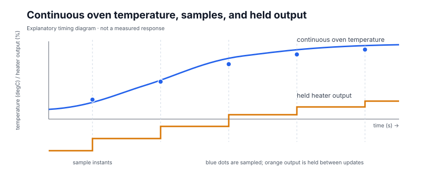
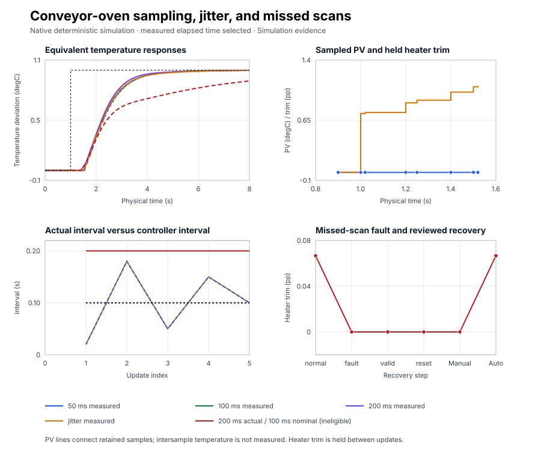

# Conveyor-oven sampling, jitter, and missed scans

Course position: Lesson 14 of 84. Previous lesson: [Measurement filtering](../13-measurement-noise/README.md). Next lesson: [First-principles heater model](../../01-feedback-foundations-and-temperature-control/15-water-heater-energy-balance/README.md).

**Lesson objective:** Configure and validate measured elapsed time for a simulated conveyor-oven temperature loop; predict its effect on time-scaled PI calculations, compare equivalent fixed and jittered runs, and prove that a missed scan latches safe zero trim until reviewed reset and explicit automatic re-enable.

**Evidence class:** Simulation evidence. These results are not evidence from a
physical conveyor oven, PLC scheduler, temperature sensor, or power stage. The
deterministic harness supplies the declared intervals. It does not claim to
reproduce operating-system scheduler jitter. Simulation evidence is not
physical task period evidence and cannot authorize a production timing change.

## The problem

The equipment is a conveyor drying oven, product-zone temperature sensor, heater power stage, and belt-speed measurement. Product moves through one heated zone; the sensor measures its controlled temperature, the electrical power stage changes heater power, and belt speed identifies the fixed operating condition.

The normal operating temperature is 120 degrees Celsius. This lesson controls
small temperature changes around that operating point rather than the full
absolute temperature. The heater command is likewise a trim around a normal
holding power. A negative trim means less heating than the holding power; it
does not mean that the heater can actively cool the oven.

The simulated temperature-deviation limit is minus 10 through plus 10 degrees
Celsius. Heater-power trim is limited to minus 10 through plus 10 percentage
points. Belt speed remains 0.5 metres per second. Manual zero trim is the safe
simulated state.

The executable oven is deliberately a reduced local response. This lesson uses
that response without naming or deriving a plant model. Spatial temperature
gradients, moisture dynamics, radiation, power-stage switching, sensor
dynamics, scheduler causality, plant trips, and physical interlocks are not
represented. Plant modelling begins in Lesson 15.

Lesson 13 showed that a measurement filter can reduce transmitter noise only
after the signal has been sampled. A filter after sampling cannot reconstruct
information that has already been aliased. It also showed that every dynamic
calculation depends on the interval between updates.

That leaves a practical problem. If the controller assumes that every update
arrives after 100 milliseconds while one update actually arrives after 200
milliseconds, its integral calculation represents only half of the elapsed
time. Passing any arbitrary delay into the controller is not safe either. We
therefore need to distinguish a valid measured interval from a missed scan and
define deliberate recovery.

## What we need

We need every time-dependent controller calculation to use the elapsed time that actually occurred, not an assumed perfect interval. We also need a bounded timing envelope and a safe response when a scan arrives too late to trust.

## The new idea

The oven temperature changes continuously. The PLC sees a new measurement only
when its controller task executes. Between two executions, the power stage
continues applying the preceding heater command. Keeping the last output
constant between updates is called a **zero-order hold**. A longer hold means
that the controller must wait longer before making its next correction.



The blue curve represents temperature changing continuously. Each blue dot is
the value available when the controller executes. The orange steps show that
the previous heater output remains applied until the next controller update.
This is an explanatory timing diagram, not a measured response.

The product-zone temperature-deviation **setpoint ($SP$)** is the desired change
from 120 degrees Celsius, measured in degrees Celsius. The **process value
($PV$)** is the measured temperature deviation, also in degrees Celsius. The
**temperature error ($e$)** is the setpoint minus the process value, measured in
degrees Celsius.

The **requested manipulated-variable trim ($MV_{\mathrm{requested}}$)** is the result
calculated by the PI controller, measured in heater percentage points. The
**applied manipulated-variable trim ($MV_{\mathrm{applied}}$)** is the heater trim presented
to the simulated oven and held until the next update, also measured in
percentage points. This lesson uses an ideal power stage, so requested and
applied trim agree at each valid update. They are still retained separately so
the hold and safety behavior remain visible.

The **actual cycle time ($dt_{\mathrm{actual}}$)** is elapsed timestamp time between two
executed controller updates, measured in seconds. On a physical PLC those
timestamps must come from a reviewed scheduler clock. Here the deterministic
test harness supplies them.

The **controller cycle time ($dt_{\mathrm{controller}}$)** is the interval passed into the
controller's time-scaled calculations, measured in seconds. The **nominal cycle
time ($dt_{\mathrm{nominal}}$)** is the configured 0.1-second schedule used by the
deliberately incorrect baseline even when actual elapsed time differs.

The **sampling frequency (fs)** is the number of samples per second,
measured in hertz. The **Nyquist frequency ($f_{N}$)** is half the sampling
frequency, also measured in hertz. A physical variation above the Nyquist
frequency can produce sampled values that look like a different, lower
frequency. That false appearance is called **aliasing**.

The **timing jitter ($j$)** is actual cycle time minus nominal cycle time,
measured in seconds. A **missed scan** in this lesson is an actual interval
greater than 0.25 second. A zero or negative interval is invalid rather than an
unusually fast scan.

With the quantities now defined, temperature error is:

$e_{k} = SP_{k} - PV_{k}$

Integral action must remember both the size of an error and how long that error
acted. The **integral gain ($K_i$)** is measured in percentage points per
degree-Celsius second. The integral correction rate is found by multiplying
gain by error:

$r_{I,k} = K_i e_k$

The degrees Celsius cancel, so $r_{I,k}$ is measured in percentage points per
second. If that rate is held for one controller interval, change equals rate
multiplied by elapsed time. Therefore the **integral contribution
($\Delta MV_I$)** is:

$\Delta MV_{I,k} = K_i e_k \Delta t_{\mathrm{controller}}$

Its units are percentage points per second multiplied by seconds, which leaves
percentage points. This is why using half the real interval adds half the
required integral correction.

If one sample arrives every $\Delta t_{\mathrm{actual}}$ seconds, then one
second contains $1/\Delta t_{\mathrm{actual}}$ samples. Sampling frequency is
therefore the reciprocal of the actual interval:

$f_s = \frac{1}{\Delta t_{\mathrm{actual}}}$

Lesson 13 defined a sinusoid as a signal that oscillates smoothly and repeats
after a fixed period. One complete sinusoidal cycle has a positive half and a
negative half. At least
two samples per cycle are required even to distinguish those two halves, so the
highest representable frequency is half the sampling frequency. This is the
Nyquist frequency:

$f_{\mathrm{N}} = \frac{f_s}{2}$

Jitter is computed for every update, not only as an average over a run:

$j_k = \Delta t_{\mathrm{actual},k} - \Delta t_{\mathrm{nominal}}$

A positive value means that update arrived late relative to the nominal
schedule; a negative value means it arrived early.

Using measured elapsed time preserves this time-scaled arithmetic inside the
reviewed envelope. It cannot undo aliasing, remove zero-order-hold delay, or
make slow sampling equivalent to fast sampling. Derivative calculations and
actuator rate limits also depend on elapsed time, but this experiment changes
neither derivative action nor actuator dynamics.

## Prediction

First isolate the integral calculation. Initialize the controller with a
setpoint of 1 degree Celsius, a process value of 0 degrees Celsius, and zero
stored output. Because the initialized setpoint already equals the first
setpoint, the first incremental proportional contribution is zero. Error is 1
degree Celsius.

With integral gain 0.667 percentage point per degree-Celsius second:

- At 50 milliseconds, the contribution is $0.667 \cdot 1 \cdot 0.05 = 0.03335$
  percentage point.
- At 100 milliseconds, it is $0.667 \cdot 1 \cdot 0.10 = 0.0667$ percentage point.
- At 200 milliseconds, it is $0.667 \cdot 1 \cdot 0.20 = 0.1334$ percentage point.

If the actual interval is 200 milliseconds but the bad baseline passes the
nominal 100 milliseconds, it produces 0.0667 percentage point instead of
0.1334 percentage point: exactly half of the required time contribution.

The 50, 100, and 200 milliseconds cases have sampling/Nyquist pairs of 20/10,
10/5, and 5/2.5 hertz. The jitter pattern is 20/180/50/150/100 milliseconds.
Its jitter values are minus 80, plus 80, minus 50, plus 50, and 0 milliseconds.
They sum to zero over 0.50 second, but zero mean jitter does not make the
individual holds uniform.

### Measures and decision rules

Define every comparison before running the lesson so that a pleasing response
cannot change the rules afterward.

**First integral contribution** is the first isolated controller output with
error fixed at 1 degree Celsius and proportional increment initialized to zero.
It is measured in percentage points. The fixed measured-time cases must equal
0.03335, 0.0667, and 0.1334 within a 1e-9-percentage-point reproduction
tolerance.

**Timing-use error** is the maximum absolute difference between controller
cycle time ($dt_{controller}$) and actual cycle time ($dt_{actual}$), measured
in seconds. For every retained update, take the absolute difference, then keep
the largest difference:

$E_{timing}=\max_k|\Delta t_{\mathrm{controller},k}-\Delta t_{\mathrm{actual},k}|$

It is measured in seconds. A measured-time case must be no greater than 1e-12
second. The instructional nominal-time baseline is expected to expose 0.1
second and is therefore ineligible.

**Peak overshoot ($M_p$)** counts only process-value travel above the
1-degree-Celsius target, evaluated over the response from the 1.1-second
setpoint step through the 30.0-second end of the qualified timing response,
before the invalid-interval exposure begins. The **peak process value
($PV_{max}$)** is the largest retained temperature-deviation sample over that
window, and the **setpoint step ($\Delta SP$)** is the 1-degree-Celsius change
applied at 1.1 seconds. Dividing the excess
above target by the step and multiplying by 100 expresses that excess as
percent:

$M_p=100\max\!\left(0,\frac{PV_{max}-SP}{|\Delta SP|}\right)$

It must be no more than 20 percent with 0.1-percentage-point numerical
tolerance.

**Settling time** is measured from the setpoint event until PV first enters and
then remains within 0.02 degrees Celsius of SP through the end of the run. It
must be no more than 8.0 seconds with 0.1-second numerical tolerance. A response
that later leaves the band is `Not settled`; merely entering once is not enough.

Only a settled run receives a **final-window absolute mean error**. The window
is 25.0 through 30.0 seconds. Because intervals differ, each absolute error is
weighted by the physical time for which its sample applies:

$E_{final}=\frac{\sum_k |SP_k-PV_k|\,\Delta t_k}{\sum_k\Delta t_k}$

It must be no more than 0.02 degrees Celsius with 0.001-degree-Celsius
tolerance.

**Requested and applied trim total variation** add the magnitude of every
successive output move over the complete run:

$TV_{MV}=\sum_k|MV_k-MV_{k-1}|$

Both are measured in percentage points. They diagnose output activity; this
simulated lesson gives them no physical acceptance threshold. Belt speed must
remain exactly 0.5 metres per second within a 1e-12-metre-per-second
reproduction tolerance.

All decisions use unrounded retained values. Display precision is presentation
only: contributions use five decimals, intervals three decimals, temperatures
and trims three decimals, overshoot one decimal, and total variation two
decimals. A run must first have strictly increasing timestamps, finite and
bounded values, the declared event and duration, and actual intervals that
agree with timestamp differences within 1e-12 second. Only then may timing and
response requirements qualify it.

## Implementation

The real Structured Text uses `Control.PID` as an incremental PI controller.
Its proportional gain is 0.667 percentage points per degree Celsius, its
integral gain is 0.667 percentage points per degree-Celsius second, derivative
gain is zero, proportional setpoint weight is one, and bias is zero. Combined
anti-windup and minus-10 to plus-10 percentage-point output limits remain
unchanged in every run. Both gains are the same configured teaching baseline
carried over from Lesson 13's pressure loop, declared in `lesson.json`; their
derivation from a plant model is deferred to Lesson 18. The 0.25-second
maximum interval is a reviewed engineering ceiling, more than twice the
0.1-second nominal schedule, chosen so a single stretched scan is treated as a
fault instead of silently absorbed. The 20-percent overshoot and 8-second
settling limits and the 0.02-degree-Celsius settled band are configured
teaching acceptance values for this comparison, matched to the same gains and
plant across every timing case so that only the timing treatment changes.

The relevant declared variables are:

```st
ExperimentEnabled : BOOL := FALSE;
ExperimentWasEnabled : BOOL := FALSE;
ExperimentCycle : DINT := 0;
TimingCase : INT := 1;
```

This is the governing timing and safety path from `src/Main.st`, quoted
verbatim including the scan that restores a valid interval while deliberately
leaving Auto requested (302) and the scan that removes Auto while requesting
reset (303) and then leaves Manual with reset removed (304):

```st
IF ExperimentEnabled THEN
    IF NOT ExperimentWasEnabled THEN
        ExperimentCycle := 0;
        TimingCase := 1;
        Setpoint := LREAL#0.0;
        ActualCycleTime := LREAL#0.1;
        MaximumCycleTime := LREAL#0.25;
        UseActualCycleTime := TRUE;
        ResetTimingFault := FALSE;
        AutoMode := FALSE;
    END_IF;

    ExperimentCycle := ExperimentCycle + 1;
    BeltSpeed := LREAL#0.5;
    MaximumCycleTime := LREAL#0.25;
    UseActualCycleTime := TRUE;
    ResetTimingFault := FALSE;

    IF ExperimentCycle <= 10 THEN
        ActualCycleTime := LREAL#0.1;
        Setpoint := LREAL#0.0;
        AutoMode := TRUE;
    ELSIF ExperimentCycle <= 300 THEN
        ActualCycleTime := LREAL#0.1;
        Setpoint := LREAL#1.0;
        AutoMode := TRUE;
    ELSIF ExperimentCycle = 301 THEN
        ActualCycleTime := LREAL#0.3;
        Setpoint := LREAL#1.0;
        AutoMode := TRUE;
    ELSIF ExperimentCycle = 302 THEN
        ActualCycleTime := LREAL#0.1;
        Setpoint := LREAL#1.0;
        AutoMode := TRUE;
    ELSIF ExperimentCycle = 303 THEN
        ActualCycleTime := LREAL#0.1;
        Setpoint := LREAL#1.0;
        AutoMode := FALSE;
        ResetTimingFault := TRUE;
    ELSIF ExperimentCycle = 304 THEN
        ActualCycleTime := LREAL#0.1;
        Setpoint := LREAL#1.0;
        AutoMode := FALSE;
    ELSIF ExperimentCycle = 305 THEN
        ActualCycleTime := LREAL#0.1;
        Setpoint := LREAL#1.0;
        AutoMode := TRUE;
    ELSE
        ActualCycleTime := LREAL#0.1;
        Setpoint := LREAL#0.0;
        AutoMode := FALSE;
    END_IF;
ELSIF ExperimentWasEnabled THEN
    ExperimentCycle := 0;
    ActualCycleTime := LREAL#0.1;
    Setpoint := LREAL#0.0;
    AutoMode := FALSE;
    ResetTimingFault := FALSE;
END_IF;
ExperimentWasEnabled := ExperimentEnabled;

TimingValid := ActualCycleTime > LREAL#0.0
    AND ActualCycleTime <= MaximumCycleTime
    AND MaximumCycleTime > LREAL#0.0
    AND MaximumCycleTime <= LREAL#0.25
    AND Setpoint >= LREAL#-5.0 AND Setpoint <= LREAL#5.0
    AND ProcessValue >= LREAL#-10.0 AND ProcessValue <= LREAL#10.0
    AND BeltSpeed >= LREAL#0.0 AND BeltSpeed <= LREAL#2.0;

IF TimingValid THEN
    IF UseActualCycleTime THEN
        ControllerCycleTime := ActualCycleTime;
    ELSE
        ControllerCycleTime := LREAL#0.1;
    END_IF;
ELSE
    ControllerCycleTime := LREAL#0.0;
    TimingFaultLatched := TRUE;
END_IF;

IF ResetTimingFault AND TimingValid AND NOT AutoMode THEN
    InitialState.Setpoint := Setpoint;
    InitialState.ProcessValue := ProcessValue;
    InitialState.NominalOutput := LREAL#0.0;
    InitialState.SaturatedOutput := LREAL#0.0;
    Controller.Initialize(State := InitialState);
    TimingFaultLatched := FALSE;
END_IF;

IF TimingValid AND NOT TimingFaultLatched THEN
    Input.CycleTime := ControllerCycleTime;
    RequestedHeaterTrim := Controller.Update(Input := Input);
    AppliedHeaterTrim := RequestedHeaterTrim;
ELSE
    RequestedHeaterTrim := LREAL#0.0;
    AppliedHeaterTrim := LREAL#0.0;
END_IF;
```

An invalid interval is not clamped and does not call `PID.Update`. It latches a
fault and commands requested and applied trim to zero. Explicit reset requires
valid timing and Manual authority. Reset reinitializes the incremental state at
safe zero; automatic operation then requires a separate explicit enable.
Configuration may tighten the maximum interval below 0.25 second, but it may
not widen that reviewed ceiling.

The example's configured 100 ms task is nominal scheduling metadata. The
timestamped native harness supplies the deterministic intervals used in this
lesson; the task declaration alone is not evidence of measured elapsed time or
real scheduler jitter. Program initialization preserves the supplied first
interval, actual-versus-nominal selection, mode, reset request, and reviewed
maximum instead of replacing the selected experiment configuration.

## Experiment in Control Studio

Control Studio runs the selected measured-100-millisecond timing and safety
journey through project-owned sequence authority. The native evidence uses
fresh runtimes for the 50-, 100-, and 200-millisecond fixed cases, deterministic
jitter, the ineligible nominal-time baseline, and both invalid-interval fault
cases. The UI does not pretend that one UI runtime executes all timing cases or
reproduces operating-system scheduler jitter. Every result remains Simulation
evidence with deterministic seed 20260824.

The selected UI sequence is deliberately visible. Scans 1 through 10 run Auto
at SP 0 degrees Celsius with measured 0.1-second timing. Scan 11 steps SP to 1
degree Celsius. Scan 301 presents an invalid 0.3-second interval, which latches
zero trim. Scan 302 restores a valid 0.1-second interval but deliberately leaves
Auto requested so the learner can see that valid timing alone does not clear
the latch. Scan 303 removes Auto and requests reset; scan 304 remains Manual
with reset removed; scan 305 separately re-enables Auto. Scan 306 restores SP
to 0 degrees Celsius and Manual zero. The Test lasts 30.6 seconds because it
retains each recovery boundary after the 30-second response.

### Control Studio actions

1. **Monitor** — Start the **Simulator**, then open **truST sidebar → Control Studio → Monitor → Response**.
   - **Baseline check:** Wait for **Simulation**, **Running**, and current data. Confirm SP = 0 degC, PV near 0 degC, requested and applied trim = 0 pp, belt speed = 0.5 m/s, actual and controller cycle time = 0.1 s, use-actual-time true, timing valid true, timing-fault latch false, timing case = 1, Manual mode, and experiment authority false. Verify units, limits, quality, and the Simulation label.
   - **Decision before action:** State the predicted 0.7337-percentage-point first PI request at scan 11: 0.667 pp proportional change plus 0.0667 pp integral contribution. Also state the required fault sequence: the 0.3-second interval must latch zero, a later valid interval must not resume heat, Manual reset must clear the latch without enabling Auto, and only the separate Auto action may resume a positive request.
   - **Successful evidence:** The Response plot advances, the displayed values are finite and current, and **Start recording** is enabled. Select **Start recording** only after those conditions are visible.
   - **Recovery:** If recording is disabled or the plot reports unavailable or stale samples, stop the Simulator, correct the displayed runtime or binding problem, restart it, and repeat the baseline check.
   - **Record:** Retain the initial SP, PV, requested/applied trim, actual/controller interval, validity, latch, mode, timing case, and prediction before opening Test.

2. **Test** — Open **truST sidebar → Control Studio → Test**.
   - **Baseline check:** Confirm **Experiment** = **Observe without excitation**, **Amplitude** = **0** (disabled), and **Maximum duration (s)** = **30.6**. The reviewed authority is **Experiment authority** (`P1.ExperimentEnabled`). Test changes only this Boolean from false to true and restores false. The project, not the generic Test panel, owns SP, actual interval, Auto, reset, and the boundary timing.
   - **Decision before action:** Before **Review test**, verify the plan names the 10/11/301/302/303/304/305/306 scan boundaries, the 0.3-second invalid interval, the reviewed 0.25-second ceiling, Manual reset, separate Auto re-enable, abort limits, and final Manual-zero restoration.
   - **Successful evidence:** Select **Review test**, verify the Boolean authority, 30.6-second duration, false restoration, and stop conditions, then select **Confirm and start**. Require **Running**, an available **Abort test**, retained samples on every named boundary, terminal completion, experiment authority false, SP 0 degC, and Manual zero.
   - **Recovery:** If the run is rejected, stale, unavailable, failed, or aborted, keep or return experiment authority false, wait for valid 0.1-second timing, latch false, Manual zero, and current data, then review a fresh test. Never claim the native multi-runtime comparison from this one UI run.
   - **Record:** Retain the first request, invalid-interval zero, valid-but-latched zero, Manual reset, reset-removed Manual sample, separate Auto resumption, final safe sample, terminal state, and seed 20260824.

The native comparison starts a fresh, independently initialized runtime for
each fixed, jittered, nominal-time, and invalid-interval case. Every fresh case
uses the same plant, gains, setpoint event, belt speed, physical duration,
limits, and seed while changing only the declared timing input. This separation
is necessary because controller and plant state from an earlier case would
otherwise contaminate the next comparison.

## Evidence and decision

Apply the predeclared measures and validity rules above to the retained native
records. Do not infer a pass from the shape of the plot.

| Timing case | First contribution | Maximum timing-use error | Overshoot | Settling | Final-window error | Applied trim travel | Decision |
| --- | ---: | ---: | ---: | ---: | ---: | ---: | --- |
| Measured 50 ms | 0.03335 pp | 0.000 s | 0.0% | 3.9 s | <0.001 degC | 1.73 pp | Qualified |
| Measured 100 ms | 0.06670 pp | 0.000 s | 0.0% | 3.9 s | <0.001 degC | 1.21 pp | Qualified |
| Measured 200 ms | 0.13340 pp | 0.000 s | 0.0% | 4.0 s | <0.001 degC | 1.31 pp | Qualified |
| Measured jitter | 0.01334 pp at first 20 ms update | 0.000 s | 0.0% | 4.4 s | <0.001 degC | 1.37 pp | Qualified |
| Actual 200 ms, nominal 100 ms | 0.06670 pp | 0.100 s | Not eligible | Not eligible | Not eligible | 1.25 pp diagnostic | Instructional baseline; ineligible |

The complete native records are
[`sampling-timing-trace.csv`](figures/sampling-timing-trace.csv) and
[`sampling-timing-summary.csv`](figures/sampling-timing-summary.csv). They
retain unrounded values, timestamps, every actual and controller interval,
criteria, tolerances, fault/recovery state, revision, seed, and evidence class.



The upper-right line joins retained PV samples only as a visual guide; it is not
an intersample temperature measurement. The orange heater trace is drawn as a
hold because that value remains applied between controller updates.

All four measured-time runs are numerically valid and timing-qualified. Their
controller interval agrees with actual elapsed time within 1e-12 second, they
settle within the predeclared limit, and their final-window error passes. The
result selects the **measured elapsed-time path with the latched invalid-
interval supervisor**. It does not select one fixed interval as universally
best.

The bad nominal-time run has a 0.100-second timing-use error. Its later response
numbers remain available in the native artifact for diagnosis, but it is not
eligible for response ranking because it executed a different controller than
the timestamps describe.

The missed-scan journey proves this sequence:

1. At 300 milliseconds, timing-valid becomes false, the fault latches, and
   requested and applied trim become zero.
2. Restoring 100 milliseconds makes the current interval valid but leaves the
   fault latched and trim at Manual zero. Automatic heat does not resume.
3. With Auto removed, explicit reset reinitializes the controller at safe zero
   and clears the latch.
4. Remaining in Manual retains zero trim.
5. A later, separate Auto enable resumes from the reinitialized state.

A run that fails its settling rule is `Not settled`; no final-window error is
reported. A timing fault is never ranked against qualified responses.

In Control Studio, use **Monitor** and **Test** for this journey. **Identify**,
**Tune**, and **Validate** are not used because this lesson estimates no plant
model, changes no controller gain, and has no executable shared-candidate
validation action. The native test, retained artifacts, and the rules declared
before Test own the multi-case comparison.

## Conclusion

Integral action represents how long an error acted. Passing the timestamp-
derived interval therefore preserves its intended contribution when execution
is irregular but still inside the reviewed envelope. Passing 100 milliseconds
during a real 200-millisecond update loses half of that contribution and slows
the response; the retained bad baseline needs about 14 seconds to settle,
compared with roughly 4 seconds for the qualified cases.

Measured elapsed time does not solve every sampling problem. The output still
remains held between updates, the controller still reacts only to sampled
measurements, and aliased information is already lost. Even a jitter sequence
whose average interval is correct contains individual long and short holds.

A missed scan is therefore a supervisory decision, not a large number to feed
into the controller or clamp to 0.25 second. Latching safe zero prevents silent
resumption. Requiring Manual reset and a separate Auto enable makes recovery an
explicit transfer of authority.

## Reason for the next lesson

For another digital loop, identify the clock that timestamps actual execution,
list every integral, derivative, filter, model, and rate calculation that uses
elapsed time, calculate the sampling and Nyquist frequencies, define a reviewed
maximum interval, compare equivalent physical-time experiments, and prove the
fault and recovery sequence before changing production timing.

These experiments describe when the oven controller executes and how its
time-scaled arithmetic responds. They do not explain why this oven has its
observed gain, response speed, or delay. Lesson 15 therefore derives a physical
thermal model before using those plant properties to predict new conditions.
