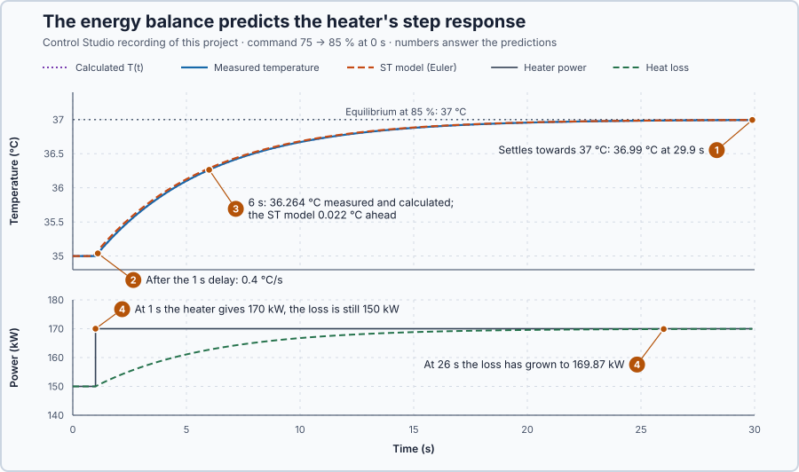

# 13. Energy balance

In this lesson, you will derive the heater's response from the heat going into and out of the water, and check that the equation predicts the measured step: its final temperature, its delay and its speed.

## The problem

Lesson 12 measured the heater's response to a held step from 75% to 85%: the temperature waited 1.0 s, rose fastest at first, crossed 63% of its change at 6.0 s and ended at 36.99 °C, a gain of 0.199 °C per % and a time constant of 5 s. These numbers describe one recorded curve, but the heater has no physical equation yet: they do not say why the curve has this shape, so they cannot predict it for another load or another heater.

We will write down how the water's stored heat changes and derive the whole response from it.

## What we need

We need to:

1. relate the heater's power and the heat loss to the change of the water temperature;
2. predict from that relation where the temperature settles and how fast it gets there; and
3. check the prediction against the measured step.

## The new idea

An **energy balance** says the water's stored heat changes by the heat going in minus the heat going out. For this heater, the heater's power goes in, and heat loss to the 20 °C surroundings goes out; their difference sets how fast the temperature changes.

**In words.** The water is a store of heat, as a tank is a store of water: its level rises when more flows in than out, falls when less flows in, and stays put when the flows are equal. In PLC terms, it is the bookkeeping of a totalizer: every scan, the stored amount changes by what came in minus what went out. For the heater the balance has three parts:

1. **The store.** The **heat capacity** is the heat needed to raise the water and vessel by 1 °C, here 50 kJ per °C. It turns stored heat into temperature: the larger it is, the more heat each degree needs. We assume the water is well mixed, so it has one temperature.
2. **Heat in.** The heater gives 2 kW per percent of command, and power commanded now reaches the water 1 s later.
3. **Heat out.** The water loses 10 kW for every °C above the 20 °C surroundings, plus any extra loss, such as colder inlet water.

Three consequences explain the curve measured in the previous lesson. The temperature settles where heat in equals heat out. Just after a change, the difference between heat in and heat out, divided by the heat capacity, says how many degrees per second the water warms or cools. As the water warms, its loss grows, the difference shrinks and the warming slows: the gap to the final temperature shrinks in proportion to itself. One store whose rate of change depends on its distance from the final value makes a **first-order model**; with the heater's delay it is a first-order model with delay.

> **Math you need: rate of change and exponential decay.** The **derivative** $dT/dt$ is the rate at which $T$ changes, in °C per second: a rise from 35.00 to 35.04 °C in 0.1 s is a rate of about $0.04/0.1 = 0.4$ °C/s. When a quantity shrinks at a rate proportional to itself, $dz/dt = -z/\tau$, it decays **exponentially**: $z(t) = z(0)\,e^{-t/\tau}$, where $e \approx 2.718$. After one $\tau$, $e^{-1} = 0.368$ of it is left; after three, $e^{-3} = 0.050$.

**The formula.** Since 1 kJ/s is 1 kW, the stored heat changes at the rate $C\,dT/dt$, and the balance reads

$$
C\frac{dT}{dt} = a\,u(t - L) - H(T - T_a) - D.
$$

- $C$ is the heat capacity, 50 kJ/°C, and $dT/dt$ how fast the temperature changes, in °C per second;
- $T$ is the water temperature and $T_a$ = 20 °C the surroundings, in °C;
- $u$ is the heater command, in %, and $a$ = 2 kW the power per %; $u(t - L)$ is the command from $L$ seconds earlier;
- $L$ = 1 s is the delay before commanded power reaches the water;
- $H$ = 10 kW per °C is the heat loss per degree above the surroundings;
- $D$ is any extra heat loss, in kW.

For this heater, $50\,dT/dt = 2u(t-1) - 10(T - 20) - D$.

Now measure from the steady point where the heater holds 35 °C with 75%: let $x = T - 35$ be the temperature's deviation, in °C, and $v = u - 75$ the command's, in percentage points. Such a **deviation from an operating point** removes the constant terms, because $2 \times 75 = 10 \times 15$. Dividing by $H$ leaves

$$
\frac{C}{H}\frac{dx}{dt} + x = \frac{a}{H}\,v(t - L) - \frac{D}{H}, \qquad \text{here} \qquad 5\frac{dx}{dt} + x = 0.2\,v(t - 1) - \frac{D}{10}.
$$

- $\tau = C/H = 5$ s is the time constant, and $K = a/H = 0.2$ °C per % the process gain.

For a command step $v$ held from time 0, with $D$ = 0, the final deviation is $Kv$. After the delay the gap to it, $Kv - x$, shrinks at the rate $(Kv - x)/\tau$, proportional to itself, so by the box above

$$
T(t) = 35 + K v \left(1 - e^{-(t - L)/\tau}\right) \quad \text{for } t \ge L .
$$

One time constant after the delay, $1 - e^{-1} = 0.632$ of the change is done: this is why the time constant marks 63%.

**Example: a step down from 75% to 70%.** Calculated from the balance, not run in this lesson; here $v = -5$:

1. **Where it settles.** With $dT/dt = 0$, $2 \times 70 = 10(T - 20)$, so $T = 20 + 140/10 = 34$ °C. The deviation form agrees: $Kv = 0.2 \times (-5) = -1$ °C.
2. **How fast it starts.** Just after the delay the heater gives $2 \times 70 = 140$ kW while the loss is still $10 \times 15 = 150$ kW, so $dT/dt = (140 - 150)/50 = -0.2$ °C/s: the water cools 0.02 °C in the first 0.1 s.
3. **How it travels.** $T(t) = 35 - 1 \times (1 - e^{-(t-1)/5})$. At 6 s, one time constant after the delay, $T = 35 - (1 - 0.368) = 34.368$ °C: 63.2% of the way. At 16 s, three time constants after the delay, $T = 35 - (1 - 0.050) = 34.050$ °C: 95% of the way.
4. **An extra loss instead.** At 75% with $D$ = 10 kW, $T = 20 + (150 - 10)/10 = 34$ °C: the same final temperature as 5 points less power, because 5 points are 10 kW. In the deviation form, $-D/10 = -1$ °C.

**The limitation.** The balance predicts this heater because $C$, $H$, $a$ and $L$ are known: they are given values for this simulated heater. On real equipment they come from its size and from thermal tests, and an error in them moves every prediction. If the real loss were 12 kW per °C instead of 10, a held 75% would settle the water at $20 + 150/12 = 32.5$ °C, not 35 °C.

## Prediction

Before running, calculate:

1. the equilibria at 75% and at 85% with $D$ = 0, and at 75% with $D$ = 30 kW;
2. the warming rate just after the delay;
3. the temperatures at 6 s and at 26 s for the 75 → 85% step;
4. the heater power and the heat loss at 1 s and at 26 s;
5. why a larger $C$ would change the speed but not the final temperature.

| Quantity | Predicted |
| --- | ---: |
| Equilibria at 75%, 85%, 75% with 30 kW | 35, 37, 32 °C |
| Rate after the delay | 0.4 °C/s |
| $T$ at 6 s and at 26 s | 36.264 and 36.987 °C |
| Heater power after 1 s | 170 kW |

## Implementation

Open [`src/Main.st`](src/Main.st). It holds 75% and applies 85% while the experiment runs. Beside the simulated heater it computes the same energy balance in ST, so the model and the measurement can be compared:

```st
HeaterPowerKw := REAL#2.0 * DelayedCommandPct;
LossPowerKw := EffectiveHeatLoss * (ModelTemperatureC - REAL#20.0);
NetPowerKw := HeaterPowerKw - LossPowerKw;
IF ThermalCapacitance > REAL#0.0 AND EffectiveHeatLoss > REAL#0.0 THEN
    ModelRateCPerS := NetPowerKw / ThermalCapacitance;
    ModelTemperatureC := ModelTemperatureC + REAL#0.1 * ModelRateCPerS;
ELSE
    SafetyAbort := TRUE;
    AppliedPowerPct := LREAL#0.0;
END_IF;
```

`DelayedCommandPct` is the command from 1 s earlier, kept in a ten-sample history. The last assignment is a **forward-Euler step**: it advances the temperature by the present rate times the 0.1 s update. A temperature outside 32–39 °C latches `SafetyAbort`, which removes heat; restart the simulator to return to 35 °C with 75%.

**Exercise.** At 6 s the recording shows a heater power of 170 kW and a loss of 162.72 kW. Calculate the model's rate by hand: $(170 - 162.72)/50 = 0.146$ °C/s, and compare it with `ModelRateCPerS`.

## Experiment in Control Studio

1. Open this lesson's project and start **Simulator**. The heater holds 35 °C with 75%, and the model shows 35 °C. In the **truST** side bar, select **Control Studio**.
2. On **Identify**, choose **Project experiment** from **Method**. **Signals** shows `P1.TemperatureC · Process value (°C)` and `P1.AppliedPowerPct · Applied output (%)`; add `P1.ModelTemperatureC · state (°C)`, `P1.HeaterPowerKw · state (kW)` and `P1.LossPowerKw · state (kW)`.
3. Answer the predictions before starting.
4. Select **Review project test** and check the declared **30.1 s** duration.
5. Select **Confirm and start**; this is time zero, and the command steps to 85%.
6. After the run, hover 1.1 s, 6 s and 26 s on the temperatures, and 1 s and 26 s on the two powers.
7. At completion, Control Studio shows **Project test completed. Outputs restored.**

Select **Abort test** to stop early. To repeat, stop and restart **Simulator** so the water and the model start at 35 °C again.

## Evidence and decision



The numbered marks answer the predictions with the same numbers. From the recorded run:

| | 1.1 s | 6 s | 26 s |
| --- | ---: | ---: | ---: |
| Calculated $T(t)$ | 35.040 °C | 36.264 °C | 36.987 °C |
| Measured temperature | 35.040 °C | 36.264 °C | 36.987 °C |
| ST model (Euler) | 35.079 °C | 36.286 °C | 36.987 °C |

1. The temperature settled towards the calculated 37 °C: 36.99 °C at 29.9 s. The 35 °C start and the 32 °C load case follow from the same balance.
2. After the 1 s delay it rose 0.04 °C in the first 0.1 s: the calculated 0.4 °C/s.
3. At 6 s and 26 s the measurement matched the calculated curve to three decimals.
4. At 1 s the heater power jumped from 150 to 170 kW while the loss was still 150 kW; by 26 s the loss had grown to 169.87 kW and nearly balanced it.
5. The heat capacity sets how much heat each degree needs, so it changes the speed, not where the heat flows balance.

The ST model ran slightly ahead, by 0.022 °C at 6 s: each Euler step adds a whole update of warming at the rate from the start of the update, and here that rate only falls. A shorter step would shrink this error. The balance explains the equilibrium, the delay and the speed. These are simulation results.

## Conclusion

An energy balance relates stored heat to the heat going in and out: $C\,dT/dt = a\,u(t-L) - H(T - T_a) - D$. Measured from an operating point it becomes a first-order model with delay, whose gain $a/H$ and time constant $C/H$ predict the whole step response.

For this heater it predicted 35, 37 and 32 °C equilibria, a 0.4 °C/s start, and the measured curve to three decimals.

## Check yourself

1. **With $C$ = 100 kJ/°C instead of 50, what are the time constant and the final temperature at 85%?**
   $\tau = 100/10 = 10$ s, twice as slow; the final temperature stays 37 °C, because $K = a/H$ is unchanged.
2. **Why does the temperature not change during the first second?**
   The commanded power reaches the water 1 s later, so the net heat flow is still zero.
3. **What equilibrium does the balance give at 75% with 20 kW of extra loss?**
   $T = 20 + (150 - 20)/10 = 33$ °C.

## Reason for the next lesson

The equation has the right form, but its numbers, the heat capacity, the loss and the delay, were given. For real equipment they are unknown and must be measured.

[Identification experiments](../../05-experiments-identification-and-validation/21-safe-informative-experiment/README.md) plans a safe test whose record reveals them.
