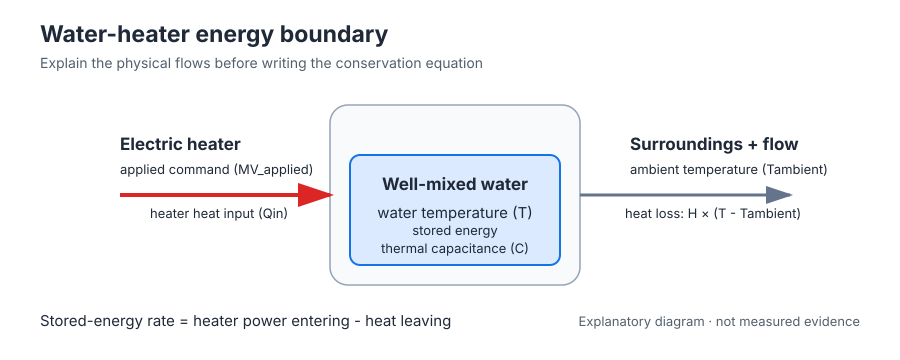
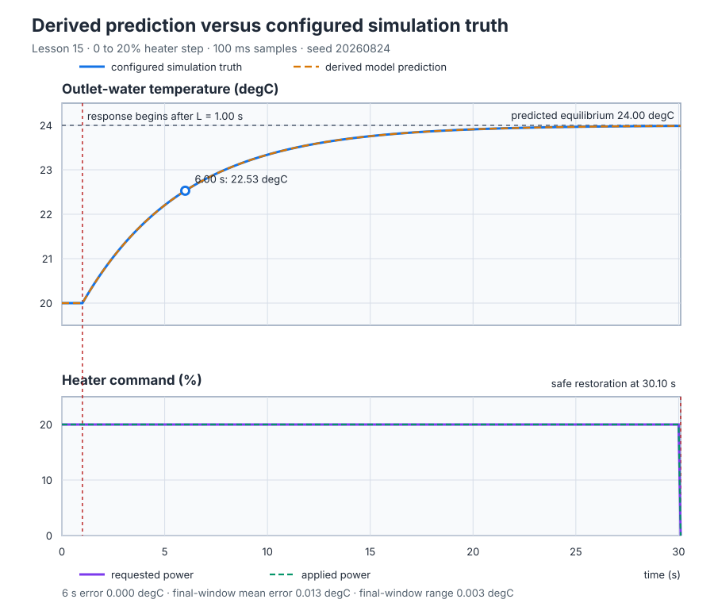

# Water-heater energy balance

Course position: Lesson 15 of 84. Previous lesson: [Sampling and jitter](../../01-feedback-foundations-and-temperature-control/14-sampling-interval/README.md). Next lesson: [Step-response identification](../16-heater-step-identification/README.md).

**Lesson objective:** Derive a local dynamic model of a recirculating water heater from stated equipment properties, predict one bounded temperature response, and decide whether the configured simulator is consistent with that model without presenting the result as identified or physical-plant evidence.

**Evidence class:** Model evidence and Simulation evidence. This lesson does not
produce evidence from an identified or physical water heater.

## The problem

The equipment in this lesson is a well-mixed recirculating vessel, electric heater, outlet-temperature sensor, and power stage.

The plant is a well-mixed recirculating vessel. A one-sided electric heater can
add heat but cannot actively cool the water; its thermal range is 0 to 200
kilowatts. The power stage accepts a command from 0 to 100 percent. An outlet sensor
measures water temperature. Heat also leaves the vessel through its walls and
with the recirculating flow.

The experiment starts with the water and surroundings at 20 degrees Celsius.
It requests 20 percent heater power and keeps the water inside its declared
0-to-80-degree-Celsius limit. Zero applied heater power is the safe state.



*Figure 1. The boundary shows what stores energy and which heat flows cross the
boundary. Draw this picture before writing an energy equation so that no
physical term appears without a meaning.*

Lesson 14 showed that controller timing changes a response, but timing cannot
explain the heater's equilibrium temperature, response speed, or delay. The
earlier response curves told us what happened under tested conditions; they did
not let us predict the response from equipment properties. We therefore need a
physical model before using Identify to estimate unknown parameters.

## What we need

We need a model whose temperature change follows from stored thermal energy, heater input, and heat loss in the named equipment. Its units, assumptions, and operating range must make a numerical prediction possible before the simulator is run.

## The new idea

Conservation of energy says, in words: the rate at which thermal energy stored
in the vessel changes equals heater power entering minus heat leaving.

The **water temperature ($T$)** is the uniform vessel and outlet temperature in
degrees Celsius. The **elapsed time ($t$)** is time since the experiment began in
seconds. The **temperature rate ($dT/dt$)** says how quickly the water changes,
measured in degrees Celsius per second.

The **thermal capacitance ($C$)** is the energy needed to raise the vessel and its
water by one degree Celsius, measured in kilojoules per degree Celsius. A larger
thermal capacitance means that the same heater power changes temperature more
slowly. The **heater heat input ($Q_{\mathrm{in}}$)** is thermal power entering the water,
measured in kilowatts.

The **heat-loss coefficient ($H$)** is the power leaving for each degree Celsius
between water and surroundings, measured in kilowatts per degree Celsius. The
**ambient temperature ($T_{\mathrm{ambient}}$)** is the surrounding temperature in degrees
Celsius. The **rated heater power ($P_{100}$)** is the heater's thermal power at a
100-percent command, measured in kilowatts.

The **requested heater command ($MV_{\mathrm{requested}}$)** is what the program asks the
power stage to apply, measured in percent. The **applied heater command
($MV_{\mathrm{applied}}$)** is the bounded command that physically enters the simulated
plant, also measured in percent. They differ when a request lies outside the
heater's 0-to-100-percent range.

The **equilibrium temperature ($T_{\mathrm{eq}}$)** is the temperature at which stored energy
stops changing because heat entering equals heat leaving. The **static gain
($K$)** is the equilibrium temperature change in degrees Celsius per percentage
point of applied heater command—degrees Celsius per percent heater power on
this scale. Lesson 8 used the symbols $K_h$ and $T_0$ for this same kind of
steady heater gain and ambient temperature on the same water heater without
deriving them; this lesson derives $K$ and $T_{\mathrm{ambient}}$ from first
principles instead. A **first-order** response is one whose dynamics are fully described by a
single stored quantity, here stored thermal energy; it has no other memory of
its own history. The **time constant ($\tau$)** is the time in
seconds for this first-order response to complete about 63.2 percent of its
eventual change after it begins. The **apparent dead time ($L$)** is the time in
seconds between changing the heater command and the measured response beginning.
It represents transport or measurement delay separately from the one-state
energy balance.

Choose any fixed reference temperature $T_{ref}$. Relative to that reference,
the stored thermal energy is $E=C(T-T_{ref})$ kilojoules. The reference and
thermal capacitance are constant, so differentiating stored energy with respect
to time gives:

$\frac{dE}{dt}=C\frac{dT}{dt}$

The result is the rate at which energy accumulates. One kilowatt means one
kilojoule per second, so $C\,dT/dt$ is measured in kilowatts. Heater input is
already in kilowatts. The linear loss assumption says that heat leaving equals
loss per degree multiplied by the water-to-ambient temperature difference:

$Q_{loss}=H(T-T_{ambient})$

Its units are kilowatts per degree Celsius multiplied by degrees Celsius, so it
also produces kilowatts. Every term in the balance is therefore measured in
kilowatts. Conservation says accumulation equals heat entering minus heat
leaving. Substituting the two expressions derives the balance:

$C\frac{dT}{dt} = Q_{\mathrm{in}} - H\left(T-T_{\mathrm{ambient}}\right)$

A 100-percent applied command supplies $P_{100}$ kilowatts. One percentage
point therefore supplies $P_{100}/100$ kilowatts. Multiplying that heat per
percentage point by the applied percentage derives the actual heater input:

$Q_{\mathrm{in}} = \frac{P_{100}}{100}MV_{\mathrm{applied}}$

At equilibrium temperature no longer changes, so set $dT/dt=0$ and replace
$T$ by $T_{eq}$:

$0=Q_{in}-H(T_{eq}-T_{ambient})$

Move the loss term to the left, divide by $H$, and add ambient temperature:

$T_{\mathrm{eq}} = T_{\mathrm{ambient}} + \frac{Q_{\mathrm{in}}}{H}$

One percentage point changes heat input by $P_{100}/100$ kilowatts. Dividing
that equilibrium heat change by $H$ gives the equilibrium temperature change
per percentage point. That coefficient is the static gain:

$K = \frac{P_{100}}{100H}$

To find the response speed, subtract the equilibrium balance from the dynamic
balance. If $x=T-T_{eq}$ is the remaining temperature difference, then:

$C\frac{dx}{dt}=-Hx$

Divide the balance by $C$. The remaining difference decays at rate $H/C$ per
second, so the time constant is the reciprocal of that rate:

$\tau = \frac{C}{H}$

Lesson 9 measured a rate as change divided by elapsed time; the same
finite-difference idea applies to $x=T-T_{eq}$. Dividing the balance above by
$C$ gives the rate $dx/dt=-x/\tau$, so over one small step $dt$ the difference
changes by approximately $-x_k\,dt/\tau$, leaving

$x_{k+1}\approx x_k(1-dt/\tau)$

Repeating that same small step $N$ times leaves a fraction $(1-dt/\tau)^N$ of
the original difference, because each step multiplies what remains by the same
factor. Now let the step shrink while $N$ grows so that $N\,dt$ always equals
the elapsed time $t$: the repeated-multiplication limit
$(1-t/(N\tau))^N$ approaches a fixed numerical value as $N$ grows without
bound. That limiting value defines **Euler's number ($e$)**, approximately
2.71828, through $\lim_{N\to\infty}(1-t/(N\tau))^N=e^{-t/\tau}$. Substituting
$t=0$ into $e^{-t/\tau}$ gives $e^0=1$, the whole original difference, exactly
as the balance requires before any time has passed; this check confirms the
solution is consistent with its starting condition. The solution says that the remaining fraction after the apparent dead time is
an exponential:

$\frac{T_{eq}-T(t)}{T_{eq}-T(0)}=e^{-(t-L)/\tau}$

At one time constant after the response begins, $(t-L)/\tau=1$. The remaining
fraction is $e^{-1}=0.367879$, so the completed fraction is
$1-0.367879=0.632121$, or about 63.21 percent. This is where the familiar 63.2
percent statement comes from; it is not an independent rule.

This model assumes one perfectly mixed temperature, constant material
properties, constant heater efficiency, fixed recirculation flow, linear
effective heat loss, and operation between 20 and 24 degrees Celsius with 0 to
20 percent applied power. It omits stratification, changing flow, boiling,
nonlinear radiation, sensor dynamics, and actuator faults.

The **model-valid state (ModelValid)** confirms that the physical parameters
lie inside generous diagnostic bounds. Thermal capacitance and heat loss must
be above zero and no greater than `1e6` in their stated units; rated heater
power must be between zero and `1e6` kilowatts; ambient temperature must remain
between 0 and 80 degrees Celsius. The **input-valid state (InputsValid)**
requires process value between 0 and 80 degrees Celsius and requested heater
power between -1000 and 1000 percent before the physical clamp is evaluated.
These diagnostic ceilings prevent nonphysical arithmetic; they are not
physical operating approval.

The typed runtime rejects a nonfinite process-image value before the Structured
Text scan executes. The lesson records that runtime rejection instead of
claiming an ST comparison handled the value. For finite values that reach the
scan, invalid model or input state commands safe zero.

The **Test-authority enable (ExperimentEnabled)** permits the reviewed step to
apply nonzero heater power. The **Manual-mode state (ManualMode)** becomes true
when Test authority is removed. Remove Test authority to make Manual mode true
and command safe zero while leaving valid derived model parameters visible for
inspection.

## Prediction

The vessel has a thermal capacitance of 50 kilojoules per degree Celsius. Its
effective heat-loss coefficient is 10 kilowatts per degree Celsius, and the
heater supplies 200 kilowatts at full power. These three values are declared
configured teaching values, chosen to keep the arithmetic below exact and
round. On real equipment the same three quantities have a measurement route:
thermal capacitance is mass times specific heat, $C=m\,c_p$ with water's
$c_p\approx4.18$ kilojoules per kilogram-degree-Celsius; rated heater power is
read from the element's nameplate; and heat-loss coefficient is estimated from
a holding-power test, dividing the steady heater power needed to hold a fixed
temperature above ambient by that temperature difference. The one-second
apparent dead time is a separate transport and sensor-response delay, not a
quantity the C, H, P_100 energy balance can produce; on real equipment it is
measured directly, as the elapsed time between a heater step and the first
detectable outlet-temperature change.

Full-scale power per percentage point is $200/100=2$ kilowatts per percentage
point. Dividing by the 10-kilowatt-per-degree-Celsius loss gives
$K=2/10=0.2$ degree Celsius per percentage point. Dividing thermal capacitance
by heat loss gives $\tau=50/10=5$ seconds. At 20 percent applied power,
$Q_{in}=2\cdot20=40$ kilowatts enters the water. Balancing that input against
loss requires a $40/10=4$-degree-Celsius water-to-ambient difference, so the
predicted equilibrium is $20+4=24$ degrees Celsius.

After the one-second dead time, one time constant leaves about 36.8 percent of
the original temperature difference and completes about 63.2 percent. At six
seconds the predicted temperature is therefore:

$20\,{}^\circ\mathrm{C} + 0.63212 \left(24\,{}^\circ\mathrm{C}-20\,{}^\circ\mathrm{C}\right) =22.52848\,{}^\circ\mathrm{C}$

Record $K = 0.2 {}^\circ\mathrm{C}/\%$, $\tau = 5 s$, $T_{\mathrm{eq}} = 24 {}^\circ\mathrm{C}$, and the six-second
prediction before running the simulator.

### Measures and decision rules

Declare the comparison before seeing the simulator result. **Six-second
prediction error** is the absolute difference between simulated PV and the
22.52848-degree-Celsius hand prediction at exactly 6.00 seconds:

$E_6=|PV(6.00)-22.52848|$

Smaller is preferred. The upper acceptance bound is 0.08 degree Celsius with
0.001-degree-Celsius numerical tolerance.

The final window is 29.00 through 30.00 seconds, inclusive. Before calling it
equilibrium evidence, calculate its **PV peak-to-peak range** by subtracting the
smallest retained PV from the largest:

$R_{PV}=\max(PV_k)-\min(PV_k)$

The window is settled only if this range is no more than 0.004 degree Celsius,
every sample is finite, requested and applied power remain at 20.00 percent,
and no hard limit is violated. Otherwise report `Not settled` and do not report
an equilibrium error.

For an eligible window, **final-window equilibrium error** is the mean absolute
difference from the 24.00-degree-Celsius prediction:

$E_{eq}=\frac{1}{N}\sum_k|PV_k-24.00|$

It must be no more than 0.02 degree Celsius with 0.001-degree-Celsius numerical
tolerance. Derived gain, time constant, and equilibrium use their unrounded
executable values and a numerical tolerance of 1e-9 in their stated units.

All decisions use unrounded retained values. Display rounding is presentation
only: temperature uses two decimals, gain three decimals, time two decimals,
and power two decimals. Numerical and input validity come first, settling comes
second, and numerical thresholds are applied only after those eligibility
checks pass.

## Implementation

The shipped Structured Text validates the physical parameters, limits the
one-sided actuator, and derives the prediction from applied power. It is
quoted verbatim, in its shipped order:

```st
ModelValid := ThermalCapacitance > LREAL#0.0
    AND ThermalCapacitance <= LREAL#1.0E6
    AND EffectiveHeatLoss > LREAL#0.0
    AND EffectiveHeatLoss <= LREAL#1.0E6
    AND FullScaleHeaterPower >= LREAL#0.0
    AND FullScaleHeaterPower <= LREAL#1.0E6
    AND AmbientTemperature >= LREAL#0.0
    AND AmbientTemperature <= LREAL#80.0;

IF ExperimentEnabled THEN
    RequestedHeaterPower := LREAL#20.0;
ELSE
    RequestedHeaterPower := LREAL#0.0;
END_IF;
ManualMode := NOT ExperimentEnabled;

InputsValid := ProcessValue >= LREAL#0.0
    AND ProcessValue <= LREAL#80.0
    AND RequestedHeaterPower >= LREAL#-1000.0
    AND RequestedHeaterPower <= LREAL#1000.0;

IF ModelValid THEN
    TimeConstant := ThermalCapacitance / EffectiveHeatLoss;
    StaticGain := (FullScaleHeaterPower / LREAL#100.0) / EffectiveHeatLoss;
ELSE
    StaticGain := LREAL#0.0;
    TimeConstant := LREAL#0.0;
END_IF;

IF ModelValid AND InputsValid AND ExperimentEnabled THEN
    IF RequestedHeaterPower < LREAL#0.0 THEN
        AppliedHeaterPower := LREAL#0.0;
    ELSIF RequestedHeaterPower > LREAL#100.0 THEN
        AppliedHeaterPower := LREAL#100.0;
    ELSE
        AppliedHeaterPower := RequestedHeaterPower;
    END_IF;
    PredictedEquilibrium := AmbientTemperature + StaticGain * AppliedHeaterPower;
ELSE
    AppliedHeaterPower := LREAL#0.0;
    IF ModelValid THEN
        PredictedEquilibrium := AmbientTemperature;
    ELSE
        PredictedEquilibrium := LREAL#0.0;
    END_IF;
END_IF;
```

The request remains visible when it is outside the actuator range or the model
is invalid. The plant receives only the safe applied value.

## Experiment in Control Studio

Control Studio runs the shipped project-owned 20-percent heater step. Test
changes only the Boolean `P1.ExperimentEnabled` from false to true and restores
false; the project owns the requested 20-percent power while authority is true
and zero power while it is false. The active comparison lasts 30.00 seconds,
and the retained 30.10-second sample proves safe restoration. The configured
simulator and derived model share parameters, so this is a consistency check,
not independent identification. The deterministic Simulation seed is 20260824.
At 30.10 seconds, the retained safe-restoration sample must show 0.00 percent
requested and 0.00 percent applied heater power.

### Control Studio actions

1. **Monitor** — Start the **Simulator**, then open **truST sidebar → Control Studio → Monitor → Response**.
   - **Baseline check:** Wait for **Simulation**, **Running**, and current data. Confirm PV = 20.00 degC, predicted equilibrium = 20.00 degC, requested and applied power = 0.00%, derived gain = 0.200 degC/%, time constant = 5.00 s, model valid, input valid, Manual mode, and Test authority false. Verify the 100-millisecond sample interval, units, limits, quality, model provenance, and Simulation provenance.
   - **Decision before action:** State the hand predictions before opening Test: 40 kW input, 24.00 degC equilibrium, 22.52848 degC at 6.00 s, and positive temperature movement only after the one-second delay. State the six-second and final-window rules, including the requirement to establish settled eligibility before reporting equilibrium error.
   - **Successful evidence:** The Response plot advances, the displayed values are finite and current, and **Start recording** is enabled. Select **Start recording** only after those conditions are visible.
   - **Recovery:** If recording is disabled or the plot reports unavailable or stale samples, stop the Simulator, correct the displayed runtime or binding problem, restart it, and repeat the baseline check.
   - **Record:** Retain the initial PV, predicted equilibrium, requested/applied power, derived parameters, validity, Manual state, false authority, unit check, and numerical predictions.

2. **Test** — Open **truST sidebar → Control Studio → Test**.
   - **Baseline check:** Confirm **Experiment** = **Observe without excitation**, **Amplitude** = **0** (disabled), and **Maximum duration (s)** = **30.1**. The reviewed authority is **Experiment authority** (`P1.ExperimentEnabled`). Test changes only that Boolean false→true→false. It does not write the requested power, applied power, physical parameters, derived parameters, or configured simulator truth.
   - **Decision before action:** Before **Review test**, verify the plan names the 30.00-second active sample, 30.10-second safe-restoration sample, false restoration, PV and applied-power hard limits, and abort conditions. Confirm no physical or model parameter changes during the run.
   - **Successful evidence:** Select **Review test**, verify the Boolean authority, duration, restoration, and stop conditions, then select **Confirm and start**. Require **Running**, an available **Abort test**, a 20.00-percent project-owned request while active, retained prediction times, terminal completion, Test authority false, Manual mode, and requested/applied power both 0.00 percent at 30.10 seconds.
   - **Recovery:** If the run is rejected, stale, unavailable, unsafe, failed, or aborted, keep or return authority false, wait for Manual zero and current data, then review a fresh test. Do not present a disabled Validate action or the retained table as newly executed evidence.
   - **Record:** Retain the 6.00-second PV, final-window samples, derived values, validity, terminal state,
     30.10-second restoration, provenance, and seed 20260824. The inherited limitation under test
     is: Earlier lessons stated observed/configured dynamic parameters without deriving their physical cause or validity region. The decision this run supports is: Derive K and tau before running a 0 to 20 percent manual-power step; compare the prediction with, but do not relabel it as, configured simulation truth.

Only Monitor and Test are used in Control Studio. Validate and Identify are not
used: there is no executable shared-candidate validation action and no unknown
parameter is estimated. The native test recalculates the retained comparison
from the shipped project and artifacts. Explicitly enable Test authority only
through the reviewed Boolean action, and remove Test authority to restore safe
zero. Identify must remain closed throughout because no parameter is being
estimated.

## Evidence and decision

Apply the decision rules declared before Implementation. Recalculate each value
from retained evidence before reading the status column.

| Measure | Prediction | Configured simulation result | Status |
| --- | ---: | ---: | --- |
| Derived static gain | 0.200 degC/% | 0.200 degC/% | Pass |
| Derived time constant | 5.00 s | 5.00 s | Pass |
| Predicted equilibrium | 24.00 degC | 24.00 degC | Pass |
| Six-second temperature | 22.53 degC | 22.53 degC; error below 0.001 degC | Pass |
| Final-window PV range | no more than 0.004 degC | 0.003 degC | Settled |
| Final-window equilibrium error | no more than 0.02 degC | 0.013 degC | Pass |
| Safe restoration | Manual mode; requested and applied power 0.00% | Manual mode; requested and applied power 0.00% | Pass |



*Figure 2. The executable evidence overlay marks the delay, the six-second
prediction, the equilibrium, and safe restoration. It distinguishes a derived
model curve from configured simulator truth.*

Recalculate the table from `figures/heater-model-trace.csv` and
`figures/heater-model-summary.csv`. First decide whether the run and final
window are eligible. Only then apply the declared tolerances. A mismatch means
checking units, assumptions, program wiring, actuator limits, and simulator
configuration; it does not justify changing a derived parameter until the
curves agree.

Agreement here is configured simulation truth consistent with a model. It is
not identification evidence and not physical-plant evidence.

## Conclusion

The energy balance explains the response rather than merely naming its shape.
More thermal capacitance stores more energy, so the same heater power changes
temperature more slowly. More heat loss requires more holding power, reduces
static gain, and lowers equilibrium for a fixed command. Dead time shifts when
the response begins but does not change the balance or its equilibrium.

The close agreement is expected because the simulator was configured from the
same local gain, time constant, and delay. It proves that the derivation,
Structured Text, and simulator agree under declared assumptions; it does not
prove that a real installation has those parameter values.

## Reason for the next lesson

For another thermal plant, draw the energy boundary, name stored energy and
every heat flow with units, derive equilibrium and dynamics, state the validity
region, make a numerical prediction, and test it safely. Real plants often have
unknown thermal mass, losses, efficiency, or delay. Lesson 16 therefore teaches
how to estimate those quantities from a safe measured experiment and then
retain their uncertainty and provenance.
