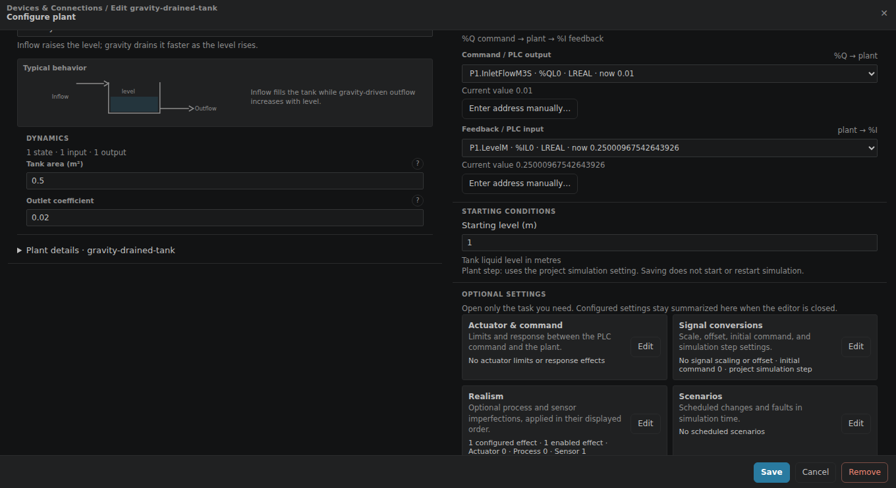
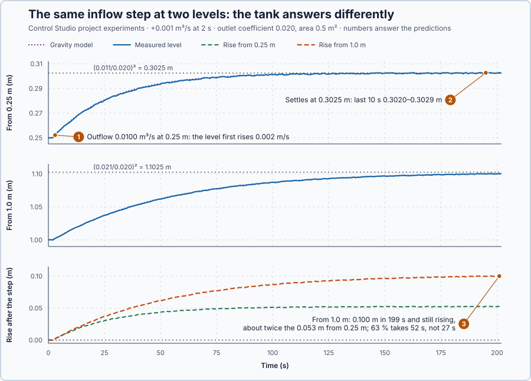

# 45. Gravity outflow

In this lesson, you will derive how much water leaves a tank through an opening at the bottom, combine it with the volume balance, and step the inflow at two levels to see the tank answer differently.

## The problem

In Lesson 44 the tuned PI, $K_p$ 204.9 % per m and $T_i$ 24.3 s, brought the level back within 0.01 m 41.5 s after the outlet pump drew 10 % more. That outflow came from a pump: it did not depend on the level, so the tank never settled by itself.

Most tanks drain through an opening instead, and then the outflow depends on the level: the higher the water, the harder it pushes. A model with a constant outflow would let any extra inflow fill the tank without limit. We will derive the outflow of an opening and find where, and how, the level settles.

## What we need

We need to:

1. calculate the outflow of an opening from the level;
2. combine it with the volume balance and find where a given inflow settles; and
3. compare the same inflow step at two levels.

## The new idea

**Gravity outflow** is what happens when a tank drains through a hole at the bottom: the water's height pushes it out, so the fuller the tank, the faster it drains. The tank finds the level at which the outflow equals the inflow, so it settles by itself, but doubling the inflow does not double the level.

**In words.** A sink with the plug out shows all three parts of the idea: open the tap a little more, and the water stands a little higher until the drain carries the extra.

1. **The height pushes the water out.** The water above the opening presses on it, and the higher the water, the faster the jet. But the jet does not grow in proportion: four times the height gives only twice the speed, and so twice the flow.
2. **The tank settles by itself.** With a fixed inflow, a level that is too low drains less than flows in, so it rises; a level that is too high drains more, so it falls. The level settles where the outflow equals the inflow, the **equilibrium level**. Lesson 44's pump-drained tank had no such level; this tank behaves more like the heater, which settles where its heat loss equals its heating.
3. **The tank is not linear.** Because the outflow grows more slowly than the level, the level must grow faster than the inflow to balance it: doubling the inflow quadruples the level. So the same extra inflow gives a different rise depending on the level the tank starts from. A process like this, whose answer to the same change depends on where it is working, is **nonlinear**, like the valve with its curved characteristic in Lesson 32.

For this lesson's tank, the outlet is a fixed opening, so the level alone sets the outflow.

**The formula.** Water at the surface, a height $h$ above the opening, has the height energy $gh$ per kilogram. Leaving the opening, that energy becomes speed, $v^2/2$ per kilogram:

$$
g h = \frac{v^2}{2} \quad\Rightarrow\quad v = \sqrt{2 g h} .
$$

The flow is the opening's area times this speed, reduced by losses at the edge. Collecting the opening's area, its losses and $\sqrt{2g}$ in one coefficient $c$, and putting the outflow into Lesson 43's volume balance:

$$
q_{out} = c\sqrt{h}, \qquad A\,\frac{dh}{dt} = q_{in} - c\sqrt{h} .
$$

At rest the two flows are equal, $q_{in} = c\sqrt{h_{eq}}$, so

$$
h_{eq} = \left(\frac{q_{in}}{c}\right)^2 .
$$

- $g$ is the acceleration due to gravity, 9.81 m/s²;
- $h$ is the level above the opening, in m, and $h_{eq}$ the equilibrium level, in m;
- $v$ is the water's speed in the opening, in m/s;
- $c$ is the outlet coefficient, in m$^{5/2}$/s, the unit that makes $c\sqrt h$ a flow in m³/s;
- $A$ is the tank's floor area, in m²; and
- $q_{in}$ and $q_{out}$ are the inflow and the outflow, in m³/s.

**Example: this lesson's tank.** $A = 0.5$ m² and $c = 0.020$ m$^{5/2}$/s; the tank rests at 0.25 m. Follow the numbers:

1. **The jet.** At 0.25 m the water leaves at $v = \sqrt{2 \times 9.81 \times 0.25} = 2.2$ m/s.
2. **At rest.** The outflow is $c\sqrt h = 0.020 \times \sqrt{0.25} = 0.020 \times 0.5 = 0.010$ m³/s, so an inflow of 0.010 m³/s holds the level.
3. **A larger inflow.** The inflow steps to 0.012 m³/s. At first the outflow is still 0.010 m³/s, so the level rises $(0.012 - 0.010)/0.5 = 0.004$ m/s.
4. **The rise slows.** At 0.30 m the outflow has grown to $0.020 \times \sqrt{0.30} = 0.01095$ m³/s, so the level rises only $(0.012 - 0.01095)/0.5 = 0.0021$ m/s, half as fast as at first.
5. **Where it settles.** $h_{eq} = (0.012/0.020)^2 = 0.6^2 = 0.36$ m: the level stops 0.11 m higher, where the outflow is 0.012 m³/s.
6. **Doubling does not double.** An inflow of 0.005 m³/s holds $(0.005/0.020)^2 = 0.0625$ m, and 0.010 m³/s holds 0.25 m: twice the inflow, four times the level.
7. **The same step at another level.** From 0.0625 m, adding the same 0.002 m³/s settles at $(0.007/0.020)^2 = 0.1225$ m: a rise of 0.06 m, against 0.11 m from 0.25 m.

**Teaching choices:** $A = 0.5$ m² and $c = 0.020$ m$^{5/2}$/s; the program holds the inflow that balances the starting level, $c\sqrt{h_0}$, and the experiment adds 0.001 m³/s; the level sensor reads within ±0.0005 m.

**The limitation: one number cannot describe the tank.** In step 7, the same 0.002 m³/s raised the level 0.06 m from one level and 0.11 m from another, so a model with one fixed gain fits only one level. The square-root law also assumes a free jet through a fixed opening: an empty tank has no jet, and the program stops its model instead of taking the square root of a negative level.

## Prediction

Before running, answer these questions:

1. What is the outflow at 0.25 m, and how fast does the level rise right after the inflow becomes 0.011 m³/s?
2. Where does the level settle from 0.25 m, and why does it settle at all?
3. Started at 1.0 m, where does the same 0.001 m³/s step settle, and is the answer the same as at 0.25 m?

| | From 0.25 m | From 1.0 m |
| --- | ---: | ---: |
| Holding inflow $c\sqrt{h_0}$ | 0.010 m³/s | 0.020 m³/s |
| First rise, $0.001/A$ | 0.002 m/s | 0.002 m/s |
| Settled level | 0.3025 m | 1.1025 m |
| Rise | 0.0525 m | 0.1025 m |

## Implementation

Open [`src/Main.st`](src/Main.st). The function `GravityOutflow` is $c\sqrt h$ and `EquilibriumLevel` is $(q_{in}/c)^2$. At startup the program takes the measured level as `OperatingLevelM` and holds the inflow that balances it, `HoldInflowM3S`. Every second it advances two models with the inflow applied during that second, both started from the measured level:

- `GravityModelLevelM`, the balance with the outflow `GravityModelOutflowM3S`; a negative model level stops the model instead of taking its square root;
- `ConstantOutflowModelLevelM`, Lesson 43's balance with the outflow fixed at the holding flow.

When Control Studio starts the project experiment, the program adds 0.001 m³/s to the holding flow for the 200 s run.

**ST practice.** Use `GravityOutflow` to check 0.010 m³/s at 0.25 m and 0.020 m³/s at 1.0 m, and `EquilibriumLevel` to check 0.3025 m and 1.1025 m. Then open [`src/tests.st`](src/tests.st) and run its tests from the **Testing** view: they check the 2.2 m/s speed, the outflows, the 0.25 m and 0.3025 m equilibria and the first 0.002 m/s rise.

## Experiment in Control Studio

The requirements for the run from 0.25 m, declared before it: after 200 s the level is within 0.001 m of 0.3025 m, and it moves at most 0.001 m in the final 10 s.

1. Open this lesson's project and start **Simulator**; the tank holds 0.25 m with 0.010 m³/s in. In the **truST** side bar, select **Control Studio**.
2. On **Identify**, choose **Project experiment** from **Method**. In **Signals**, select `P1.LevelM · Process value (m)`, `P1.InletFlowM3S · Applied output (m³/s)`, `P1.GravityModelLevelM · state (m)`, `P1.ConstantOutflowModelLevelM · state (m)`, `P1.GravityModelOutflowM3S · state (m³/s)` and `P1.EquilibriumLevelM · state (m)`.
3. Answer the predictions. Select **Review project test**, check the declared **202.1 s** duration and select **Confirm and start**; the inflow step comes 2 s later. Hover the rise at 12 s and the end at 200 s.
4. Now start the tank at 1.0 m. In the **truST** side bar, select **Devices & Connections**, then **gravity-drained-tank**. **Configure plant** shows the tank: **Tank area (m²)** 0.5 and **Outlet coefficient** 0.02 are $A$ and $c$. Under **STARTING CONDITIONS**, enter 1 in **Starting level (m)** and select **Save**.

   

5. Saving does not restart the simulation: stop and restart **Simulator**. The tank now starts at 1.0 m, and the program holds 0.020 m³/s.
6. In **Control Studio**, run the same project test as in steps 2 and 3.

To return to 0.25 m, enter 0.25 in **Starting level (m)**, save, and restart **Simulator**.

## Evidence and decision

The numbered marks answer the predictions with the same numbers. From the two recordings:

| After the step | From 0.25 m: tank, model | From 1.0 m: tank, model |
| --- | --- | --- |
| 0 s | 0.2501, 0.2501 m | 1.0001, 1.0001 m |
| 10 s | 0.2663, 0.2668 m | 1.0185, 1.0184 m |
| 50 s | 0.2943, 0.2946 m | 1.0634, 1.0639 m |
| 100 s | 0.3008, 0.3013 m | 1.0872, 1.0878 m |
| 199 s | 0.3028, 0.3025 m | 1.1002, 1.1003 m |

1. The outflow at 0.25 m was 0.0100 m³/s. The first 10 s raised the tank 0.0162 m, less than 10 × 0.002 = 0.020 m, because the outflow had already grown to 0.0103 m³/s.
2. From 0.25 m the level settled at 0.3025 m: its last 10 s read 0.3020 to 0.3029 m, within the sensor noise, and the noise-free model moved 0.000012 m. It settles because the outflow grows with the level until it equals the inflow. Both requirements pass.
3. From 1.0 m, with 0.020 then 0.021 m³/s, the same step raised the level 0.100 m in 199 s, about twice the 0.053 m from 0.25 m, and it was still 0.0023 m below 1.1025 m and rising. The answer was also slower: two thirds of the rise took 52 s instead of 27 s.

In both runs the gravity model stayed within 0.0009 m of the tank, while Lesson 43's constant-outflow model kept rising at 0.002 m/s, to 0.648 m and 1.398 m. The square-root model costs one square root per update; we use it for this tank. These are simulation results, not a physical qualification.

## Conclusion

An opening at the bottom passes $c\sqrt h$: the water's height sets the outflow. With the volume balance this gives a tank that settles by itself at $(q_{in}/c)^2$, ever more slowly as the outflow catches up with the inflow.

For this tank, the same 0.001 m³/s step raised the level 0.053 m from 0.25 m and about 0.10 m from 1.0 m, and took about twice as long there.

## Check yourself

1. **With $c = 0.020$ m$^{5/2}$/s, where does the level settle for an inflow of 0.016 m³/s?**
   $h_{eq} = (0.016/0.020)^2 = 0.64$ m.
2. **Why does this tank settle by itself when Lesson 44's tank did not?**
   Its outflow grows with the level, so a higher level drains faster until outflow equals inflow; a pump's outflow
   stays the same at every level.
3. **Why did the same step raise the level further from 1.0 m?**
   At 1.0 m another centimetre adds less outflow than at 0.25 m, so the level must rise further before the extra
   0.001 m³/s drains away.

## Reason for the next lesson

The tank's answer to a step depends on its level: from 0.25 m it rose 0.053 m with two thirds in 27 s, from 1.0 m about 0.10 m with two thirds in 52 s. One gain and one time constant cannot describe the tank at all levels.

[Linearization](../17-gravity-tank-linearization/README.md) describes the tank near one level with its own gain and time constant.
