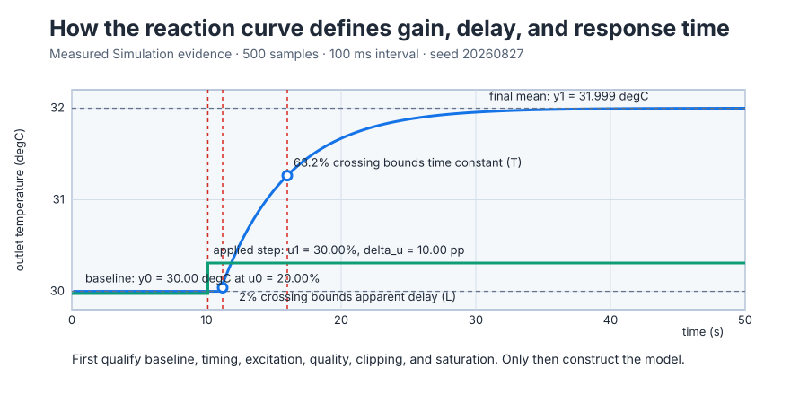
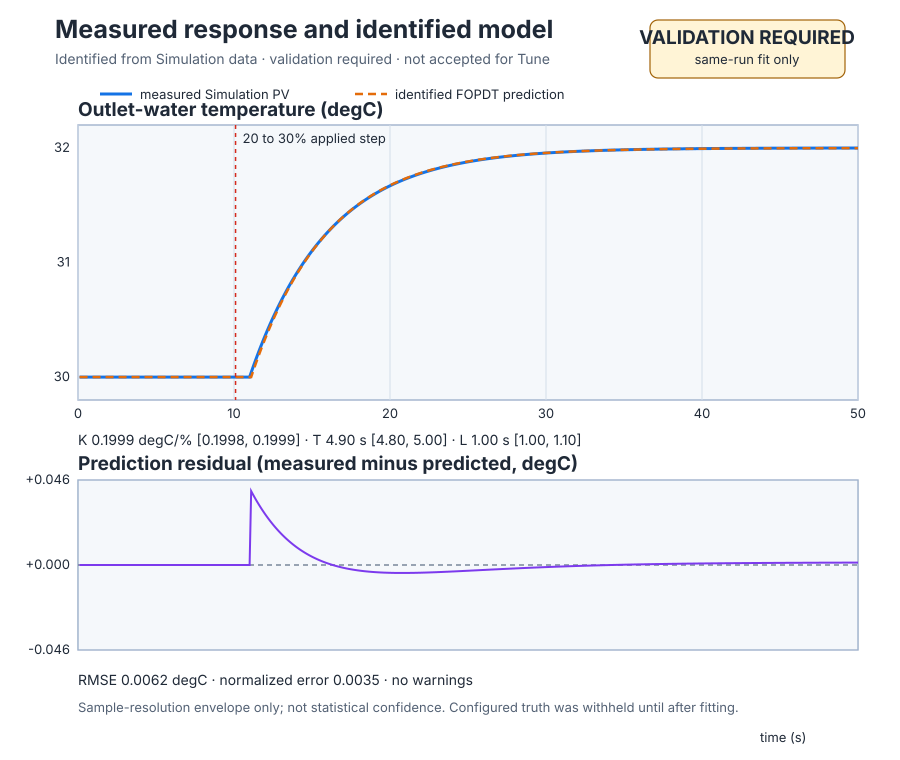

# Identify a water heater from a measured step

Course position: Lesson 16 of 84. Previous lesson: [First-principles heater
model](../15-water-heater-energy-balance/README.md). Next lesson:
[Independent model validation](../17-independent-model-validation/README.md).

**Lesson objective:** Design and approve a bounded water-heater step experiment,
qualify its measured data, estimate one local dynamic model with explicit
resolution limits, and explain why that model still requires independent
validation.

**Evidence class:** Simulation evidence. This lesson does not prove behavior on a
physical water heater.

## The problem

The equipment is: Electric recirculating water heater, outlet-temperature sensor, and heater power stage. It is the same heater dynamics as Lesson 15: water flows
through a heated vessel, the outlet sensor measures water temperature, and the
0-to-100-percent power stage drives the heater. The heater can add heat but
cannot actively cool the water. This experiment must therefore keep outlet
temperature between 0 and 40 degrees Celsius.

Lesson 15 predicted the response from thermal capacitance, heater rating, heat
loss, and transport delay. On installed equipment those values may be unknown,
outdated, or difficult to measure. We now need a model obtained from signals we
can actually record: applied heater power and outlet-water temperature.

This lesson's configured teaching condition reuses Lesson 15's gain, time
constant, and dead time (0.2 degrees Celsius per percentage point, 5 seconds,
1 second) but at a warmer declared ambient condition: 26 degrees Celsius
instead of Lesson 15's 20 degrees Celsius, representing a warmer supply main.
Lesson 15's balance therefore predicts $26+0.2\times20=30$ degrees Celsius at
20 percent power, matching the plant's starting condition below; it is not the
same ambient condition as Lesson 15's own 24-degree-Celsius prediction. The
plant starts at 30 degrees Celsius and 20 percent heater power. A reviewed
test will hold that baseline, raise power to 30 percent, record the response,
and restore 20 percent. The controller stays in Manual mode so feedback cannot
change the input and hide the plant's natural response.

One important limitation remains. A model can reproduce the recording used to
fit it and still predict a new experiment badly. This lesson therefore selects
a model preview; Lesson 17 tests its frozen parameters with independent data.

## What we need

We need to answer four questions in order:

1. Was the initial condition stable and was the applied input change large
   enough to reveal a response?
2. Are timing, quality, limits, mode, and restoration trustworthy enough to use
   the recording?
3. Which simple model best explains the qualified recording without inventing
   unsupported dynamics?
4. What can the fitted parameters establish, and what must remain unclaimed
   until an independent experiment tests them?

## The new idea

An **open-loop step experiment** holds feedback inactive, changes one actuator
input by a known amount, and records the sensor response. “Open loop” does not
mean uncontrolled or unsafe. The input, duration, limits, abort conditions, and
restoration are all decided before authority is granted.

Start with quantities that can be read from the recording. The **baseline input
($u_{0}$)** is the mean applied heater command before the step, in percent. The
**new input ($u_{1}$)** is the mean applied command after the step, also in
percent. The **input step amplitude ($\Delta u$)** is the difference between the
new heater command and the baseline heater command, measured in percentage
points. We subtract because the model must describe the change
caused by the experiment, not the heater's existing 20-percent operating load.

The **baseline output ($y_{0}$)** is the mean outlet temperature before the
step, in degrees Celsius. The **final output ($y_{1}$)** is the settled mean near
the end of the step. Their difference is the **output change ($\Delta y$)**, in
degrees Celsius.

The **process gain ($K$)** answers a physical question: how many degrees Celsius
of settled temperature change result from one percentage point of applied
heater change? Dividing output change by input change gives exactly that unit.

Only after defining those physical quantities do we write their relationships:

$\Delta u = u_{1} - u_{0}$

$\Delta y = y_{1} - y_{0}$

$K = \Delta y / \Delta u$

The gain relation follows directly from “output change per input change.” Its
units confirm the interpretation:

$[K] = {}^\circ\mathrm{C}/\text{percentage point}$

Gain describes the final size of the response but not its timing. The
**apparent dead time ($L$)** is the elapsed time from the applied step until the
temperature has distinguishably left its baseline. In this deterministic
lesson, response onset is the first retained sample at or above 2 percent of
the qualified output change. The preceding sample and crossing sample form a
resolution bracket; the recording cannot locate the crossing more precisely
than its sample interval.

After the delay, a simple self-regulating plant can be described by a
first-order balance identical in structure to Lesson 15's energy balance,
$C\,dT_{\mathrm{water}}/dt=Q_{in}-H(T_{\mathrm{water}}-T_{\mathrm{ambient}})$.
Dividing that balance by $H$ and writing the departure from equilibrium as
before recovers a time constant of $C/H$ seconds and a gain of
$(P_{100}/100)/H$ degrees Celsius per percentage point, the same $\tau$ and $K$
Lesson 15 derived. From here this lesson renames the time constant from
Lesson 15's $\tau$ to $T$, the conventional symbol used in identification and
controller-tuning literature and the symbol Lesson 18 also uses; nothing else
about the physical relationship changes. Let the output departure be $x = y-y_0$ and the delayed
input departure be $v=u(t-L)-u_0$, playing the same role as Lesson 15's
temperature-minus-equilibrium departure. The balance says that the current departure
plus the rate needed to change it equals the departure demanded by the input:

$T\,dx/dt + x = K v$

Substituting $x=y-y_0$ and $v=u(t-L)-u_0$ gives the familiar
**first-order-plus-dead-time model**, abbreviated FOPDT:

$T \cdot dy/dt + y = y_{0} + K \cdot [u(t - L) - u_{0}]$

For a constant step, $v=\Delta u$ after the delay. The difference between the
eventual departure $K\Delta u$ and the current departure decays
exponentially. Solving that decay gives, for $t\ge L$:

$y(t)-y_0 = K\Delta u\,[1-e^{-(t-L)/T}]$

This equation explains both the final response and the time-constant rule. As
time becomes large, the exponential tends to zero, so
$\Delta y=K\Delta u$. One time constant after the delay, $t-L=T$, and the
completed fraction is:

$1-e^{-T/T}=1-e^{-1}=0.632120\ldots$

The **model time constant ($T$)** is therefore the elapsed seconds from the end
of apparent dead time to 63.2 percent of the final output change. The number
63.2 percent is derived from the first-order exponential; it is not an
arbitrary plotting convention.

A model must also be compared with every retained measurement. At sample $k$,
the **prediction residual ($r_k$)** is measured temperature minus the
model-predicted temperature:

$r_{k} = PV_{\mathrm{measured},k} - PV_{\mathrm{predicted},k}$

In sampled-signal notation, the same quantity is read aloud as "residual at
sample k" and written $r[k]$; later lessons use this bracket form for any
quantity recorded once per scan.

Positive and negative residuals would cancel if they were simply averaged.
Squaring prevents cancellation. Averaging the $N$ squared residuals gives the
mean squared error; taking its square root restores the original temperature
unit. This derives the **root-mean-square residual ($RMSE$)**:

$RMSE=\sqrt{\frac{1}{N}\sum_{k=1}^{N}r_k^2}$

RMSE is a typical same-record prediction difference in degrees Celsius. To
compare fits from responses of different sizes, divide it by the qualified
output span. This derives the dimensionless **normalized root-mean-square
error ($NRMSE$)**:

$NRMSE=\frac{RMSE}{y_{\max}-y_{\min}}$

The degrees Celsius cancel. An NRMSE of 0.05 means that the typical residual is
5 percent of the recorded response span; it does not mean 5 percent physical
accuracy outside this experiment.

### Measures and decision rules

Define the decisions before seeing the result so a disappointing run cannot
tempt us to relax its limits afterward.

- The analysis record contains exactly 500 active samples from 0.10 through
  50.00 seconds. The separate 50.10-second restoration sample proves safe
  return but is not fitted.
- Sample times must be finite and strictly increasing. The intended interval is
  0.10 second and no gap may exceed 0.15 seconds; otherwise elapsed-time and
  crossing calculations are unreliable.
- Every active sample must have good quality, finite requested power, finite
  applied power, finite temperature, Manual mode, and no clipping or
  saturation. A model of corrupted or limited data would mix plant dynamics
  with an instrumentation or actuator defect.
- **Baseline drift** is the final baseline temperature minus the first baseline
  temperature, divided by elapsed baseline time. Its absolute value must not
  exceed 0.001 degrees Celsius per second, because a moving initial condition
  would be mistaken for step response.
- **Input span** is maximum applied power minus minimum applied power. It must
  be at least 9.99 percentage points, proving that the intended 10-point step
  actually reached the plant.
- **Output span** is maximum temperature minus minimum temperature. It must be
  at least 1.90 degrees Celsius, proving enough response to estimate dynamics.
- **Signal-to-noise ratio (SNR)** compares response amplitude with baseline
  noise, using the same decibel scale Lesson 13 defined: here **signal** is the
  output span above (the qualified temperature range), and **noise** is the
  baseline-window peak-to-peak temperature variation before the step. The
  common logarithm ($\log_{10}$) is the power to which 10 must be raised to
  produce its argument; for example $\log_{10}(10)=1$ because $10^1=10$.
  $SNR_{dB}=20\log_{10}(\text{signal}/\text{noise})$. The factor 20 follows
  because amplitude is squared when converted to power. The 20-decibel limit
  means signal amplitude is at least ten times noise amplitude, since
  $20\log_{10}(10)=20$.
- Five model classes are fitted to the qualified samples, each by adjusting its
  own free parameters to minimize the sum of squared prediction residuals
  against the recorded response (a least-squares fit). **Integrating** has no
  equilibrium: its output ramps at a rate proportional to input, so it never
  produces a settled gain. **First order** is the delay-free version of the
  FOPDT relationship derived above. **First order plus dead time (FOPDT)** is
  that same relationship, additionally fitting an apparent dead time.
  **Second order** and **second order plus dead time** each add one more
  retained state: here two identical time constants at a **repeated pole**,
  meaning the same first-order stage applied twice in series, the way Lesson
  13's cascaded filter applied its update twice. A candidate's poles are
  stable when every fitted time constant is positive; a non-positive time
  constant would predict a temperature that grows without bound instead of
  settling, which cannot describe this heater.
- A candidate is eligible only if its parameters and NRMSE are finite, its
  poles are stable, and NRMSE is no greater than 0.0500.
- Among eligible candidates, prefer the least-complex model. The dead-time rule
  overrides that least-complex preference only when apparent dead time exceeds
  two sample intervals and the delayed first-order NRMSE is at least 2 percent
  lower than the no-delay first-order NRMSE. This prevents one sampled crossing
  from inventing delay while retaining a delay that materially improves fit.
- Parameter ranges are a **sample-resolution envelope**, not statistical
  confidence. Moving endpoints and crossings by one available sample shows
  recording resolution only; it does not cover sensor bias, covariance,
  structural mismatch, or another operating point.
- Configured simulation truth is withheld from fitting. It may be compared with
  the frozen preview afterward, with gain tolerance 0.005 degrees Celsius per
  percentage point, delay tolerance 0.2 second, and time-constant tolerance
  0.3 second. Those are teaching checks, not physical-heater acceptance.

Any failed qualification prerequisite makes the recording **Unqualified**. No
candidate is ranked from an unqualified recording.



## Prediction

Use Lesson 15's model only to review whether the experiment appears safe and
informative. With $u_0=20\%$ and $u_1=30\%$:

$\Delta u=30\%-20\%=10\text{ percentage points}$

Lesson 15 predicted $K=0.2\,{}^\circ\mathrm{C}/\%$, so the expected final
temperature change is:

$\Delta y=K\Delta u=0.2\times10=2\,{}^\circ\mathrm{C}$

Starting from 30 degrees Celsius, the predicted final temperature is therefore
32 degrees Celsius. The 63.2-percent level is:

$y_{63.2}=30+0.632120\times2=31.26424\,{}^\circ\mathrm{C}$

With a predicted 1-second delay and 5-second time constant, that crossing
should occur about $1+5=6$ seconds after the applied step. Write down the
direction, 10-point input change, 32-degree final value, 31.264-degree crossing,
and 6-second crossing time before running. These predictions are withheld from
the fitter; changing a fit to match them would no longer be identification from
measured data.

## Implementation

Control Studio writes one reviewed Boolean, `P1.ExperimentEnabled`. The project
then owns all timing. While authority is true, scans 1 through 100 retain the
20-percent baseline and scans 101 through 500 request 30 percent. When Test
restores authority false at 50.10 seconds, the project restores 20 percent. A
stale or direct write to the request cannot bypass this sequence.

The shared `Control.PID` remains in Manual mode, so the request still travels
through the same controller-facing output path used by a commissioned loop.
Requested and applied power remain separate signals. Invalid finite inputs or
`SafetyAbort` force zero applied power in the same scan.

```st
IF ExperimentEnabled THEN
    IF NOT ExperimentWasEnabled THEN
        ExperimentCycle := UDINT#0;
    END_IF;
    ExperimentCycle := ExperimentCycle + UDINT#1;
    IF ExperimentCycle <= UDINT#100 THEN
        ExperimentInput := LREAL#20.0;
    ELSE
        ExperimentInput := LREAL#30.0;
    END_IF;
ELSE
    ExperimentCycle := UDINT#0;
    ExperimentInput := LREAL#20.0;
END_IF;

IF SafetyAbort OR NOT InputsValid THEN
    Input.ManualOutput := LREAL#0.0;
ELSE
    Input.ManualOutput := ExperimentInput;
END_IF;
Input.Mode := PIDMode#Manual;
ManipulatedValue := Controller.Update(Input := Input);

IF SafetyAbort OR NOT InputsValid THEN
    ManipulatedValue := LREAL#0.0;
END_IF;
```

## Experiment in Control Studio

The complete learner workflow is **Monitor → Test**. Test writes only
`P1.ExperimentEnabled`; the project executes the reviewed heater sequence and
the native lesson contract retains, qualifies, and fits its immutable samples.
There is no separate Identify or Validate action in this lesson. Independent
validation belongs to Lesson 17.

### Control Studio actions

1. **Monitor** — Start the **Simulator**, then open **truST sidebar → Control Studio → Monitor → Response**.
   - **Baseline check:** Wait for **Simulation**, **Running**, current data, and good quality. Confirm outlet-water temperature = 30 degC, requested heater power = 20%, applied heater power = 20%, Manual mode, input validity true, safety abort false, and `P1.ExperimentEnabled` false. Confirm the 100-millisecond sample interval and the 0-to-40-degree and 0-to-100-percent limits.
   - **Decision before action:** Read your written prediction and the qualification rules above. Confirm that the proposed response remains below 40 degrees Celsius and that 10 percentage points of excitation should exceed the declared minimum.
   - **Successful evidence:** The Response plot advances with finite, current signals and **Start recording** is enabled. Select **Start recording** before opening Test.
   - **Recovery:** If data are stale, unavailable, invalid, outside limits, or in Auto, stop the Simulator, correct the displayed runtime or binding fault, restart, and repeat the complete baseline check.
   - **Record:** Write down baseline PV, requested and applied power, mode, quality, sample interval, evidence class, and your predicted direction, final value, and crossing time.

2. **Test** — Open **truST sidebar → Control Studio → Test**.
   - **Baseline check:** Confirm **Experiment** = **Observe without excitation**, **Amplitude** = **0** (disabled), and **Maximum duration (s)** = **50.1**. The reviewed authority is **Experiment authority** (`P1.ExperimentEnabled`). Its false-to-true transition starts 10.0 seconds at 20%, then 40.0 seconds at 30%; false restoration produces the separate 50.10-second sample at 20%.
   - **Decision before action:** Confirm that Test changes only Boolean authority, the project owns every timed power request, applied power remains bounded 0–100%, temperature remains bounded 0–40 degC, and completion restores the same 20-percent Manual operating point. This run is made so that the first-principles derivation depends on physical parameters that may be unavailable or inaccurate on installed equipment is measured rather than assumed.
   - **Successful evidence:** Select **Review test**, verify the Boolean signal, 50.1-second timeout, stop conditions, and false restoration, then select **Confirm and start**. Keep **Abort test** available. Response must show 20% through 10.00 seconds, 30% from 10.10 through 50.00 seconds, and 20% after authority returns false at 50.10 seconds.
   - **Recovery:** Select **Abort test** for nonfinite or bad-quality data, a sample gap above 0.15 seconds, PV outside 0–40 degC, power outside 0–100%, clipping, saturation, unexpected mode, or an unapproved event. Confirm authority false and requested/applied power restored to 20% before retrying. A safety abort overrides normal restoration and commands zero.
   - **Record:** Compare the observed direction and timing with your prediction. Retain the terminal state, false
     authority restoration, 500 active samples, separate restoration sample, deterministic seed
     **20260827**, and the project-owned qualification and model evidence. The inherited limitation
     under test is: The first-principles derivation depends on physical parameters that may be unavailable or inaccurate on installed equipment. The decision this run supports is: Estimate from immutable time/MV/PV/quality samples only, retain all candidates and uncertainty, and leave the selected preview unaccepted until independent validation.

Repeating this procedure on a physical heater requires a separately reviewed
plan, independent protection, and explicit approval from an authorised heater
controls engineer. Simulation approval does not transfer to equipment.

## Evidence and decision

Apply the qualification and selection rules defined before the experiment. The
run contains 500 active samples at 0.10-second intervals, no gaps, no rejected
quality, no clipping, no saturation, zero measured baseline drift, 10.00
percentage points of input span, 2.00 degrees Celsius of displayed output span,
and signal-to-noise ratio above 20 decibels. The 50.10-second sample proves
Manual restoration to 20.00 percent and is excluded from fitting.

| Candidate | Gain (degC/percentage point) | Time constant (s) | Dead time (s) | NRMSE | Decision |
| --- | ---: | ---: | ---: | ---: | --- |
| Integrating | 0.0002 | Not applicable | 0.00 | 0.8654 | Ineligible fit |
| First order | 0.1999 | 5.90 | 0.00 | 0.0291 | Eligible, but delay omitted |
| First order plus dead time | 0.1999 | 4.90 | 1.00 | 0.0035 | Selected preview |
| Second order | 0.1999 | 2.75 per repeated pole | 0.00 | 0.0217 | Eligible, more complex |
| Second order plus dead time | 0.1999 | 2.28 per repeated pole | 1.00 | 0.0427 | Eligible, more complex |

The delayed first-order candidate is selected because its 1.00-second delay is
more than two 0.10-second intervals and its NRMSE is far more than 2 percent
lower than the no-delay model's 0.0291. Thus the declared dead-time rule
overrides the normal least-complex preference. Configured simulation truth was
revealed only after this selection.

The preview has $K=0.1999$ degrees Celsius per percentage point, $T=4.90$
seconds, $L=1.00$ second, and RMSE = 0.0062 degrees Celsius. Its
sample-resolution envelopes are 0.1998–0.1999 degrees Celsius per percentage
point, 4.80–5.00 seconds, and 1.00–1.10 seconds. These narrow ranges reflect
this deterministic sample grid; they are not statistical confidence.



The complete evidence is retained in
[`heater-identification-trace.csv`](figures/heater-identification-trace.csv),
[`heater-identification-run-summary.csv`](figures/heater-identification-run-summary.csv),
and
[`heater-identification-model-evidence.json`](figures/heater-identification-model-evidence.json).
The deterministic [figure generator](figures/generate_figures.py) reads those
artifacts rather than drawing an expected curve.

The model remains a qualified, selected **preview** with state
`validation required`. **Tune remains closed** because same-record fit is not
independent prediction evidence.

## Conclusion

The heater response remains near baseline for about one second after the power
step, then approaches a new equilibrium. That shape supports a self-regulating
first-order model with delay. Dividing final temperature change by applied
power change gives gain. The 2-percent crossing locates apparent delay, and the
derived 63.2-percent crossing locates one time constant after that delay.

The fitted values are close to configured simulation truth because this is a
deterministic, well-excited Simulation run. That comparison checks whether the
teaching experiment recovered its known simulation parameters. It does not
establish physical-heater accuracy, prediction on new data, or validity beyond
20–30 percent power and 30–32 degrees Celsius.

## Reason for the next lesson

We now have a qualified model that fits its own estimation record. We still do
not know whether its frozen parameters predict another input sequence without
refitting. Lesson 17 supplies that missing independent validation evidence.
