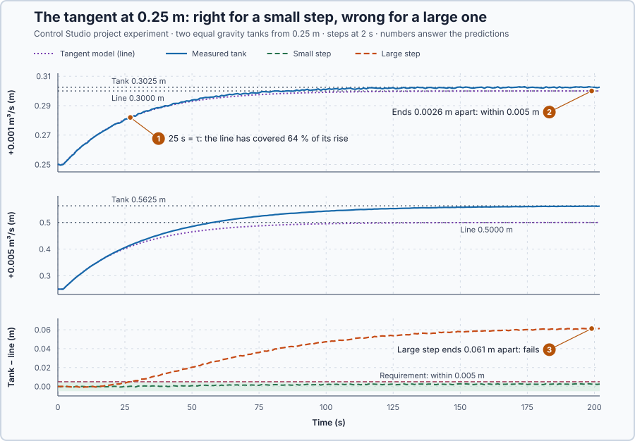

# 46. Linearization

In this lesson, you will replace the tank's square-root outflow by a straight line at one operating level, derive the local gain and time constant, and measure how the error of that line grows with the size of the step.

## The problem

In Lesson 45 the same 0.001 m³/s inflow step raised the gravity tank 0.053 m from 0.25 m, two thirds of it in 27 s, but about 0.10 m from 1.0 m, two thirds in 52 s. The tank is nonlinear: how it answers a step depends on its level.

The tuning methods we know need one gain and one time constant. We will describe the tank near its operating level with a straight line, and find how far from that level the line can be trusted.

## What we need

We need to:

1. replace the outflow curve with a straight line at the operating level;
2. turn the tank into a first-order process with its own gain and time constant; and
3. measure how wrong the line becomes for larger steps.

## The new idea

**Linearization** replaces a curve with the straight line that touches it at the operating point. Near that level, the tank then behaves like a simple first-order process with its own gain and time constant.

**In words.** Lesson 45's tank answers differently at every level, but close to one level it is almost regular: a little more level pushes out a little more water, nearly in proportion. Linearization uses that in three steps:

1. **Draw the tangent.** Through the point where the tank works, draw the straight line that has the same slope as the outflow curve there. This line is the curve's **tangent**. Near the operating point, curve and line almost coincide.
2. **Count from the operating point.** Measure the level and the inflow as deviations: how far the level is above its operating level, and how much the inflow is above the flow that holds it there. The steady flow that holds the operating level then drops out, and only the changes remain.
3. **Read off a first-order process.** On the straight line, extra outflow is proportional to extra level, exactly like the heater's heat loss, which grew in proportion to its temperature. So near its operating level the tank is a first-order process, with a gain (how much higher it settles per unit of extra inflow) and a time constant (how fast it gets there).

PLC engineers do the same whenever they treat a curved characteristic, such as a valve's or a sensor's, as a straight line around its normal working range: fine nearby, wrong far away. The price is that the line holds only locally. Each level has its own tangent, and so its own gain and time constant; and the further a step takes the tank from the operating point, the more the curve bends away from the line.

For this lesson's tank, the operating level is 0.25 m, and the tuning methods we know need exactly what the line provides: one gain and one time constant.

**The formula.** The tangent's slope is the derivative of the outflow $q = c\sqrt h$ at the operating level. Since $\sqrt h = h^{1/2}$, its derivative is $\tfrac12 h^{-1/2}$, so

$$
g = \frac{dq}{dh}\bigg|_{h_0} = \frac{c}{2\sqrt{h_0}} .
$$

On the tangent, $q_{out} \approx q_0 + g\,x$. Putting this into the balance $A\,\dot h = q_{in} - q_{out}$, with $\dot h = \dot x$ because $h_0$ is fixed, gives $A\,\dot x = (q_0 + v) - (q_0 + g\,x)$, and $q_0$ cancels:

$$
A\,\dot x = v - g\,x .
$$

Dividing by $g$ gives the first-order process $(A/g)\,\dot x + x = v/g$, with

$$
K = \frac{1}{g}, \qquad \tau = \frac{A}{g} .
$$

How wrong is the line at rest? It settles at $h_0 + v/g$, the tank at $(q_{in}/c)^2$. Expanding $(q_0 + v)^2/c^2$, where $q_0^2/c^2 = h_0$ and $2q_0/c^2 = 1/g$, gives $h_0 + v/g + v^2/c^2$: the line's level plus exactly $v^2/c^2$.

- $h_0$ is the operating level, in m, and $q_0 = c\sqrt{h_0}$ its outflow, in m³/s;
- $g$ is the tangent's slope, the extra outflow per metre of extra level, in m²/s; here $g$ is not gravity;
- $x = h - h_0$ is the level's deviation, in m;
- $v = q_{in} - q_0$ is the inflow's deviation, in m³/s;
- $K$ is the local gain, in metres of level per m³/s of inflow, which is s/m²;
- $\tau$ is the local time constant, in s; and
- $c$ and $A$ are Lesson 45's outlet coefficient and floor area.

**Example: the tank at 0.36 m.** The tank of Lesson 45, $A = 0.5$ m² and $c = 0.020$ m$^{5/2}$/s, works at $h_0 = 0.36$ m. Follow the numbers:

1. **The operating point.** $q_0 = 0.020 \times \sqrt{0.36} = 0.020 \times 0.6 = 0.012$ m³/s holds the level.
2. **The slope.** $g = 0.020/(2 \times 0.6) = 0.0167$ m²/s: 1 cm more level lets out 0.000167 m³/s more.
3. **Gain and time constant.** $K = 1/g = (2 \times 0.6)/0.020 = 60$ s/m² and $\tau = A/g = 0.5 \times 60 = 30$ s: every extra 0.001 m³/s settles the level $60 \times 0.001 = 0.06$ m higher, with a time constant of 30 s.
4. **A step of $v = +0.004$ m³/s.** At first neither outflow has changed, so line and tank both rise $v/A = 0.004/0.5 = 0.008$ m/s.
5. **The line's answer.** It settles $K v = 60 \times 0.004 = 0.24$ m higher, at 0.60 m. After two time constants, 60 s, it has covered $1 - e^{-2} = 86$ % of that rise: 0.21 m.
6. **The tank's answer.** The tank settles at $(0.016/0.020)^2 = 0.64$ m, so the line ends $0.004^2/0.020^2 = 0.04$ m too low. The curve bends below its tangent, so the line drains more than the tank and settles lower.
7. **A new level, a new line.** At 0.64 m the slope is $0.020/(2 \times 0.8) = 0.0125$ m²/s, so $K = 80$ s/m² and $\tau = 40$ s: the tank is slower and more sensitive there.

**Teaching choices:** two equal tanks, so both of the experiment's steps start from the same state, and a declared requirement: the line's level within 0.005 m of the tank's.

**The limitation.** The line is right only near $h_0$. Its error $v^2/c^2$ grows with the square of the step: twice the step, four times the error. A requirement on the error therefore limits the step to $|v| \le c\sqrt{\text{allowed error}}$; for 0.02 m that is $0.020 \times \sqrt{0.02} = 0.0028$ m³/s. And step 7 shows that the gain and the time constant themselves change with the level.

## Prediction

Before running, answer these questions:

1. What are $g$, $K$ and $\tau$ at 0.25 m, and how much of its rise does the line cover in 25 s?
2. How far apart will the line and the tank end for the +0.001 m³/s step?
3. And for the +0.005 m³/s step? Which step meets the 0.005 m requirement?

| | Predicted |
| --- | ---: |
| $g$, $K$, $\tau$ at 0.25 m | 0.020 m²/s, 50 s/m², 25 s |
| Line after one $\tau$ | 63 % of its rise |
| +0.001 m³/s: line, tank, apart | 0.3000 m, 0.3025 m, 0.0025 m |
| +0.005 m³/s: line, tank, apart | 0.5000 m, 0.5625 m, 0.0625 m |
| Largest step within 0.005 m | 0.0014 m³/s |

## Implementation

Open [`src/Main.st`](src/Main.st). The function `TangentSlope` is $g = c/(2\sqrt{h_0})$, and `TangentDeviationNext` advances $A\,\dot x = v - g\,x$ by one second. The simulated rig has two equal tanks at 0.25 m with 0.010 m³/s, each with a level sensor that reads within ±0.0005 m. For each tank, the program advances the line with the inflow deviation applied during that second, started from the measured level; `SmallTangentLevelM` and `LargeTangentLevelM` are $h_0 + x$. When Control Studio starts the project experiment, the program raises the inflows to 0.011 and 0.015 m³/s for the 200 s run.

**ST practice.** Use `TangentSlope` to check 0.020 m²/s at 0.25 m and 0.0133 m²/s at 0.5625 m, then calculate $K$ and $\tau$ at both levels. Then open [`src/tests.st`](src/tests.st) and run its tests from the **Testing** view: they check $g$, $K$ and $\tau$, both equilibria, the $v^2/c^2$ errors and the 0.0014 m³/s limit.

## Experiment in Control Studio

1. Open this lesson's project and start **Simulator**; both tanks hold 0.25 m. In the **truST** side bar, select **Control Studio**.
2. On **Identify**, choose **Project experiment** from **Method**. In **Signals**, select `P1.SmallLevelM · Process value (m)`, `P1.SmallInletFlowM3S · Applied output (m³/s)`, `P1.SmallTangentLevelM · state (m)`, `P1.LargeLevelM · state (m)`, `P1.LargeTangentLevelM · state (m)` and `P1.LargeInletFlowM3S · state (m³/s)`.
3. Answer the predictions. Select **Review project test**, check the declared **202.1 s** duration and select **Confirm and start**; the steps come 2 s later.
4. After the run, hover at 27 s, one time constant after the steps, and at 200 s.
5. At completion, Control Studio shows **Project test completed. Outputs restored.**

Select **Abort test** to stop early. To repeat, stop and restart **Simulator**.

## Evidence and decision

The numbered marks answer the predictions with the same numbers. From the recording:

| After the step | Small: tank, line | Apart | Large: tank, line | Apart |
| --- | --- | ---: | --- | ---: |
| 10 s | 0.2667, 0.2668 m | −0.0001 m | 0.3337, 0.3338 m | 0.0000 m |
| 25 s | 0.2822, 0.2820 m | 0.0002 m | 0.4149, 0.4099 m | 0.0050 m |
| 50 s | 0.2940, 0.2935 m | 0.0005 m | 0.4896, 0.4675 m | 0.0221 m |
| 100 s | 0.3011, 0.2992 m | 0.0019 m | 0.5438, 0.4958 m | 0.0481 m |
| 199 s | 0.3022, 0.3000 m | 0.0022 m | 0.5608, 0.4999 m | 0.0609 m |

1. 25 s after the step the small step's line had covered 64 % of its rise, the predicted 63 % plus a little from the 1 s updates; the tank reached 63 % at 28 s.
2. Averaged over its last 10 s, the small step's line ended 0.0026 m below the tank, the predicted 0.0025 m: within the requirement.
3. The large step's line started on the tank, because the first rise $v/A$ does not depend on the outflow, then fell behind and ended 0.061 m below it while the tank still approached 0.5625 m. It fails the requirement.

The line costs one division and gives the gain and time constant that tuning needs, but only near its level. We use the line at 0.25 m for inflow changes up to about ±0.0014 m³/s. These are simulation results, not a physical qualification.

## Conclusion

A tangent at the operating level turns the tank into a first-order process with $K = 1/g$ and $\tau = A/g$. Its error grows with the square of the step, so the line can be trusted only near the level where it was drawn.

For this tank at 0.25 m, the line was within 0.0026 m for a 0.001 m³/s step and 0.061 m off for a 0.005 m³/s step.

## Check yourself

1. **At $h_0 = 1.0$ m, with $c = 0.020$ m$^{5/2}$/s and $A = 0.5$ m², what are $g$, $K$ and $\tau$?**
   $g = 0.020/(2 \times 1) = 0.010$ m²/s, $K = 100$ s/m², $\tau = 50$ s.
2. **Why does the large step's line start on the tank and then fall behind it?**
   At first neither outflow has changed; as the level rises, the line's outflow grows faster than the tank's, because
   the curve bends below its tangent, so the line drains more and settles lower.
3. **How far apart do the line and the tank settle for a 0.002 m³/s step?**
   $v^2/c^2 = 0.002^2/0.020^2 = 0.01$ m.

## Reason for the next lesson

The line's gain and time constant change with the level: 50 s/m² and 25 s at 0.25 m, 75 s/m² and 37.5 s at 0.5625 m. Gains tuned at one level behave differently at another.

[Gain scheduling](../../09-industrial-control-structures/56-gain-scheduling/README.md) changes the controller's settings with the level.
