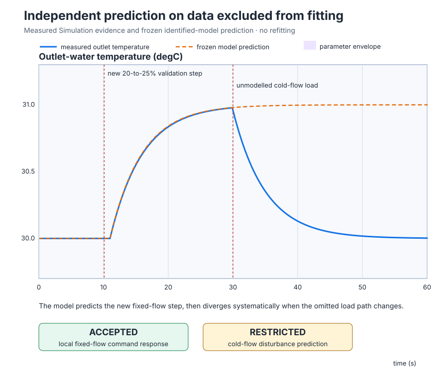
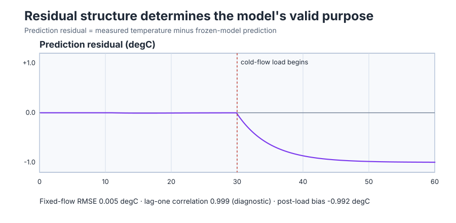

# Validate the identified water-heater model independently

Course position: Lesson 17 of 84. Previous lesson: [Step-response
identification](../16-heater-step-identification/README.md). Next lesson:
[Model-based PI tuning](../18-nominal-fopdt/README.md).

**Lesson objective:** Use new data without refitting to accept the local command
model, restrict its disturbance purpose, and retain uncertainty, residuals,
range, and verdict.

**Evidence class:** Simulation evidence. The recorded results are not evidence
from a physical water heater.

## The problem

The equipment in this lesson is Electric recirculating water heater, outlet-temperature sensor, heater power stage, and cold-flow load.

Lesson 16 fitted a first-order-plus-dead-time model to one 20-to-30-percent
heater experiment. A low error on that recording answers “can this model
reproduce the data that selected it?” It does not answer “can this frozen model
predict data it has never seen?” A flexible fitting method can partly memorize
an estimation record, so reusing that same record would reward overfitting.

This lesson presents two new challenges. First, heater power rises only from 20
to 25 percent, an amplitude not used for estimation. Second, a cold-flow event
changes the real plant but is absent from the heater-command-only model. We
must judge those purposes separately: success on the command step must not
silently approve prediction of an unmodelled load.

The heater starts near 30 degrees Celsius at 20 percent power. Outlet
temperature is limited to 0–40 degrees Celsius, heater power is limited to
0–100 percent, and a safety abort commands zero applied power.

## What we need

We need to freeze the Lesson 16 model, challenge it with a distinct immutable
record, measure prediction error without refitting, and issue a verdict that
names the supported purpose and operating range as well as the unsupported
disturbance path.

## The new idea

**Estimation data** are measurements used to choose model structure and
parameters. **Validation data** are separate measurements used only to test the
already frozen model. If validation data change the parameters, they have
become new estimation data and can no longer provide an independent verdict.

The **sample number ($k$)** identifies one recorded update. The **measured
process value ($PV_{\mathrm{measured}}$)** is the sensor's outlet-water
temperature at that update, in degrees Celsius. The **model-predicted process
value ($PV_{\mathrm{predicted}}$)** is the temperature calculated by the frozen
model for the same timestamp and applied heater input, also in degrees Celsius.

The **prediction residual ($r_k$)** is measured temperature minus predicted
temperature at sample number $k$, in degrees Celsius. Only after defining the
quantities do we write:

$r_{k} = PV_{\mathrm{measured},k} - PV_{\mathrm{predicted},k}$

A positive residual means the water is warmer than predicted. A negative
residual means it is colder. The sign is important because it helps distinguish
a persistent omitted load from random error.

One residual describes one instant. To summarize a window containing $N$
residuals, first square each residual so positive and negative errors cannot
cancel. Add those squares and divide by $N$ to obtain the mean squared error.
Take the square root to restore the original temperature unit. This derives the
**root-mean-square residual ($RMSE$)**:

$RMSE=\sqrt{\frac{1}{N}\sum_{k=1}^{N}r_k^2}$

RMSE is therefore a typical residual magnitude in degrees Celsius. Squaring
also makes occasional large residuals contribute more strongly than small
ones.

The **residual bias ($b_r$)** is the signed mean residual over a declared
window, in degrees Celsius. To preserve direction, average the signed
residuals:

$b_r=\frac{1}{N}\sum_{k=1}^{N}r_k$

A bias near minus 1 degree Celsius means the measured plant stays about one
degree colder than the model predicts. A persistent bias can indicate an
omitted offset, operating-point change, or disturbance.

Residual magnitude alone does not reveal whether errors retain a time pattern.
For the **lag-one residual correlation**, form two aligned sequences: one ends
at $r_{N-1}$ and the other begins at $r_2$. Subtract each sequence's own mean,
multiply paired departures, and add them. Then divide by the square root of the
two departure-energy sums:

$\rho_1=\frac{\sum_{k=1}^{N-1}(r_k-\bar r_a)(r_{k+1}-\bar r_b)}
{\sqrt{\sum_{k=1}^{N-1}(r_k-\bar r_a)^2\sum_{k=1}^{N-1}(r_{k+1}-\bar r_b)^2}}$

The numerator is the shared variation of successive residuals. The denominator
normalizes by both sequences' variation, so units cancel and the result is
bounded from -1 to 1. A value near +1 means a residual tends to be followed by
one with the same direction; near -1 means alternating direction; near zero
means little linear one-step relationship. This introductory diagnostic does
not prove statistical whiteness. If residual variation is below measurement
resolution, round-off can dominate the ratio even when its magnitude is near
one.

Lesson 16 retained a **parameter uncertainty interval** for gain, time constant,
and delay. It is a plausible range created by sample resolution, not a
probability statement. The **prediction envelope** is the lower-to-upper
prediction range produced by those parameter intervals. At each validation timestamp, evaluate the frozen FOPDT
equation for every lower/upper parameter-bound combination. The minimum and
maximum results form the **prediction envelope**. The envelope shows how those
retained parameter bounds affect prediction; it does not promise that future
measurements or omitted disturbances must lie inside.

An **accepted** verdict means the model passes a named purpose inside a declared
range. A **restricted** verdict means only part of the requested behavior is
supported. A **rejected** verdict means the model cannot support that purpose.
Prediction inside tested input and output conditions is interpolation. Using
the model beyond them, or for an input it does not contain, is extrapolation and
requires new evidence.

### Measures and decision rules

Declare these rules before looking at validation results:

- Estimation and validation run IDs must be distinct. The Lesson 16 structure,
  parameters, parameter intervals, source identity, and provenance must remain
  unchanged; otherwise the run is not independent validation.
- Retain exactly 600 active samples from 0.10 through 60.00 seconds at a
  0.10-second interval. The separate 60.10-second restoration sample is not
  included in error windows.
- Active samples require finite timestamps, requested and applied power,
  measured and predicted temperature, and residual; good quality; no excessive
  timestamp gap; Manual mode; Test authority; and no clipping, saturation,
  abort, or hard-limit violation.
- **Validation step amplitude** is maximum applied power minus baseline applied
  power. It must equal 5 percentage points with numerical comparison tolerance
  $10^{-9}$ percentage point, proving that the new amplitude reached the plant.
- **Fixed-flow RMSE** uses only 11.00 through 29.00 seconds, after the step and
  before the cold-flow event. The outlet-temperature sensor's declared
  resolution is 0.01 degrees Celsius (`lesson.json`); the 0.030-degree-Celsius
  limit is three times that resolution, a configured teaching margin wide
  enough to absorb rounding but tight enough to catch a genuinely mismatched
  model. It must not exceed 0.030 degrees Celsius, with
  0.001-degree-Celsius numerical comparison tolerance, for the local command
  purpose to pass.
- Lag-one correlation uses the same 11.00-to-29.00-second residual window. It is
  diagnostic only; it cannot overrule a failed RMSE or establish whiteness.
- **Post-load residual bias** uses 50.00 through 60.00 seconds so the load
  response has nearly settled. A bias magnitude from 0.90 to 1.10 degrees
  Celsius, with 0.01-degree-Celsius comparison tolerance at each bound, proves
  the missing load path and restricts cold-flow prediction.
- The accepted interpolation range is 20–25 percent applied power and 30–31
  degrees Celsius outlet temperature. No result extends that range.
- All decisions use unrounded retained values. Display rounding is for reading,
  not eligibility.

A failed qualification rule makes the run ineligible. Do not refit the model or
weaken a limit to erase a diagnostic failure.

## Prediction

Freeze the exact model retained by Lesson 16:

- gain $K=0.1998605954$ degrees Celsius per percentage point;
- time constant $T=4.9$ seconds;
- dead time $L=1.0$ second.

The new applied-power change is:

$\Delta u=25\%-20\%=5\text{ percentage points}$

The final model-predicted temperature change is gain times input change:

$\Delta \hat y_{\infty}=K\Delta u=0.1998605954\times5=0.999302977{}^\circ\mathrm{C}$

Starting from 30 degrees Celsius, the predicted fixed-flow equilibrium is
$30.999302977$ degrees Celsius.

For time after the dead time, reuse the FOPDT step solution derived in Lesson
16. Let $t_s$ be the input-step time:

$\hat y(t)=y_0+K\Delta u\left[1-e^{-(t-t_s-L)/T}\right]$

Six seconds after the step, five seconds of first-order response remain after
subtracting the 1-second delay. Substitution gives:

$\hat y(t_s+6)=30+0.999302977\left[1-e^{-5/4.9}\right]
=30.639106{}^\circ\mathrm{C}$

The model contains heater power but no cold-flow input. At 30 seconds the
simulator lowers the real plant equilibrium by 1 degree Celsius while the
frozen prediction remains near 31 degrees. Because residual is measured minus
predicted, predict a post-load bias near negative 1 degree Celsius.

Write down 5 percentage points, 30.9993 degrees Celsius final, 30.639 degrees
Celsius after six seconds, and negative 1 degree Celsius post-load bias before
running.

## Implementation

Control Studio writes one Boolean, `P1.ExperimentEnabled`. The project owns
the complete power sequence: scans 1 through 100 hold 20 percent; scans 101
through 600 request 25 percent; false restoration returns 20 percent. A stale
direct write to `ExperimentInput` cannot bypass that sequence. The simulation
configuration independently applies the cold-flow event at 30.00 seconds.
At 60.10 seconds, false authority restores Manual operation at 20.00 percent.

The request passes through the ordinary `Control.PID` Manual path. Requested
and applied power stay separate, while prediction and residual calculations
remain in retained project evidence so they cannot overwrite the measurement
being tested.

```st
IF ExperimentEnabled THEN
    TestCycle := TestCycle + UDINT#1;
    IF TestCycle <= UDINT#100 THEN
        ExperimentInput := LREAL#20.0;
    ELSE
        ExperimentInput := LREAL#25.0;
    END_IF;
ELSE
    TestCycle := UDINT#0;
    ExperimentInput := LREAL#20.0;
END_IF;

InputsValid := ProcessValue >= LREAL#0.0
    AND ProcessValue <= LREAL#40.0
    AND ExperimentInput >= LREAL#0.0
    AND ExperimentInput <= LREAL#100.0;

IF SafetyAbort OR NOT InputsValid THEN
    Input.ManualOutput := LREAL#0.0;
ELSE
    Input.ManualOutput := ExperimentInput;
END_IF;
Input.Mode := PIDMode#Manual;
ManipulatedValue := Controller.Update(Input := Input);
```

## Experiment in Control Studio

The complete learner workflow is **Monitor → Test**. Test writes only
`P1.ExperimentEnabled`; the project runs the exact validation sequence used
by the native evidence. There is no Identify step because the model must remain
frozen, and there is no separate Validate action: this Test is the independent
validation experiment.

### Control Studio actions

1. **Monitor** — Start the **Simulator**, then open **truST sidebar → Control Studio → Monitor → Response**.
   - **Baseline check:** Wait for **Simulation**, **Running**, current data, and good quality. Confirm measured outlet-water temperature = 30 degC, requested heater power = 20%, applied heater power = 20%, Manual mode true, input validity true, safety abort false, and `P1.ExperimentEnabled` false. Confirm the 100-millisecond interval, frozen Lesson 16 model identity and intervals, distinct planned validation run ID, and 0–40 degC / 0–100% limits.
   - **Decision before action:** Read your written prediction and the rules above. Confirm the model remains frozen, the 20-to-25-percent step is inside its planned range, and the cold-flow event is intentionally absent from its inputs.
   - **Successful evidence:** Response advances with finite current values and **Start recording** is enabled. Select **Start recording** before opening Test.
   - **Recovery:** If data are stale, unavailable, invalid, outside limits, in the wrong mode, or model identity differs from Lesson 16, stop the Simulator, correct the displayed problem, restart, and repeat the full baseline check.
   - **Record:** Write down the estimation and validation run IDs, frozen parameters and intervals, initial PV, requested/applied power, mode, quality, evidence classes, and all four predictions.

2. **Test** — Open **truST sidebar → Control Studio → Test**.
   - **Baseline check:** Confirm **Experiment** = **Observe without excitation**, **Amplitude** = **0** (disabled), and **Maximum duration (s)** = **60.1**. The reviewed authority is **Experiment authority** (`P1.ExperimentEnabled`). Its false-to-true transition starts 10.0 seconds at 20%, then 50.0 seconds at 25%. The simulation applies the declared cold-flow load at 30.00 seconds. False restoration produces the separate 60.10-second sample at 20%.
   - **Decision before action:** Confirm that Test changes only Boolean authority, the project owns every power transition, the model cannot refit, and completion restores the 20-percent Manual point. Keep the fixed-flow and cold-flow decisions separate. This run is made so that low error on the recording used to estimate parameters cannot establish prediction on unseen amplitude or disturbance data is measured rather than assumed.
   - **Successful evidence:** Select **Review test**, verify the Boolean signal, 60.1-second timeout, stop conditions, and false restoration, then select **Confirm and start**. Keep **Abort test** available. Response must show 20% through 10.00 seconds, 25% from 10.10 through 60.00 seconds, the measured temperature departing below the frozen prediction after 30.00 seconds, and 20% after authority returns false at 60.10 seconds.
   - **Recovery:** Select **Abort test** if any value is nonfinite, quality or timing fails, model parameters change, estimation samples are reused, PV leaves 0–40 degC, power leaves 0–100%, or an unexpected event occurs. Safety abort commands zero. Before retrying, confirm authority false and normal Manual restoration at 20%.
   - **Record:** Compare the new-step response and post-load residual with your predictions. Retain 600 active
     samples, the separate restoration sample, frozen-model provenance, terminal state, false
     authority restoration, seed **20260827**, calculated windows, plots, and purpose verdict. The
     inherited limitation under test is: Low error on the recording used to estimate parameters cannot establish prediction on unseen amplitude or disturbance data. The decision this run
     supports is: Accept fixed-flow command response when its independent RMSE passes, but restrict load prediction when post-load residual bias fails.

A physical heater requires a separately reviewed plan, independent protection,
and explicit approval from an authorised heater controls engineer. Simulation
validation does not become physical-plant evidence.

## Evidence and decision

The project-owned record is qualified, its run ID differs from Lesson 16, and
the model parameters remained frozen.





| Decision measure | Exact window | Result | Interpretation |
| --- | --- | ---: | --- |
| Fixed-flow RMSE | 11.00–29.00 s | 0.004760 °C | Passes the 0.030 °C limit |
| Fixed-flow lag-one correlation | 11.00–29.00 s | 0.998623 | Diagnostic only; residual variation is below measurement resolution |
| Post-load residual bias | 50.00–60.00 s | -0.991545 °C | Inside the declared missing-load band |
| Applied validation step | Complete active run | 20.00→25.00% | New amplitude, no clipping |

The fixed-flow RMSE passes, all parameters stayed frozen, and the qualified run
remained inside 20–25 percent power and 30–31 degrees Celsius. The model is
therefore **accepted** for local fixed-flow heater-command prediction in that
range.

The lag-one value is numerically high because tiny, smooth model mismatch
persists between adjacent samples. Its residual magnitude is below measurement
resolution, so this lesson does not call the residual statistically non-white
or use correlation to reverse the passing command verdict.

After cold flow, measured temperature remains about 0.992 degree Celsius below
the command-only prediction. That signed bias matches the predicted missing
load and lies in the declared 0.90-to-1.10-degree magnitude band. Cold-flow
prediction is therefore **restricted**. The fixed-flow command purpose is
accepted; the cold-flow purpose is restricted. Do not refit merely to erase
this useful diagnosis.

The unrounded evidence used for these decisions is retained in
[`validation-trace.csv`](figures/validation-trace.csv),
[`validation-summary.csv`](figures/validation-summary.csv), and
[`heater-validation-evidence.json`](figures/heater-validation-evidence.json).

## Conclusion

The frozen Lesson 16 model predicts a genuinely new heater-step amplitude with
small independent error. The cold-flow event then produces a persistent
negative residual because the model has no cold-flow input. Independent
validation has made the model more useful by defining its boundary: it supports
local fixed-flow heater-command prediction, not load prediction or universal
heater behavior.

## Reason for the next lesson

Lesson 18 may now use the accepted fixed-flow command model to calculate PI
gains inside 20–25 percent heater power and 30–31 degrees Celsius. It must carry
the cold-flow restriction forward and test disturbance behavior rather than
pretend the missing load path was validated.
