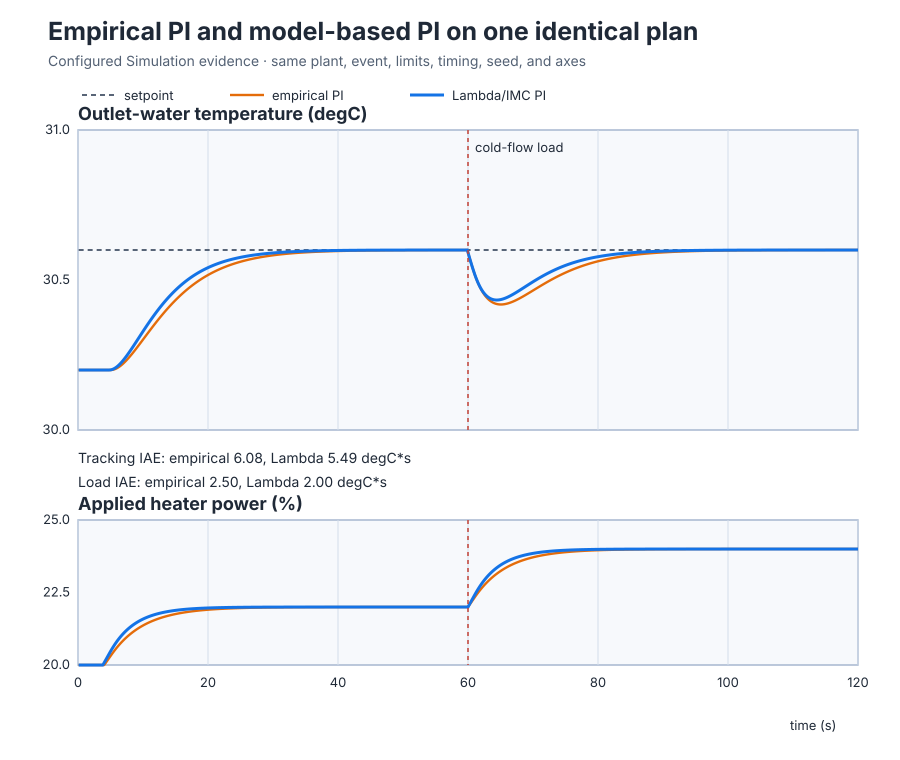
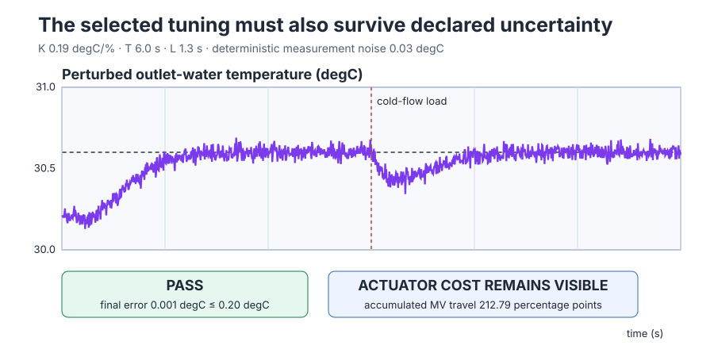

# Tune the validated water-heater model with Lambda/IMC PI

Course position: Lesson 18 of 84. Previous lesson: [Independent model
validation](../../01-feedback-foundations-and-temperature-control/17-independent-model-validation/README.md). Next
lesson: Position-table P control (Lesson 19).

**Lesson objective:** Choose a closed-loop response target, calculate PI gains
from the validated FOPDT model, and compare them with empirical tuning under
nominal and uncertain conditions.

**Equipment:** Electric recirculating water heater, outlet-temperature sensor,
heater power stage, and cold-flow load.

The gain calculation is identified-model evidence. The recorded responses are
Simulation evidence, not evidence from a physical water heater.

## The problem

The equipment remains the Electric recirculating water heater, outlet-temperature sensor, heater power stage, and cold-flow load used by the preceding modelling lessons.

Lesson 7 found a PI controller by trying gains on this heater. That empirical
controller works, but its gains do not tell another engineer which plant model
was assumed or how fast the closed loop was intended to be. Lessons 15 and 16
derived and identified a local heater-command model. Lesson 17 then accepted
that model for fixed-flow command response near 30 °C and 20–25% heater power;
it explicitly restricted cold-flow prediction.

We can now calculate a controller instead of starting another trial-and-error
search. We must still avoid a common mistake: a formula produces a *candidate*,
not proof that the candidate is safe or better. The empirical and calculated
controllers therefore need the same plant, setpoint, disturbance, limits,
sample time, and initial state. We must also repeat the chosen candidate with
plausible model error and measurement noise.

## What we need

We need four things, in this order:

1. retain the validated model and its restricted purpose;
2. choose how quickly we want the closed loop to respond;
3. derive PI gains from those two inputs, with units; and
4. compare the candidate with the empirical PI on one frozen experiment.

The candidate must remain separate from the active controller until validation
has passed and Apply has been explicitly approved. Removing the Test authority
must stop the run and restore the empirical gains.

## The new idea

### Name every quantity before using it

Lesson 16 obtained this model from a bounded heater-power step: settled
temperature change divided by applied-power change produced its gain, the
measured response-onset time produced its apparent delay, and the time from
that onset to 63.2 percent of the settled change produced its time constant.
Lesson 17 then froze those quantities and tested them on an unused input
amplitude and a separate load event. The model was accepted only for the local
heater-power path and restricted for the omitted cold-flow disturbance. It is
therefore an identified and independently checked local model, not a universal
heat-balance equation.

The **plant transfer function ($G(s)$)** is the zero-initial-deviation ratio of
modelled outlet-temperature change to applied heater-power change. Its unit is
degrees Celsius per percentage point. The **Laplace frequency variable ($s$)**
has unit inverse seconds and lets a differential equation be written as an
algebraic input-output ratio. The **model gain ($K$)** is the
steady temperature change in degrees Celsius per percentage point of heater
power. The **model time constant ($T$)** is the response time in seconds: after
one time constant, a delay-free first-order response has completed about 63.2%
of its eventual change. The **model dead time ($L$)** is the number of seconds
between a heater change and the beginning of the modelled temperature response.

The delayed factor $e^{-Ls}$ says that the input reaches the modelled response
$L$ seconds late. The denominator $Ts+1$ is the Laplace form of the
first-order balance derived and fitted in Lesson 16. Multiplying that dynamic
shape by $K$ restores the measured steady temperature-per-power scale. These
pieces give the validated first-order-plus-dead-time plant:

$G(s) = \frac{K e^{-Ls}}{Ts + 1}$

As $s$ approaches zero, the delay and denominator approach one, so $G(0)=K$;
the equation therefore preserves the measured steady gain. Its use remains
limited to the operating and input ranges validated in Lesson 17.

The **desired closed-loop response time (lambda)**, written $\lambda$, is the
engineer's speed target in seconds. We choose it; it is not another plant
parameter. A small $\lambda$ asks the controller to correct error quickly and
usually requires more actuator movement. A large $\lambda$ asks for a gentler
response and normally tolerates delay, noise, and model error better.

The **proportional gain ($K_p$)** is requested heater percent per degree Celsius
of present error, so its unit is
%/°C. The **integral time ($T_i$)** is measured in seconds and sets integral
action relative to proportional action. The **integral gain ($K_i$)** is
requested heater percent per degree-Celsius-second of persistent error. Its unit is percent per
degree-Celsius-second, written %/(°C·s).

### Derive the Lambda/IMC PI rule

The **internal-model controller ($Q(s)$)** is the design element that would
invert the usable part of the identified plant and then impose the response
speed we choose. Its unit is percentage points of heater command per degree
Celsius. We do not invert the delay because doing so would require acting on a
temperature change before its information exists.

First ignore the non-invertible delay and ask the controller to make the
invertible first-order part behave like a first-order filter with the chosen
response time:

$Q(s) = (Ts + 1) / [K(\lambda s + 1)]$

The numerator $(Ts+1)$ cancels the plant's first-order denominator. The added
filter $(\lambda s+1)$ prevents the inverse from demanding an instantaneous
response. The **equivalent feedback controller ($C(s)$)** converts the same
internal-model design into the ordinary error-to-heater-command controller
used by the feedback loop. Closing the loop makes the remaining correction
equal to the internal-model action divided by one minus its predicted
plant-through-controller return, which gives

$C(s) = Q(s) / [1 - G(s)Q(s)]$

The delay cannot be cancelled safely. For frequencies slow enough for this
local design, use the first term of its series approximation,
$e^{-Ls} \approx 1-Ls$. Substituting $G$ and $Q$ then makes the denominator of
$C$ approximately $(\lambda+L)s/(\lambda s+1)$. Cancelling the common filter
gives

$C(s) \approx (Ts+1) / [K(\lambda+L)s]$

and factoring out the constant gives

$C(s) \approx T/[K(\lambda+L)] \cdot [1 + 1/(Ts)]$

The bracket is the ideal PI form $1+1/(T_i s)$. Matching like terms explains,
rather than merely states, the initial choices $K_p=T/[K(\lambda+L)]$ and
$T_i=T$. The practical SIMC rule limits the integral time to four effective
closed-loop horizons:

$K_p = T / [K \cdot (\lambda + L)]$

$T_i = min[T, 4 \cdot (\lambda + L)]$

If the plant time constant is the smaller value, $T_i=T$ and we retain the
derived cancellation. If the plant is very slow, $4(\lambda+L)$ is smaller;
using that cap prevents integral action from becoming so slow that a load
disturbance lingers unnecessarily.

The shipped PID uses the parallel form $K_p e + K_i\int e\,dt$. The ideal form
is $K_p[e+(1/T_i)\int e\,dt]$. Expanding the second expression shows that the
coefficient of the integral must be $K_p/T_i$, so

$K_i = K_p / T_i$

Its units also check: (%/°C)/s = %/(°C·s).

### Derive the measures before running the experiment

At sample $k$, the control error is $e_k=SP_k-PV_k$. With the 0.1-second
sample interval $\Delta t$, the **integral absolute error (IAE)** accumulates
error rectangles in degree-Celsius-seconds and is

$IAE = \sum_k |e_k|\Delta t$

Each rectangle has height in °C and width in seconds, so the sum has unit
°C·s. Taking the absolute value prevents positive and negative errors from
cancelling. Lower IAE means less accumulated error, but it says nothing by
itself about overshoot or actuator effort.

The final mean absolute error is the arithmetic mean of $|e_k|$ from 110 to
120 seconds. Overshoot is the greatest amount by which PV rises above SP. The
setpoint settling time is the first time after which $|e_k|$ remains at or
below 0.20 °C until the cold-flow event at 60 seconds.

The **accumulated manipulated-variable travel** is

$MV_{travel}=|MV_0-0|+\sum_{k=1}^{N}|MV_k-MV_{k-1}|$

It includes the safe 0% to initial command movement and every later movement.
Its unit is percentage points, and it can exceed 100 because it is a travelled
distance, not an instantaneous command. **Saturation exposure** is the number
of samples at the active 20% or 25% qualification limit multiplied by 0.1 s.

For a measure where lower is better, improvement is

$improvement = (IAE_{empirical}-IAE_{lambda})/IAE_{empirical}\cdot100\%$

The subtraction is the error removed by the new tuning; division by the
empirical value makes the comparison relative; multiplication by 100 expresses
that ratio as a percentage.

Before practice, freeze these decisions:

- tracking IAE from 0–60 s must be at most 6.00 °C·s, tolerance 0.01 °C·s;
- load IAE from 60–120 s must be at most 2.40 °C·s, tolerance 0.01 °C·s;
- both IAE improvements must be at least 2.0%, tolerance 0.1%;
- perturbed final mean absolute error must be at most 0.20 °C, tolerance 0.01 °C;
- perturbed MV travel must be at most 300 percentage points, tolerance 1 point;
- applied heater power must never exceed the 25% model-validity limit,
  tolerance 0.001%; and
- all values must remain finite and use the frozen model, plan, and seed.

## Prediction

Use the rounded validated values $K=0.2$ °C/%, $T=5$ s, and $L=1$ s. Choose
$\lambda=4$ s. The proportional gain is

$K_p = 5/[0.2(4+1)] = 5\,\%/{}^\circ\mathrm{C}$

The integral-time alternatives are $T=5$ s and $4(\lambda+L)=20$ s. Their
minimum is therefore

$T_i=min(5,20)=5\,\text{s}$

and the parallel integral gain is

$K_i=5/5=1\,\%/({}^\circ\mathrm{C}\cdot\text{s})$

Lesson 7's empirical PI used $K_p=4$ %/°C and $K_i=0.8$ %/(°C·s). Both
calculated gains are 25% larger, so predict a smaller tracking and load IAE.
Also predict at least as much short-term heater movement; the uncertainty run
will tell us whether noise makes that cost unacceptable.

## Implementation

`GenerateCandidate` calculates the selected gains but does not apply the
candidate. `ValidationPassed` records that the frozen native comparisons passed.
`ApplyApproved` copies a validated candidate into the Simulation controller.
`RunApproved` is separate permission for Automatic mode to command the plant.
`RollbackRequested` restores the empirical gains.

The complete learner workflow is **Monitor → Test**. Control Studio writes one
reviewed Boolean, `P1.ExperimentEnabled` at `%MX85.0`. On its rising edge, the
project selects Lambda tuning, generates the candidate, records the retained
validation verdict, applies it to this Simulation, and grants run authority in
that visible program order. While the Boolean remains true, the project owns
the 120-second response. On its falling edge, the project removes run authority,
requests rollback, restores $K_p=4$ and $K_i=0.8$, and commands Manual safe 0%.

```st
IF ExperimentEnabled AND NOT ExperimentWasEnabled THEN
    TuningSelection := 1;
    GenerateCandidate := TRUE;
    ValidationPassed := TRUE;
    ApplyApproved := TRUE;
    RollbackRequested := FALSE;
    RunApproved := TRUE;
ELSIF ExperimentWasEnabled THEN
    GenerateCandidate := FALSE;
    ValidationPassed := FALSE;
    ApplyApproved := FALSE;
    RollbackRequested := TRUE;
    RunApproved := FALSE;
END_IF;
```

The cold-flow event itself belongs to `simulation.toml`: at 60 seconds its
equilibrium-temperature bias changes from 30.2 to 29.8 °C. Control Studio does
not write a second disturbance. Native tests use fresh runtimes to compare the
empirical, selected, and perturbed/noisy cases; the interactive Test does not
pretend to reproduce three simultaneous controllers.

`RequestedManipulatedValue` is the PID's bounded request.
`ManipulatedValue` is the applied heater command. `SafetyAbort OR NOT
InputsValid OR NOT RunApproved` bypasses normal control and forces the applied
command to Manual safe 0%.

## Experiment in Control Studio

This is an observation of a project-owned Simulation sequence. The Test plan
uses zero excitation amplitude because its sole reviewed write is the Boolean
authority, not a direct SP, MV, or disturbance write. The deterministic seed is
20260824.

### Control Studio actions

1. **Monitor** — Start the **Simulator**, then open **truST sidebar → Control Studio → Monitor → Response**.
   - **Baseline check:** Wait for **Simulation**, **Running**, and current data. Confirm SP = 30.6 °C, PV starts at 30.2 °C, applied heater power is 0% in Manual, `P1.ExperimentEnabled` is false, and the active gains are the empirical $K_p=4$, $K_i=0.8$. Requested and applied heater values must be finite, current, and carry their units.
   - **Decision before action:** State the prediction made above: the selected PI should reduce both IAE values, but uncertainty and noise may increase MV travel.
   - **Successful evidence:** The Response plot advances and **Start recording** is enabled. Start recording only after those conditions are visible.
   - **Recovery:** If samples are stale, unavailable, or nonfinite, stop the Simulator, correct the binding or runtime cause, restart, and repeat this baseline check.
   - **Record:** Retain the initial SP, PV, requested and applied heater power, mode, empirical gains, model identity, and prediction.

2. **Test** — Restart the **Simulator** from the declared initial state, then open **truST sidebar → Control Studio → Test**.
   - **Baseline check:** Confirm **Experiment** = **Observe without excitation**, **Amplitude** = **0** (disabled), and **Maximum duration (s)** = **120.1**. The reviewed authority is **Experiment authority** (`P1.ExperimentEnabled`). The project, not Control Studio, owns the selected-tuning lifecycle and timed cold-flow event.
   - **Decision before action:** Confirm the reviewed plan will start at 30.2 °C and 20 percent heater power, request 30.6 °C, apply the 29.8 °C cold-flow condition at 60 seconds, stay inside PV 0–80 °C and applied MV 0–100%, then remove authority at 120.10 seconds.
   - **Successful evidence:** Select **Review test**, inspect the Boolean write, duration, abort conditions, and restoration, then select **Confirm and start**. While authority is true, observe the Lambda gains $K_p=5$, $K_i=1$, Automatic mode, and the response through the 60-second load event. At 120.10 seconds, confirm `P1.ExperimentEnabled=false`, `RunApproved=false`, `CandidateApplied=false`, empirical gains restored, Manual mode active, and applied heater power 0%. Keep **Abort test** visible.
   - **Recovery:** Select **Abort test** if inputs are stale or invalid, there is a hard-limit violation, model provenance is mismatched, or authority is unexpected. Restart from the declared initial state; never weaken a gate to make the run pass.
   - **Record:** Retain the terminal state, restoration result, seed, response plot, and the native comparison evidence below.

## Evidence and decision

This common-axis plot changes only the controller tuning. Both runs use the
same initial state, setpoint, load event, limits, timing, and plant.



| Decision measure | Empirical PI | Lambda/IMC PI | Difference |
| --- | ---: | ---: | ---: |
| Tracking IAE, 0–60 s | 6.08 °C·s | 5.49 °C·s | 9.59% lower |
| Load IAE, 60–120 s | 2.50 °C·s | 2.00 °C·s | 20.01% lower |
| Final mean absolute error, 110–120 s | <0.001 °C | <0.001 °C | Both settled |
| Overshoot, complete run | 0.00 °C | 0.00 °C | None |
| Setpoint settling, ±0.20 °C | 13.6 s | 12.4 s | 1.2 s faster |
| Qualification-limit exposure | 4.0 s | 3.8 s | 0.2 s less at 20% |
| Complete applied-command travel | 24.00 pp | 24.00 pp | Equal nominal travel |
| Proportional gain | 4.00 %/°C | 5.00 %/°C | 25% larger |
| Integral gain | 0.80 %/(°C·s) | 1.00 %/(°C·s) | 25% larger |

The selected tuning passes both absolute IAE limits and improves both IAE
values by more than 2%. It settles 1.2 seconds sooner without overshoot or
additional nominal travel. The lower qualification-limit exposure is not an
actuator saturation claim; it is time at the 20% boundary of this local model.

Now repeat only the selected candidate in a fresh runtime with $K=0.19$ °C/%,
$T=6.0$ s, $L=1.3$ s, and deterministic 0.03 °C measurement noise.



The perturbed final mean absolute error is 0.001 °C, below 0.20 °C. Applied
heater power remains inside the accepted 20–25% range. MV travel is
212.79 percentage points, below the 300-point gate but far above the nominal 24 points.
That is the important trade-off: the candidate remains accurate under the
declared uncertainty, but measurement noise makes the actuator work much more.

The candidate is therefore eligible for this fixed-flow Simulation purpose.
It does not validate the cold-flow disturbance model, extend the operating
range, or prove physical-heater performance. An invalid model identity,
purpose, parameter, target, signal, or actuator-feasibility check creates no
usable candidate and cannot change the active gains.

## Conclusion

Lambda tuning connects three facts that trial-and-error gains hide: the
validated plant dynamics, the chosen response speed, and the resulting PI
gains. We derived $K_p=5$ %/°C and $K_i=1$ %/(°C·s), then showed on one frozen
plan why they are preferred to the empirical values. The improvement is real
in Simulation, and the noisy-case MV travel makes its cost equally visible.

The workflow also keeps evidence and authority separate. Native comparisons
qualify the candidate; one reviewed Test Boolean runs the project-owned
Simulation lifecycle; removing it rolls back the gains and restores Manual
safe 0%.

## Reason for the next lesson

The thermal sequence is now complete: we moved from feedback and PI behavior
to a derived plant model, independent validation, and model-based tuning.
Lesson 19 starts a mechanical position servo. A position plant introduces
inertia and damping, so proportional control will act like a commanded
stiffness rather than like the thermal correction studied here. That contrast
is the natural next step toward understanding how plant physics changes the
meaning of the same controller structure.
