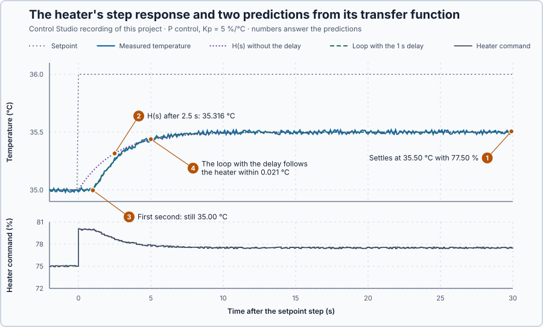

# 48. Laplace transforms

In this lesson, you will turn the heater's differential equation into algebra, connect a P controller to it by multiplying and dividing, and predict the closed-loop step response. You will then see why the heater's 1 s delay must stay inside that algebra.

## The problem

Lesson 47 held the gravity tank at 0.09, 0.25 and 0.49 m by scheduling the integral gain, from 0.00334 m²/s² at the low level to 0.00140 m²/s² at the high level. Getting there meant linearizing the tank's differential equation at each level and solving the connected equations again. Every new part, such as a delay or another controller term, makes such equations harder to combine.

We will write the heater and its P controller as fractions, connect them by algebra and check the predicted response on the heater.

## What we need

We need to:

1. turn derivatives into something we can multiply and divide, so that a plant and a controller connect by algebra;
2. get from the algebra back to the response over time; and
3. keep the heater's 1 s delivery delay in the calculation.

## The new idea

**The Laplace transform** turns a differential equation into ordinary algebra: every derivative becomes a multiplication by $s$. A process can then be written as one fraction, its **transfer function**, which says how its output answers its input.

**In words.** A differential equation links a signal with its own rate of change, so connecting a plant and a controller means solving their equations together. The Laplace transform changes the signals instead of the method: it turns each signal over time into a function of a new variable, $s$. In that form:

1. **A rate of change becomes a multiplication.** Differentiating a signal multiplies its transform by $s$. One extra term remembers where the signal started.
2. **A delay becomes a multiplication too.** Delaying a signal multiplies its transform by a fixed factor that depends on the delay.
3. **A process becomes a fraction.** Divide the output's transform by the input's, with the process starting from rest. The result is the same whatever the input is, so it belongs to the process alone: this fraction is the transfer function.

It works like scaling an analog input in a PLC: the raw counts are converted into engineering units, the calculation is done there, and the result is converted back. Here the signals are converted into functions of $s$, the parts are connected by algebra, and the result is converted back into a response over time. In the $s$ form, parts connect like the gains of function blocks in a chain: in series their fractions multiply, and closing a feedback loop gives one more fraction.

For the heater, the stored heat, the 0.2 °C per percentage point and the 1 s delivery delay become one fraction, and connecting a P controller to it takes one line of algebra.

**The formula.**

> **Math you need: an integral transform.** An integral transform turns a whole signal into a new function. For each value of a variable $s$, it multiplies the signal by a weighting curve and adds up the area under the product, as the integral of the PI controller added up small pieces of error. Here the weight is $e^{-st}$. For the constant signal $x(t) = 1$, the area under $e^{-st}$ from 0 to infinity is $1/s$: at $s = 2$ per second, it is 0.5.

The transform of a signal $x(t)$ is

$$
X(s) = \int_0^\infty x(t)\,e^{-st}\,dt .
$$

Let:

- $t$ be time, in seconds;
- $x(t)$ be a signal, for example a temperature deviation in degrees Celsius;
- $s$ be the transform variable, in 1 per second, positive and large enough for the area to stay finite;
- $X(s)$ be the transformed signal, the area under $x(t)\,e^{-st}$; and
- $t_d$ be a delay, in seconds.

Four results do almost all the work:

| Over time | Transform |
| --- | --- |
| A step of size 1 at $t = 0$ | $1/s$ |
| The decay $e^{-at}$ | $1/(s + a)$ |
| The derivative $\dot x$ | $s\,X(s) - x(0)$ |
| The same signal delayed, $x(t - t_d)$ | $e^{-s t_d}\,X(s)$ |

Where they come from:

1. **The decay.** The product $e^{-at}\,e^{-st} = e^{-(s+a)t}$ has the area $1/(s + a)$. With $a = 0.2$ per second and $s = 0.8$ per second, the area is $1/(0.8 + 0.2) = 1.0$. With $a = 0$ the decay is the step, and the area is $1/s$.
2. **The derivative.** Adding up the area by parts, the product rule of differentiation used backwards, gives $s\,X(s) - x(0)$. Check it on the decay: $\dot x = -0.2\,e^{-0.2t}$ transforms to $-0.2/(s + 0.2)$, and $s\,X - x(0) = s/(s + 0.2) - 1 = -0.2/(s + 0.2)$, the same.
3. **The delay.** The delayed signal is the same curve, $t_d$ seconds later, so every piece of its area is weighted at a time $t_d$ later: $e^{-s(t + t_d)} = e^{-s t_d}\,e^{-st}$. Every piece, and so the whole area, is multiplied by $e^{-s t_d}$. A 1 s delay at $s = 0.8$ per second multiplies the area by $e^{-0.8} = 0.449$.

The transfer function of a process with input $v$ and output $x$ is the ratio of their transforms, with the process starting from rest:

$$
G(s) = \frac{X(s)}{V(s)} .
$$

Since $s$ stands for a rate of change, $s = 0$ describes a process whose rates have all become zero: one that has settled. $G(0)$ is therefore the process gain, also called the steady gain: how far the output finally moves per unit of input.

**Back to time.** A transform belongs to exactly one signal. A result split into pieces from the table can therefore be read backwards, piece by piece.

**Example: the water heater.** We return to the water heater: its equation is the simplest we know with a delay. Measure the temperature from its operating point, $x = T - 35$ °C, and the heater command from its holding value, $v = u - 75$ %. The water stores heat with a time constant of 5 s, settles 0.2 °C higher for every extra percentage point, and receives the heater's power 1 s late:

$$
5\,\dot x + x = 0.2\,v(t - 1).
$$

Follow the method:

1. **Transform each term.** The derivative gives $5\,(sX - x(0))$ and the delayed command $0.2\,e^{-s}\,V$, so $5\,(sX - x(0)) + X = 0.2\,e^{-s}\,V$.
2. **Collect $X$:** $(5s + 1)\,X = 0.2\,e^{-s}\,V + 5\,x(0)$. No derivative is left: the equation is algebra.
3. **Divide by $V$, starting from rest,** $x(0) = 0$:

$$
G(s) = \frac{X}{V} = \frac{0.2\,e^{-s}}{5s + 1} .
$$

One fraction holds the stored heat, $5s + 1$, the gain 0.2 and the delay, $e^{-s}$.

4. **The steady gain.** $G(0) = 0.2$ °C per percentage point: 10 points more power settles the water 2 °C higher.
5. **Connect a P controller.** Leave the delay out for a moment: $G_0(s) = 0.2/(5s + 1)$. P control gives $V = K_p\,(R - X)$, where $R$ is the transformed setpoint change and $K_p$ the gain in percentage points per °C. Then $X = G_0\,K_p\,(R - X)$, and collecting $X$:

$$
H(s) = \frac{X}{R} = \frac{G_0\,K_p}{1 + G_0\,K_p} = \frac{0.2\,K_p}{5s + 1 + 0.2\,K_p} .
$$

The complete loop is one more fraction, found in one line.

6. **This lesson's gain.** With $K_p = 5$ percentage points per °C, $H(s) = 1/(5s + 2) = 0.5/(2.5s + 1)$. The loop is first order again, with gain 0.5 and time constant 2.5 s: feedback makes the water answer twice as fast as the heater's own 5 s, and it closes half of a setpoint step, the steady error of P control.
7. **Back to time.** A 1 °C setpoint step has $R = 1/s$, so $X = 0.5/\big(s\,(2.5s + 1)\big) = 0.2/\big(s\,(s + 0.4)\big)$. Split it into pieces from the table: $0.5/s - 0.5/(s + 0.4)$; check: $0.5\,(s + 0.4) - 0.5\,s = 0.2$. Read backwards, $x(t) = 0.5 - 0.5\,e^{-0.4t} = 0.5\,(1 - e^{-t/2.5})$. Two seconds after the step, the delay-free loop has raised the water by $0.5\,(1 - e^{-0.8}) = 0.275$ °C.
8. **The shaft, the same way.** Under P control with $K_p = 4$ N·m/rad, $\ddot\theta + \dot\theta = 4\,(r - \theta)$ becomes $(s^2 + s + 4)\,\Theta = 4\,R$ from rest, so $\Theta/R = 4/(s^2 + s + 4)$. Setting $s = 0$ gives 1: the angle settles on its target.

$K_p = 5$ is a teaching value, not a tuned value for physical equipment.

**The limitation: the delay.** With the delay kept, the loop's denominator becomes $5s + 1 + e^{-s}$. This is not a fraction of polynomials: it cannot be split into pieces from the table, so the response cannot be read back this way. Nor is it $H(s)$'s response moved 1 s later: while the extra power is on its way, the error stays larger, so the controller holds more power and the water then rises faster. A loop with a delay must be calculated with the delay inside it, step by step; the program does that beside the heater.

## Prediction

Before running, answer these questions for a setpoint step from 35 to 36 °C:

1. Where will the water settle, and with which heater command?
2. According to $H(s)$, how far will the water have risen 2.5 s after the step?
3. What will the heater do in the first second after the step?
4. Which prediction will follow the heater: $H(s)$ without the delay, or the loop computed with the delay?

| Time after the step | $H(s)$, without the delay |
| ---: | ---: |
| 1 s | 35.165 °C |
| 2.5 s | 35.316 °C |
| 5 s | 35.432 °C |
| Settled | 35.500 °C, with 77.5 % |

## Implementation

Open [`src/Main.st`](src/Main.st). `Control.PID` drives the heater as a P controller, $u = 75\,\% + 5\,(SP - T)$, every 0.1 s. When the project experiment starts, the setpoint steps to 36 °C and the program writes two predictions: `NoDelayPredictionC`, the step response of $H(s)$, and `DelayedModelC`, the same loop advanced every 0.1 s with the command arriving 1 s late. The measurement reads within ±0.02 °C.

**ST practice.** Find the functions `ClosedLoopGain` and `ClosedLoopTimeS` and calculate both by hand for $K_p = 5$: 0.5 and 2.5 s. Then check the line that calculates `NoDelayPredictionC` at 2.5 s: $35 + 0.5\,(1 - e^{-1}) = 35.316$ °C. The tests in [`src/tests.st`](src/tests.st), run from the **Testing** view, check these values.

## Experiment in Control Studio

1. Open this lesson's project and start **Simulator**. The heater holds 35 °C with 75 %. In the **truST** side bar, select **Control Studio**.
2. On **Identify**, choose **Project experiment** from **Method**. **Signals** already shows `P1.SetpointC · Setpoint (°C)`, `P1.TemperatureC · Process value (°C)` and `P1.HeaterPowerPct · Applied output (%)`; add `P1.NoDelayPredictionC · state (°C)` and `P1.DelayedModelC · state (°C)`.
3. Answer the predictions before starting.
4. Select **Review project test** and check the declared **32.1 s** duration: 2 s at 35 °C, then 30 s after the setpoint step.
5. Select **Confirm and start**. After 2 s the setpoint steps to 36 °C.
6. After the run, hover the first seconds after the step, 2.5 s and 5 s after it, and the end.
7. At completion, Control Studio shows **Project test completed. Outputs restored.**

Select **Abort test** to stop early. To repeat, stop and restart **Simulator**.

## Evidence and decision

The numbered marks answer the predictions with the same numbers. From the recorded run, times after the setpoint step:

| Time | Heater | $H(s)$, without the delay | Loop with the delay |
| ---: | ---: | ---: | ---: |
| 1 s | 34.997 °C | 35.165 °C | 35.000 °C |
| 2.5 s | 35.274 °C | 35.316 °C | 35.255 °C |
| 5 s | 35.453 °C | 35.432 °C | 35.439 °C |
| 30 s | 35.500 °C | 35.500 °C | 35.500 °C |

1. The water settled at 35.50 °C with a 77.50 % heater command, as $H(s)$'s steady gain predicts.
2. $H(s)$ predicted 35.316 °C after 2.5 s; the heater was at 35.274 °C.
3. For the first second nothing happened: 34.997 °C, 35 °C within the noise, while the extra power was on its way.
4. The loop computed with the delay followed the heater within 0.021 °C throughout, the size of the measurement noise. $H(s)$ was up to 0.168 °C off in the first 5 s, and moving it 1 s later is also wrong: 0.055 °C low after 3 s.

The algebra was quick: one fraction per part and one line for the loop. The cost: a delay does not fit a polynomial fraction and must stay inside the loop's calculation. There, it predicts the heater within the measurement noise. These are simulation results.

## Conclusion

The Laplace transform turns each derivative into a multiplication by $s$ and keeps the starting value as a separate term. A plant then becomes a fraction, its transfer function, and connected parts combine by algebra, as in $H = G\,K_p/(1 + G\,K_p)$. A delay enters as $e^{-s t_d}$ and must stay inside the loop.

For the heater under P control, the fraction predicted the settled 35.50 °C and 77.50 %, and the loop computed with the 1 s delay followed the recorded rise within 0.021 °C.

## Check yourself

1. **What are the closed-loop gain and time constant for $K_p = 2$ percentage points per °C, without the delay?**
   Gain $0.2 \times 2/(1 + 0.4) = 0.286$; time constant $5/1.4 = 3.57$ s.
2. **Why is the delayed response not $H(s)$'s curve moved 1 s later?**
   While the command waits, the error stays larger, so the controller holds more power and the water rises faster
   afterwards. The delay changes the whole feedback transient, not only its start.
3. **What is the transform of $x(t) = e^{-0.5t}$, and its value at $s = 1.5$ per second?**
   $1/(s + 0.5)$, which is $1/2 = 0.5$ at $s = 1.5$.

## Reason for the next lesson

We can now write a plant and its loop as fractions and calculate their responses. But we cannot yet read such a fraction to see whether a response decays, grows or oscillates: the heater gave $1/(5s + 2)$, the shaft $4/(s^2 + s + 4)$, and nothing yet tells us that the second one swings.

[Poles and zeros](../../02-derivative-action-and-dynamic-response/19-poles-zeros-and-response/README.md) reads decay, growth and oscillation from the roots of a fraction's denominator and numerator.
