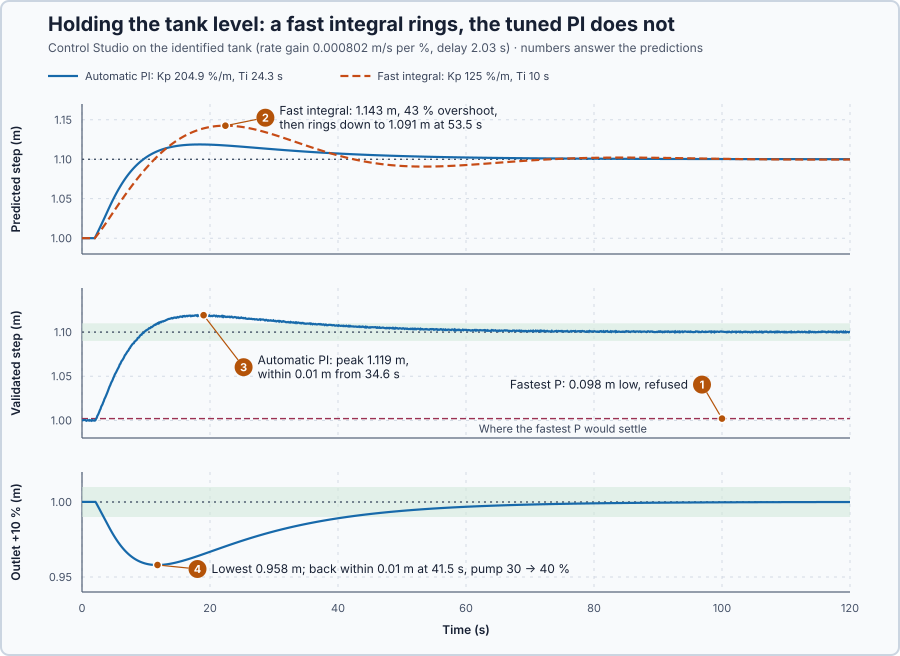

# 44. Level control

In this lesson, you will hold the tank's level with the inlet pump while the next process step draws water out, and find out why its integral must be slow.

## The problem

In Lesson 43, 10 s of extra inflow raised the level 0.0394 m, and with equal flows it then stayed between 0.2897 and 0.2903 m. The level drifts whenever the flows differ, 0.72 m an hour for a 1 % pump mismatch, and nothing brings it back.

Now the next process step draws water with the outlet pump, and the draw changes with production. We will set the inlet pump from the measured level without making the level swing.

## What we need

We need to:

1. describe the tank's response to the pump in numbers;
2. know what P and PI do on a tank; and
3. choose the integral so that the level does not swing.

## The new idea

An **integrating process** keeps adding up what goes into it, so it never settles by itself. In a tank, more water in than out makes the level rise and keep rising; only equal flows hold it, at whatever level it happens to be. A heater is the opposite: it settles at a new temperature by itself, because it loses more heat as it gets warmer.

**In words.** Lesson 43's tank behaves like a flow totalizer: a difference between the pumps does not move the level to a new value, it moves the level at a steady speed for as long as the difference lasts. Controlling such a process has three parts:

1. **How fast the tank adds up.** One percent more on the inlet pump than on the outlet pump makes the level rise at a fixed speed. That speed per percent is the number that describes the tank, just as the heater was described by how many degrees it settles higher per percent.
2. **What P does.** The inlet pump must replace what the outlet pump draws, all the time. P runs the inlet pump only from an error, so the level settles just low enough for the error to keep the pump running. How far low depends on the draw, not on the target: a higher target needs exactly the same pumping.
3. **What PI does, and why its integral must be slow.** The integral keeps the pump running with no error left. But now two things in the loop add up: the tank adds up the pump difference, and the integral adds up the error. Two adders in a loop behave like the shaft of Lesson 34, where torque added up to speed and speed to angle: they swing. A fast integral makes the level overshoot and ring; a slow integral damps the swing. Level loops that slowly hunt up and down are a familiar sight in plants, and the cause is usually an integral that is too fast.

A **tuning rule for integrating processes** sets the proportional gain and the integral time from the tank's rate, its delay and one choice: how fast the level should follow a change. It always gives just enough damping.

For this lesson's tank, the outlet pump stands for the next process step and its draw changes with production, so the inlet pump must be set from the measured level.

**The formula.** The pumps are commanded in percent, and $q_{max}$ is the flow at 100 %. One percentage point of pump difference moves the level at the **rate gain**

$$
K' = \frac{q_{max}/100}{A} .
$$

P runs the inlet pump with $u = K_p e$, and at a steady level the inlet must equal the outlet, $u = u_{out}$. So P settles with the error

$$
e = \frac{u_{out}}{K_p} .
$$

With PI, and ignoring the delay, the error changes as $\dot e = -K'(u - u_{out})$ with $u = K_p e + \frac{K_p}{T_i}\int e\,dt$. Differentiating once more removes the integral:

$$
\ddot e + K_pK'\,\dot e + \frac{K_pK'}{T_i}\,e = 0, \qquad \zeta = \tfrac{1}{2}\sqrt{K_pK'T_i} .
$$

This is Lesson 34's swing equation, and $\zeta$ is its damping ratio. The tuning rule chooses $\lambda$, at least the delay, and sets

$$
K_p = \frac{1}{K'(\lambda + L)}, \qquad T_i = 4(\lambda + L) .
$$

Then $K_pK'T_i = 4$ and $\zeta = 1$ for every $\lambda$: critical damping.

- $A$ is the tank's floor area, in m², and $q_{max}$ the pump flow at 100 %, in m³/s;
- $K'$ is the rate gain, in m/s per % of pump;
- $e$ is the error, target minus level, in m;
- $u$ is the inlet pump's command and $u_{out}$ the outlet pump's command, in %;
- $K_p$ is the proportional gain, in % per m;
- $T_i$ is the integral time, in s, with $K_i = K_p/T_i$;
- $\zeta$ is the damping ratio, without unit;
- $\lambda$ is how fast the level should follow a change, in s; and
- $L$ is the delay before the inlet water arrives, in s.

The code calls the rule SIMC, after the published tuning rules it comes from. Control Studio's **Automatic** tries the more robust response, $\lambda = 4L$, first, then the balanced $\lambda = 2L$ and the faster $\lambda = L$, and keeps the first whose prediction meets the requirements, as in Lesson 22.

**Example: this lesson's tank.** The tank is Lesson 43's, $A = 0.5$ m², with pumps that deliver 0.04 m³/s at 100 %; the inlet water needs $L = 2$ s to arrive, and the outlet draws 30 %. Follow the numbers:

1. **The rate gain.** One percentage point is $0.04/100 = 0.0004$ m³/s, so $K' = 0.0004/0.5 = 0.0008$ m/s per %: a 10 % pump difference moves the level 8 mm per second.
2. **P's error.** With $K_p = 100$ % per m, $e = 30/100 = 0.30$ m: the level settles 0.30 m below its target, and the inlet pump runs at $100 \times 0.30 = 30$ %, exactly the draw. Raising the target by 0.2 m changes nothing: the level settles 0.30 m below the new target.
3. **A PI integral.** With $K_p = 125$ % per m and $T_i = 20$ s, $\zeta = \tfrac12\sqrt{125 \times 0.0008 \times 20} = \tfrac12\sqrt{2} = 0.71$: below 1, so the level still swings a little. A faster integral, a smaller $T_i$, lowers $\zeta$.
4. **The rule.** With $\lambda = 4L = 8$ s, $K_p = 1/(0.0008 \times (8 + 2)) = 125$ % per m and $T_i = 4 \times 10 = 40$ s. Check: $125 \times 0.0008 \times 40 = 4$, so $\zeta = 1$.
5. **A larger draw.** The outlet steps from 30 to 35 %. The level first falls at $5 \times 0.0008 = 0.004$ m/s. P and the integral raise the inlet pump as the error grows; when the inlet reaches 35 % the level stops falling, but an error remains, so the integral keeps adding and the level climbs back. At the target, the integral alone holds the inlet pump at 35 %.

**Teaching choices:** the outlet pump stands for the next process step; the trials are a 0.1 m target change and a 10 % larger draw. The gains in the example are teaching values.

**The limitation.** The swing formula ignores the delay; the rule includes it through $\lambda + L$, and $\lambda$ may not be shorter than the delay. The fastest setting, $\lambda = L = 2$ s, gives $T_i = 4 \times (2 + 2) = 16$ s, the fastest integral the rule allows. The same delay caps P: its fastest gain is the rule's $K_p$ at $\lambda = L$, so P's error can shrink but never vanish while the outlet draws water; prediction 1 asks how large it stays.

## Prediction

Before running, answer these questions:

1. With the outlet at 30 %, how far below the target does P hold the level with $K_p = 125$ % per m, and with the fastest P?
2. What will the fast integral, $K_p = 125$ % per m and $T_i = 10$ s, do to a 0.1 m target step?
3. The rule gives $\zeta = 1$. Will the tuned PI overshoot a 0.1 m target step?
4. When the outlet draws 10 % more, does the PI bring the level back, and at what inlet pump?

| | Predicted |
| --- | ---: |
| P error, $K_p = 125$ % per m | 0.24 m |
| P error, fastest $K_p = 312$ % per m | 0.096 m |
| Fast integral, $T_i = 10$ s | $\zeta = 0.5$: overshoots and rings |
| Rule with $\lambda = 2L = 4$ s | $K_p$ = 208 % per m, $T_i$ = 24 s, $\zeta = 1$ |
| Inlet pump after the outlet +10 % | 40 % |

## Implementation

Open [`src/Main.st`](src/Main.st). `Control.PID` sets the inlet pump from the measured level; `OutletPumpPct` is the next process step's draw. Three functions hold the calculations:

```st
ProportionalLevelOffset := OutletCommandPct / ProportionalGain;
IntegratingProportionalGain := LREAL#1.0 / (RateGain * (ResponseTimeS + DelayS));
IntegratingIntegralTime := LREAL#4.0 * (ResponseTimeS + DelayS);
```

**ST practice.** Use them to check 0.24 m and 0.32 m, then $K_p = 208.3$ % per m and $T_i = 24$ s for $\lambda = 4$ s. Then open [`src/tests.st`](src/tests.st) and run its tests from the **Testing** view: they check both P errors and that the rule gives $K_pK'T_i = 4$.

## Experiment in Control Studio

1. Open this lesson's project and start **Simulator**; the tank holds 1.0 m with both pumps at 30 % in Manual. In the **truST** side bar, select **Control Studio**.
2. On **Identify**, select **Identify plant**. Control Studio raises the inlet pump 10 % for 30 s and reports **Integrating model with delay**.
3. On **Tune**, select **Requirements…** and enter **Setpoint change (m)** 0.1, **Maximum steady-state error (m)** 0.01, **Maximum settling time (s)** 90, **Settling band (±m)** 0.005, **Validation duration (s)** 180 and **Input disturbance (%)** −10, the outlet drawing 10 % more; select **Done**.
4. Keep **Controller** at **Choose automatically** and select **Tune controller**. Then choose `P1.Controller · P`, tune, and read the refusal.
5. Choose `P1.Controller · PI — recommended`, set **Tuning method** to **Manual**, enter 125 in **Proportional gain (Kp)** and 12.5 in **Integral gain (Ki)**, select **Tune controller** and read the **Predicted response**.
6. Set **Tuning method** to **Automatic** and select **Tune controller**. On **Validate**, select **Validate controller**; when every row passes, select **Apply**. Control Studio reports **Applied**.

To repeat, select **Restore previous settings** on **Validate**, then start again from step 3.

## Evidence and decision



The numbered marks answer the predictions with the same numbers. Control Studio identified a rate gain of 0.000802 m/s per % and a delay of 2.03 s.

| Result | Control Studio |
| --- | --- |
| Choose automatically | **PI, recommended**: $K_p$ 204.9 % per m, $K_i$ 8.42 % per (m·s), so $T_i$ = 24.3 s |
| P | refused: its fastest response settles 0.098 m from the target; 0.01 m is allowed |
| PI, $K_p$ 125, $K_i$ 12.5, manual | predicted peak 1.143 m, then down to 1.091 m at 53.5 s |
| PI, validated | step: peak 1.119 m, within 0.01 m from 34.6 s; outlet +10 %: lowest 0.958 m, within 0.01 m from 41.5 s; **Applied** |

1. Control Studio refused P: its fastest setting, 307 % per m with the identified numbers, leaves 0.098 m, close to the predicted 0.096 m.
2. The fast integral was predicted to overshoot to 1.143 m, 43 % of the step, then swing below the target to 1.091 m.
3. Yes: the tuned PI peaked at 1.119 m, without ringing. The inlet pump must end at the 30 % it started from, so the integral must too: the error's area above the target cancels the area below. $\zeta = 1$ removes the ringing, not this overshoot.
4. The level dipped to 0.958 m and was back within 0.01 m at 41.5 s; the integral alone held the inlet pump at 40 %.

These gains are the rule with $\lambda = 2L$: $K_p = 1/(0.000802 \times 6.09) \approx 205$ % per m, $T_i = 24.3$ s. The PI costs a 19 % overshoot on target changes and a 0.042 m dip when the draw jumps 10 %, and leaves no error; we apply it. These are simulation results for this tank.

## Conclusion

A tank is an integrating process: it never settles by itself, so a controller must hold its level. P holds it low by an error the outflow sets. PI removes the error, but its integral must be slow, because the tank adds up too; the rule $K_p = 1/(K'(\lambda + L))$, $T_i = 4(\lambda + L)$ keeps the level from swinging.

For this tank, Control Studio refused P, predicted ringing for a fast integral, and applied a PI that settled within 41.5 s of either trial.

## Check yourself

1. **With $K' = 0.0008$ m/s per % and $L = 2$ s, which $K_p$ and $T_i$ does the rule give for $\lambda = 6$ s?**
   $K_p = 1/(0.0008 \times 8) = 156$ % per m and $T_i = 4 \times 8 = 32$ s.
2. **Why can P never hold the level at its target while the outlet pump runs?**
   P runs the inlet pump only from an error, and replacing the outlet's water needs inlet flow, so an error of
   $u_{out}/K_p$ must remain.
3. **Why did the tuned PI overshoot the target step even with $\zeta = 1$?**
   The pump must end at 30 % again, so the integral must too: the error's areas above and below the target cancel.

## Reason for the next lesson

This tank's outflow came from a pump and did not depend on the level. Many tanks drain by gravity, and their outflow grows with the level.

[Gravity outflow](../16-gravity-tank-nonlinearity/README.md) derives that outflow from the water's height.
