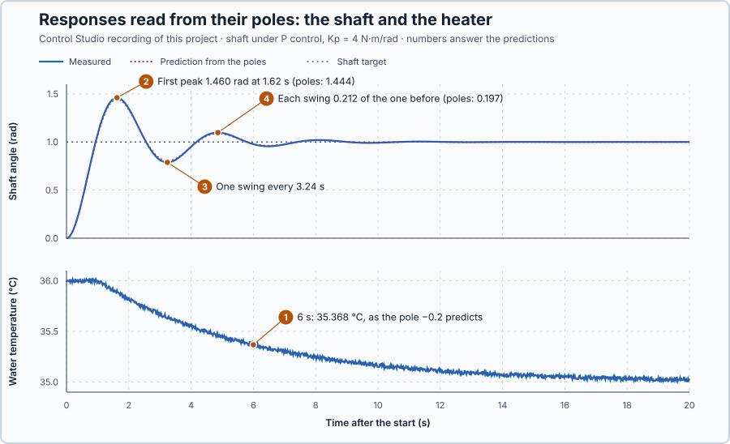

# 49. Poles and zeros

In this lesson, you will read from a transfer function whether a response dies away, grows or swings, and how fast. You will check those readings on the heater and the shaft, and see how a zero can hide a part of the response.

## The problem

Lesson 48 wrote the heater under P control as $H(s) = 0.5/(2.5s + 1)$ and predicted its settled 35.50 °C and 77.50 % correctly. It also wrote the shaft under P control as $4/(s^2 + s + 4)$. We can calculate responses from such fractions, but we cannot yet read them: nothing in $4/(s^2 + s + 4)$ says, at a glance, that the shaft will swing.

We will find the roots of each fraction's denominator and numerator, read each root as a way the system moves, and compare the readings with the heater and the shaft.

## What we need

We need to:

1. find, from a fraction, the rates at which its response dies away or grows;
2. tell a swinging response from a smooth one, and how fast it swings; and
3. know what the numerator changes in a response.

## The new idea

**Poles** are the values of $s$ that make a transfer function's denominator zero. Each pole is one natural way the system moves: a negative real pole dies away, a positive one grows, and a complex pair oscillates. **Zeros**, the values of $s$ that make the numerator zero, shape how the input appears in the response.

**In words.** A process left alone after a push moves in its own ways, whatever pushed it: a heated tank cools at its own pace, a pendulum swings at its own rate. These **natural motions** belong to the process, and the poles describe them. Each pole says three things:

1. **Its sign: dies away or grows.** A pole with a negative real part gives a motion that fades, a positive one a motion that grows, and a pole at 0 a motion that stays.
2. **Its size: how fast.** A pole of −0.2 per second fades with a time constant of $1/0.2 = 5$ s.
3. **An imaginary part: a swing.** A complex pair of poles gives a motion that swings to and fro, inside an envelope that shrinks or grows.

The zeros do not change these motions. They decide how strongly a particular input sets each one going; an input can even miss a motion completely.

In PLC terms, a pole is like the time constant of a first-order lag (PT1) block: it belongs to the block, and whatever signal you feed in, the output settles with that time constant. A process with several poles behaves like several such blocks, some of which may swing.

For the heater, the single pole says how fast a temperature deviation fades. For the shaft under P control, the two poles say how fast it swings and how quickly the swing dies away.

**The formula.** A transfer function is a fraction, $G(s) = N(s)/D(s)$. The denominator comes from the process's own equation, the one it obeys without input. Try the motion $x = A\,e^{pt}$ in that equation: every derivative multiplies it by $p$, so the equation becomes $D(p)\,A\,e^{pt} = 0$. That holds exactly when $D(p) = 0$. The natural motions are therefore $e^{pt}$, one for each pole $p$, and every response is a sum of them plus the part the input itself forces.

> **Math you need: complex numbers.** A complex number $a + jb$ has a real part $a$ and an imaginary part $b$, where $j$ stands for a number with $j^2 = -1$. Equations such as $s^2 + s + 4 = 0$ have no real roots, but they have two complex ones: $s = -0.5 \pm j1.936$. Multiplying the pair checks them: $(-0.5 + j1.936)(-0.5 - j1.936) = 0.25 + 1.936^2 = 4.0$, the equation's constant term. Complex numbers follow one more rule, **Euler's identity**: $e^{j\omega t} = \cos\omega t + j\sin\omega t$.

A complex pair $p = \sigma \pm j\omega$ gives two exponentials, which Euler's identity combines into one real motion:

$$
x(t) = e^{\sigma t}\,(c_1\cos\omega t + c_2\sin\omega t) .
$$

Let:

- $p$ be a pole, in 1 per second;
- $\sigma$ be its real part, in 1 per second: it sets the envelope $e^{\sigma t}$, which shrinks when $\sigma$ is negative;
- $\omega$ be its imaginary part, in radians per second: it sets the swing; and
- $c_1$ and $c_2$ be constants fixed by the starting values.

From these follow the readings used in this lesson:

| From the poles | Reading |
| --- | --- |
| Real pole $p$ | after a time $t$, the fraction $e^{pt}$ of a deviation is left; if $p > 0$, it doubles every $\ln 2/p$ |
| Complex pair, one swing | lasts $2\pi/\omega$ |
| Complex pair, successive swings | each is $e^{2\pi\sigma/\omega}$ times the one before |
| Complex pair, step from rest, no zero | first peak after half a swing, $\pi/\omega$, overshooting by $e^{\sigma\pi/\omega}$ of the step |

For the shaft under P control, $J\ddot\theta + B\dot\theta = K_p\,(r - \theta)$ gives the denominator $Js^2 + Bs + K_p$. When its roots are complex,

$$
\sigma = -\frac{B}{2J}, \qquad \omega = \sqrt{\frac{K_p}{J} - \sigma^2} ,
$$

with $J$ the inertia in kg·m², $B$ the friction in N·m·s/rad and $K_p$ the gain in N·m/rad.

**Example 1: the heater, a real pole.** The heater's denominator $5s + 1$ is zero at $s = -0.2$ per second. Its natural motion is $e^{-0.2t}$:

1. After 2 s, $e^{-0.4} = 0.670$ of a temperature deviation is left; after 10 s, $e^{-2} = 0.135$.
2. With the controller acting the wrong way, $K_p = -10$ % per °C, the loop's denominator is $5s + 1 - 2 = 5s - 1$, with the pole $+0.2$: a deviation doubles every $\ln 2/0.2 = 3.47$ s.
3. A pole at 0 neither fades nor grows, like the integrating tank, which keeps whatever level an imbalance left.

**Example 2: the shaft, a complex pair.** The shaft has $J = 1$ kg·m² and $B = 1$ N·m·s/rad, so $\sigma = -1/2 = -0.5$ per second for every gain: P control changes only the swing.

1. With this lesson's $K_p = 4$ N·m/rad, the denominator is $s^2 + s + 4$, the poles are $-0.5 \pm j1.936$, and $\omega = \sqrt{4 - 0.25} = 1.936$ rad/s.
2. For a target step from 0 to 1 rad, the shaft starts at rest, which gives $c_1 = -1$ and $c_2 = \sigma/\omega = -0.258$:

$$
\theta(t) = 1 - e^{-0.5t}\,(\cos 1.936t + 0.258\sin 1.936t) .
$$

3. **Reading the swing.** Take $K_p = 2.5$ N·m/rad, whose numbers come out round: $\omega = \sqrt{2.5 - 0.25} = 1.5$ rad/s. The first peak comes at $\pi/1.5 = 2.09$ s, at $1 + e^{-0.5 \times 2.09} = 1.351$ rad, an overshoot of 35 %. One swing lasts $2\pi/1.5 = 4.19$ s, and each swing is $e^{-0.5 \times 4.19} = 0.123$ times the one before. The predictions ask you to read $K_p = 4$ the same way.

**Example 3: a zero.** Take the heater under PI control, $K_p = 2.5$ and $K_i = 0.5$, without the delay. The controller is $C = 2.5 + 0.5/s = 2.5\,(s + 0.2)/s$, with a zero at $-0.2$, and Lesson 48's loop formula $CG/(1 + CG)$ with $G = 0.2/(5s + 1)$ gives the setpoint response

$$
\frac{X}{R} = \frac{0.5\,(s + 0.2)}{5\,(s + 0.1)(s + 0.2)} = \frac{0.1}{s + 0.1}.
$$

The controller's zero, $-K_i/K_p = -0.2$, sits on the water's pole $-0.2$ and cancels it: a setpoint step contains no $e^{-0.2t}$ term, and the water follows as $1 - e^{-0.1t}$. A disturbance entering after the controller has the response $0.04\,s/\big((s + 0.1)(s + 0.2)\big)$: both poles remain. The water's motion $e^{-0.2t}$ is still in the loop; one input simply does not set it going.

**The limitation.** Poles describe a linear model. Anything the model leaves out moves the real behaviour away from them: a torque limit, a delay, the hold between controller updates. Here the first torque of a 1 rad step is $K_p \times 1 = 4$ N·m, far inside the drive's ±20 N·m, so the limit should not matter; the 20 ms hold is left out, and the evidence shows what it changes.

## Prediction

Before running, answer these questions:

1. The heater rests at 36 °C with 80 %; at the start its command returns to 75 %, which holds 35 °C. When does the water start to cool, and where is it 6 s after the start?
2. The shaft's target steps from 0 to 1 rad. When is its first peak, and how high?
3. How long is one swing?
4. How much smaller is each swing than the one before?

| Prediction from the poles | Value |
| --- | ---: |
| Water after 1 s / 6 s | 36.000 / 35.368 °C |
| Shaft's first peak | 1.444 rad at 1.62 s |
| One swing | 3.245 s |
| Ratio of successive swings | 0.197 |

## Implementation

Open [`src/Main.st`](src/Main.st). The project holds two plants: the heater in open loop, with its 1 s delivery delay and ±0.02 °C measurement noise, and the shaft under `Control.PID` as P control, $K_p = 4$ N·m/rad within ±20 N·m, updated every 20 ms. When the project experiment starts, the heater command returns to 75 % and the shaft's target steps to 1 rad. The program then writes two predictions: `HeaterPoleResponseC`, $35 + e^{-0.2(t - 1)}$ once the new command has arrived, and `ShaftPoleResponseRad`, the step response $\theta(t)$ above.

**ST practice.** Find the functions `ShaftPoleRealPart` and `ShaftPoleImaginaryPart`. Calculate $\sigma$ and $\omega$ by hand for $K_p = 4$ (−0.5 and 1.936) and for $K_p = 16$ (−0.5 and 3.969): more gain swings faster in the same envelope. The tests in [`src/tests.st`](src/tests.st), run from the **Testing** view, check these poles and the heater's pole.

## Experiment in Control Studio

1. Open this lesson's project and start **Simulator**. The water rests at 36 °C with 80 % and the shaft at 0 rad. In the **truST** side bar, select **Control Studio**.
2. On **Identify**, choose **Project experiment** from **Method**. **Signals** already shows `P1.SetpointRad · Setpoint (rad)`, `P1.AngleRad · Process value (rad)` and `P1.TorqueNm · Applied output (N·m)`; add `P1.ShaftPoleResponseRad · state (rad)`, `P1.TemperatureC · state (°C)` and `P1.HeaterPoleResponseC · state (°C)`.
3. Answer the predictions before starting.
4. Select **Review project test** and check the declared **22.1 s** duration: 2 s at rest, then 20 s after the start.
5. Select **Confirm and start**. After 2 s the heater command returns to 75 % and the shaft's target steps to 1 rad.
6. After the run, hover the angle's first peak, first trough and second peak, and the temperature 6 s after the start.
7. At completion, Control Studio shows **Project test completed. Outputs restored.**

Select **Abort test** to stop early. To repeat, stop and restart **Simulator**.

## Evidence and decision

The numbered marks answer the predictions with the same numbers. From the recorded run, times after the start:

| Shaft | From the poles | Recorded |
| --- | ---: | ---: |
| First peak | 1.444 rad at 1.62 s | 1.460 rad at 1.62 s |
| First trough | 0.803 rad at 3.24 s | 0.788 rad at 3.24 s |
| Second peak | 1.088 rad at 4.86 s | 1.097 rad at 4.86 s |
| Swing ratio | 0.197 | 0.212 |

| Heater | From the pole | Recorded |
| --- | ---: | ---: |
| 1 s | 36.000 °C | 35.998 °C |
| 6 s | 35.368 °C | 35.368 °C |
| 20 s | 35.022 °C | 35.032 °C |

1. The water held 36 °C for the 1 s delivery delay, then cooled as the pole $-0.2$ predicts: 35.368 °C after 6 s, and within 0.020 °C of it throughout, the measurement noise.
2. The first peak came at 1.62 s, as predicted, at 1.460 rad instead of 1.444 rad.
3. It swung once every 3.24 s, as the imaginary part predicts.
4. Each swing was 0.212 of the one before, against 0.197.

The small difference is itself a pole shift. Each torque is held for 20 ms, so on average the controller acts 10 ms late. A delay $\tau$ multiplies the torque by about $1 - s\tau$, which turns $s^2 + s + 4$ into $s^2 + 0.96s + 4$: $\sigma = -0.48$, a swing ratio of 0.212 and a first peak of 1.460 rad, as recorded. The torque stayed between −1.84 and 4.00 N·m, far from its ±20 N·m limits, so the linear model holds. These are simulation results.

## Conclusion

Poles, the roots of a fraction's denominator, are the rates $e^{pt}$ of its natural response: a negative real pole dies away, a positive one grows, and a complex pair $\sigma \pm j\omega$ swings once every $2\pi/\omega$ inside the envelope $e^{\sigma t}$. Zeros, the roots of the numerator, decide how strongly an input excites each term; a zero on a pole removes that term from one response, not the mode from the loop.

Here the poles predicted the heater's decay and the timing of every swing; the 20 ms hold explains the small rest.

## Check yourself

1. **With $K_p = 16$ N·m/rad, what are the shaft's poles, and how long is one swing?**
   $\sigma = -0.5$ and $\omega = \sqrt{16 - 0.25} = 3.969$ rad/s; one swing takes $2\pi/3.969 = 1.58$ s.
2. **Why does the shaft's response swing, but the heater's not?**
   The shaft has a complex pair of poles, whose imaginary part makes the response oscillate. The heater has one
   real pole, which only makes a deviation fade.
3. **A heater with a 10 s time constant has which pole, and how much of a deviation is left after 10 s?**
   The pole is $-1/10 = -0.1$ per second; $e^{-1} = 0.368$ of the deviation is left.

## Reason for the next lesson

In the PI loop, the pole $-0.2$ vanished from the setpoint response, although the water's mode is still in the loop and shows in the disturbance response. A transfer function supplied for one input does not give the complete loop's behaviour once feedback is connected.

[Characteristic equations](../../07-classical-stability-and-frequency-design/43-characteristic-equation/README.md) derives every mode of the connected loop, including the controller's own stored quantities.
