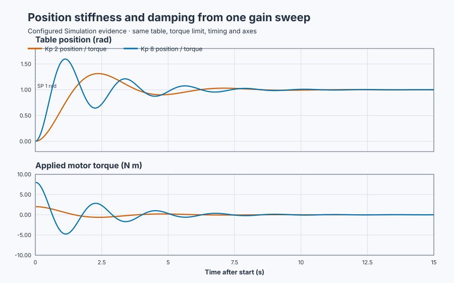

# Position-table proportional control

Course position: Lesson 19 of 84. Previous lesson:
[Model-based heater tuning](../../01-feedback-foundations-and-temperature-control/18-nominal-fopdt/README.md).
Next lesson: [Position-table proportional-derivative control](../20-servo-position-pd/README.md).

**Lesson objective:** Tune a proportional position controller experimentally
and explain why increasing position stiffness eventually causes unacceptable
overshoot, oscillation, and motor effort.

**Equipment:** Motor-driven industrial positioning table.

This lesson uses Simulation. Its results are not physical-axis evidence.

## The problem

The Motor-driven industrial positioning table rotates a welding fixture,
inspection camera, or packaging tool. An encoder reports its angular position
and velocity; a motor drive applies torque. The Simulation represents table and
payload as one rigid rotating mass with inertia and viscous friction. Gear
elasticity, backlash, encoder noise, and dry friction come later.

The thermal plant in Lesson 18 settled because heat loss continuously removed
energy. A positioning table stores kinetic energy while it moves. It can reach
the requested angle with nonzero velocity and pass straight through the target.
That makes this a useful first mechanical question: how much faster can
proportional gain make the move before the loss of damping quality and increase
in motor effort outweigh the speed improvement?

The table starts at rest at 0 rad. The drive accepts only -10 to +10 N·m. Its
safe state is Manual mode with zero applied torque.

## What we need

We need a controller whose torque points toward the target, a mechanical model
that explains the resulting motion, and measures that prevent us from choosing
gain from speed alone. We will compare $K_p=2$ and $K_p=8$ on identical fresh
runtimes. The interactive workflow runs only the selected high-gain case; the
native evidence owns the two-run comparison.

## The new idea

### From torque balance to a second-order position response

The **setpoint ($r$ or $SP$)** is the desired table angle. The **process value
($\theta$ or $PV$)** is its measured angle. Both use radians. Their difference
is position error:

$e=r-\theta$

A positive error requests positive motion. The **proportional gain ($K_p$)** is
requested motor torque per radian of error, in N·m/rad. The controller therefore
requests

$\tau_{requested}=K_p e=K_p(r-\theta)$

The drive produces the **applied motor torque** after its amplitude limit:

$\tau_{applied}=clamp(\tau_{requested},-10,10)\,\text{N·m}$

Because displacement from the target creates a restoring torque, $K_p$ behaves
like a virtual spring stiffness. This analogy becomes exact in the unsaturated
linear model.

The **rotational inertia ($J$)** measures resistance to angular acceleration in
kg·m². The **viscous damping coefficient ($B$)** gives opposing torque per unit
angular velocity in N·m·s/rad. Newton's rotational balance says applied torque
equals inertial torque plus viscous-friction torque:

$J\ddot{\theta}+B\dot{\theta}=\tau_{applied}$

For an unsaturated P response, substitute $K_p(r-\theta)$ for torque. During a
constant setpoint, define displacement from target as $x=\theta-r$. Because $r$
is constant, $\dot{x}=\dot{\theta}$ and $\ddot{x}=\ddot{\theta}$. Substitution
and moving all terms to the left gives

$J\ddot{x}+B\dot{x}+K_p x=0$

Divide by $J$:

$\ddot{x}+(B/J)\dot{x}+(K_p/J)x=0$

The standard second-order form is

$\ddot{x}+2\zeta\omega_n\dot{x}+\omega_n^2x=0$

Matching coefficients derives, rather than assumes,

$\omega_n=\sqrt{K_p/J}$

$\zeta=B/[2\sqrt{JK_p}]$

The **undamped natural frequency ($\omega_n$)** is the oscillation rate the
inertia and virtual spring would have without friction, in rad/s. The
dimensionless **damping ratio ($\zeta$)** compares actual viscous damping with
the critical amount that would avoid oscillation. Increasing $K_p$ raises
$\omega_n$, so it makes the response faster. But with $B$ and $J$ unchanged,
the same increase lowers $\zeta$, so the faster response is more oscillatory.
Proportional gain adds stiffness; it does not add velocity-dependent damping.

For $0<\zeta<1$, the ideal unsaturated continuous second-order response has
fractional overshoot

$M_p=\exp[-\pi\zeta/\sqrt{1-\zeta^2}]$

This comes from evaluating the decaying sinusoidal response at its first peak:
the exponential gives the remaining oscillation amplitude when the sinusoid
first turns. It is a useful prediction, not a replacement for the sampled,
limited Simulation result.

### Measures and decisions before practice

The **90-percent rise time** is the timestamp of the first retained sample with
$PV\ge0.9$ rad. It measures first arrival, not permanent settling. **Position
overshoot** is the largest positive distance beyond the 1-rad target:

$overshoot=\max_k(PV_k-SP)$

**Peak applied torque** is

$\tau_{peak}=\max_k|\tau_{applied,k}|$

The maximum absolute value counts positive acceleration and negative braking
equally. Retain velocity and error sign changes so oscillation remains visible,
but do not invent an oscillation-count acceptance gate.

Freeze these decisions before running:

- both runs start at position 0 rad and velocity 0 rad/s;
- both use a 1-rad setpoint, 20-ms sample interval, identical plant, limits,
  seed, axes, and 15-s retained comparison window;
- high-gain rise-time improvement must be greater than 0 s, tolerance 0.001 s;
- high-gain additional overshoot must be at least 0.1 rad, tolerance 0.001 rad;
- absolute applied torque must be at most 10 N·m, tolerance 0.01 N·m; and
- every retained position, velocity, and torque value must be finite.

## Prediction

Here $J=1$ kg·m², $B=1$ N·m·s/rad, and the initial error is 1 rad.

For $K_p=2$ N·m/rad:

$\tau_0=K_p e=2\times1=2\,\text{N·m}$

$\omega_n=\sqrt{2/1}=1.414\,\text{rad/s}$

$\zeta=1/[2\sqrt{1\times2}]=0.354$

For $K_p=8$ N·m/rad:

$\tau_0=8\times1=8\,\text{N·m}$

$\omega_n=\sqrt{8/1}=2.828\,\text{rad/s}$

$\zeta=1/[2\sqrt{1\times8}]=0.177$

Neither initial torque reaches the 10-N·m clamp. Four times the stiffness
doubles natural frequency and halves damping ratio. Predict that $K_p=8$ will
reach 90% sooner, overshoot farther, oscillate more strongly, and use four
times the initial peak torque.

## Implementation

The executable uses `Control.PID` with integral and derivative gains zero. The
complete learner workflow is **Monitor → Test**. Control Studio writes one
reviewed Boolean, `P1.ExperimentEnabled` at `%MX32.1`; it does not directly
write setpoint or gain.

On the rising edge, the project configures $K_p=8$, sets SP to 1 rad,
reinitializes the controller from the measured state, and enters Auto. On the
falling edge, it restores $K_p=2$, SP = 0 rad, Manual mode, and zero torque.

```st
IF ExperimentEnabled AND NOT ExperimentWasEnabled THEN
    ProportionalGain := LREAL#8.0;
    Setpoint := LREAL#1.0;
    AutoMode := TRUE;
    ReconfigureRequested := TRUE;
ELSIF ExperimentWasEnabled THEN
    ProportionalGain := LREAL#2.0;
    Setpoint := LREAL#0.0;
    AutoMode := FALSE;
    ReconfigureRequested := TRUE;
END_IF;

IF ReconfigureRequested THEN
    Parameters.ProportionalGain := ProportionalGain;
    Controller.Configure(Parameters := Parameters);
    Controller.Initialize(State := InitialState);
END_IF;

IF AutoMode AND InputsValid AND NOT SafetyAbort THEN
    Input.Mode := PIDMode#Auto;
ELSE
    Input.Mode := PIDMode#Manual;
    Input.ManualOutput := LREAL#0.0;
END_IF;
Input.CycleTime := LREAL#0.02;
MotorTorque := Controller.Update(Input := Input);
```

The native comparison creates fresh equivalent runtimes and supplies either
$K_p=2$ or $K_p=8$ before initialization. That is why the retained table can
compare two controllers while the interactive Test honestly runs only one.

## Experiment in Control Studio

This Test observes a project-owned selected-gain move. Its amplitude is zero
because its sole reviewed write is Boolean authority. The deterministic
Simulation seed is 20260828.

### Control Studio actions

1. **Monitor** — Start the **Simulator**, then open **truST sidebar → Control Studio → Monitor → Response**.
   - **Baseline check:** Wait for **Simulation**, **Running**, and current data. Confirm SP = 0 rad, PV = 0 rad, velocity = 0 rad/s, applied torque = 0 N·m, `P1.ExperimentEnabled=false`, $K_p=2$, and Manual mode.
   - **Decision before action:** State the prediction: selected $K_p=8$ should move sooner but overshoot farther and use 8 N·m initially.
   - **Successful evidence:** Position, velocity, and torque are finite and current, the plot advances, and **Start recording** is enabled.
   - **Recovery:** If a value is stale, nonfinite, or outside its declared range, stop the Simulator, correct the cause, restart, and repeat the baseline check.
   - **Record:** Retain initial SP, PV, velocity, torque, gain, mode, and prediction.

2. **Test** — Restart from the declared initial state, then open **truST sidebar → Control Studio → Test**.
   - **Baseline check:** Confirm **Experiment** = **Observe without excitation**, **Amplitude** = **0** (disabled), and **Maximum duration (s)** = **20.02**. The reviewed authority is **Experiment authority** (`P1.ExperimentEnabled`).
   - **Decision before action:** Confirm the project-owned move stays inside position -4 to +4 rad, velocity -20 to +20 rad/s, and torque -10 to +10 N·m. Confirm false restoration returns SP to 0 rad and Manual zero torque.
   - **Successful evidence:** Select **Review test**, inspect the Boolean write, bounds, aborts, duration, and restoration, then **Confirm and start**. Observe $K_p=8$, SP = 1 rad, Auto mode, the initial positive torque, target crossing, negative braking torque, and decaying oscillation. At 20.02 seconds confirm authority false, $K_p=2$, SP = 0 rad, Manual mode, and applied torque 0 N·m. Keep **Abort test** visible.
   - **Recovery:** Select **Abort test** if position or velocity is invalid, there is a hard-limit violation, data is stale, or authority is unexpected. Restart from zero position and velocity; do not weaken a criterion.
   - **Record:** Retain the terminal state, restoration, seed, selected response, and the native two-run evidence below.

## Evidence and decision

The native evidence changes only proportional gain and uses unrounded retained
samples for each decision.

| Evidence | Gain 2 | Gain 8 | Interpretation |
| --- | ---: | ---: | --- |
| 90-percent rise time | 1.30 s | 0.56 s | Gain 8 is 0.74 s faster |
| Position overshoot | 0.313 rad | 0.596 rad | Gain 8 adds 0.283 rad |
| Peak applied torque | 2.00 N·m | 8.00 N·m | Gain 8 uses four times the peak |



[Retained samples](figures/position-p-trace.csv) ·
[Decision summary](figures/position-p-summary.csv)

Every value is finite and torque remains inside ±10 N·m. Gain 8 passes the
declared comparison: it rises sooner, adds more than 0.1 rad overshoot, and
reveals the intended torque cost. Passing these teaching gates does not make it
an acceptable production tuning; the additional overshoot is evidence of the
problem that the next lesson must solve.

For a physical axis, independently review travel limits, payload, drive current,
braking, emergency stop, and safe restoration before any move. Simulation
evidence is not commissioning evidence.

## Conclusion

Proportional position control is a virtual spring. Raising $K_p$ from 2 to 8
quadrupled stiffness, doubled natural frequency, and halved damping ratio. The
table therefore accelerated harder and reached 90% sooner, but arrived near the
target with kinetic energy. At zero position error, P control requests no
special torque to oppose that velocity, so the table passed the target.

After the error changed sign, the virtual spring pulled back and inertia carried
the table through again. Physical viscous friction eventually removed the
energy. Increasing $K_p$ added no such damping, which is why speed alone cannot
select a motion-controller gain.

## Reason for the next lesson

Lesson 20 keeps the same table, inertia, proportional stiffness, setpoint, and
torque limit. It adds torque proportional to measured velocity. That derivative
term is designed to oppose motion directly, so we can test whether added damping
reduces overshoot without discarding the position stiffness established here.
